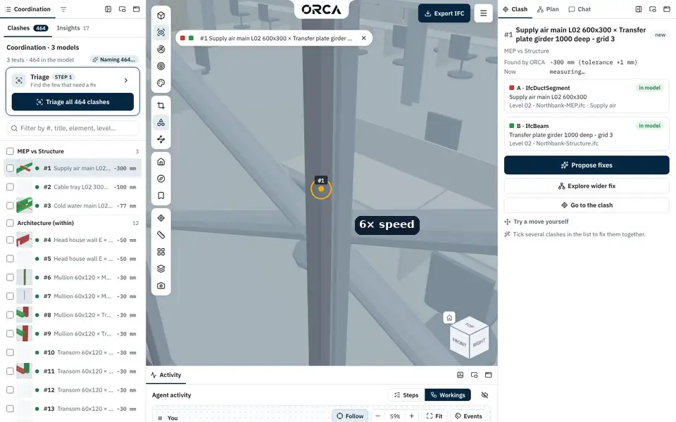
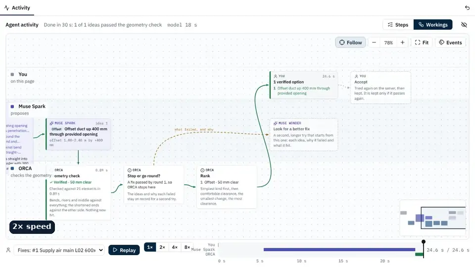
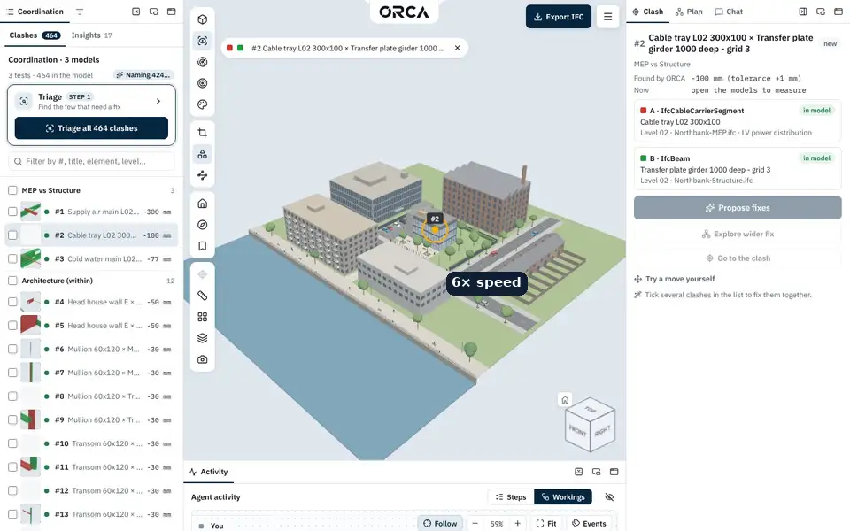
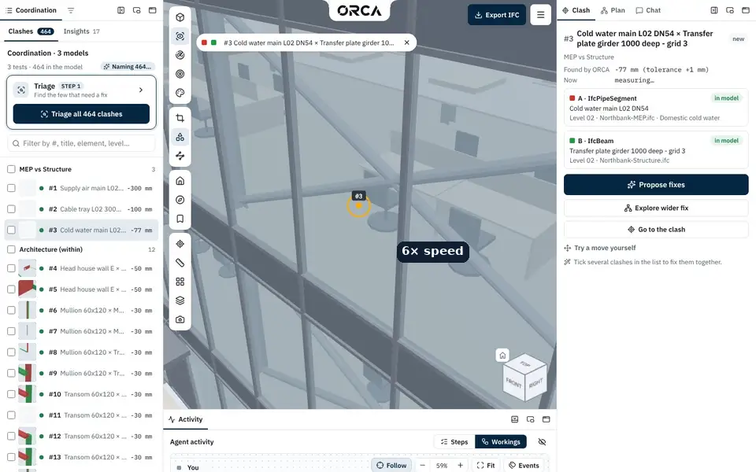
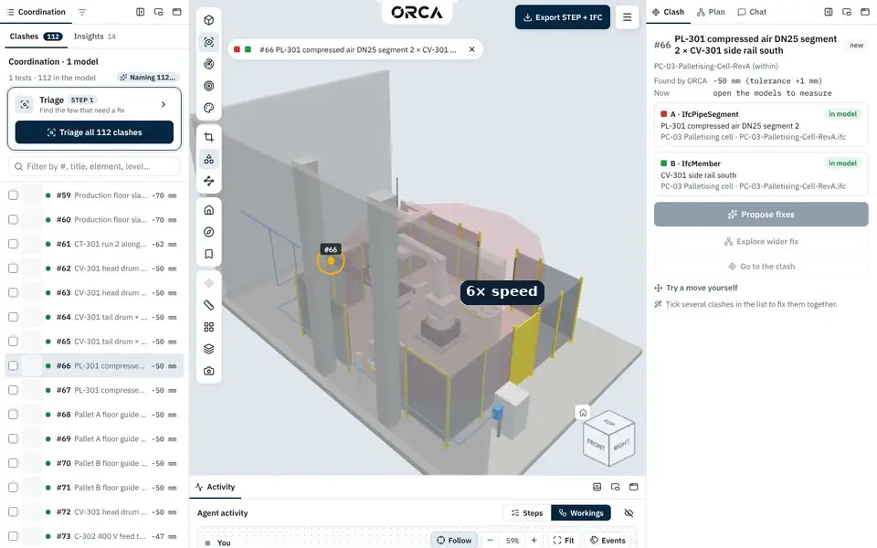
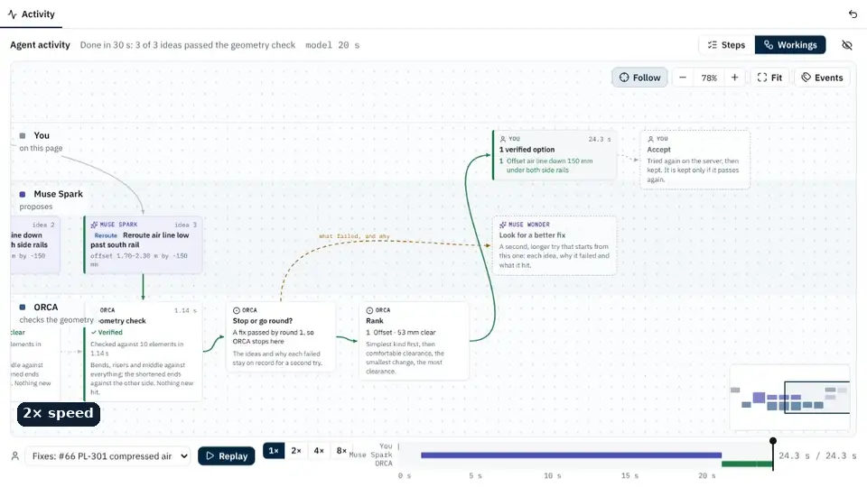
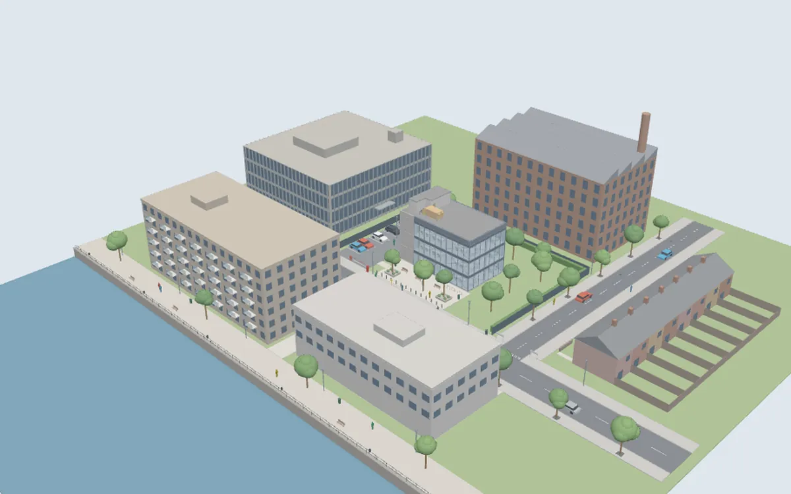
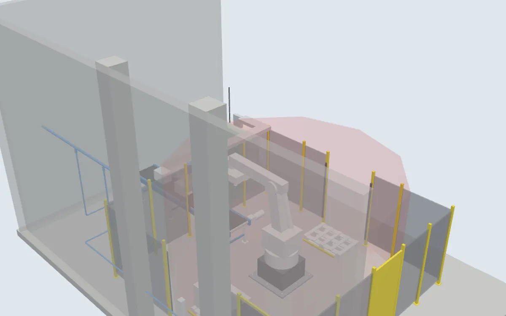

# ORCA

An AI design coordinator for 3D models, proven on buildings.

ORCA checks the models every team makes against each other, finds where they clash, sorts what matters from what
doesn't, and proposes one to three fixes by editing real model elements. Every fix
is checked with geometry before you see it: the clash is gone, there is clearance, and nothing new clashes.
You review the options in 3D and export the edited IFC.

ORCA stands for its loop: **Observe** the clash, **Resolve** it with a proposed fix, **Check** the fix with geometry,
**Apply** it to the model.

Built for the Meta Global AI Developer Hackathon (Oct 27 – Nov 4, 2026) by IssueLab. **Northbank is a pre-existing
synthetic baseline asset used to demonstrate and evaluate ORCA; it was not created during the challenge.**
ORCA's application code was written during the event. See [BUILT_DURING_HACKATHON.md](BUILT_DURING_HACKATHON.md)
for the full distinction between new work, baseline data and third-party dependencies.

## See it work

Real proposal runs, recorded in ORCA's own app with `web/scripts/capture-proposals.cjs` (Oct 31, Muse Spark live; the
waits are sped up and each frame says by how much). Pick a clash, choose **Propose fixes**: Muse Spark reads the
pair and the model data, proposes edits, ORCA checks each one against the geometry, and only verified options reach
the panel, with **Before / After** in 3D.

**Northbank #1: the supply air main through the transfer girder.** Muse Spark offsets the middle of the duct up
400 mm through the girder's own web opening: 50 mm clear all round (25 mm needed), checked against 21 elements. All three Northbank
fixes below land at the designer's own Rev04 heights (+400, +250, +280 mm).



**The Workings of that run**, replayed in the Activity panel: the brief ORCA gives Muse Spark (the pair in words and
numbers, the openings it could use, pictures A, B and C), the round's ideas, ORCA's geometry check on each, and the
ranking. An idea that fails the check shows the reason, and is sent back on the next round.



<table>
<tr>
<td width="50%" valign="top">


**#2, cable tray:** offset up 250 mm through the girder opening, 50 mm clear
(was 100 mm overlap), checked against 5 elements.

</td>
<td width="50%" valign="top">


**#3, cold water main:** offset up 280 mm through the girder opening, 53 mm clear
(was 77 mm overlap), checked against 15 elements.

</td>
</tr>
<tr>
<td width="50%" valign="top">


**PC-03 cell #66, from STEP:** the air line dropped 150 mm under both conveyor side rails as one offset.

</td>
<td width="50%" valign="top">


**The cell run's Workings.**

</td>
</tr>
</table>

Each capture is a fresh proposal, so a new run can word or rank its options differently.

## Try it (judges)

**[Open the live ORCA demo](https://dodzikojo--orca-web.us-east.modal.run)** — no installation or personal API key needed.

1. Choose **Open the Northbank demo**. Four models open and ORCA checks them for clashes.
2. Select the clash between **Supply air main `SA-MAIN-L02-5`** and **Transfer girder `TB-L02-01`**.
3. Choose **Propose fixes**, review a verified option with **Before / After / Both**, then **Accept this fix**.
4. Choose **Export IFC** to download the edited model. The hosted demo has shared usage limits; a guided tour also
   offers labelled recordings when a live proposal is unavailable.

The machine demo is on the same landing page. See [Two demos](#two-demos) for what each demonstrates.

## Run locally

### 1. Prerequisites

- [Git](https://git-scm.com/downloads).
- [Node.js](https://nodejs.org/en/download) **LTS, version 22.12 or newer**, including npm.
- [uv](https://docs.astral.sh/uv/getting-started/installation/). It installs **Python 3.13** for this project;
  you do not need to install Python separately.
- A current desktop browser with WebGL enabled. Internet access is needed to install dependencies and use AI features.

**Windows PowerShell:** install uv and Node.js (with npm) before running the setup commands:

```powershell
winget install --id=astral-sh.uv -e
winget install --id=OpenJS.NodeJS.LTS -e
```

**Close and reopen PowerShell** so it sees the updated PATH, then check:

```powershell
git --version
uv --version
node --version
npm.cmd --version
```

Use **`npm.cmd` in PowerShell**: Windows may block the `npm.ps1` wrapper when scripts are disabled. The commands
below use `npm.cmd` for Windows; **on macOS/Linux, use `npm` instead**. No execution-policy change is needed.
On macOS/Linux, install Node.js and uv using the links above and check the same versions with `npm --version`.

**Linux:** install the OpenCASCADE runtime library before starting the server: `sudo apt install libgl1` on
Ubuntu/Debian. [PDF reports need additional system libraries](#pdf-system-libraries) on every platform; you can
skip those initially if you only want to view models, check clashes and try fixes.

### 2. Clone and install

Run from the directory where you keep your projects:

```text
git clone https://github.com/IssueLab-Inc/ORCA.git
cd ORCA
uv python install 3.13
uv sync --project server --locked --python 3.13
npm.cmd ci --prefix web
```

`npm ci` also copies the viewer's WebAssembly files into `web/public/wasm/`. The Python environment lives in
`server/.venv/`; no manual activation is needed. The server package is still named `sightline`, as are its
`SIGHTLINE_*` settings.

Create the local configuration **at the repo root**, keeping an existing `.env` if you have one:

```powershell
# Windows PowerShell, from ORCA/
if (-not (Test-Path .env)) { Copy-Item .env.example .env }
```

```bash
# macOS / Linux, from ORCA/
test -f .env || cp .env.example .env
```

You can leave the API keys empty for the first geometry check. See [Enable AI features](#enable-ai-features)
when you want ORCA to propose fixes.

### 3. Start both servers

**Terminal 1 — start in `ORCA/`:**

```text
cd server
uv run --locked uvicorn sightline.app:app --reload --host 127.0.0.1 --port 8000
```

**Terminal 2 — open a new terminal in `ORCA/`:**

```text
cd web
npm.cmd run dev -- --host 127.0.0.1 --port 5173 --strictPort
```

Keep both terminals running and open **[http://127.0.0.1:5173](http://127.0.0.1:5173)**.
Vite forwards `/api` requests to the Python server on port 8000. To check the API separately, open
[http://127.0.0.1:8000/api/samples](http://127.0.0.1:8000/api/samples); it should return JSON with `files` and `demos`.
Stop either server with **Ctrl+C**. Server reloads discard open scenes and unexported edits; export anything you
want to keep before restarting or editing Python files.

### 4. First check, without an API key

Generate a small synthetic model in a third terminal, starting in `ORCA/`:

```text
uv run --directory server --locked python -m sightline.fixtures ../samples/fixture-clash.ifc
```

1. Refresh the page. In **Models**, select only `fixture-clash.ifc` and choose **Open 1 model**
   (on a small screen, **Models** is inside **Menu**).
2. Double-click **Supply duct 400x300** as element A, then **UB 406x178 beam** as element B.
3. Expand **Try a move yourself**, enter **-0.80** in **Move A vertically (m)**, and choose **Check this move**.
4. Expect **Clear**. A **-0.40** move clears the beam but hits the pipe. These checks preview moves; they do not
   change the saved source file.

### Demo models for local use

**Both demo model sets are included in [samples/](samples/README.md), under this repository's [MIT licence](LICENSE)**
(eight IFC/STEP files, about 15 MB total). A normal clone is enough: no separate download, Git LFS or private-repository
access is needed. Open the Northbank card to follow the judge walkthrough above. The machine card opens PC-03 from
STEP; its first conversion takes longer, and AI part classification requires credentials as described below.

Northbank's six IFC files include the original coordination set, grids and the designer's fixed MEP revision.
PC-03 includes the original Rev A and fixed Rev B STEP files. Northbank predates the hackathon and is baseline data;
the PC-03 models were generated during it. Both are synthetic IssueLab assets, with no customer data. Generator source
code, Revit files and optional Navisworks evaluation packages are not included. See [samples/README.md](samples/README.md)
for provenance and optional evaluation inputs.

### Enable AI features

Edit the root `.env` and set **`META_API_KEY`** to a key with access to the configured Meta models. The template
already sets the API URL, model and reasoning effort. Write values **without quotes or inline comments**, keep
`.env` out of git, and restart the Python server after changes. Existing process environment variables override `.env`.

| Feature | Credentials |
|---|---|
| IFC viewing, geometry detection, measuring, manual move checks | None |
| Proposals, chat, AI triage/titles, coordinated plans and report text | `META_API_KEY` |
| STEP conversion | None for geometry; AI part classification needs a model key. Without classification, parts use generic IFC classes |
| Optional open-weights triage, titles and STEP classification | `TRIAGE_API_KEY` (or `BASETEN_API_KEY`) **and** `SIGHTLINE_OPEN_WEIGHTS=1`; proposals still need the Meta key |

The open-weights host is optional; leave its key empty for the simplest setup. Owner settings are optional too.
Live AI calls need provider access and may incur charges; local proposal/chat caps are off unless configured.
**Before submission: add the verified Meta API access/key-creation link and any contributor-access requirements.**
Until then, the hosted demo is the way to evaluate the AI flow without arranging your own credentials.
All settings are documented in [the configuration reference](docs/architecture/15-requirements-settings-and-config.md).

### PDF system libraries

Install these before generating PDF reports or running the full server test suite. Python dependencies alone do
not install Pango and its native libraries. See [WeasyPrint's platform instructions](https://doc.courtbouillon.org/weasyprint/stable/first_steps.html#installation).

- **Ubuntu/Debian:** `sudo apt install libpango-1.0-0 libpangoft2-1.0-0 libharfbuzz0b libharfbuzz-subset0 fonts-dejavu-core`
  (plus `libgl1` from the prerequisites).
- **macOS with Homebrew:** `brew install pango libffi`.
- **Windows:** install [MSYS2](https://www.msys2.org/), then run `pacman -S mingw-w64-ucrt-x86_64-pango` in its
  **UCRT64** shell. If Python cannot find the DLLs, set `$env:WEASYPRINT_DLL_DIRECTORIES = 'C:\msys64\ucrt64\bin'`
  in the PowerShell terminal used to start the server/tests (adjust for your MSYS2 installation).

From `ORCA/`, check discovery with `uv run --directory server --locked python -m weasyprint --info`.

### Updating from GitHub

**For routine updates: export your edits, stop both servers, pull, sync dependencies, then restart.**
Accepted model edits live in the Python process until you export them; a server restart loses that in-memory work.

1. Export any model edits you want to keep, and wait for active proposals/checks to finish.
2. Press **Ctrl+C** in both server terminals.
3. In a terminal at `ORCA/`, run `git status --short`. Commit local code/doc changes on a working branch before
   switching branches or pulling; do not discard changes to make an update pass. `.env` and ignored local data stay local.
4. For the latest merged application, run these from `ORCA/` **once your working tree is clean**:

   ```powershell
   git switch main
   git pull --ff-only origin main
   uv sync --project server --locked --python 3.13
   npm.cmd ci --prefix web
   ```

   `--ff-only` stops if your local main has diverged; resolve that before continuing. If you are developing on a
   feature branch, update that branch deliberately rather than switching to main with unfinished work.
5. Restart both servers using the commands above, refresh the browser and reopen your models.

For small edits during development, [Vite hot-reloads web source changes](https://vite.dev/guide/features.html#hot-module-replacement)
and uvicorn's `--reload` restarts on Python
changes. A Git pull can change both source and dependencies at once, so use the stopped-server workflow above.
To check for updates while keeping the app running, `git fetch origin` updates remote references without changing
your working files; `git log --oneline HEAD..origin/main` shows commits not in your current checkout.

### Troubleshooting

| Symptom | Check |
|---|---|
| `uv`, `node` or `npm` is missing | Install the prerequisites and reopen the terminal. `python` opening the Windows Store is avoidable: use the documented `uv` commands |
| `npm.ps1 cannot be loaded because running scripts is disabled` | Use `npm.cmd` in PowerShell, including `npm.cmd ci --prefix web` from `ORCA/`, or `npm.cmd ci` if already in `ORCA/web/` |
| Port 8000 or 5173 is busy | Stop the process already using it, then restart. Keep port 8000 unless you also change Vite's API proxy in `web/vite.config.ts` |
| Page loads but API requests fail | Confirm both terminals are running; check `/api/samples` on port 8000 and read the Python terminal's error |
| Demo cards or files are missing | Confirm the eight bundled model files exist in `samples/` and `/api/samples` lists them; restart the server if you just restored files |
| Viewer reports missing `.wasm` files | From `ORCA/`, run `npm.cmd run copy-wasm --prefix web` (macOS/Linux: `npm`), then refresh; check that WebGL is enabled |
| AI request fails | Check the root `.env`, model access and quota, then restart the server. Empty keys allow geometry checks, not AI calls |
| PDF reports fail with a missing-library error | Install the PDF system libraries and check DLL discovery on Windows |
| MCP client cannot connect through port 5173 | Use `http://127.0.0.1:8000/mcp` with the app's pairing token; Vite proxies `/api`, not `/mcp` |

The owner confirmed Windows startup on Oct 31 after installing uv/Node.js and using `npm.cmd`. **Still to verify
before submission:** complete clean installations on Windows, macOS and Ubuntu, including a browser geometry check,
a live AI proposal and PDF export.

## Two demos

<table>
<tr>
<td width="50%" valign="top">


**Northbank, a riverside office site** (building, 4 IFC models)

Structure, building services, architecture and site, modelled by four teams. On Level 02 a transfer girder is hit
by a supply-air duct, a cable tray and a cold water main: the answer key.

- Every pair of models checked: 464 clashes in 1,732 elements, in 4 s.
- Triage sorts the real problems from the noise.
- The duct raised through the girder's web opening at the designer's own height: ~40 s to a verified fix, 3 of 3
  designer fixes matched.
- One root-cause plan for all three services.

</td>
<td width="50%" valign="top">


**PC-03, a robot palletising cell** (machine, 1 STEP file)

A robot, a conveyor, safety guarding and services in a corner of the plant, from mechanical CAD, with eight planted
problems.

- The STEP converted: 161 parts keep their names and colours, and Muse Spark names what each is (160-161 of 161 right).
- All 17 planted clashes found, nothing unexpected.
- The cable ladder moved, the air pipe dropped under both conveyor rails as one fix, a branch rerouted round two plant
  columns, a rail trimmed, openings asked for through the plant wall and the motor control centre's gland plate.
- The STEP handed back with the fixes written in.

</td>
</tr>
</table>

Open either from the landing page's cards, or take its guided tour there. Both model sets are generated by IssueLab's
own scripts, each with an answer key; the models ship in this repo and the live demo. Northbank is pre-existing baseline
data, as disclosed above; the generator source remains private. The pictures
are captured in ORCA's own viewer by `web/scripts/capture-demos.cjs`.

## How it works

```
Browser (React + three.js + web-ifc)          Server (Python, FastAPI)
  view · pick · isolate · preview options  ⇄    ORCA core (also an MCP server)
                                                  ├─ IfcOpenShell: load, connected runs, edits, IFC export
                                                  ├─ Geometry check: collision + clearance (IfcOpenShell tree)
                                                  └─ Meta models: Muse Spark (vision, reasoning)
```

The agent loop is **propose → verify → retry → rank**: Muse Spark proposes fixes from the images, the
element data and a domain pack (construction rules of thumb, in `server/sightline/domain_packs/`); the
geometry check tests each one; failures are fed back with what they hit; only verified options are shown.
A fix is a **move** (an element and its straight run), a **local offset** (split a segment either side of an
obstacle, raise or lower the middle piece, join it with bends and risers, re-chain the ports, as a designer would
around a beam; `server/sightline/edits.py`), a **reroute** (up to three such steps, up and/or sideways, for obstacles an offset
can't pass: room only beside a column, or obstacles needing different detours), or a **trim** at a joint. Openings
through the obstacle, and the room beside it, are measured on the run's line and given to the model. Every kind is
registered once (design: [docs/edits.md](docs/edits.md)). **Accept this fix** keeps it in the server's model; **Export
edited IFC** downloads the changed files.

The browser previews moves instantly; the server makes the real edit and is the only source of
clearance numbers. Elements are addressed by IFC GlobalId everywhere.

**Coordinate › Check the open models** finds the clashes (design: [docs/detection.md](docs/detection.md), code:
`server/sightline/detect.py`). The demo opens Northbank and runs it at once:
- **Tests:** every pair of open models and each model against itself, hard at 1 mm, plus duplicates.
- **Not reported:** pairs meant to meet (joined by ports, one assembly, a door in its wall) and touches. They are
  counted and shown under "What was checked".
- **Engine:** a sweep over the element boxes finds every pair that could clash; IfcOpenShell's triangle tree measures
  them, with an exact check for flush rectangular solids.
- **Result:** the clash list, which triage, insights, fixes, chat ("find the clashes") and the PDF all work on.
  ORCA takes each clash's A/B/C views in the browser for the fix agent.
- **Detect again:** after fixes, it says which clashes were resolved.

A site model (terrain, paving, planting) is context: its tests are listed but off by default, so Northbank's default
check covers Structure, MEP and Architecture (1,732 elements): 464 clashes in about 4 s, including all three of the
answer key's girder clashes. With every test on (1,961 elements, 633 clashes, 7-12 s) it finds every sampled Navisworks
result that is a real overlap (117 of 117).

**Clashes have numbers and titles, not "Clash39".**
- **Number:** every clash has a number, #39, unique across the whole report. For clashes ORCA finds, it is kept
  across runs.
- **Title:** Muse writes one from the clash's facts ("Cold-water main clips the transfer girder at grid 3, level 02";
  `server/sightline/titles.py`). Until it lands, a plain name from the two elements shows.
- **Navisworks label:** on an imported report, kept as a small reference.
- **Using the number:** chat and voice understand "#39".

For a clash that needs changes around it, choose **Explore wider fix** on a matched report clash or two manually
picked model elements. ORCA inspects nearby geometry, discovers blockers and checks complete arrangements with
up to three coordinated edit groups. The **Plan** tab shows up to three alternatives, every edit and its reason,
geometry and model integrity evidence, retained authored frame warnings, and individual designer review conditions.
**Before / After / Both** previews the entire arrangement, including surrounding elements that must move.

Wider-search offsets support horizontal straight service segments with plain rectangular or circular profiles.
Hollow, rounded and open-section profiles cannot yet retain their shape through generated bends, so those offsets
are rejected and inspection explains the limit. Whole-run moves remain available when supported by the model.

Acknowledge every condition to **Accept complete proposal**. The server rechecks its stored proposal against the
current model revision and keeps all dependent edits atomically; the browser reloads every affected IFC file and
marks only confirmed resolved pairs fixed. If the model changed, regenerate for the proposal's original objective.
Chat can also explore wider fixes; the same review appears in Plan while the conversation stays open. Search is
bounded, so an empty result does not prove no solution exists. These are geometry and model checks with designer
review conditions, not a claim of engineering adequacy or full IFC conformance. **Export IFC** includes all edited files.

While the agent works it drives the viewer ([`web/src/pilot.ts`](web/src/pilot.ts)): each idea appears in place as
the geometry check runs (amber), then turns teal when it is clear or lights up what it hit in magenta, and the camera
follows; between rounds it turns slowly round the clash. Drag, scroll or click in the view to take it back (the agent
keeps working); **Let ORCA drive** hands it over again.

### Your own models, and STEP

**Use your own models** on the landing page starts a blank project: drop or choose IFC or STEP files (or import a
Navisworks report), and ORCA checks them as soon as they open. **Models › Upload models (IFC or STEP)** does the same from
the header. Up to eight files, 150 MB together on the demo (packed in the browser, with progress while they go up and
open: [docs/uploads.md](docs/uploads.md)), a few uploads per visitor per hour. The viewer sizes its framing,
clash marker and pictures to the parts, so a 100 mm load cell frames as well as a building. A STEP machine (AP203/AP214/AP242) is converted to IFC when it opens (`server/sightline/step.py`,
design in [docs/step.md](docs/step.md)):
- every part keeps its name, colour and transparency;
- the model names each part's IFC class from its name and group;
- the parts are checked like any model.

Straight bars, rods and pipes (plain boxes and cylinders) become exact extrusions, so they take offsets and trims as
well as moves; other parts move. Parts of one STEP group that touch move together, so a cable ladder moves as one.
**Export** then gives your STEP back beside the IFC: moved parts translated, changed parts rebuilt, an offset's new
pieces added to their assembly, names and colours kept.

The second demo ([above](#two-demos)) opens the PC-03 robot palletising cell from its STEP file:
- the check finds all eight planted problems (17 part pairs, nothing unexpected);
- Muse Spark fixes the cable ladder through the fence post by raising it 150 mm, the designers' own fix;
- **Fix together** on the air pipe through both conveyor rails makes one job and drops the pipe under them;
- **Fix together** on the branch through two plant columns makes one **reroute**: a detour round each column, the
  only fix that clears (the columns run full height, and an emergency stop stands between them);
- the air main through the plant's west wall and the feed conduit through the panel's gland plate get **openings**: a
  Ø130 mm one in the wall (with clearance, reviewed), a Ø34 mm gland hole in the plate (fitted), each with a provision for
  void;
- the exported STEP has exactly those five ladder parts moved, the pipe's offset pieces added and the openings cut.

**Take the cell tour** on its card walks through it in 12 steps.

`evals/step_cell.py` checks this against the cell's answer key.

### Works with Navisworks reports

Teams that already run Navisworks can bring its results instead: **Coordinate › Import a Navisworks clash report** opens
an XML clash report: a sample from `samples/reports/<name>/` (any
`*.xml` at the top of the folder, with the images it links to), or an upload of an export folder or XML files. Several
XML files open as one report; a result exported twice is kept once. Each clash is matched to the open model by IFC
GlobalId (else by a unique class and name), shown with its Navisworks images, and measured again by ORCA's own
check (Navisworks and IfcOpenShell report depth differently: #042 is −150 mm in Navisworks, −300 mm here).
**Propose fixes** on a report clash sends its Navisworks images and distance to the model.

### Triage

**Triage all** gives every clash a verdict (real, by design, not physical, model error) before anyone
opens one ([`server/sightline/triage.py`](server/sightline/triage.py)). Sure cases are settled by rule with no model call
(a space, port or opening on either side; a touch within 1 mm); the rest go to the triage model, eight at a time, with
their images. The list shows a tag per row and filters by verdict, the clash panel shows the reading, and **Set aside**
marks the by-design and non-physical results as reviewed. One run per sample report is shared by every visitor.

The triage model is **Muse Spark Open** (open weights) on any OpenAI-compatible host when a key is set, and Muse Spark on
Meta's API otherwise; the card says which one answered:

| Variable | Default |
|---|---|
| `TRIAGE_API_KEY` (or `BASETEN_API_KEY`) | unset: use Muse Spark |
| `TRIAGE_API_BASE_URL` | `https://inference.baseten.co/v1` |
| `TRIAGE_MODEL` | `meta-models/muse-spark-open` |
| `TRIAGE_IMAGES` | `1` (`0` for a text-only host) |
| `SIGHTLINE_TRIAGE_WORKERS` | `8` |

A host without strict structured output gets JSON mode with the schema in the prompt (switched on the first 400).
Alike clashes (the same kinds of element, named alike, about as deep; three or more) are read once, through the deepest:
Northbank's 464 detected clashes (default tests) took 39 model calls and 101 s on Muse Spark Open: 5 real, including the
answer key's three, all high and for MEP (all 633 with Site: 98 calls, 214 s). Navisworks' 317 results: 184 by rule, 133 by the model, 119 s on Muse Spark with `reasoning_effort=low`, 189 s on Muse
Spark Open on Baseten (live deploy, Oct 27: median call 7.9 s but a longer tail, up to 33 s). Scored on the whole package
the two models agree on 299 of 317 verdicts ([evals/README.md](evals/README.md#triage-of-navisworks-results)).

### Coordination requirements (optional)

**Requirements** in the header sets the standard ORCA checks, triages and fixes to
([`docs/requirements.md`](docs/requirements.md), [`server/sightline/requirements.py`](server/sightline/requirements.py)).
Without requirements, ORCA uses its defaults. A requirements file sets:
- **A design level**, L1 Concept to L5 As-built. The names fit any industry; RIBA, LOD and product-phase equivalents
  are hints only.
- **A strictness**, from lenient to exacting, which covers both flagging and fixing. Strict flags more and fixes
  cautiously.
- **Checks** between groups of elements: hard, clearance or off.
- **Who moves**: order, edits allowed, largest move, trims.
- **Pairs declared by design.**
- **Guidance for Muse Spark.**

Level and strictness only ever turn into numbers (tolerance, clearance, smallest element, fix clearance, move limit),
and the dialog shows the clash count they would give before you apply them.

Muse Spark stays in the loop:
- it drafts a file from the open models on request;
- it still reads every clash no rule settles, told the requirements;
- it audits each by-design rule on the clashes it set aside;
- where nothing may be edited, it recommends a change for the designer.

On a by-design pattern in Insights, **Add to requirements** settles those clashes at once. Verified fixes say which
requirements they meet, and the PDF and BCF say which requirements they were checked against. The file downloads
and uploads as `*.orca-requirements.json` for the next project. The guided tour's act "Your standard" walks through it.

At L3 Balanced, ORCA finds exactly what it finds with no file (Northbank 464 = 464, the cell 107 = 107). On #1 under
Strict, Muse proposed the duct offset up 400 mm through the girder opening (the designer's height), inside the
400 mm limit.

### Several clashes at once, and root causes

Tick clashes in the list and choose **Fix together**: ORCA runs the fix agent on every pair at once, then applies
all the chosen fixes in one trial and checks each against the whole model, the other fixes included, swapping in a
next-best option when two collide (`server/sightline/plans.py`). **Root causes** lists elements in several real
clashes (cross-discipline first) and asks the geometry for clashes the report missed; **Fix** asks Muse Spark for the
cause and a strategy (move that element, or coordinate everything crossing it) and builds one plan. On Northbank it
finds the transfer girder, adds the cold water main Navisworks missed, and offsets all three services through the
girder's openings at Rev04's heights, verified together. Plans preview in 3D (before / after / both) and are accepted
in one go. When a root cause is how the parts are meant to go together (a ground beam tying into its footings), the
plan says so instead, with the clash rule to add, and marks those clashes as by design.

**Patterns** are the same clash repeated (every column through every slab, curtain-wall members all at −30 mm).
**Explain** asks Muse Spark about all of them in one call: by design (with the clash rule to add), a modelling error
(flag for the author) or a real problem (fix together). Reviewed clashes drop out of root causes, patterns and plans.
The chat can do the same (`find_root_causes`, `find_patterns`, `plan_root_cause`, `plan_fixes_together`).

### Chat

**Chat with ORCA** (right pane) talks to Muse Spark with tools over the open report and model
(`server/sightline/chat.py`, prompt `domain_packs/chat.md`): report summary, list/get clashes, look at a clash's
images, measure, describe/find elements, find openings, check a move or offset, propose fixes (the same verified
agent), and two page actions, show a clash and set the view. Every tool call streams to the page. Chat messages are
capped per visitor (`SIGHTLINE_CHAT_PER_HOUR`, `SIGHTLINE_CHAT_PER_DAY`); proposals made through the chat count
against the proposal caps.

### Viewer

Modes Shaded / X-ray / Context / Isolate, edges through geometry, section box, measure, properties on click, preset
views and fit, per-model visibility and screenshots. Keys: 1-4 views, H fit, F go to the clash, X/C/I/V modes,
S section, E edges, M measure, Esc clears. Double-click picks element A, then B.

Uploads stay in a temp folder while the report is open (`SIGHTLINE_UPLOAD_MAX_MB`, default 200;
`SIGHTLINE_UPLOAD_MAX_FILES`, default 5000; `SIGHTLINE_MAX_REPORTS` open at once).

### Connect an agent (MCP)

Any MCP client (Muse Code, Claude Code or Desktop, an IDE) can work on your ORCA session. In the app choose
**Connect an agent** and paste the settings it shows, for example:

```bash
claude mcp add --transport http orca https://<host>/mcp --header "Authorization: Bearer <token>"
```

The agent sees what you have open (models, clashes, their pictures). It can:
- check its own ideas against the model;
- run ORCA's fix agent;
- apply fixes;
- triage;
- build the report;
- export.

Your page follows it: the camera goes to the clash it shows, and its fixes appear as it applies them. Close the tab and the agent keeps working; open ORCA again and **Resume** brings back the same models, clashes,
fixes (the agent's too) and link. The link is a
secret that expires 12 hours after its last use; **Revoke** ends it. Fixes it asks for count against the demo's
allowance. The tools, links and security are in [docs/mcp.md](docs/mcp.md).

Locally, with its own session and no browser:

```bash
cd server && uv run python -m sightline.mcp_server
```

## Deploy (public demo on Modal)

One container serves the built web app and the API from the same origin
([`deploy/modal_app.py`](deploy/modal_app.py)). This is optional: local development needs no Modal account.
The bundled IFC/STEP files are ready in `samples/`; optional sample clash reports go in `samples/reports/<name>/`.
For the Modal CLI installation, authentication and STEP conversion cache, follow
[the deployment guide](docs/architecture/17-deployment-and-operations.md).

```bash
cd web && npm ci && npm run build && cd ..
modal secret create sightline-meta META_API_KEY="$META_API_KEY" TRIAGE_API_KEY="$BASETEN_API_KEY" --force   # once; no echo
modal deploy deploy/modal_app.py
```

It runs one container on purpose: open models and edits live in server memory. Proposals are capped per visitor
and per day (`SIGHTLINE_PROPOSE_PER_HOUR`, `SIGHTLINE_PROPOSE_PER_DAY`, in `server/sightline/limits.py`), because
each one is a paid Muse Spark call; **Check this move** is not limited.

### Owner settings

Set `SIGHTLINE_OWNER_TOKEN` (24+ characters, in the `sightline-meta` Modal secret, never in git) and open the site with
`#owner` to unlock the gear in the header. It has two scopes:
- **For me:** Muse Spark and triage reasoning effort, the open-weights model on or off, and skipping the demo caps, for
  the owner's own requests only (kept in that browser).
- **For everyone:** Muse Spark and triage reasoning effort and the open-weights model, for every visitor
  (`server/sightline/settings.py`, kept in the `sightline-settings` Modal Dict, or a JSON file locally, so they survive
  restarts).

The owner's own settings win for the owner; the settings for everyone win over the environment. The open-weights model
(Muse Spark Open, which writes clash titles and runs triage) is **off** unless switched on (`SIGHTLINE_OPEN_WEIGHTS`,
default `0`): off, titles and triage use Muse Spark.

## Tests

Run all three from `ORCA/` after installing dependencies (and the PDF system libraries for the server suite):

```text
uv run --directory server --locked pytest -q
npm.cmd run build --prefix web
npm.cmd test --prefix web
```

On macOS/Linux, use `npm` in place of `npm.cmd`.

The unit tests use synthetic models and scripted AI responses; they need no API keys or private demo files.
Real-model [evals](evals/README.md) are separate and may need additional data and paid model calls.

## How it is built

The approved [ORCA identity and motion kit](assets/brand/orca/README.md) is kept in `assets/brand/orca/` for the upcoming
application redesign: editable masters, static exports, loading animations and integration examples. Its design and
adoption notes are in [docs/brand-assets.md](docs/brand-assets.md).

[docs/architecture/](docs/architecture/README.md) maps the whole application: product and journeys, architecture,
end-to-end flows, the server and web code, geometry, fixes, AI models and prompts, the API and MCP, files in and out,
configuration, security and caps, deployment, tests and evals, demo data and decisions, with diagrams. Feature designs
are in [docs/](docs/).

## Day-1 spikes

See [spikes/README.md](spikes/README.md).

## Licences

ORCA's own code: MIT (see LICENSE). Dependencies keep their own licences: IfcOpenShell (LGPL-3.0),
web-ifc (MPL-2.0), three.js (MIT), React (MIT).

The eight bundled synthetic demo models in `samples/` are also MIT, copyright IssueLab Inc.; their provenance and
creation periods are recorded in [samples/README.md](samples/README.md) and [BUILT_DURING_HACKATHON.md](BUILT_DURING_HACKATHON.md).
