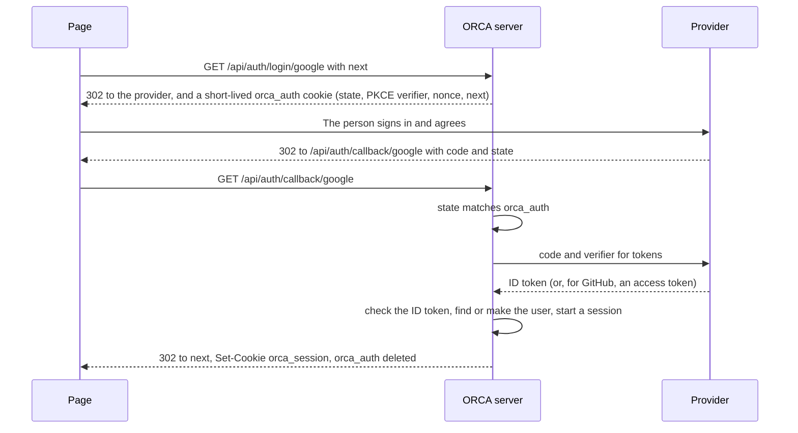

# User accounts, sign-in and preferences

**Status:** design, not built. Owner decisions of Nov 5 below. The build goes on `feature/` branches, one PR per slice
("Slices", at the end), each behind a switch that is off until the owner turns it on, so `main` and the live demo
stay as judged until the owner says otherwise.

Owner decisions (Nov 5, after the hackathon, while judging is under way):

- **Sign in with Microsoft, Google, GitHub, or a link sent by email.** No passwords.
- **ORCA runs sign-in itself**, with a standard library on the Python server, and keeps its users in its own
  database. No hosted identity service.
- **Accounts and preferences first.** Sign-in, a profile, the admin role, preferences that follow the person, and
  allowances per person. Saved projects (models and edits kept on the server) are designed here and built next.
- **Signing in stays optional.** Without an account ORCA works as today, with today's caps per address; a signed-in
  person gets allowances of their own, larger than a visitor's, and keeps their settings.
- **Branches are `feature/…`**, as `AGENTS.md` says; nothing goes to `main` without the owner's word.

Later the same day:

- **ORCA moves to Hetzner after judging**: the app, its database and saved projects' files, in Germany. Until then
  the live demo stays on Modal as judged. The move gets a design of its own (`deploy/`, doc
  [17](architecture/17-deployment-and-operations.md)).
- **Amazon SES in Frankfurt (`eu-central-1`) sends the sign-in links.**
- Left to the design ("your choice"): Postgres run by ORCA on its own Hetzner Cloud server rather than a managed
  service (Hetzner sells none); everything in **Falkenstein** (`fsn1`), on Hetzner's private network; backups in
  **Helsinki** (`hel1`), another country, so one site's trouble cannot take both.

## Today

ORCA has no accounts ([16](architecture/16-security-caps-and-cost.md), "Who is asking"):

- **A visitor is an address.** `limits.client_id` returns the socket's peer address. Every cap, a triage run's
  `starter` and an agent link's `visitor` key on it; nine places in `app.py` call it the same long way
  (`client_id(request.headers, request.client.host …)`).
- **The owner is a token.** `SIGHTLINE_OWNER_TOKEN`, sent once to `POST /api/owner/unlock`, answered with the signed
  `sightline_owner` cookie. `_OwnerContext` reads it on every request and `owner.enter` sets context variables that
  `owner.spawn` and `owner.submit` carry into stream workers and model-call pools.
- **An agent is a link token** (`agents.Links`), charged to the visitor who made it.
- **Scenes and reports belong to nobody.** Their random ids are the only key (`app._scene`, `app._report`).
- **Preferences live in the browser**: about twenty `localStorage` keys spread over ten files
  ([05](architecture/05-domain-model-and-state.md), "The browser"), and the reviewer's name for sign-offs is one of them.
- **Only the settings for everyone outlive a restart** (the Modal Dict in `settings.py`); everything else is in one
  process's memory.

What this means for the design: identity comes in at one middleware and a handful of call sites, and the context
variables that already carry the owner can carry the person too. Nothing in the fix path, the geometry or the models
needs to know who is signed in.

## What the person sees

- **Signed out:** ORCA exactly as today, plus **Sign in** in the menu (`AppMenu`) and on the landing. When a cap
  refuses a visitor and accounts are on, the refusal adds "Sign in for a larger allowance."
- **Sign in:** one dialog: **Continue with Microsoft**, **Continue with Google**, **Continue with GitHub**, or an
  email address and **Email me a link**. Only the ways the server has keys for are shown
  (`GET /api/auth/providers`). The browser goes to the provider and comes back to where it was.
- **Signed in:** the menu shows the person's name, with:
  - **Preferences**: their name and team (the name is the reviewer on sign-offs, in the PDF and BCF), and the
    interface settings that follow them (below);
  - **Agent links**: the live links they made, with time left, and Revoke;
  - **Sign out**, and **Sign out everywhere**;
  - **Your data**: download it, or delete the account;
  - for an admin, **Settings for everyone** and their own AI settings (today's owner menu, `Owner.tsx`).
- **Allowances:** a signed-in person's caps are their own, not their address's, and larger (below).

## Who is asking

One place decides, once per request: the middleware that is `_OwnerContext` today, renamed for what it does. It reads
the session cookie, looks the session up (cached in memory for a minute, so a request does not wait on the database),
and sets the request's identity: the person (or none), their role, and the address. Work started with `owner.spawn`
and `owner.submit` keeps it, as it keeps the owner's settings now.

- **`who(request)`** replaces the nine `client_id(...)` calls: `u:<user id>` for a signed-in person, else the address
  exactly as `limits.client_id` gives it today (which stays, with `SIGHTLINE_TRUST_FORWARDED`). Caps, a triage run's
  `starter` (`triage.Job.may_stop`), a link's `visitor` and chat all take it, so a person who changes network keeps
  their own run and their own allowance.
- **Admins replace the owner.** An admin is a user with the role `admin`. `owner.is_owner()` and `no_caps()` answer for
  them as for the token holder, so every gate in [16](architecture/16-security-caps-and-cost.md) ("What the owner gets")
  holds unchanged. The first admins come from `SIGHTLINE_ADMINS` (verified email addresses, matched at sign-in as in
  "Linking sign-ins" below); an admin can then make others. `SIGHTLINE_OWNER_TOKEN` keeps working, for local runs and
  as a way in if no admin can sign in; once an admin has signed in on the deploy it can be taken out of the secret.
- **Scenes, reports and links record who opened or made them** (`u:<id>` or the address), so the person's menu can
  list their links and saved projects can list their models. Ids stay the key to a scene, as today: who may open what
  is enforced with saved projects, where it matters.

## Sign-in

### With a provider (Microsoft, Google, GitHub)

The authorisation code flow with PKCE, all on the server; no token from a provider ever reaches the browser.

- **Microsoft:** OpenID Connect on the `common` endpoint (work and school accounts and personal ones). The person is
  their `tid` and `oid` (or `sub`); the issuer is checked against the token's own tenant.
- **Google:** OpenID Connect; the person is `sub`; `email_verified` says whether the address is proven.
- **GitHub:** OAuth 2, not OpenID Connect: the server asks `GET /user` for the id and `GET /user/emails` for the
  primary verified address.
- **The library:** Authlib's OAuth client (BSD licence) does the flow and checks ID tokens against each provider's
  keys; the plan confirms it fits FastAPI without its session middleware, since the state rides in `orca_auth`.
- **Where the provider sends people back:** `SIGHTLINE_PUBLIC_URL` + `/api/auth/callback/<provider>`, never built
  from the request's `Host` (a forged host would send codes elsewhere). Locally that is
  `http://localhost:5173/api/auth/callback/<provider>`, through Vite's proxy, which keeps the host; each provider's app
  registration lists both addresses.

### With an email link

- `POST /api/auth/email` with an address always answers "If that address can sign in, a link is on its way", so it
  never says whether someone has an account. It is capped per address and per visitor.
- The link is `<public URL>/#signin=<token>`: 32 random bytes, kept only as their sha256, for 15 minutes, used once.
  It is in the address's fragment, which browsers never send, because mail scanners open links to check them and
  would spend a token in a plain URL. The page reads the fragment, clears it, and posts the token to
  `POST /api/auth/email/verify`, which starts the session.
- The email is sent by Amazon SES in Frankfurt, through its SMTP endpoint (`email-smtp.eu-central-1.amazonaws.com`),
  so the server needs only Python's own `smtplib` and could change service without a code change. The sending domain
  gets SPF, DKIM and DMARC records, and the AWS account leaves SES's sandbox before the public can sign in.

### Linking sign-ins

One person, one account, whichever way they come in. A new sign-in joins an existing account by email only when the
address is proven: Google's `email_verified`, GitHub's primary verified address, or an email link. Microsoft's email
claim is not proven for every tenant, so a Microsoft sign-in joins an account only when the person adds it while signed
in (**Preferences**, "Ways to sign in"). Otherwise a sign-in with a new identity makes a new account.

### Sessions and cookies

| Cookie | Holds | Flags | Lives |
|---|---|---|---|
| `orca_session` | A random token; the server keeps only its sha256 | HttpOnly, Secure, `SameSite=Strict`, `Path=/api` | 30 days from last use, never more than 90 |
| `orca_auth` | State, PKCE verifier, nonce and where to return, signed with `SIGHTLINE_SESSION_SECRET` | HttpOnly, Secure, `SameSite=Lax`, `Path=/api/auth` | 10 minutes, deleted at the callback |

- `orca_auth` is `Lax` because the provider's redirect back is a navigation from another site, and a `Strict` cookie
  would not come with it. The session cookie can stay `Strict` like the owner's: the redirect to the page carries no
  cookie, and the page's own calls to `/api` do.
- Requests from other sites stay powerless as today: no CORS, `Strict` session cookies, and every change a `POST`,
  `PUT` or `DELETE`. **Sign out** is a `POST`. `next` must be a path on this site (one `/`, never `//` or a scheme).
- Sessions are rows, so **Sign out everywhere** and deleting an account end them at once; a cached lookup lasts a
  minute at most.
- Nothing logs a token, a code or an email address; logs name users by id.

## Preferences

`web/src/prefs.ts` becomes the one way the page reads and writes a setting. It reads `localStorage` synchronously, so
the first paint does not wait. Signed in, it also loads the person's preferences from `GET /api/me/preferences` at
start and saves changes with `PUT` a second after the last one. The first time a person signs in with nothing saved,
this browser's settings become theirs.

| Today's key | Follows the person | Why |
|---|---|---|
| `sightline.views.fly`, `sightline.views.layout` | Yes | How they like to work (a phone still shows Single, a tablet at most Two) |
| `sightline.measure.snap` | Yes | |
| `sightline.workings` | Yes | |
| `sightline.triage.compact` | Yes | |
| `sightline.dock.properties`, `sightline.dock.classic` | Yes | |
| `sightline.agent.setup` | Yes | They have made a link before |
| `sightline.reviewer` | Becomes the profile's name | Sign-offs name a real person |
| `sightline.owner` | Yes, for admins only | Their own AI settings; still sent as `X-Sightline-Settings` and read only for an admin or the owner |
| `sightline.left-w`, `sightline.right-w`, `sightline.measure.at`, `sightline.dock.v1` | No, this device | Sizes and positions depend on the screen |
| `sightline.voice.handsfree` | No, this device | Depends on the microphone |
| `orca.edit.carry` (`sessionStorage`) | No, this tab | |
| `sightline.views.<project>`, `sightline.filters.<project>`, `sightline.signoffs:*`, `sightline.requirements`, `sightline.session` | Not yet | They belong to a project: saved projects take them |

The server keeps one small JSON object per person: known keys only, 64 KB at most, with a version so two tabs do not
overwrite each other unseen (a stale `PUT` answers 409 and the page merges by key).

## Allowances

- Each per-hour cap counts per `who`, so a signed-in person's allowance is their own wherever they are, and visitors
  behind one address no longer share theirs with someone who signed in.
- Signed-in people get `SIGHTLINE_SIGNED_IN_FACTOR` times each per-hour cap (3 to start). The per-day caps for everyone
  and the Muse Wonder budget stay as they are: they protect the money, whoever spends it.
- New accounts are capped per address (`SIGHTLINE_SIGNUPS_PER_HOUR`), so making accounts is not a way round the caps.
- Counts stay in memory, as today; a restart forgets the hour. Counting that outlives a restart comes with plans or
  billing, if they come.

## Storage

- **A database** for users, their ways to sign in, sessions, email-link tokens, preferences and roles, through
  SQLAlchemy with Alembic migrations. Locally a SQLite file (`server/.sightline.db`, gitignored), so a fresh clone needs
  nothing new; in tests a temporary one. On Hetzner, Postgres on its own small Cloud server in Falkenstein, reached
  over the private network only, never the internet: a crash of the app server (IfcOpenShell on a big model can take
  gigabytes) cannot take the database with it. Continuous WAL archiving and a nightly base backup go to Object Storage
  in Helsinki, and a restore is tried before accounts go on for the public. Until the move there is no production
  database: accounts stay off on Modal.
- `SIGHTLINE_DATABASE_URL` says where; unset, the local file.
- Tables (slices 2 to 4): `users` (id, name, email, team, role, created, last seen, disabled), `identities`
  (provider, subject, user, email and whether it was proven), `sessions` (token hash, user, created, last used,
  expires), `email_tokens` (token hash, address, expires, used), `preferences` (user, version, JSON).

## Routes

| Route | Does |
|---|---|
| `GET /api/auth/providers` | Which ways to sign in this server offers |
| `GET /api/auth/login/{provider}` | Starts a provider sign-in (`next`: where to come back to) |
| `GET /api/auth/callback/{provider}` | Finishes it: the session cookie, then back to `next` |
| `POST /api/auth/email` | Sends a sign-in link |
| `POST /api/auth/email/verify` | Uses one |
| `POST /api/auth/logout` | Ends this session |
| `POST /api/auth/logout-everywhere` | Ends all of the person's sessions |
| `GET /api/me` | The person (null when signed out): id, name, email, team, role, ways to sign in |
| `PUT /api/me` | Their name and team |
| `GET`, `PUT /api/me/preferences` | Their preferences |
| `GET /api/me/links` | The live agent links they made |
| `GET /api/me/export` | Everything kept about them, as JSON |
| `DELETE /api/me` | Deletes the account, its sessions and preferences, and revokes its links |

With accounts off every one of these answers 404, and the page shows no sign-in. `GET /api/owner` and its unlock and
lock stay; `owner` is true for an admin too.

## Settings and secrets

| Variable | For |
|---|---|
| `SIGHTLINE_ACCOUNTS` | `1` turns accounts on; off (`0`) by default, and then ORCA is exactly as today |
| `SIGHTLINE_DATABASE_URL` | The database; unset, `server/.sightline.db` |
| `SIGHTLINE_SESSION_SECRET` | Signs `orca_auth` (a secret) |
| `SIGHTLINE_MICROSOFT_CLIENT_ID` / `_SECRET`, `SIGHTLINE_GOOGLE_CLIENT_ID` / `_SECRET`, `SIGHTLINE_GITHUB_CLIENT_ID` / `_SECRET` | Each provider's app registration (secrets); a provider without both is not offered |
| `SIGHTLINE_SMTP_HOST`, `SIGHTLINE_SMTP_USER`, `SIGHTLINE_SMTP_PASSWORD` | SES's SMTP endpoint and its SMTP credentials (the user and password are secrets) |
| `SIGHTLINE_MAIL_FROM` | The address sign-in links come from, on ORCA's own domain |
| `SIGHTLINE_ADMINS` | The first admins' verified addresses |
| `SIGHTLINE_SIGNED_IN_FACTOR` | How many times a visitor's per-hour caps a signed-in person gets (3) |
| `SIGHTLINE_SIGNUPS_PER_HOUR` | New accounts per address per hour |

The secrets go where `META_API_KEY` goes: `.env` locally, the Modal secret on the deploy, never git or chat.
`SIGHTLINE_PUBLIC_URL` already exists (the address MCP clients show) and becomes required when accounts are on.

## Personal data

Accounts keep names and email addresses, and saved projects will keep people's models. CLAUDE.md's "No customer data,
ever" was written for the hackathon build. Before accounts are switched on for the public, the owner restates that rule
(open question 3) and the site gains:

- a privacy notice and terms, linked from the sign-in dialog;
- **Your data**: download and delete (the routes above), deleting at once rather than marking;
- how long things are kept: sessions and email tokens go when they expire; an account with no sign-in for a set time,
  if the owner wants;
- where things are, said in the notice: the database and saved files in Germany (Hetzner, Falkenstein), backups in
  Finland (Helsinki), sign-in emails through AWS in Frankfurt; and what goes to the AI models: models' data,
  clash pictures and chat text to Meta's API, and to Baseten when the open-weights model is on.

Nothing about accounts goes into the repo, the tests, the evals or the demos: tests make their own users.

## Agents and MCP

- A link made by a signed-in person is theirs (`Link.visitor` is `u:<id>`): charged to their allowance, listed in their
  menu, revoked with the account. Links stay in memory, so a restart still ends them, until saved projects keep them.
- Later, OAuth 2.1 on `/mcp` ([docs/mcp.md](mcp.md), "Later"): with its own users ORCA can be the authorisation
  server itself, so an MCP client signs in as the person instead of pasting a link token. Its own design when it comes.

## Saved projects (designed here, built next)

What saving means, so the slices above leave room for it:

- **A project** belongs to a person and holds its models: the files as opened, and the latest edited IFC or STEP
  (`Workspace.export` writes those already). Files go to Hetzner Object Storage in Falkenstein (S3-compatible), in a
  private bucket only the server reads, copied to Helsinki; the database keeps the rows.
- **How much each person keeps** (proposed, for the owner to confirm): 5 projects and 2 GB; a project untouched for
  12 months is warned of by email and deleted 30 days later.
- **With it:** each kept check's latest run, the ids and #N numbers, titles, triage readings and captured views
  (`checks.Register`; clash ids hash the test and the pair, so they hold across a reload), the edit log's entries as a
  record, and what the page keeps per project today: saved views, filters, sign-offs, the requirements, the fixes.
- **Undo does not survive a reload.** Each edit-log entry holds IfcOpenShell transactions, which cannot be written out;
  a reopened project starts its undo history from the saved state.
- **Reopening** reads the saved files back into a scene (`Workspace.open_paths`), so a restart, or a scene let go to make
  room, costs a reload instead of the work.
- **Who may open it** is enforced at `app._scene` and `app._report` and in the MCP tools (which reach the workspace
  directly), from the project's owner.
- **My projects** replaces the saved session (`sightline.session`) and its resume.

Open there: storage per person, sharing a project with a team, and keeping projects of people who stop signing in.

## Slices

One PR each, on `feature/` branches, the switch off until the owner turns it on.

1. **`feature/accounts-identity`, no change in behaviour.** The middleware sets an identity; `who(request)` replaces
   the nine `client_id` calls; `web/src/prefs.ts` takes over every storage key (still the browser only). The existing
   suites pass unchanged.
2. **`feature/accounts-sign-in`.** The database and migrations; Microsoft, Google and GitHub sign-in; sessions;
   `/api/me`; sign out and sign out everywhere; the admin role; `SIGHTLINE_ACCOUNTS`. The page's sign-in dialog and
   account menu.
3. **`feature/accounts-email`.** Email links through SES (SMTP); a local run prints the link instead of sending it.
4. **`feature/accounts-preferences`.** Preferences that follow the person, the profile's name and team on sign-offs,
   **Agent links**, **Your data**.
5. **`feature/accounts-allowances`.** Caps per person, the factor for signed-in people, the sign-up cap, the refusal's
   words.

Then saved projects: a spec of its own, from the section above.

### Checks for each slice

- Server: `uv run pytest` (the whole suite, and `test_docs_map.py` for the routes, modules and settings added). New
  tests sign in against a fake provider (its token endpoint and keys served by httpx's mock transport) and cover:
  state and nonce mismatches, an ID token from another issuer or audience, `next` off the site, linking only on a
  proven address, an email token used twice or late, the cookies' flags, sign out everywhere, preferences' version
  conflicts, deleting an account, and every auth route answering 404 with accounts off.
- Web: `npm run build`, `npm test`; `prefs.ts` with and without a signed-in person. A new import in `App.tsx` goes into
  both stub lists (`web/tests/app-host.mjs`, `app-replacement.test.mjs`).
- In a browser: a real sign-in with each provider against apps registered for `localhost`, then a reload, sign out,
  and the same page with accounts off.

### Docs each slice updates

[02](architecture/02-system-architecture.md) (who the caller is), [04](architecture/04-server-code-map.md) (new
modules), [05](architecture/05-domain-model-and-state.md) (users, sessions, preferences, the browser keys),
[10](architecture/10-http-api-and-streams.md) (routes), [11](architecture/11-mcp-and-agent-links.md) (links owned by a person),
[12](architecture/12-web-app.md) (the dialog, the menu, `prefs.ts`), [15](architecture/15-requirements-settings-and-config.md)
(the variables), [16](architecture/16-security-caps-and-cost.md) (identity, admins, cookies, allowances),
[17](architecture/17-deployment-and-operations.md) (the database, secrets, provider registrations),
[20](architecture/20-decisions-limits-and-roadmap.md), [21](architecture/21-glossary-and-naming.md) (names people see), and an
entry in [22](architecture/22-build-log.md).

## Open questions for the owner

Decided Nov 5: the mail service (SES, Frankfurt), the hosting (Hetzner after judging), the database (self-run
Postgres in Falkenstein) and where files live (Hetzner Object Storage). Still open:

1. **ORCA's own domain.** The providers' return addresses, the email links and SES's sending domain need it; the Modal
   address goes with the move. Needed for slice 2's provider registrations on the deploy (local sign-in works without).
2. **When judging ends**, which is when the move can start.
3. **The personal-data rule** that replaces "No customer data, ever". Proposed: "No customer data in the repo, tests,
   evals, logs or demos. Personal data and people's models only in the production database and storage, as the
   privacy notice says." And the facts the privacy notice and terms need: the legal entity's name, registered address
   and country, a privacy contact address, whether ORCA is for businesses only, and whether it is free or a beta. ORCA
   drafts both; a lawyer reviews them before accounts go on for the public.
4. **How much each person keeps:** the numbers proposed under "Saved projects".
5. **Organisations and teams.** Proposed: later, but every saved project belongs to a workspace and every person gets
   a personal one from the start, so a team is a shared workspace and nothing moves when teams come.
