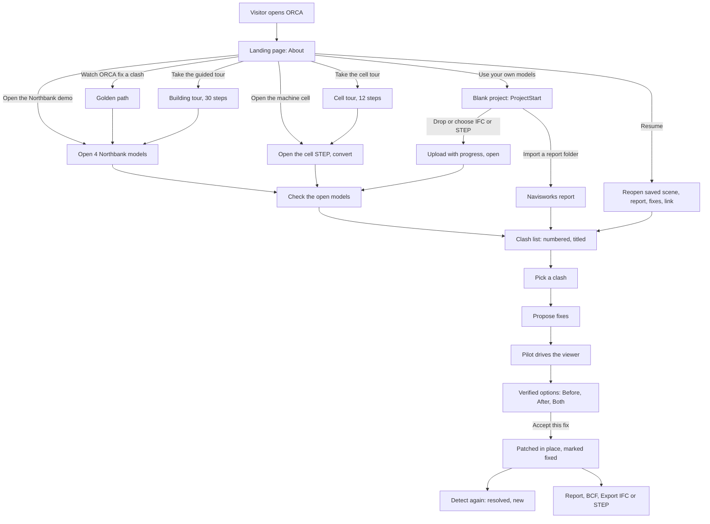
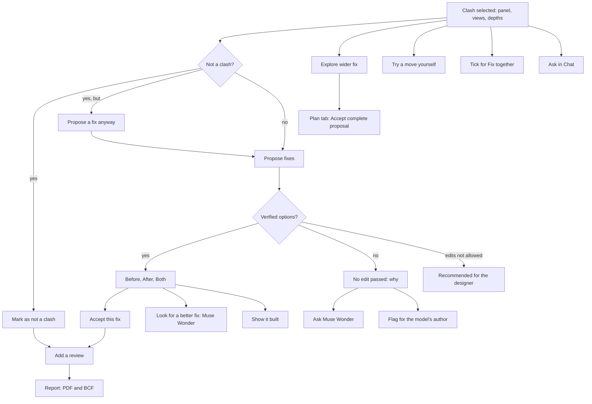
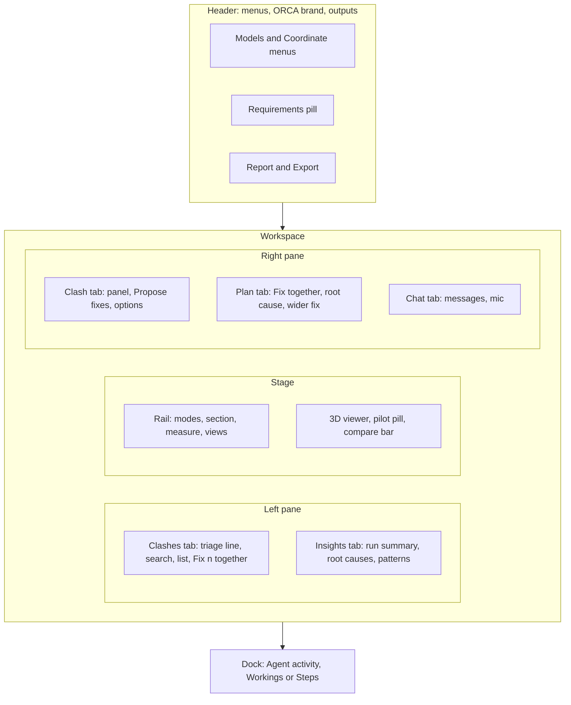
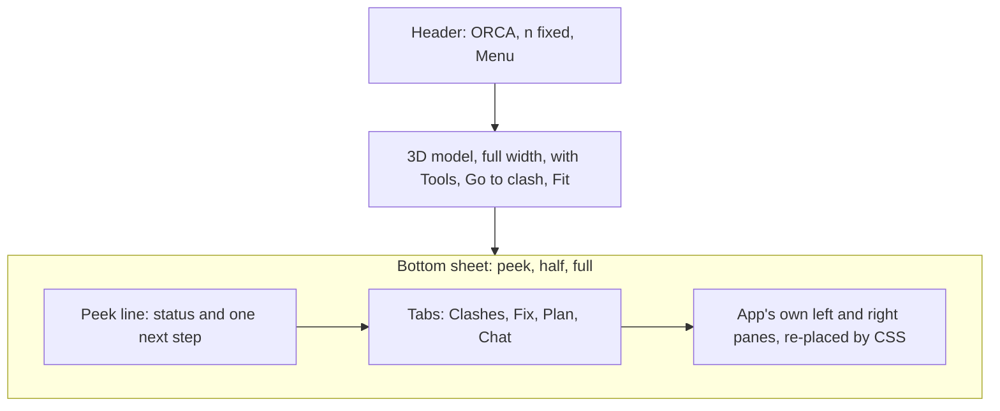

# 01 · Product and user journeys

> **Covers:** `web/src/About.tsx`, `web/src/AboutOrca.tsx`, `web/src/ProjectStart.tsx`, `web/src/Tour.tsx`, `web/src/App.tsx`,
> `web/src/AppMenu.tsx`, `web/src/Detect.tsx`, `web/src/ReportList.tsx`, `web/src/Triage.tsx`,
> `web/src/Insights.tsx`, `web/src/ClashPanel.tsx`, `web/src/PlanPanel.tsx`, `web/src/ContextPlan.tsx`,
> `web/src/Chat.tsx`, `web/src/Requirements.tsx`, `web/src/ReportDoc.tsx`, `web/src/Agent.tsx`, `web/src/Owner.tsx`,
> `web/src/Sheet.tsx`, `web/src/layout.ts`, `web/src/ViewerToolbar.tsx` · **Checked against code:** 2026-10-30
> (`104fda9`) · **Deeper design:** [docs/mobile.md](../mobile.md), [docs/detection.md](../detection.md),
> [docs/edits.md](../edits.md), [docs/requirements.md](../requirements.md), [docs/escalation.md](../escalation.md),
> [docs/show-it-built.md](../show-it-built.md), [docs/voice.md](../voice.md), [docs/mcp.md](../mcp.md),
> [docs/step.md](../step.md), [docs/uploads.md](../uploads.md)

ORCA (Observe · Resolve · Check · Apply), by IssueLab, is an AI design coordinator for 3D models. It checks the
models several teams make against each other, finds where they clash, sorts what matters from what doesn't, and
proposes one to three fixes that **edit real model elements**. Every fix is checked by geometry before anyone sees
it: the clash is gone, there is clearance, nothing new is hit. The user reviews the options in 3D, accepts one, and
takes away the edited IFC (and STEP), a PDF report and BCF issues. This doc is the product seen from the user's
side: who it is for, every way in, the golden path, every feature as a journey, and the screen. How each step works
inside lives in the docs it links to; the cross-layer sequence of each action is in
[03](03-end-to-end-flows.md).

## What ORCA does, and for whom

| Step | What the user gets | Where it is built |
|---|---|---|
| **Check** | Every pair of open models and each model against itself, hard at 1 mm, plus duplicates. A numbered, titled clash list (or an imported Navisworks report). | [06](06-geometry-and-detection.md), `server/sightline/detect.py` |
| **Sort** | Triage gives every clash a verdict (real, by design, not physical, model error). Insights groups patterns and finds root causes. | [09](09-agent-workflows.md), `triage.py`, `plans.py` |
| **Understand** | Muse Spark reads the clash's A/B/C pictures and the model's own data (classes, runs, openings, room nearby). | [09](09-agent-workflows.md), `agent.py` |
| **Propose and verify** | 1-3 fixes that edit real IFC elements (move, offset, trim, reroute, resize, opening, combined), each tried and checked by geometry; failures go back to the model with what they hit. | [07](07-fixes-and-edits.md), `agent.resolve`, `verify.check` |
| **Review** | The agent drives the 3D view while it works; options show Before / After / Both and a proof strip. | [13](13-3d-viewer.md), `web/src/pilot.ts` |
| **Apply** | Accept keeps the edit in the server's model and patches the viewer in place. | [07](07-fixes-and-edits.md), `Workspace.patch` |
| **Hand off** | Export the edited IFC (and STEP), a PDF per scope with team reviews, BCF 2.1 issues. | [14](14-files-in-and-out.md), `document.py` |

**Who it is for.** Design coordinators and the teams whose models meet: structure, building services (MEP) and
architecture on a building; mechanical, electrical and safety on a machine cell. The landing page (`About`) is
written for people who have never heard of BIM: what a clash is, the disciplines, a colour legend for the viewer and a
short glossary ("Words you'll see"). **About ORCA** (`AboutOrca`) tells the longer story in six tabs, for anyone who
wants more, judges included.

**The hackathon framing.** ORCA was built for the Meta Global AI Developer Hackathon (Startup track, Oct 27 - Nov 4,
2026), with only work written during the event. The headline is **verified model edits**: a fix is a real IFC edit,
proved by geometry, not a picture with advice. Image-only explanation is a fallback, never the pitch ("simple image
analyzers", dashboards as the main feature and Streamlit apps are on the hackathon's anti-project list). The models it
uses are named on the page: Muse Spark (understanding, proposals, chat), Muse Spark Open (titles and triage, when the
open-weights model is switched on), Muse Voice Transcribe (voice), Muse Wonder (a second try) and Muse Image (Show it
built). The product name never contains "Meta" or "Muse" ([21](21-glossary-and-naming.md)).

## Every way in

`App` decides what the page is from three things: `stats` (models drawn in the viewer), `report` (a clash list open)
and `blank` (a blank project started). `landing = !stats && !report && !blank`: until something opens, the page is the
landing, with no panes or dock (`.app.landing`). `starting = blank && !stats && !report`: the blank project's drop
zone has the whole stage.

| Way in | Control | What it calls | What happens |
|---|---|---|---|
| **Golden path** | Landing hero **Watch ORCA fix a clash** (`data-tour=golden`); also in the landing header | `startGolden` → `openDemo()` | Opens the default demo models, runs the check, then picks the duct through the girder and proposes (below). |
| **Northbank demo** | Demo card **Open the Northbank demo** (`data-tour=demo`) | `openDemo()` → `open(picked)` → `runDetect(null, id)` | Opens the default pick and checks it. The label is "Open the models" when the pick holds no Northbank file (`startLabel`). |
| **Machine cell demo** | Demo card **Open the machine cell** (`data-tour=cell`) | `openDemo([cellSample])` | Opens `PC-03-Palletising-Cell-RevA.step` from `samples/` (`cellSample`, matched by name), converts it and checks it. The card shows only when that file is there. |
| **Guided tours** | **Take the guided tour** / **Take the cell tour** on the cards; header **Tour** once something is open | `startTour("northbank" \| "cell")` | `Tour` walks the real app (below). |
| **Pick a demo** | Hero link | scrolls to `#demos` | The two `DemoCard`s: picture, what it is, what it shows, measured chips, Open and Tour. |
| **Resume** | **Pick up where you left off** card (`ResumeCard`), shown while the server still holds the session | `resumeSession` | Reopens the saved scene (`open(files, existing)`), its report, the fixes, and the agent link. **Start fresh** forgets it and revokes the link (`startFresh`). The session is kept in `localStorage` (`sightline.session`). |
| **Blank project** | Hero **Use your own models** (`data-tour=blank`) | `setBlank(true)` → `ProjectStart` | A drop zone or **Choose files** for IFC/STEP (→ `openDemo(files)`: upload, open, check), **Import a report folder**, **Back to the demos**. |
| **Models menu** | Header **Models** popover | `open()` / `openDemo(files)` | Tick sample files and **Open n models**, or **Upload models (IFC or STEP)…**. The default pick is the samples matching `(structure\|mep\|architecture\|site).ifc`. |
| **Coordinate menu** | Header **Coordinate** popover | `runDetect(null)` / `loadReport` / `upload` | **Check the open models** first; then **Or import a Navisworks clash report (XML)**: a sample folder from `samples/reports/`, **Upload an export folder…** (not on iOS), **Upload XML files…**. |
| **Agent over MCP** | Header **Connect an agent** | `AgentDialog`, `connectAgent` | A pairing link for an MCP client; the page follows what the agent does ([11](11-mcp-and-agent-links.md)). |
| **Owner** | Header gear, only for the owner or on a page opened with `#owner` | `OwnerSettingsMenu` | Unlock with the owner token, then settings "For me" and "For everyone" ([15](15-requirements-settings-and-config.md), [16](16-security-caps-and-cost.md)). |
| **Help** | Header **About ORCA** (also on the landing, in the phone menu, the landing's "Go deeper" card, or the address `#about`, `#about/<tab>`) | `openAbout(tab)` | A full page over the app in six tabs: Overview, How it works, The fixes, The AI, Under the hood, Proof and limits. Animated pictures (the ORCA loop, the duct raised through the girder, each fix kind before and after, the propose-check loop, the architecture); still under reduced motion. Escape, Close or Back closes it. |

## The golden path, step by step

The path the demo is built around, as the code runs it. Timings are those measured on Oct 28 (CLAUDE.md, "Coordination
first"): list at about 22 s, the first idea verified about 42 s into the proposal; the landing says "~40 s to a
verified fix".

| Step | What the user sees | What the page does |
|---|---|---|
| 1. Start | **Watch ORCA fix a clash** on the landing. | `startGolden` sets `golden.current` and calls `openDemo()`. |
| 2. Open | "Loading 4 models…" over the stage; the four Northbank models (Structure, MEP, Architecture, Site) drawn. | `open(picked)`: `api.open` (or the upload stream), then `Viewer.load` with each file's bytes. |
| 3. Check | The left pane's Detect card ("Coordinate the models"), its phase line ("Checking n elements") and each test's coverage. | `runDetect(null, id)` streams `api.detect` (NDJSON phases) and opens the result as the report (`loadReport`). Site's tests are listed but off by default, so the check covers 1,732 elements: 464 clashes in about 4 s (README). |
| 4. List | The **Clashes** tab: report title "Coordination · n models", tests as groups, rows `#N` with a plain name, then Muse's title as it lands ("Muse is naming n…"), thumbnails drawn as rows scroll into view. | `api.titles` streams titles; `LazyThumb` queues `Viewer.thumbClash`. |
| 5. Pick | The supply-air main through the Level 02 transfer girder (MEP vs Structure; #1 on a fresh check, per CLAUDE.md) selected; the camera flies to where the two meet; the clash panel shows the pair, "Found by ORCA" and "Now" depths, and "Taking the A/B/C views of this clash…". | The golden effect finds the pair with `clashOfPair(TOUR.duct)` (else the deepest clash) and calls `selectClash` → `goToClash`. A detected clash's views are captured by `captureViews` (`Viewer.captureClash`, saved to the server). |
| 6. Propose | **Propose fixes** runs by itself: "Understanding", Muse Spark's live reasoning notes, the status line. | `propose()` → `runProposal`: waits up to 4 s for the views, then `api.proposeStream`. |
| 7. Pilot | The glowing border: ORCA is driving. Each idea appears in place, amber while checked, teal when clear, what it hit in magenta; the camera follows and turns slowly while Muse thinks. **Take the view** / **Let ORCA drive**. The Activity panel draws the run in Workings (each round, idea and check, "in view" on the one the pilot shows), or fills the Steps table. | `trackAgent` feeds every event to `Pilot` (`web/src/pilot.ts`); any user camera move is a takeover (`Viewer.onUserCamera`). |
| 8. Options | "Verified options": rank, kind chip (Move, Offset, Trim, Reroute, Resize, Opening, Combined), title, Edit / Clearance / Review facts, what it meets, the rationale and a proof strip. The bar over the stage switches **Before / After / Both**, with a before/after summary. On Northbank the first idea is the offset up 400 mm through the girder's web opening, Rev04's height. | The first option is chosen; the viewer frames what changed (`frameFix`) and, 1.4 s later, captures the proposed fix for the report. |
| 9. Accept | **Accept this fix**: "Applying the fix…", the edited pieces appear without a reload, the row and panel get "✓ fixed", the header counts "1 fixed". | `accept` → `api.accept` (`/fix/apply` with the clash's pair; the server tries the fix again and refuses it with why if it no longer passes) → `applyToViewer`, which patches the viewer when the page is at the server's `revision_before`, else reloads the changed files; `markFixed` marks every report clash of that pair; the clash is measured again. |
| 10. Re-check | **Detect again** (the icon on the Insights tab's run summary): the chips say how many clashes the fixes resolved and how many are new. | `runDetect(lastTests)`. Clash ids are stable across runs, so the page keeps its "not a clash" marks and the server carries titles and views over (`Workspace._carry`). |

## Every feature as a journey

### Triage: sort them all first

The Triage card leads the Clashes tab. Before a run it says "Step 1 · sort the clashes" with **Triage all n clashes**;
while running it shows the clashes settled by rule (touch, same element, not physical: no model call) and the model's
progress, with the live reading of the newest few; when done, "n need a fix of N", a bar with a segment per verdict
(click to filter), a row per verdict, **Set aside n as noise** and **Flag n for their authors**. It folds to one line
once a run is done (kept in `sightline.triage.compact`). The clash panel shows the verdict, severity, responsible team,
the reading, what settled it (`BASIS` in `ClashPanel.tsx`) and "How the triage model reasoned". `runTriage` streams
`api.triage`; the server side is in [09](09-agent-workflows.md).

### Not a clash

`noClash.ts` decides when a clash needs no fix: one element on both sides (drawn purple), a non-physical side, a touch,
no overlap in the open model, or a by-design / non-physical triage verdict. The clash panel then shows why with **Mark
as not a clash** in place of Propose fixes; **Propose a fix anyway** (`data-tour=fix-anyway`) overrides.

### Insights: patterns and root causes

The left pane's **Insights** tab holds the impact line (clashes, real, fixed), the run's summary (`DetectSummary`:
"Found by ORCA", the count, "n resolved" / "n new" chips, "What was checked", **Detect again**), **Root causes**
and **Patterns** (`Insights.tsx`).
- **Patterns** are the same clash repeated ("11× Mechanical fastener with Plate"). They are read automatically once
  per report and models (`explainPatterns(quiet)`), or by **Explain the n patterns with Muse Spark**: by design (with
  the rule to add), modelling error (flag for the author) or real problem (fix together). A by-design pattern has
  **Add to requirements**.
- **Root causes** are elements in several real clashes, cross-discipline first, with hits the report lacks. **Fix**
  asks Muse Spark for the cause and a strategy and builds one plan (`runPlan({ hub })`). On Northbank: the transfer
  girder, with the duct, the cable tray and the cold water main.
- A funnel button filters the list to a pattern or root cause (`listFocus`); tick buttons select its clashes. Both
  switch back to the Clashes tab.

### Fix together

Tick clashes in the list (per row, or per test group) and press **Fix n together** in the selection bar. The Plan tab
takes the view: "Fix together", the items with their chosen fixes, the combined check, **Accept the plan** (or "Accept
the n verified", or "Nothing to accept yet"), **Discard**. A failed item says why in plain words and can **Ask Muse
Wonder**. A plan whose model changed since it was checked cannot be accepted (`planStale`). Pairs that share a movable
element become one job (the cell's air pipe through both conveyor rails). A root cause plan that says the parts are
meant to go together offers to mark them by design instead (`onAsDesigned`).

### Explore a wider fix

**Explore wider fix** on a clash (or two picked elements) inspects the geometry around it and checks complete
arrangements of up to three coordinated edit groups (`context_planner.py`, `context_eval.py`). The Plan tab shows
"Explore wider fix" (`ContextPlan.tsx`) with up to three alternatives, each edit and its reason, the evidence and the
designer review conditions; every condition must be ticked to **Accept complete proposal**. A stale proposal must be
regenerated for its original objective. When a batch plan exists too, a switch chooses "Wider fix" or "Clash plan".

### Chat and voice

The right pane's **Chat** tab (`Chat.tsx`): Muse Spark with tools over the open report and models. It can summarise,
list and open clashes, look at a clash's pictures, measure, describe and find elements, find openings, check a move,
offset, route, resize or opening, propose (counted as a proposal), find root causes and patterns, plan, explore a wider
fix, detect, show it built, and drive the page (`show_clash`, `set_view`). Its proposals and plans fill the same
panels; a chat-run check adopts its report without remounting the chat. The mic: **Hold to talk** (captions while held, sent on release; a quick tap latches), or
**Hands-free** (each sentence sent at the pause, `sightline.voice.handsfree`). Live recognition streams to Muse Voice
Transcribe through the server; an upload is the fallback ([docs/voice.md](../voice.md)).

### Coordination requirements

Header **Requirements** (once models are open) opens `RequirementsDialog`: level cards (L1 Concept to L5 As-built), a
strictness slider (Lenient to Exacting) with the numbers it sets and the expected count, the check matrix between
groups, who moves, by-design rules with Muse's audit, openings for services, guidance, **Suggest with Muse Spark**,
Download / Upload, then **Use these requirements** or **Use them and check again**. The header pill then shows the
short label ("L4 · Strict"). Detect and Triage cards say what they ran under; options say what they meet; under L5 a
recommendation replaces edits ("Recommended for the designer"). Design: [docs/requirements.md](../requirements.md);
code: [15](15-requirements-settings-and-config.md).

### Reviews, the report and BCF

- **Review:** in the clash panel, every team with an element in a real or fixed clash adds a review: a name and a
  decision (`ReviewBlock`, kept in `localStorage` per report). No sign-in yet.
- **Report:** header **Report** opens `ReportDialog`: scope (**One report**, **One per team**, **One per model**),
  the team that owns each model (guessed, confirmed here), **Include BCF issues**, **Build the report**, then
  **Download**. It needs triage done (it offers Triage all otherwise) and costs one proposal. The PDF says DRAFT until
  every page has a review from every team involved.
- **Export:** header **Export IFC** (or **Export STEP + IFC** when a STEP model is open) downloads every edited file,
  zipped when several changed. Details in [14](14-files-in-and-out.md).

### A second try on Muse Wonder

When nothing passes, the "No edit passed the geometry check" card (`NoFix`) explains what blocked the ideas and offers
**Ask Muse Wonder** (and **Propose again**, **Flag for the model's author**). Under verified options, **Look for a
better fix** asks Muse Wonder to beat them; the first options stay. Each option then carries a model chip. Offered when
the `escalation` setting is `button` (default) or `auto` (a failed proposal escalates at once); never for a
recommendation or a not-a-clash. Design: [docs/escalation.md](../escalation.md).

### Show it built

When the owner has switched `built_views` on, a chosen option (and each verified plan fix) has **Show it built**: Muse
Image restyles ORCA's own view of the fix as a presentation render, checked against the model before it is shown,
with a wipe and **Lines from the model** (`BuiltView.tsx`). A kept fix shows "As it could look built", and the PDF's fix
page gets the picture. Never for a trim or a cleanup. Design: [docs/show-it-built.md](../show-it-built.md).

### When the server lets go of the models

Open models and kept fixes live only in the server's memory, so a redeploy, a restart or a long idle spell drops them
while the page still shows them. The page's next call then brings one notice over the viewer, **The server no longer
holds your models (it restarted, or made room for other visitors). The fixes you kept went with them.**, with **Open
them again**: the same sample models and the same check (or sample report) come back, and fixes are accepted again
from there. The visitor's own models go back to the file picker (**Pick your files again**). Until then the clash list
stops showing kept fixes, Export is hidden, and a failed Show it built offers the same reopen instead of Try again.
How: [03](03-end-to-end-flows.md), "When the server lets go of the models".

### By hand

Double-click element A, then B (on touch: tap, then **Set as A** / **Set as B** on its card, or a long press) to work
on any pair without a report. **Try a move yourself** checks a vertical move of A with the geometry (`api.verify`): no
model call, no API key. **Go to the clash** frames the pair.

### What the user can do with one clash

## The guided tours

`Tour.tsx` tells the story on the real app. Each step points at a real control (`data-tour` attributes, or a selector
built from `TourState`), moves on when the app reaches the state it describes, and has **Show me** buttons that do the
click. Live Muse steps offer **Watch a recorded run** when the live run errors, finds no fix or is slow (45 s for a
proposal, 75 s for a plan; a plan that fails to start moves the tour on to the step that offers it): real runs from
`web/public/tour/`, replayed through the same pilot and plan code (`replayPropose`,
`replayPlan`) and labelled as recorded; accepting a replayed fix edits the model for real
([19](19-demo-data.md)). The tour's clashes are found by element pair (`TOUR`, `clashOfPair`) or, for the cell, by
part names (`CELL`, `clashOfNames`), so they work on a fresh check or an imported report. On phones and tablets
`TourActions.reveal` opens whatever hides a step's control.

| Tour | Acts (steps) |
|---|---|
| **Building** (`BUILDING_STEPS`, 30 steps) | Design coordination (2) · Triage (2) · One fix, live (6: the duct through the girder, propose, the pilot, before/after, "it isn't only this duct") · A joint, not a move (3: the curtain-wall transom trim, accepted as a cleanup) · The root cause (4: Chat, "Why are there so many clashes on Level 02? Fix the root cause.", the girder plan, accept) · Not everything needs a fix (2: patterns, by design) · Your standard (6: Add to requirements, L4, Strict, the grid, Use them) · People decide (3: a review, Report, build) · Hand-off (1: PDF, BCF, Export IFC) · ORCA (1: the numbers) |
| **Cell** (`CELL_STEPS`, 12 steps) | From STEP (2) · Triage (2) · One fix (3: the cable ladder through fence post W5; the copy names the shown option's kind) · Together (3: the air pipe through both conveyor rails, one plan) · Hand-off (1: Export STEP + IFC) · ORCA (1) |

## The main screen

### Desktop (wider than 1100 px)

Three columns and a dock (`.app`, widths from `--left-w` / `--right-w`, resizable from each pane's inner edge and
remembered in `sightline.left-w` / `sightline.right-w`; defaults 310 px and 380 px, `PANE` in `App.tsx`).

| Area | What it holds |
|---|---|
| **Header** (`.bar`, three columns) | Left: **Models** (with the element count after it), **Coordinate**, **Requirements**, **About ORCA**, **Tour**. Centre: the ORCA brand. Right: "n fixed", **Connect an agent** (or the agent pill: "Agent · tool"), the owner chip and gear, **Report**, **Export IFC** / **Export STEP + IFC**. At 1280 px and below, Requirements, About ORCA, Tour and Connect an agent show their icons only (`.bar .lbl`). |
| **Left pane** (`.pane.left`) | Over a report, `ReportList` with two tabs: **Clashes** (title and test count, Triage folded to one line, search with filters, the list grouped by test, ticks and the Fix together bar) and **Insights** (impact line, the run's summary with Detect again, root causes, patterns). Models open with no report: the Detect setup card. Nothing open: "Nothing to coordinate yet". |
| **Stage** (`main.stage`) | The viewer canvas; the rail (`ViewerToolbar`: Shaded, X-ray, Context, Isolate; section box, outlines, measure; Go to the clash, Fit, standard views, models shown, screenshot); the properties card on single click; the busy and status overlays; the pilot pill and glow; the Before / After / Both bar; the landing (`About`) or the blank project (`ProjectStart`) when nothing is open. |
| **Right pane** (`.pane.right`) | Tabs **Clash** (the clash panel, Propose fixes, Explore wider fix, Go to the clash, Understanding, reasoning, options, Try a move yourself), **Plan** (Fix together, root cause plan, wider fix) and **Chat**. |
| **Dock** (`footer.dock`) | "Agent activity": Workings, every run drawn as it happens (proposals, plans, triage, Show it built, ORCA's check; [docs/workings.md](../workings.md)), or Steps, every attempt of the running or last proposal. |

### Tablet and phone

`useLayout()` (`web/src/layout.ts`) picks the layout from the window width; the CSS uses the same numbers
(`PHONE_MAX` 760, `TABLET_MAX` 1100). `(pointer: coarse)` gives finger-sized targets at any width (`useCoarse`).
Design: [docs/mobile.md](../mobile.md); the app side: [12](12-web-app.md).

| Layout | Width | What changes |
|---|---|---|
| **Tablet** (`.app.tablet`) | 761-1100 px | The model and the right pane. The clash list is a drawer from the left (header **Clashes** with the count, `data-tour=drawer`); a scrim or picking a clash closes it. Report and Export stay in the header; the rest moves to **Menu** (`MenuSheet` in `AppMenu.tsx`: Models, Coordinate, This session, Help). |
| **Phone** (`.app.phone`) | 760 px and below | Header with the brand, "n fixed" and **Menu**; the model full width; a bottom sheet (`SheetBar` in `Sheet.tsx`) at peek, half or full, with tabs **Clashes · Fix · Plan · Chat** over App's own panes, re-placed by CSS, never remounted. The peek line carries the one next step: Check for clashes, Propose fixes, Accept, Next clash, See why, Ask Wonder. The rail becomes **Tools**, Go to clash and Fit. |

The sheet follows what happens (`follow()` in `layout.ts`, one effect in `App`): a report or the models open → the list
at half; a clash picked → Fix at half; a proposal, plan or wider fix starts → peek, so the pilot is in view; the result
→ half, scrolled to the options. Moving the sheet by hand wins until the next event.

## When to update this doc

- A new way in: a landing button or card, a header action, a menu item in `modelsMenu` / `coordinateMenu` /
  `MenuSheet`, a new dialog.
- A change to the golden path: `startGolden`, `openDemo`, the golden effect in `App.tsx`, the default model pick, or
  what Accept does on the page (`accept`, `applyToViewer`).
- A new user-facing feature or fix kind, or a renamed control the journeys above quote.
- A change to the tours: acts, step counts, recorded runs (`BUILDING_STEPS`, `CELL_STEPS`, `web/public/tour/`).
- A change to the layouts: panes, tabs, the dock, breakpoints in `layout.ts`, the phone sheet's tabs or `follow()`.
- New measured headline numbers on the landing or the demo cards.
