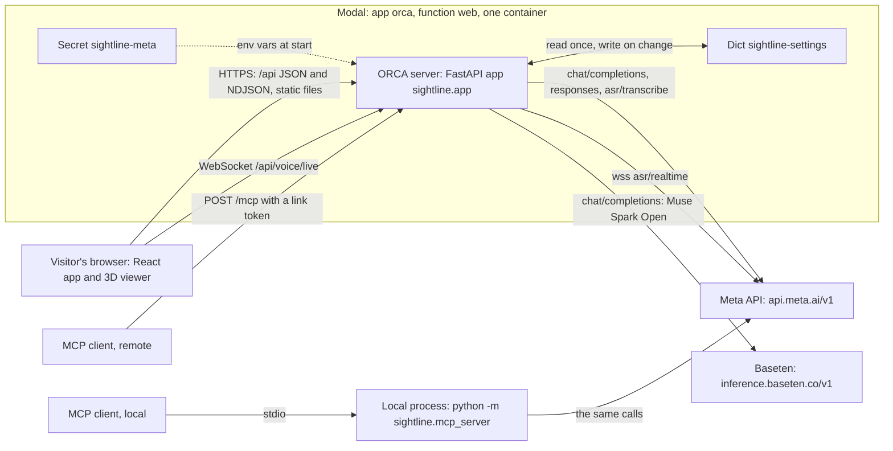
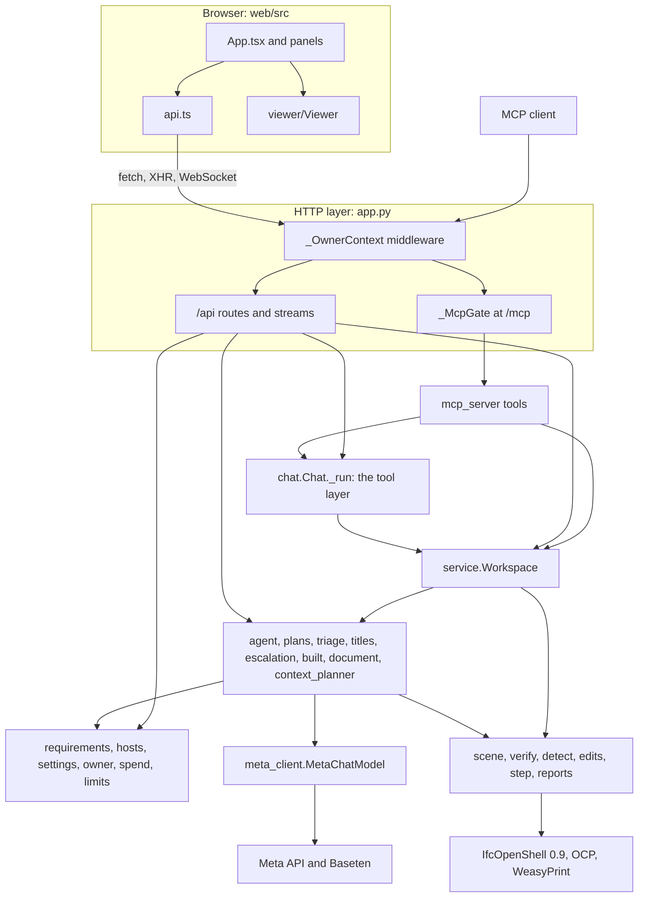
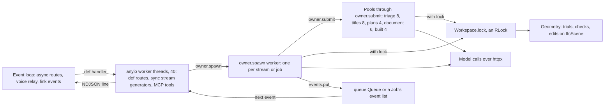
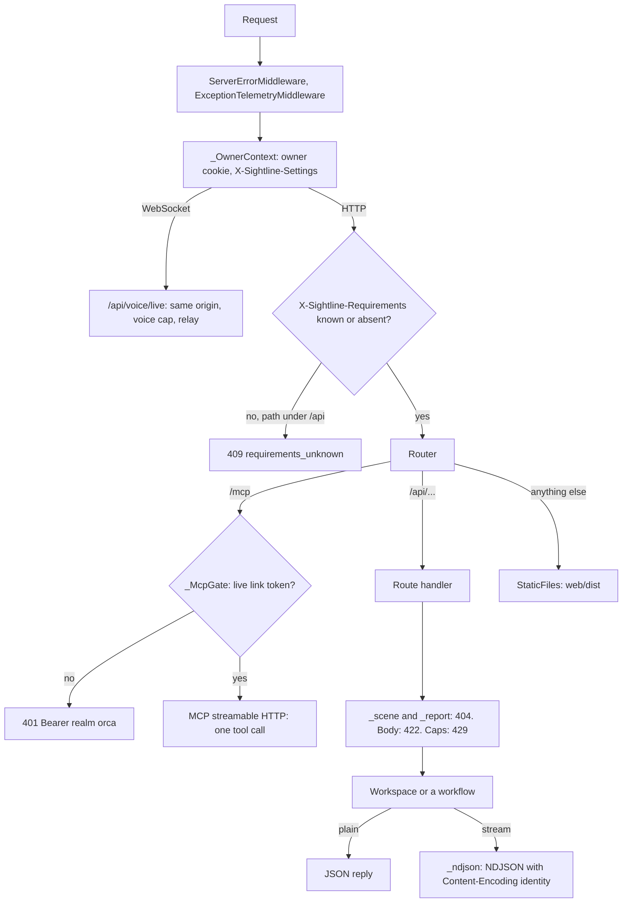

# 02 · System architecture

> **Covers:** `server/sightline/app.py`, `server/sightline/service.py`, `server/sightline/owner.py`,
> `server/sightline/meta_client.py`, `server/sightline/limits.py`, `server/sightline/agents.py`, `deploy/modal_app.py`,
> `web/src/api.ts`, `web/src/App.tsx` (as the caller), `server/pyproject.toml`, `web/package.json` ·
> **Checked against code:** 2026-10-30 (`104fda9`) ·
> **Deeper design:** none of its own; the docs in the last table link to the feature designs in `docs/*.md`.

ORCA is one web app: a React page with a three.js viewer, and one Python process that holds the open models, checks
geometry, edits IFC and calls Meta's models. The browser previews; the server is the only source of clearance numbers
and the only holder of API keys. This doc is the big picture: who talks to whom, the main parts, how one process does
many things at once, what happens to every request, and which stack it runs on and why.

## System context

| Who | Talks to | How |
|---|---|---|
| The visitor's browser | the ORCA server, same origin | HTTPS: JSON and NDJSON streams under `/api/`, one WebSocket (`/api/voice/live`), the built web app at `/` |
| The ORCA server | Meta's API, `https://api.meta.ai/v1` (`META_API_BASE_URL`) | `POST /chat/completions` (plain, streamed, or with `tools`), `POST /responses` (streamed reasoning summaries; Muse Image's `image_generation` tool), `POST /asr/transcribe` (one WAV clip, multipart), `wss://api.meta.ai/v1/asr/realtime` (the live voice relay) |
| The ORCA server | Baseten, `https://inference.baseten.co/v1` (`TRIAGE_API_BASE_URL`) | `POST /chat/completions` (streamed for triage) for Muse Spark Open, only when a key is set (`TRIAGE_API_KEY` or `BASETEN_API_KEY`) and the open-weights setting is on |
| The ORCA server | Modal | hosting (app `orca`, one container), the Secret `sightline-meta` (env vars), the Dict `sightline-settings` (settings for everyone) |
| A remote MCP client (Muse Code, Claude, an IDE) | the ORCA server's `/mcp` | streamable HTTP, stateless, one JSON reply per call, `Authorization: Bearer orca_…` (a pairing link token) |
| A local MCP client | `python -m sightline.mcp_server` | stdio, a separate process with its own session and no browser |

Which model answers what (the plumbing is [08](08-ai-models-prompts-and-spend.md)):

| Model (default id) | Host and endpoint | Used by |
|---|---|---|
| Muse Spark (`META_MODEL`, `muse-spark-1.3-contributor`) | Meta, `/chat/completions`; `/responses` when someone watches (`MetaChatModel.complete_json_reasoning`, only on `api.meta.ai`) | proposals (`agent.resolve`), chat and the wider-fix search (`MetaChatModel.chat` with tools), root causes and patterns (`plans`), report text (`document`), requirement drafts, Show it built's lighter judges; titles, triage, host readings and STEP part classes when the open-weights model is off |
| Muse Spark Open (`TRIAGE_MODEL`, `meta-models/muse-spark-open`) | Baseten, `/chat/completions` (streamed for triage: `complete_json_streamed`) | `meta_client.triage_model()`: titles, triage, host readings (`Workspace.hosts_model`), STEP part classes (`app._classifier`) |
| Muse Wonder (`META_ESCALATION_MODEL`, `muse-wonder-1.0`) | Meta, the same two endpoints; every call's cost charged (`spend.charge`) | second tries (`meta_client.escalation_model`), Show it built's judges (`built.judge_model`) |
| Muse Image (`META_IMAGE_MODEL`, `muse-image-1.0`) | Meta, `/responses` with the `image_generation` tool | `built.restyle` |
| Muse Voice Transcribe (`META_VOICE_MODEL`, `muse-voice-transcribe-1.0`) | Meta, `/asr/transcribe` and the realtime socket (`META_VOICE_REALTIME_URL`) | `meta_client.transcribe`, `voice_live.relay` |

## The main parts

| Layer | Code | Job | Doc |
|---|---|---|---|
| Browser app | `web/src/App.tsx`, `web/src/api.ts`, `web/src/pilot.ts`, `web/src/voice.ts`, `web/src/uploads.ts` and the panels | state and flows; every server call (`call`, `ndjson`, `send` with the requirements retry); the agent driving the viewer; voice; uploads | [12](12-web-app.md) |
| Viewer | `web/src/viewer/` (`Viewer.ts`, `ifcLoader.ts`, `patch.ts`) | web-ifc parsing, one `THREE.BatchedMesh` per file (plus a `glass` batch), previews, captures, accept-in-place patches | [13](13-3d-viewer.md) |
| HTTP layer | `server/sightline/app.py` | routes, the `_OwnerContext` middleware, the `_McpGate` route, caps (`ProposeLimit` instances), streams (`_ndjson`, `_RequestEvents`), shared job tables (triage, titles, documents), static files | [10](10-http-api-and-streams.md) |
| Operations | `server/sightline/service.py` (`Workspace`) | open and evict scenes and reports, check and keep every fix kind, propose and escalate, detect, match and measure, export, patches; shared by the API, the chat and the MCP server | [04](04-server-code-map.md), [05](05-domain-model-and-state.md) |
| AI workflows | `agent.py`, `plans.py`, `triage.py`, `titles.py`, `chat.py`, `escalation.py`, `built.py`, `document.py`, `context_planner.py`, `context_eval.py`, `hosts.py` | the propose, verify, retry and rank loop; plans and root causes; bulk triage; titles; the chat's tool loop; second tries; built views; reports; the wider-fix search | [09](09-agent-workflows.md) |
| Rules and money | `requirements.py`, `settings.py`, `owner.py`, `spend.py`, `limits.py` | coordination requirements, settings for everyone, the owner, the day's Muse Wonder budget, demo caps | [15](15-requirements-settings-and-config.md), [16](16-security-caps-and-cost.md) |
| Model plumbing | `meta_client.py` | one OpenAI-style client for every host, usage and cost, effort per role | [08](08-ai-models-prompts-and-spend.md) |
| Geometry | `scene.py` (`IfcScene`), `verify.py`, `detect.py`, `edits.py` | the federated scene, the neighbourhood check, detection, every model edit | [06](06-geometry-and-detection.md), [07](07-fixes-and-edits.md) |
| Files | `step.py`, `reports.py`, `document.py` (PDF, BCF) | STEP to IFC and back, Navisworks XML, reports | [14](14-files-in-and-out.md) |
| Agents | `agents.py`, `mcp_server.py` | pairing links, the page's event channel, jobs; the MCP tools | [11](11-mcp-and-agent-links.md) |

Three rules hold the parts together:
- **One set of operations.** The web API, the chat (`Chat._run`) and the MCP tools all call `Workspace` and the same
  workflow modules, so a fix checked from chat or by an outside agent is checked exactly as one from the page.
- **Elements by GlobalId, distances in metres.** Every layer addresses elements by IFC GlobalId; the server works in
  SI metres, Z up; the viewer converts to three.js's Y up (`(dx, dz, −dy)`).
- **The browser never sees a key.** Only the Python server calls Meta or Baseten; the live voice relay exists because
  Meta reads the key from the socket's first frame (`voice_live.handshake`).

## Process and concurrency model

**One process.** On Modal the app runs in one container (`max_containers=1`, up to 64 requests at once:
`@modal.concurrent(max_inputs=64)`); locally, one uvicorn process. Everything lives in that process's memory: the one
`Workspace` (`app.ws`) with its scenes and reports, the job tables, links, caps and the day's spend. A second process
would not see the first one's scenes ("Model not loaded. Open it again."), which is why there is exactly one
([17](17-deployment-and-operations.md)).

**Kinds of thread.**

| Thread | Created by | Runs |
|---|---|---|
| The asyncio event loop | uvicorn (or Modal's ASGI host) | `async def` routes: model and report uploads (`_receive_models`, `upload_report`), requirements register and preview, `transcribe_voice`, `save_view`, link events and captures; the voice relay (`voice_live.relay`, pure I/O); `_RequestEvents.stream`, which polls its queue every 50 ms |
| anyio worker threads (one `CapacityLimiter(40)` at anyio 4.15.1) | Starlette and FastAPI | every plain `def` route; every `next()` of a stream whose body is a sync generator (`propose/stream`, `detect/stream`, `plan/stream`, `document/stream`, `triage/stream`, `titles/stream`, `upload/stream`), so such a stream holds a worker thread while it waits for its next event; `run_in_threadpool` work (`_unpack`, `transcribe`, preview counts); MCP tool calls (the MCP SDK runs sync tools with `anyio.to_thread.run_sync`) |
| Daemon workers | `owner.spawn` | the work behind each streamed request (propose, detect, plan, document, chat, built, context, upload stream), each `triage.Job` and `titles.Job` run, MCP jobs (`agents.Link.start` with `hooks.spawn`) |
| Pools inside a workflow | `ThreadPoolExecutor`, each task through `owner.submit` | see the next table |
| IfcOpenShell's own threads | `ifcopenshell.geom.iterator` | element boxes at open (`scene.THREADS`, the CPUs from `sched_getaffinity`), detection's triangle tree (`os.cpu_count()`) |

| Pool | Size | What runs in parallel |
|---|---|---|
| `triage.triage_report` | `SIGHTLINE_TRIAGE_WORKERS` (8) | one strict-JSON call per clash or group of alike clashes |
| `titles.title_report` | `titles.WORKERS` (8) | one call per 40 clashes (`titles.BATCH`) |
| `plans._resolve_items` | 4 | one `agent.resolve` per plan item |
| `document.explain` | 6 | Muse Spark's explanation of each report page |
| `built._make` | `PICTURES × judges`: 4, or 6 with Muse Spark's three judges | two restyles, then the judges of each picture |

**`Workspace.lock`** is a `threading.RLock` and the one rule of geometry concurrency: "anything touching a scene's
geometry holds this" (`service.py`). A trial edits the in-memory IFC and undoes it, so two trials at once would see each
other's edits. It is taken by every `Workspace` geometry method (`verify_move`, each `check_*` and `apply_*`, `file`,
`export`, `detect`, `measure`, `classes`, `fix_settings`, `patch`), by `agent.resolve` around `_describe` and around
each trial (never around the model call), by `plans` (the joint check and keeping), by `escalation.brief`, by
`_with_patch` (keeping a fix and building its patch in one hold), by `_triage_facts`, `report_teams` and the requirements
preview's `detect.run`, and by MCP's `apply_fix` and `apply_plan`. It is re-entrant because those outer holds call
`Workspace` methods that take it again. Not under it: opening a scene (`Workspace.open_paths` builds the `IfcScene` and
its boxes before adding it to `ws.scenes`), `requirements_default` (read-only), and the wider-fix search, which works on
a private copy (`IfcScene.snapshot()`) and takes the lock only to copy, store and accept.

The result: **model calls overlap, geometry takes turns.** Four plan items think at once and eight triage calls run at
once, while a detection run or a trial briefly blocks other geometry, never another visitor's model wait.

**Streams from worker threads.** A streamed route checks and charges first (plain HTTP errors), then:
1. makes a `queue.Queue()` (or a `_RequestEvents`),
2. defines `work()`, which calls the operation with `on_event=events.put`, puts `{"type": "result", …}` (or `done`,
   `plan`, `ready`) or `{"type": "error", "detail": …}`, then `None`,
3. starts it with `owner.spawn(work)`,
4. returns `_ndjson(stream())`, where `stream()` yields `json.dumps(event) + "\n"` until `None`.

Variants:
- **Shared jobs** (`triage.Job`, `titles.Job`) keep every event in a list under a `threading.Condition`; `follow()`
  replays it to each subscriber, then waits, and yields `{"type": "ping"}` after 15 s of quiet.
- **`_RequestEvents`** (Show it built, the wider-fix search, chat) keeps at most 64 events, drops progress first when the
  reader is slow, and sets `cancel` when the client goes away (the chat's turn and the wider-fix search stop on it; a
  built view's drawing runs on).
- **The plain queues** (propose, detect, plan, document, upload) do not notice a disconnect: their worker runs to the
  end.

**Context carried into threads.** `owner.spawn` and `owner.submit` run the function inside
`contextvars.copy_context()`, so a worker or pool task sees what the request set: whether it is the owner's and the
owner's settings (`owner.py`), the coordination requirements in force (`requirements.enter`), and the request's spend
claim (`spend.claim` → `spend.held`). Without it the owner's reasoning effort, the requirements and the Muse Wonder hold
would be lost the moment work left the request's thread.

## Request lifecycle

The ASGI stack, outermost first (FastAPI 0.162's `build_middleware_stack` plus the app's one `add_middleware`):

1. `ServerErrorMiddleware` and `ExceptionTelemetryMiddleware` (FastAPI's): an unhandled exception becomes a plain 500.
2. **`_OwnerContext`** (`app.py`), for HTTP and WebSocket scopes (lifespan passes through):
   - reads the `sightline_owner` cookie and checks it (`owner.cookie_ok`: HMAC with a key made from
     `SIGHTLINE_OWNER_TOKEN`, not expired);
   - reads `X-Sightline-Settings` only when the cookie checks out, and sets the owner's context variables
     (`owner.enter`);
   - a WebSocket gets only that and goes on;
   - for HTTP, reads `X-Sightline-Requirements`: an id the registry does not know, on a path under `/api/`, is answered
     409 `{"detail": "requirements_unknown"}` before any route runs; otherwise `requirements.enter(rid)`;
   - calls the app, then resets both on the way out.
3. `ExceptionMiddleware` (turns `HTTPException` into JSON) and `AsyncExitStackMiddleware` (FastAPI's).
4. The router, in this order:
   - `Route("/mcp")`, inserted at index 0, whose endpoint is `_McpGate`;
   - the FastAPI routes in the order `app.py` defines them, including the WebSocket `/api/voice/live`;
   - `StaticFiles` mounted at `/` last, and only when `web/dist/index.html` exists at import (`WEB_DIST`,
     `SIGHTLINE_WEB_DIST`), so `/api` routes always win.

**`_McpGate`** takes the token from `Authorization: Bearer …` or `?key=` (`agents.token_from`); a token with no live
link (`links.get(token, touch=False)`) gets 401 JSON with `WWW-Authenticate: Bearer realm="orca"`; a `?key=` token is
copied into an `Authorization` header for the tools to read; the response gets `content-encoding: identity`. Then the
MCP SDK's streamable-HTTP app (`_mcp_transport`: stateless, JSON responses, DNS-rebinding check off), whose session
manager starts in the app's lifespan (`_lifespan`). Each tool call runs inside `requirements.using(link.requirements)`.

**In a route handler**, typically:
- `_scene(sid)` / `_report(rid)` answer 404 "Model not loaded. Open it again." / "Clash report not loaded. Open it
  again." when the server no longer holds them, with `X-Sightline-Gone: scene:<id>` (or `report:<id>`) so the page
  offers to open them again ([10](10-http-api-and-streams.md));
- pydantic validates the body (FastAPI's 422);
- a cap is taken: `_take(limit, request)` → `limits.client_id` → `ProposeLimit.take`, 429 with a sentence that says
  why; the owner (`owner.no_caps()`) skips caps. Plans take several at once (`take_many`), a second try takes one
  escalation and one proposal (`take_all`) and claims the day's Muse Wonder budget (`spend.claim`);
- the work answers JSON, or streams NDJSON through `_ndjson`.

**Who the caller is.** There are no accounts:
- a visitor is an address: `limits.client_id` takes the peer address (on Modal that is the visitor: its edge strips
  `X-Forwarded-For`), or behind N trusted proxies (`SIGHTLINE_TRUST_FORWARDED=N`) the N-th `X-Forwarded-For` entry
  from the right ([16](16-security-caps-and-cost.md));
- the owner is a signed cookie;
- an agent is a link token, charged to the visitor who made the link (`Link.visitor`; `Link.owner` skips caps).

| Header | Read by | For |
|---|---|---|
| `Cookie: sightline_owner` | `_OwnerContext` | the owner |
| `X-Sightline-Settings` | `_OwnerContext` → `owner.settings`, owner only | effort, triage effort, escalation and its effort, built views, open weights, no caps |
| `X-Sightline-Requirements` | `_OwnerContext` → `requirements.enter` | the requirements id the page registered; 409 when unknown |
| `X-Forwarded-For` | `limits.client_id` | the visitor, only with `SIGHTLINE_TRUST_FORWARDED=N` (N-th from the right; 0 on Modal) |
| `X-Forwarded-Host`, `X-Forwarded-Proto`, `Host` | `create_link`, `mcp_server` `base_url` | the `/mcp` URL and download links handed to agents |
| `Authorization: Bearer orca_…`, or `?key=` | `_McpGate`, `mcp_server` `link_of` | the link token |
| `Origin`, `Host` | `voice_live.same_origin` | a socket from another site is closed (1008) before it is accepted |
| `Content-Length` | `_receive_models` | 411 without it, 413 over the cap, before the body is read |

**How errors are shaped.**
- `HTTPException` → `{"detail": "<a sentence>"}` with its status: 403 (owner only, a feature switched off), 404 (not
  loaded, expired), 409 (state: nothing to export, triage first, requirements unknown, nothing may be edited), 411,
  413, 415, 422 (an edit the shape cannot take), 429 (a cap or the budget, with the reason), 502 (Muse Spark or the
  transcriber failed).
- Validation errors: FastAPI's 422 with a `detail` list.
- Inside a stream: `{"type": "error", "detail": "<Type>: <message>"}`, then the stream ends. The report stream says
  `message`, the upload stream adds `status`.
- MCP: expected failures become a `ToolError` with the sentence (the `tool()` wrapper maps `KeyError`,
  `PermissionError`, `LookupError`, `FileNotFoundError`, `ValueError`, `RuntimeError`, `edits.Unsupported`).
- The page: `api.ts` `call` throws `ApiError(detail, status)`; `send` re-registers the requirements and retries once
  on 409 `requirements_unknown`.

## Technology stack

Server: Python 3.13 or later (`requires-python = ">=3.13"`; the Modal image is `debian_slim(python_version="3.13")`).
`server/pyproject.toml` sets minimums and `server/uv.lock` pins them.

| Package | `pyproject.toml` | Locked | For |
|---|---|---|---|
| `fastapi` | `>=0.162.0` | 0.162.0 | the HTTP API |
| `uvicorn[standard]` | `>=0.54.0` | 0.54.0 | the local server (Modal hosts the ASGI app itself) |
| `ifcopenshell` | `>=0.9.0.post1` | 0.9.0.post1 | IFC read and write, geometry, triangle trees, edits (`ifcopenshell.api`) |
| `cadquery-ocp` | `==8.0.1.1.0` | 8.0.1.1.0 | OpenCASCADE bindings: STEP in and out (`step.py`) |
| `mcp` | `>=2.3.0` | 2.3.0 | the MCP server (`MCPServer`, streamable HTTP, stdio) |
| `httpx` | `>=0.28.1` | 0.28.1 | every call to Meta and Baseten |
| `numpy` | `>=2.5.4` | 2.5.4 | geometry maths |
| `pydantic` | `>=2.14.1` | 2.14.1 | request bodies |
| `python-multipart` | `>=0.0.32` | 0.0.32 | multipart uploads |
| `weasyprint` | `>=70.0` | 70.0 | HTML to PDF for reports |
| `defusedxml` | `>=0.7.1` | 0.7.1 | Navisworks XML, parsed safely |
| transitive | | starlette 1.10.0, anyio 4.15.1, websockets 17.3, pillow 13.0.0 | the ASGI core, threads, the voice relay's client socket, pictures (built views, the PDF) |
| `pytest` (dev group) | `>=9.1.1` | 9.1.1 | server tests |

Web: Node 22 or later (README). `web/package.json` pins exact versions.

| Package | Version | For |
|---|---|---|
| `react`, `react-dom` | 19.3.1 | the UI |
| `three` | 0.186.1 | the viewer |
| `web-ifc` | 0.0.77 | IFC parsing in the browser; its `.wasm` files are copied to `public/wasm/` by `scripts/copy-wasm.mjs` (`postinstall`) |
| `lucide-react` | 1.48.0 | icons |
| `three-mesh-bvh` | 0.9.16 | declared, but no file under `web/` imports it at HEAD |
| `typescript`, `vite`, `@vitejs/plugin-react` (dev) | 5.9.3, 8.3.5, 6.1.2 | type-check and build (`npm run build` = `tsc --noEmit && vite build`) |
| `@types/react`, `@types/react-dom`, `@types/three` (dev) | 19.3.0, 19.3.0, 0.186.0 | types |

Why this stack (CLAUDE.md "Stack and why", checked against the code where it is code):
- **No That Open.** The viewer is plain three.js over web-ifc. Each IFC file is one `THREE.BatchedMesh`
  (`viewer/ifcLoader.ts`), plus a `glass` batch for see-through elements, so every element keeps its own transform,
  colour and visibility and a preview is one matrix update.
- **`COORDINATE_TO_ORIGIN` off.** `ifc.OpenModel(bytes, { COORDINATE_TO_ORIGIN: false })`: federated discipline files
  share coordinates, and shifting each by its own origin would pull them apart.
- **Not Blazor.** Telerik is commercial with a private feed (a public repo must build for anyone), there would be
  JS-to-.NET interop on every viewer event, and WASM starts slowly for judges (an owner decision, not code).
- **Python and IfcOpenShell on the server**, because only the server's geometry supplies clearance numbers, and the
  same operations serve the API, the chat and the MCP server.
- **Meta's API is OpenAI-style** chat completions at `https://api.meta.ai/v1`, so one small client (`meta_client.py`)
  serves Meta and Baseten alike.

## Where state lives

The full inventory, with limits and lifecycles, is [05](05-domain-model-and-state.md). In short:

| Where | What | Survives |
|---|---|---|
| Process memory, `app.ws` (`Workspace`) | open scenes (`IfcScene` with every kept edit), reports, matches, detection runs and their diffs, last tries per pair, pattern readings, STEP sources | until evicted or the process restarts |
| Process memory, other modules | triage and title jobs, pattern verdicts, built documents, preview counts, chat sessions, links, cap counters, the requirements registry, the day's spend, host readings, wider-fix proposals (kept on the `Workspace` by `context_planner`) | until the process restarts |
| Container disk, `tempfile.gettempdir()` | `sightline-models` (uploads, STEP conversions), `sightline-reports` (uploaded reports), `sightline-exports` (written models, exports, PDF copies; an hour), `sightline-built` (built views, `SIGHTLINE_BUILT_CACHE`) | until the container goes |
| The image | `samples/` (models, sample reports, `step-cache`), `web/dist` | until the next deploy |
| Durable | settings for everyone: the Modal Dict `sightline-settings`, else `server/.sightline-settings.json` | restarts and redeploys |
| The browser | `localStorage` keys `sightline.*` (the saved session for resume, owner settings, requirements, reviews, panel choices) | that browser |

## How the pieces map to docs

| To understand | Read |
|---|---|
| Every server module and what it depends on | [04 · Server code map](04-server-code-map.md) |
| Objects, ids, lifecycles, where state lives | [05 · Domain model and state](05-domain-model-and-state.md) |
| Scene loading, the check, detection | [06 · Geometry engine and detection](06-geometry-and-detection.md) |
| Fix kinds, the registry, edits, accept in place | [07 · Fixes and model edits](07-fixes-and-edits.md) |
| Models, hosts, prompts, effort, spend | [08 · AI models, prompts and spend](08-ai-models-prompts-and-spend.md) |
| The agent loop, plans, triage, titles, chat, escalation, built views | [09 · Agent workflows](09-agent-workflows.md) |
| Every route, stream event, header and error | [10 · HTTP API and streams](10-http-api-and-streams.md) |
| MCP tools and pairing links | [11 · MCP and agent links](11-mcp-and-agent-links.md) |
| The React app, its state and modules | [12 · Web app](12-web-app.md) |
| The 3D viewer | [13 · 3D viewer](13-3d-viewer.md) |
| IFC, STEP, Navisworks, uploads, export, PDF, BCF | [14 · Files in and out](14-files-in-and-out.md) |
| Requirements, settings, every env var | [15 · Requirements, settings and configuration](15-requirements-settings-and-config.md) |
| Secrets, the owner, caps, budgets | [16 · Security, caps and cost controls](16-security-caps-and-cost.md) |
| The Modal deploy and running it | [17 · Deployment and operations](17-deployment-and-operations.md) |
| One user action end to end | [03 · End-to-end flows](03-end-to-end-flows.md) |

## When to update this doc

- A new external host or Meta endpoint (a new model, a new API path, a change to `META_API_BASE_URL` handling).
- A new layer or module that other layers call, or a change to who calls whom (for example the MCP tools stop going
  through `Chat._run`).
- A new middleware, a change to the router's order, or a new header the server reads.
- A new thread pool, a changed pool size, or a new place that starts threads without `owner.spawn` / `owner.submit`.
- A change to what `Workspace.lock` covers, or a second lock around geometry.
- A change to how streams are produced (`_ndjson`, `_RequestEvents`, the shared jobs' `follow`).
- A dependency added, removed or moved to a new major version in `server/pyproject.toml` or `web/package.json`.
- Running more than one process or container, or any state moved out of memory.
