# 03 · End-to-end flows

> **Covers:** `web/src/App.tsx`, `web/src/api.ts`, `web/src/pilot.ts`, `web/src/voice.ts`, `web/src/uploads.ts`,
> `web/src/Chat.tsx`, `web/src/ReportDoc.tsx`, `web/src/Agent.tsx`, `server/sightline/app.py`,
> `server/sightline/service.py`, and the workflow modules each flow reaches · **Checked against code:** 2026-10-30
> (`104fda9`) · **Deeper design:** [docs/detection.md](../detection.md), [docs/edits.md](../edits.md),
> [docs/escalation.md](../escalation.md), [docs/show-it-built.md](../show-it-built.md), [docs/voice.md](../voice.md),
> [docs/mcp.md](../mcp.md), [docs/uploads.md](../uploads.md), [docs/requirements.md](../requirements.md)

One section per thing a person (or an agent) does, traced through the code: what the page calls, which route answers,
what `Workspace` and the workflow modules do, which model is asked, and what comes back. Each step is short and links to
the doc that owns that part. Route paths use `{sid}` (scene id), `{rid}` (report id), `{cid}` (clash id); diagrams write
them as `:sid`. Every route, event and error is listed in [10](10-http-api-and-streams.md); threads and the lock are in
[02](02-system-architecture.md#process-and-concurrency-model).

Names used in the diagrams:

| Name | Is |
|---|---|
| `App.tsx` | the React app's flows (`web/src/App.tsx`), calling `web/src/api.ts` |
| `Viewer` | `web/src/viewer/Viewer.ts`, with `Pilot` (`web/src/pilot.ts`) where it drives |
| `app.py` | the FastAPI routes (`server/sightline/app.py`) |
| `Workspace` | `service.Workspace`, the shared operations |
| `Geometry` | `IfcScene`, `verify`, `detect`, `edits` under `Workspace.lock` |
| a model name | the model host call ([08](08-ai-models-prompts-and-spend.md)) |

## Open the Northbank demo and run the check

The landing's **Open the Northbank demo** calls `openDemo()`; **Watch ORCA fix a clash** (`startGolden`) also proposes
on the duct × girder clash afterwards. `open()` posts the picked samples (Structure, MEP, Architecture and Site, chosen by
name from `GET /api/samples`); `Workspace.open_paths` builds the `IfcScene` and its element boxes (`IfcScene.bounds`)
before it answers. The page downloads and draws each file, then `runDetect(null, id)` streams the check: a worker runs
`Workspace.detect`, holding `Workspace.lock` for `detect.run`. Once `loadReport` adopts the result, effects fetch which
element each side is (`match`) and start titles: one shared `titles.Job` per report, on the triage model.

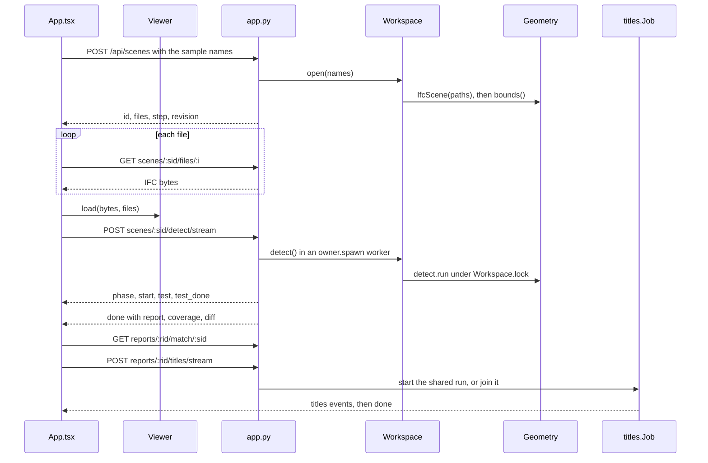

Owned by: [06](06-geometry-and-detection.md) (scene, boxes, detection), [12](12-web-app.md) (`open`, `runDetect`,
`loadReport`), [13](13-3d-viewer.md) (`Viewer.load`), [09](09-agent-workflows.md) (titles),
[19](19-demo-data.md) (Northbank).

## Pick a clash and propose fixes

Picking a row (`selectClash`) frames the pair and fetches ORCA's own measure. **Propose fixes** (`runProposal(false)`)
first takes A/B/C views of a detected clash that has none (`captureViews` → `Viewer.captureClash`, waiting at most 4 s),
then streams `propose/stream`: one proposal is charged, and a worker runs `Workspace.propose` → `agent.resolve(trials=True)`
for up to three rounds. Each round asks Muse Spark through Meta's Responses endpoint (`complete_json_reasoning`: live
`reasoning` notes), then checks each candidate under `Workspace.lock`, sending `checking`, `trial` (the candidate in
place, before its check) and `attempt`. `trackAgent` fills the activity table and feeds `Pilot`, which plays the trials
at a readable pace; the `result` (ranked verified options with `before` meshes) shows once the pilot has caught up.

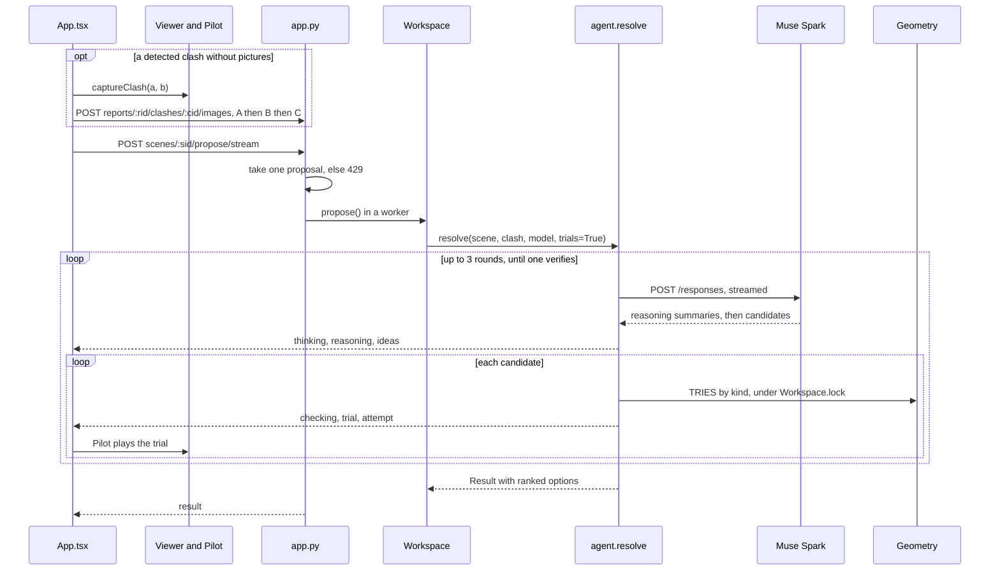

Owned by: [09](09-agent-workflows.md) (`agent.resolve`), [07](07-fixes-and-edits.md) (`agent.TRIES`, the trials),
[08](08-ai-models-prompts-and-spend.md) (Responses and reasoning), [12](12-web-app.md) (`trackAgent`, `Pilot`),
[13](13-3d-viewer.md) (captures and trial drawing), [16](16-security-caps-and-cost.md) (the cap).

## Accept a fix in place

**Accept this fix** (`accept(o)`) takes before and after pictures for the report (`captureFix`), then `api.accept` posts
to the route for its kind: `apply` (move), `offset/apply`, `trim/apply`, or `fix/apply` for every other kind, which
rebuilds the fix from its kind and parameters (`plans.apply`, `plans.KEEP`). Each route goes through `_with_patch`:
under `Workspace.lock` it notes the scene's `revision`, keeps the fix (`mark_edited`, `IfcScene.bump`) and adds
`Workspace.patch` (revisions, `history`, the changed elements' meshes, none past 500,000 vertices). `applyToViewer`
patches the viewer in place when `revision_before` is the page's `sceneRevision`, else reloads the changed and missed
files. `markFixed` then marks every report clash of the pair, and the clash is measured again.

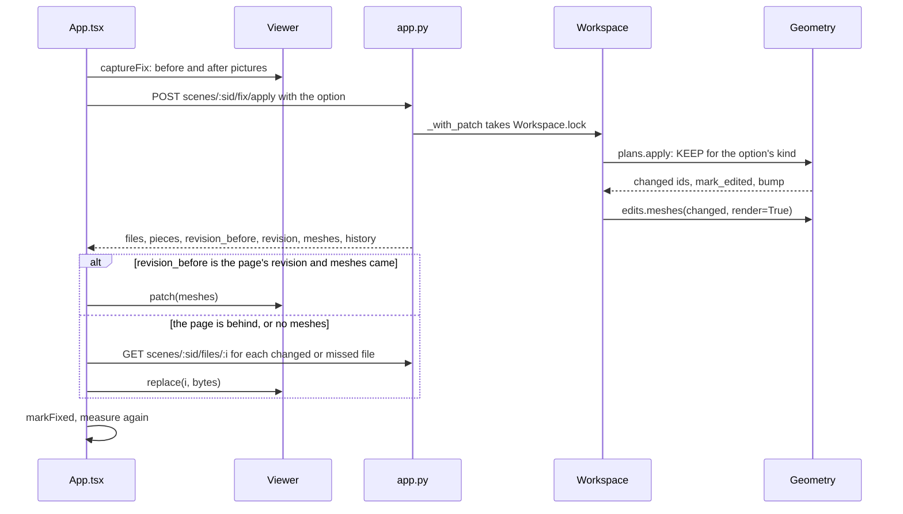

Owned by: [07](07-fixes-and-edits.md) (keeping, `plans.KEEP`, patches), [13](13-3d-viewer.md) (`Viewer.patch`),
[12](12-web-app.md) (`accept`, `applyToViewer`), [05](05-domain-model-and-state.md) (scene revisions).

## Triage the report

**Triage all** (`runTriage`) streams `triage/stream`. `_start_triage` joins the report's shared run (`_triage_key`: a
sample report's run serves every visitor; under requirements it is also keyed by prompt and rules) or starts one,
charging one proposal to whoever starts it (free when only the rules changed: it starts from the last run's readings).
The `triage.Job` worker settles sure cases by rule first (`by_rule`, the requirements' by-design rules, and one-element
pairs from `_triage_facts`), then reads each group of alike clashes with one strict-JSON call on the triage model, 8 at
a time, streaming its reasoning. `Job.follow()` replays everything so far to each subscriber, then each new event; the
page overlays what it already knows (`shownTriage`).

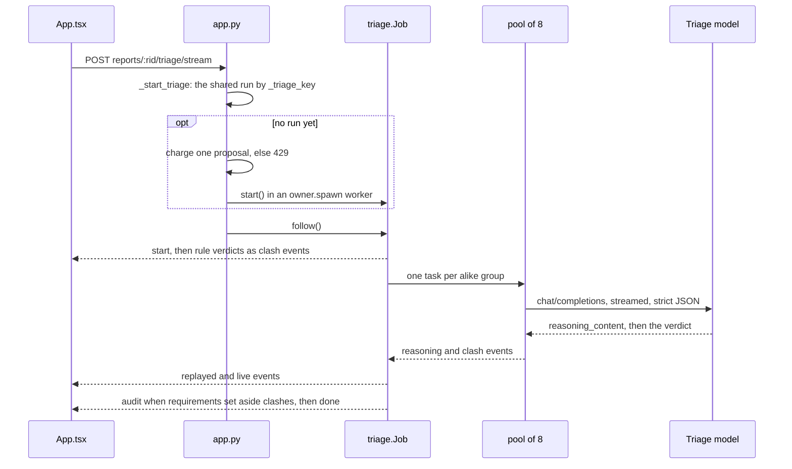

Owned by: [09](09-agent-workflows.md) (triage), [08](08-ai-models-prompts-and-spend.md) (the triage model and its host),
[15](15-requirements-settings-and-config.md) (rules and the audit), [12](12-web-app.md) (the Triage card,
`shownTriage`).

## Fix together, and root causes

**Fix together** (`runPlan({clash_ids})`) and a root cause's **Fix** in Insights (`runPlan({hub})`) stream
`plan/stream`. A batch is charged one proposal per distinct pair, all or none (`take_many`, at most `plans.MAX_ITEMS`,
8); a hub is charged one, and `plans.build_root_cause` charges the fixes only if Muse Spark's strategy needs edits.
`pairs_for` merges pairs that share an element which can move (`merge_shared`); `_resolve_items` runs `agent.resolve` per
item, 4 at a time (model calls overlap, trials take turns on the lock); `_settle` → `verify_together` checks every fix in
one trial against everything, the others included, swapping in alternatives on a collision. **Accept** posts
`plan/apply` through `_with_patch`; a plan whose scene changed since its check cannot be accepted (`planStale`).

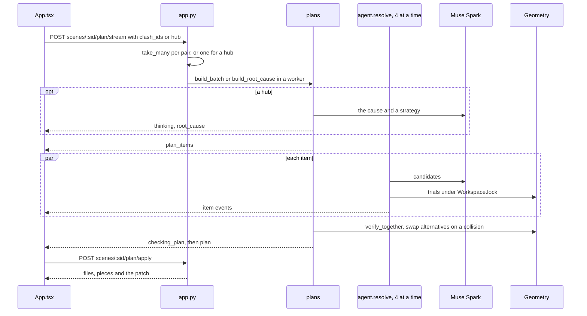

Owned by: [09](09-agent-workflows.md) (plans, root causes), [07](07-fixes-and-edits.md) (the joint check, keeping),
[16](16-security-caps-and-cost.md) (charging), [12](12-web-app.md) (the Plan tab).

## Explore a wider fix

**Explore wider fix** (`exploreContext`) streams `context/stream` for the pair (and its report clash). The route checks
the objective (`context_planner.validate_objective`), takes three proposals at once and streams through
`_RequestEvents`, so closing the tab cancels the search. `context_planner.build` copies the scene under the lock
(`IfcScene.snapshot()`) and searches that private copy with Muse Spark's tool calls, within `Limits` (6 model calls,
12 trials, 120 s by default), ending with `context_result`: up to three proposals and their review conditions.
**Accept complete proposal** posts `context/apply`; `context_planner.accept` refuses a changed scene revision (409) or
an unacknowledged condition (422), then keeps it through `_with_patch`.

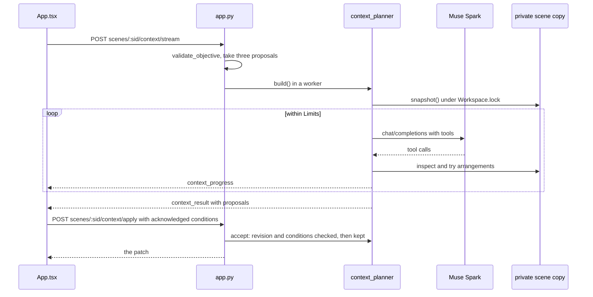

Owned by: [09](09-agent-workflows.md) (the wider search), [07](07-fixes-and-edits.md) (keeping),
[12](12-web-app.md) (the Plan tab's review).

## Chat with a tool that proposes fixes

The Chat tab (`ChatPanel`) posts `/api/chat` with the message and what is open. The route takes one chat message from
the cap, binds this request's proposal and second-try caps into closures, and streams through `_RequestEvents`. The
worker runs `Chat.turn`: up to `chat.MAX_STEPS` (8) Muse Spark calls with OpenAI `tools` (`MetaChatModel.chat`). When
Muse calls `propose_fixes`, `Chat._run` charges one proposal, emits `ui select_clash` and runs `Workspace.propose`,
wrapping each agent event as `{"type": "agent", "event": …}`; the result goes to the page as `proposal` and back to Muse
as a short summary. `onChatEvent` sends `agent` events to a `trackAgent` handler (the same pilot and activity table as
a direct proposal) and `proposal` to the options panel.

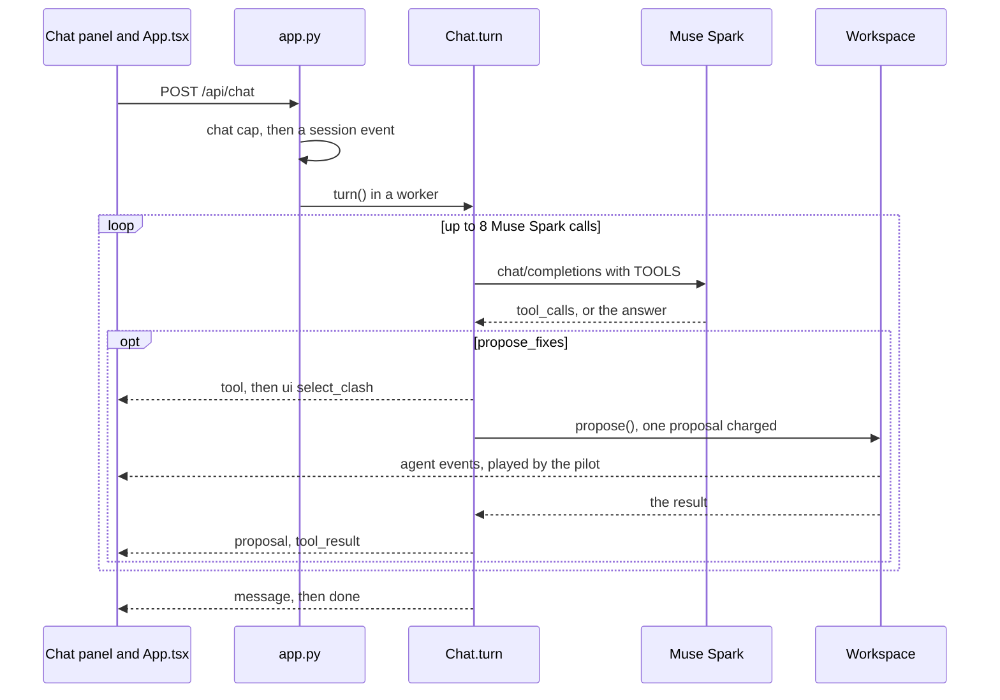

Owned by: [09](09-agent-workflows.md) (the chat's tool loop), [12](12-web-app.md) (`onChatEvent`),
[16](16-security-caps-and-cost.md) (chat and proposal caps).

## Talk to ORCA: live voice, and the upload fallback

**Hold to talk** starts `LiveVoice` (`voice.ts`): an AudioWorklet resamples the microphone to 16 kHz PCM over a
WebSocket to `/api/voice/live`. The handler closes a socket from another site before accepting it
(`voice_live.same_origin`, 1008), reads the first frame (`{mode, report_id}`), takes one voice message from the cap and
runs `voice_live.relay` on the event loop: it opens Meta's realtime socket with the key in the first frame (why the
browser cannot connect itself) and the vocabulary (`_voice_words`), paces audio to real time (`AHEAD_S`, 1.5 s) and
turns Meta's events into `ready`, `partial`, `final`, `speech`, `limit`, `error`. The final transcript is sent as a chat
message. If the socket cannot open in hold mode, `VoiceRecorder` makes a 16 kHz WAV and posts it to `/api/transcribe`.

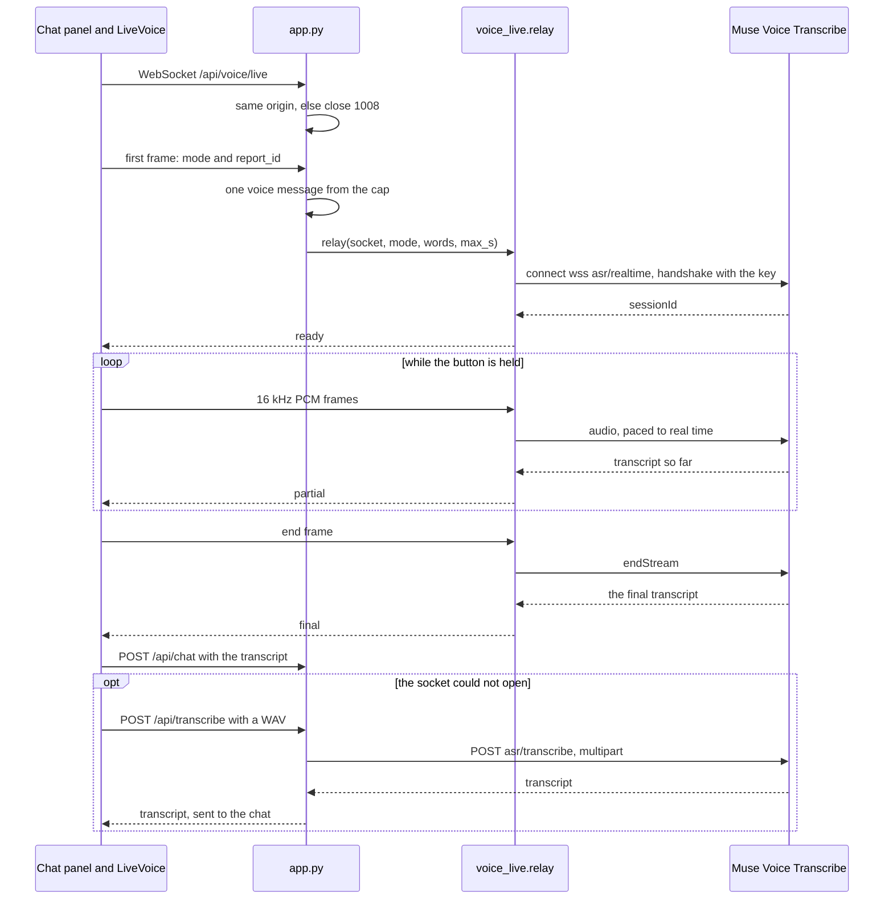

Owned by: [docs/voice.md](../voice.md) (design), [08](08-ai-models-prompts-and-spend.md) (Muse Voice Transcribe),
[12](12-web-app.md) (`voice.ts`, `Chat.tsx`), [16](16-security-caps-and-cost.md) (the voice cap, the origin check).

## Escalate to Muse Wonder

NoFix's **Ask Muse Wonder**, **Look for a better fix** under verified options, and a failed plan item's **Ask Muse
Wonder** (`escalateItem`) call `runProposal(true)`: the same `propose/stream` with `escalate: true`. Before any charge,
`_refuse_escalation` answers 409 when nothing may be edited; `escalation_refused` answers 403 when escalation is off and
429 when `spend.claim` finds the day's Muse Wonder budget spent or `take_all` refuses one escalation plus one proposal.
`Workspace.escalate` turns the claim into a hold (`spend.held`), reads the first try (`last_try`, valid only while the
scene revision and requirements are unchanged), sends `escalating`, writes `escalation.brief` under the lock, and runs
`agent.resolve` on Muse Wonder for two rounds with every kind, combined fixes included. In `auto` mode
`Workspace.propose` does this itself when a first try finds nothing.

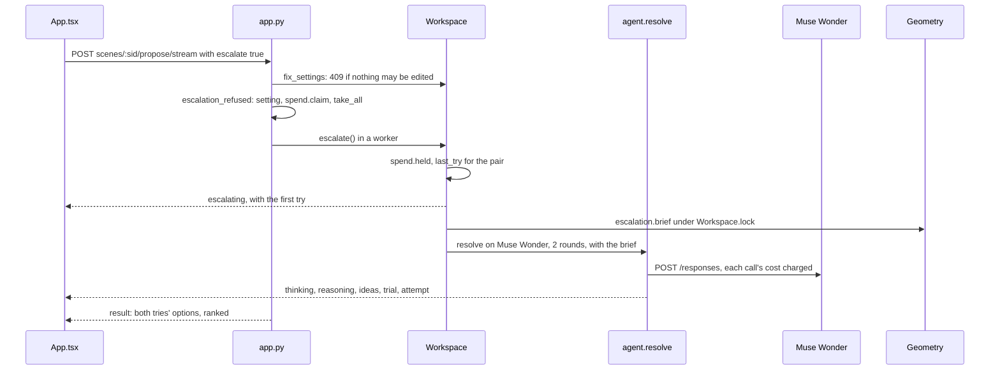

Owned by: [docs/escalation.md](../escalation.md) (design), [09](09-agent-workflows.md) (the second try),
[08](08-ai-models-prompts-and-spend.md) (Muse Wonder, `spend`), [16](16-security-caps-and-cost.md) (budget and caps).

## Show it built

With built views on (`settings.built_views()`, reported by `GET /api/models`), **Show it built** (`showBuilt`) has
`Viewer.captureBuilt` render one camera three ways (look, ids, normals; a cutaway chosen with class costs from
`classes`) and posts them to `built/stream`. The route refuses a trim or oversized passes (422), answers a cached
picture free, shares one being made (`built.running`), else claims the day's budget (`spend.claim`) and one use of the
built-views cap. `built.make` draws two restyles at once on Muse Image (`built.restyle`), runs the pixel `gate`, then has
two Muse Wonder judges (three Muse Spark judges when the budget cannot cover Wonder) read each passing picture; a second
round is told what they found. A kept picture is cached (`/api/built/<key>.jpg`); accepting a fix draws its picture in
the background for the report (`buildAccepted`).

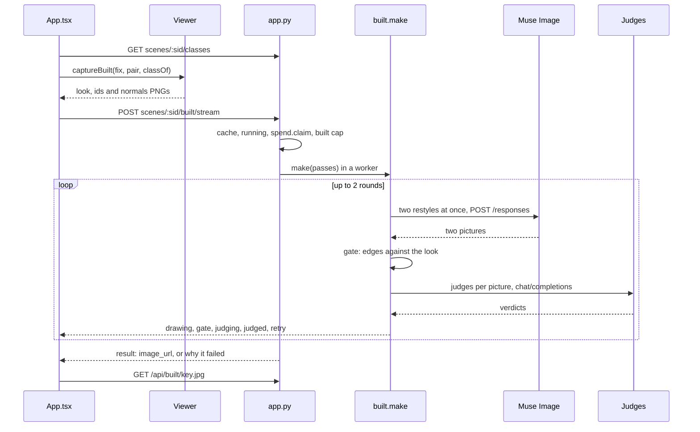

Owned by: [docs/show-it-built.md](../show-it-built.md) (design), [09](09-agent-workflows.md) (`built.make`),
[13](13-3d-viewer.md) (`captureBuilt`), [16](16-security-caps-and-cost.md) (budget and cap).

## Build the PDF report and BCF

**Report** opens `ReportDialog` (`ReportDoc.tsx`), which asks the server to guess each model's team
(`document.guess_teams`) for the person to confirm. On build the page finishes the built pictures first (`prepareReport`,
at most 10), then streams `document/stream` with the scope, teams, evidence, reviews, marks and the triage verdicts it
shows. The route needs verdicts for at least half the clashes (else 409 "Triage the report first") and charges one
proposal; `document.generate` explains each page with Muse Spark (6 at a time), writes one summary, renders a PDF per
group with WeasyPrint and the BCF 2.1 zip, then sends `ready` with `/api/documents/{doc_id}` (the last 24 are kept in
memory), which the page downloads.

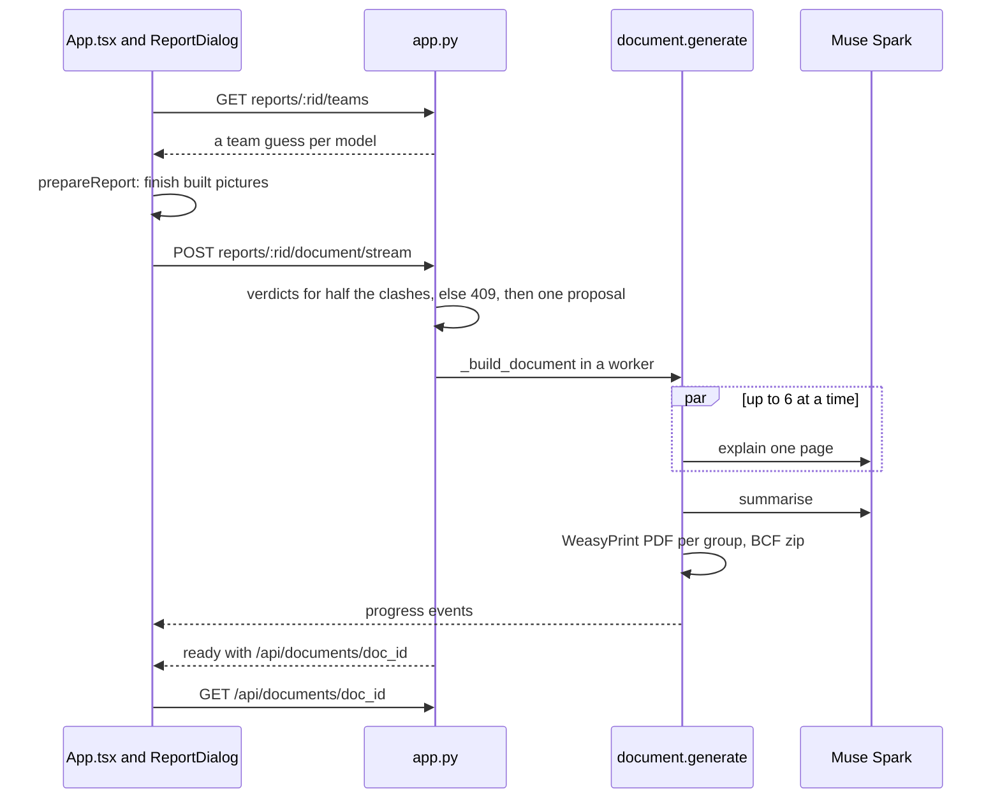

Owned by: [14](14-files-in-and-out.md) (PDF and BCF), [09](09-agent-workflows.md) (the report text),
[12](12-web-app.md) (`ReportDialog`, reviews).

## Export the edited IFC and STEP

**Export IFC** is a plain link to `GET /api/scenes/{sid}/export`. `_tidy_exports` first deletes exports older than an
hour; `Workspace.export` (under the lock) writes only the files with kept edits (`IfcScene.write_edited`:
`<name>.orca.ifc`) and, for a model opened from STEP, writes `<stem>.orca.step` from the original STEP with what changed
(`service.step_changes` → `step.export`: moved parts, rebuilt or cut parts, new pieces). One file comes back as it is,
several as one zip (`{sid}-sightline.zip`), and nothing kept yet is 409. MCP's `export_models` hands an agent this URL
(remote) or writes the files (stdio).

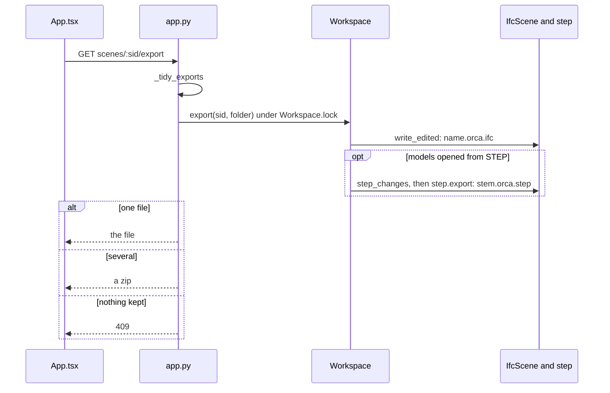

Owned by: [14](14-files-in-and-out.md) (export, STEP write-back), [05](05-domain-model-and-state.md) (what marks a
file edited).

## An MCP agent on a pairing link

**Connect an agent** (`connectAgent`) posts `/api/links`: an `orca_` token (only its sha256 is kept), charged to the
link cap, with an `mcp_url` built from the request's host. The page keeps the link's context current (`PUT .../context`)
and follows its events (`hello`, a `heartbeat` every 15 s; the server ends the stream after 240 s and the page
reconnects). The agent's `POST /mcp` passes `_McpGate` with a live token; every tool call publishes `agent_call` and
`agent_result`. `get_clash_images` on a detected clash without pictures publishes `capture_request` and waits up to
20 s for the page to save its views and answer (`Link.deliver`). `propose_fixes` runs as a job through `Chat._run`, so
the page's pilot plays it; `apply_fix` keeps the option under the lock (`plans.apply`, `Workspace.patch`) and publishes
`ui applied`, which the page's `onAgentEvent` draws with `applyToViewer`.

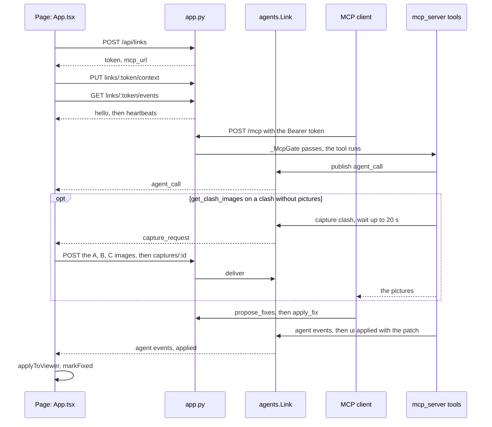

Owned by: [11](11-mcp-and-agent-links.md) (tools, links, jobs), [docs/mcp.md](../mcp.md) (design),
[12](12-web-app.md) (`onAgentEvent`), [16](16-security-caps-and-cost.md) (link and call caps).

## Resume a saved session

As it works, the page saves `{scene_id, report_id, files, fixes, link}` in `localStorage` (`sightline.session`). On
arrival it asks `GET /api/scenes/{sid}` (`Workspace.scene_info`: files, STEP names, the last detection, `revision`; 404
once the server no longer holds it, and the saved session is then forgotten), `GET /api/reports/{rid}` and, with a link,
`GET /api/links/{token}` (whose `applied` lists fixes its agent made while no page was open), and shows "Pick up where
you left off". **Resume** (`resumeSession`) calls `open(info.files, existing)`, which skips opening and downloads each
file: `GET .../files/{i}` serves the model as it is now (`Workspace.file` writes an edited one out), so kept fixes come
back. Then `loadReport`, the saved and agent-applied fixes, the detection summary and the link (its events stream starts
again). **Start fresh** revokes the saved link and forgets the session.

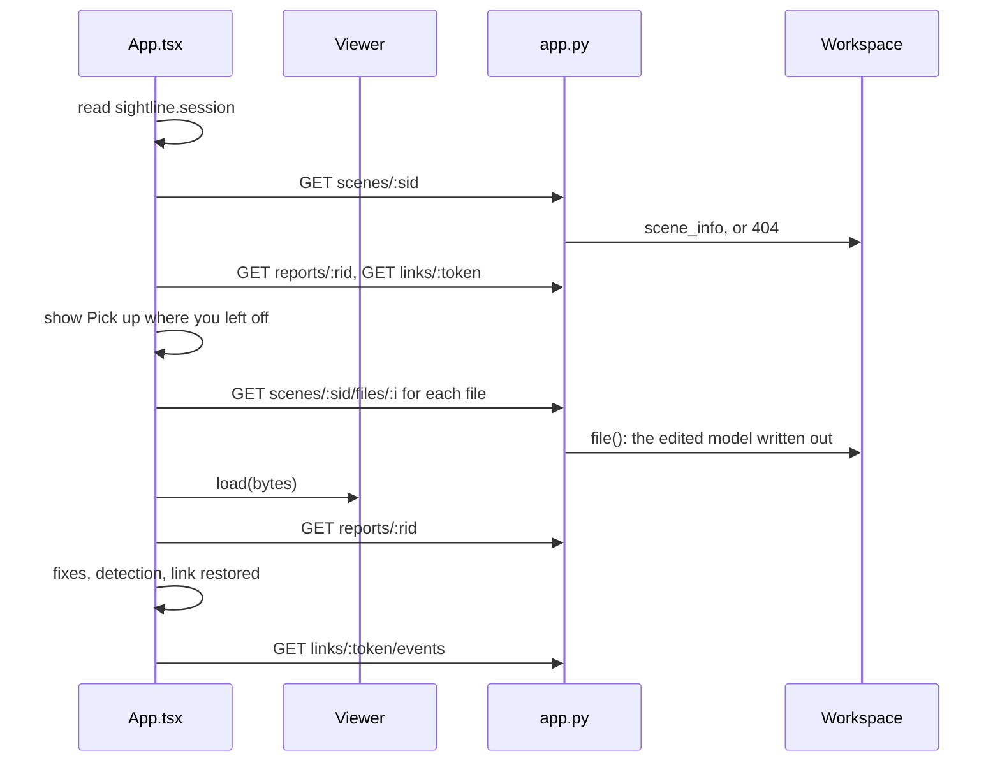

Owned by: [12](12-web-app.md) (the saved session), [05](05-domain-model-and-state.md) (what the server keeps and for
how long), [11](11-mcp-and-agent-links.md) (`Link.applied`).

## Upload your own models (big ones too)

**Use your own models** (`ProjectStart.tsx`) or **Models › Upload models** calls `openDemo(files)`. `open()` checks the
files against the server's cap (`uploadRefusal`, `model_upload_max_mb` from `GET /api/models`), and
`api.uploadModelsStream` gzips each file over 1 MB in the browser (`pack`, sent as `<name>.gz`) and sends one form by
XHR, with upload progress. `_receive_models` refuses with 411 or 413 before reading the body, with 400 or 429 once the
form is read, then unpacks each part off the event loop (`_unpack`, counting the unpacked size). A worker runs
`Workspace.open_paths`, streaming STEP conversion events, `opening`, `boxes` and a `tick` every 5 s, then `done`. The
page draws an uploaded IFC from the visitor's own file (`localFile`) and runs the check.

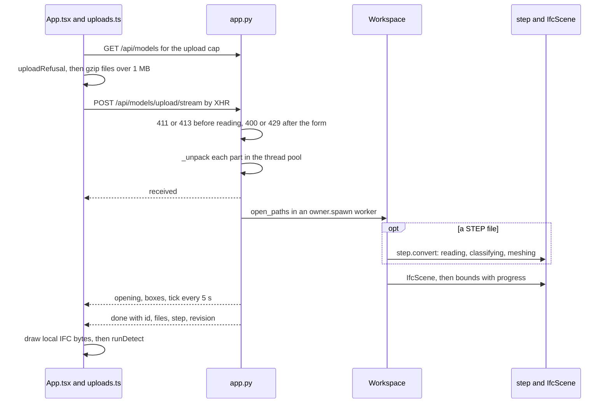

Owned by: [docs/uploads.md](../uploads.md) (design and measurements), [14](14-files-in-and-out.md) (uploads, STEP),
[06](06-geometry-and-detection.md) (boxes), [16](16-security-caps-and-cost.md) (size and upload caps).

## Use coordination requirements

**Use them and check again** in the Requirements dialog calls `applyRequirements(doc, true, true)`. An effect registers
the file (`POST /api/requirements`: `requirements.parse`, `register` by its content id `doc_id`, charged only when new)
and `setRequirements` makes `api.ts` send `X-Sightline-Requirements` with every call. `_OwnerContext` puts the file in
the request's context (`requirements.enter`), which `owner.spawn` and `owner.submit` carry into workers; then the
pending check runs and `Workspace.detect` compiles its tests from the file (`requirements.compile_tests`). Triage,
proposals (`Workspace.fix_settings`) and plans read it the same way. After a restart the id is unknown: 409
`requirements_unknown`, and `send` registers the file again and retries once.

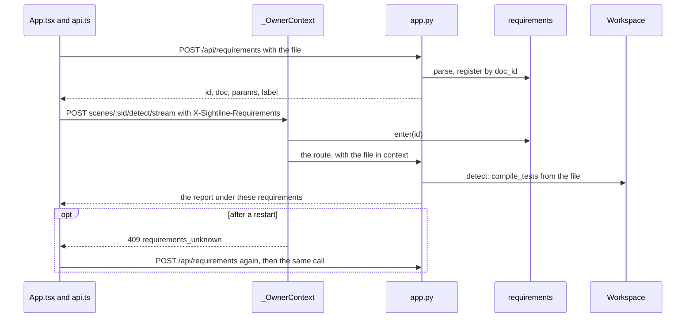

Owned by: [15](15-requirements-settings-and-config.md) (requirements), [docs/requirements.md](../requirements.md)
(design), [02](02-system-architecture.md#request-lifecycle) (the middleware).

## When to update this doc

- A user action added, removed or rerouted (a new button that calls a new route, a flow that moves from one route to
  another, a new stream for an existing action).
- A route in one of these flows renamed or its charging changed (which cap, how many, when).
- A new event type that changes what the page does in one of these flows (for example a new agent event the pilot
  plays).
- A change to how accepting a fix reaches the viewer (`_with_patch`, `Workspace.patch`, `applyToViewer`).
- A change to which model a flow calls, or to the endpoint it uses.
- A change to how the page and an MCP agent share a session (link events, captures, `applied`).
