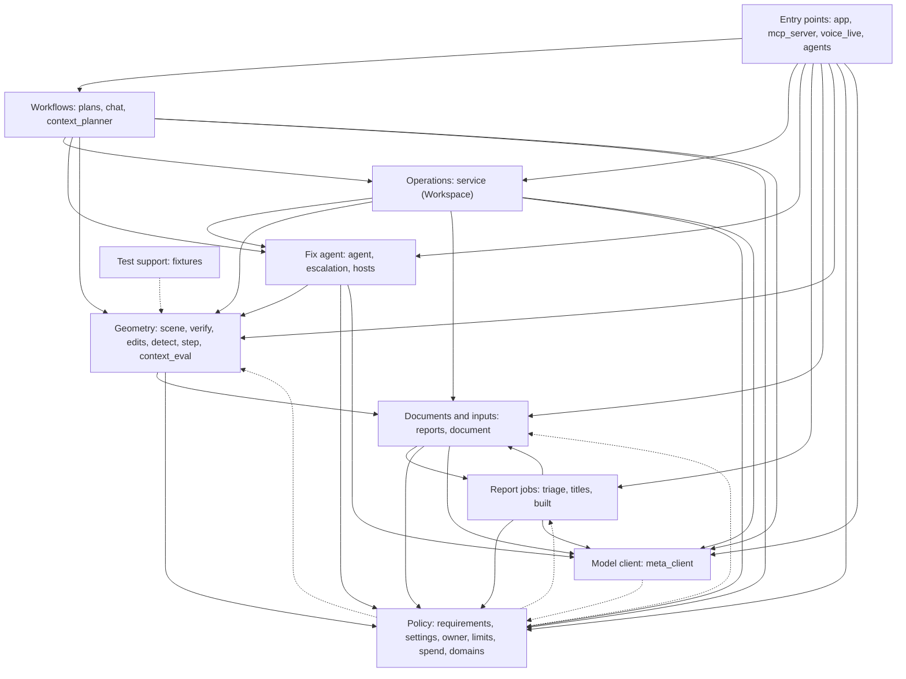
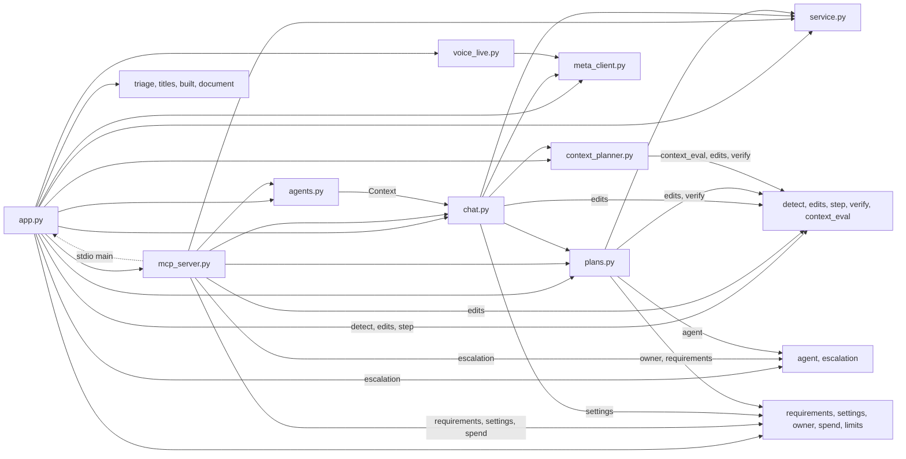
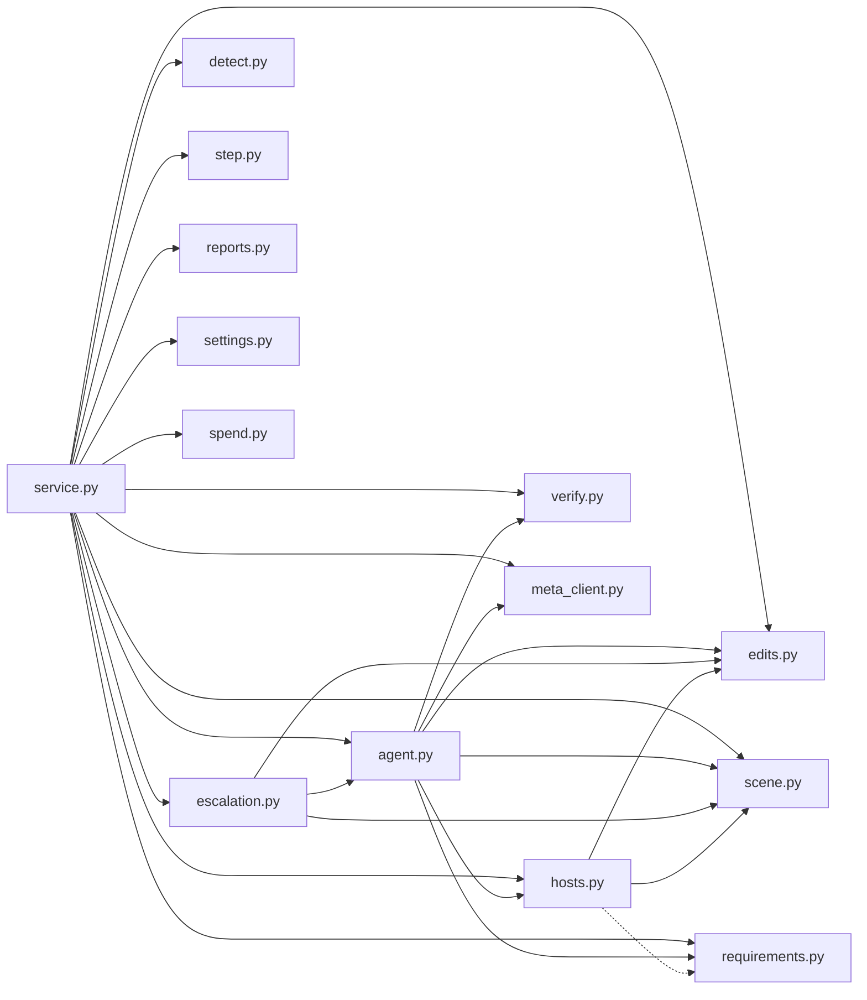
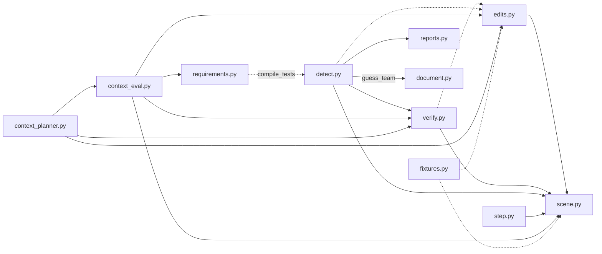
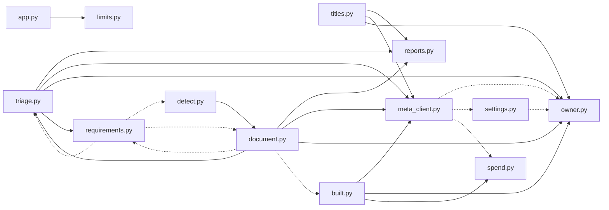

# 04 · Server code map

> **Covers:** `server/sightline/*.py` (35 modules), `server/sightline/demos/`, `server/sightline/domain_packs/`, `server/pyproject.toml`,
> `server/tests/` · **Checked against code:** 2026-10-30 (`fix/hardcoded-defaults`: `demos.py`, what stays, settings) · **Deeper design:** the feature docs linked
> from each module below ([detection](../detection.md), [edits](../edits.md), [escalation](../escalation.md),
> [mcp](../mcp.md), [requirements](../requirements.md), [show-it-built](../show-it-built.md), [step](../step.md),
> [uploads](../uploads.md), [voice](../voice.md))

The server is one Python package, `sightline` (the internal name, kept on purpose; the product is ORCA). It is a
FastAPI app and an MCP server over one shared `Workspace`, which holds the open models and clash reports in memory
and offers every operation both front doors use. Under it sit the AI workflows (the fix agent, triage, titles,
chat, plans, escalation, built views), the geometry engine on IfcOpenShell, the readers and writers for reports and
documents, and a thin client for Meta's models. This doc lists every module: what it is for, its main symbols, what
it imports from the package and who imports it, and the rules it enforces. The package's `__init__.py` does one thing:
it loads the repo's `.env` (`meta_client.load_env`) on the first import of any module, before any module reads a
setting ([15](15-requirements-settings-and-config.md)). [05](05-domain-model-and-state.md) covers
the objects these modules hold and where their state lives.

## The layers at a glance

The layers follow the real imports (computed from every `from . import` and `from .x import` at HEAD, including the
imports made inside functions, which are drawn dotted below).

| Layer | Modules | What the layer does |
|---|---|---|
| Entry points | `app.py`, `mcp_server.py`, `voice_live.py`, `agents.py` | HTTP routes and NDJSON streams, the MCP server, the live voice relay, pairing links for MCP agents |
| Workflows over the Workspace | `plans.py`, `chat.py`, `context_planner.py` | Several clashes at once, root causes and patterns; the chat's tool loop; the bounded wider-fix search |
| Operations | `service.py`, `checks.py` | `Workspace`: scenes, reports, detection (each scene's kept checks in a `checks.Register`), every check and keep of a fix, export. Shared by the API and MCP |
| Per-clash fix agent | `agent.py`, `escalation.py`, `hosts.py` | Propose → verify → retry → rank for one clash; the second try on Muse Wonder; which hosts may take an opening |
| Report jobs | `triage.py`, `titles.py`, `built.py` | Bulk verdicts, Muse titles, Show it built pictures: work over a whole report or one picture, no scene edits |
| Documents and inputs | `reports.py`, `document.py` | Navisworks XML in; PDF and BCF out |
| Geometry | `scene.py`, `verify.py`, `edits.py`, `detect.py`, `step.py`, `context_eval.py` | The federated IFC scene, the geometric check, model edits, ORCA's own detection, STEP conversion, whole-arrangement checks |
| Policy and request context | `requirements.py`, `settings.py`, `owner.py`, `limits.py`, `spend.py`, `domains.py`, `demos.py` | Coordination requirements, settings for everyone, the owner's context, demo caps, the Muse Wonder budget, a scene's domain and what stays in place by default, the demo projects |
| Model client | `meta_client.py` | Chat completions, Responses, transcription; model choice, effort, usage and price |
| Test support | `fixtures.py` | Small synthetic IFC models for tests and spikes |

Three edges go "up" and are worth knowing before you add an import:

- `detect.py` imports `document.guess_team` (to name each model's discipline), so importing detection also loads
  `document.py`, `triage.py`, `meta_client.py`, `owner.py` and `requirements.py`.
- `document.py` imports `triage.py` (verdict labels and summaries), and lazily `built.py` and `requirements.py`.
- `requirements.py` imports `detect.py`, `document.py` and `triage.py` only inside functions (`compile_tests`,
  `inventory`, `settle`), which is what keeps the package free of import cycles at load time. Keep it that way.

## Every module

| Module | Layer | What it is for |
|---|---|---|
| `agent.py` | Fix agent | The propose → verify → retry → rank loop for one clash, and the fix-kind registry (`TRIES`, `PARAMS`, `TIERS`) |
| `agents.py` | Entry points | Pairing links (`Link`, `Links`): token, context, the page's event channel, capture requests, MCP jobs |
| `app.py` | Entry points | The FastAPI app: every `/api` route and stream, the owner and requirements middleware, the caps, `/mcp`, static files |
| `built.py` | Report jobs | Show it built: outline, Muse Image restyles, pixel gate, judges, the picture cache |
| `chat.py` | Workflows | Chat with Muse Spark through tools; `Chat._run` is also the MCP server's tool layer |
| `checks.py` | Operations | Kept checks ([docs/detection.md](../detection.md), "Kept checks"): per scene a `Register` of each check's latest run (`Check`, keyed `models` or a check on filters' `filter:` id), the scene-wide clash identity (ids issued, numbers, titles, captured views in its own folder, triage readings), and the union report of every kept check's clashes (`Register.union`); no geometry, `Workspace` drives it |
| `properties.py` | Geometry | Everything the model says about one object, for the Properties panel and the filters' index (`Reader`): every attribute, its type, every property and quantity set on it or its type (`from_type`), every kind of property with its unit (lengths, areas, volumes, masses in SI), materials (layers, profiles, constituents), classifications, groups, documents, its storey, container and path up to the project; the demo models' own set shown as "Model data", the hidden note kept out by `shown` ([docs/panels.md](../panels.md)) |
| `facets.py` | Geometry | The filters' index: every value the Properties panel shows each drawn element with that a filter can match (file, class, storey, type, material, attributes, property and quantity sets, classifications, groups), value → elements, kept on the scene until an edit; `matching` and `suggest` for chat and MCP ([docs/filters.md](../filters.md)) |
| `datums.py` | Geometry | Levels, grid axes and each element's storey for the viewer's drawing views and level filter; a sample scene with no grid reads its project's `<prefix>-Grids.ifc` as context ([docs/views.md](../views.md)) |
| `connections.py` | Geometry | Joints (connected ports, STEP flow parts face to face), element classes, runs, `plan_move` (moves that keep their joints: carry fittings, stretch segments, or are refused) and the connection graph |
| `parametric.py` | Geometry | After a hand edit, inside its transaction: what the model says besides the shape follows the body (`snapshot` before, `sync` after): a layered element's layers (the layer on the pushed face, the reference line held), a profile set's section, the `Axis` (fitted to each piece of a split, given to a piece made without one), base quantities, path joins (handed to the piece that holds the end, else left open with the joints); shared sets copied for the edited element alone (`own_usage`: its own type "… (ORCA)", or its own set) ([docs/editing-parity.md](../editing-parity.md)) |
| `quantities.py` | Geometry | Base quantities worked out again from the body: only the `Qto_*BaseQuantities` already there, only what the body settles (lengths, widths, heights, volumes and the areas that follow); the rest named and left ([docs/editing-parity.md](../editing-parity.md)) |
| `consistency.py` | Geometry | Model consistency: what an edit must keep true besides the shape (material layer and profile sets, `Axis`, path joins, a type's maps, base quantities), read per element and rule (`measure`) and compared before and after an edit (`compare`): what the edit made worse blocks or warns; a model already inconsistent never blocks ([docs/editing-parity.md](../editing-parity.md)) |
| `context_eval.py` | Geometry | Whole-arrangement geometry and connection checks on a scene snapshot (wider fixes) |
| `context_planner.py` | Workflows | The bounded, revision-pinned wider-fix search, and its accept |
| `detect.py` | Geometry | ORCA's own clash detection: tests (sides by file, team, class, system, id or a filter), sort and sweep, triangle tree, exact box depth, stable ids (`_assign_ids`: a clash keeps the id first issued for its pair and kind, whatever check finds it, given what the scene `known`), rerun diff against the same check's last run |
| `demos.py` | Policy | The demo projects in one place: their sample files, start labels, tours, default requirements (`demos/*.json`), and what only the demo models need (their property set, their Navisworks smart tags) |
| `domains.py` | Policy | Which domain a scene is in (`of`: the effective requirements' `domain`, else opened wholly from STEP is `machines`), the classes that stay in place by default (`STAYS`), who reviews a seat (`SEAT_REVIEW`), voice words, and the shared prompts in that domain's voice (`prompt` fills `{role}`, `{meeting}`, `{teams}`, `{examples}`) |
| `document.py` | Documents | Coordination reports: PDF (combined, per team, per model) and BCF 2.1, team guessing, who acts and reviews |
| `edits.py` | Geometry | Model edits: offsets with bends, routes, resizes, trims, penetrations; trial and keep transactions; meshes |
| `escalation.py` | Fix agent | The brief a second try on Muse Wonder reads (first try, neighbourhood, blockers) |
| `fixtures.py` | Test support | Synthetic IFC models: clash, run, joint, context, detection, route, penetration, resize, edit and parametric fixtures |
| `faces.py` | Geometry | The faces of an element's body as a person points at them: a pick (point and normal) resolved to a cap, a rectangle's side, a round face, an I-section's flank or an outline's edge, named in words ("east end", "north face", "top"), with what each allows ([docs/manual-edits.md](../manual-edits.md)) |
| `hosts.py` | Fix agent | Which hosts may take an opening: hard rules, requirements, Muse's reading by kind, hole limits |
| `journal.py` | State | The edit log: one `Entry` per kept edit (agent fixes, plans, wider fixes, hand edits), who and which clash, the fix a hand edit follows, undo and redo over each file's transactions ([docs/manual-edits.md](../manual-edits.md)) |
| `limits.py` | Policy | `ProposeLimit`: rolling per-visitor and per-day caps; `client_id` |
| `manual.py` | Operations | Hand edits as ops (push/pull, align, move, and the rest as they are built): `resolve`, the requirements' `gate`, ORCA's rules as warnings, `check` in a trial (cleared, new, worse, nearest), `apply` checked again and kept through the edit log, the clash measured again ([docs/manual-edits.md](../manual-edits.md)) |
| `mcp_server.py` | Entry points | ORCA as an MCP server: remote at `/mcp` by link token, or local over stdio |
| `meta_client.py` | Model client | `MetaChatModel` and the model factories: Muse Spark, Muse Spark Open, Muse Wonder; transcription; prices |
| `owner.py` | Policy | The owner token, signed cookie, owner settings in context variables, `spawn` / `submit` that carry them |
| `plans.py` | Workflows | Fix together, root causes, patterns; the plan check; `KEEP` and `apply` for every kept fix |
| `reports.py` | Inputs | Navisworks XML reports: `Report`, `ReportClash`, `ReportElement`, numbering, image sets |
| `requirements.py` | Policy | The `orca-requirements/1` file: parse, ids, registry, what it compiles into, policies, prompt lines |
| `scene.py` | Geometry | `IfcScene`: the federated IFC models, element facts, cached boxes, moves, revisions, writing |
| `service.py` | Operations | `Workspace`: every operation the API and MCP share, plus `step_changes` for STEP export |
| `settings.py` | Policy | Settings for everyone (open weights, effort, escalation, built views), in a Modal Dict or a JSON file |
| `spend.py` | Policy | The day's Muse Wonder budget: charge, claim, hold, refuse |
| `step.py` | Geometry | STEP → IFC conversion (parts, classes, exact prisms, cache) and STEP export with the fixes |
| `titles.py` | Report jobs | Muse titles for every clash, in batches, as a shared job |
| `triage.py` | Report jobs | Bulk triage: rule verdicts, one model call per clash or alike group, audits, the shared `Job` |
| `verify.py` | Geometry | The geometric check, the authority for every clearance number; supports kept under a move |
| `voice_live.py` | Entry points | The live voice relay: browser PCM to Muse Voice Transcribe's realtime socket and words back |

## Entry points

### `app.py`: the web server

The FastAPI app (`app = FastAPI(title="ORCA")`) and the one `Workspace` (`ws`) everything shares. It defines every
route and stream (inventory in [10](10-http-api-and-streams.md)), mounts the MCP server at `/mcp` and serves the
built web app from `web/dist` (`SIGHTLINE_WEB_DIST`) last, so `/api` wins.

- **Main symbols:** `app`, `ws`; middleware `_OwnerContext` (owner cookie and `X-Sightline-Settings` into
  `owner.enter`; `X-Sightline-Requirements` into `requirements.enter`, or a 409 `requirements_unknown`);
  `_ndjson` and `NDJSON_HEADERS` (every stream goes out with `Content-Encoding: identity`); `_RequestEvents` (a
  bounded 64-event queue per streamed request that never makes a worker wait for a reader); the caps
  (`propose_limit`, `escalate_limit`, `chat_limit`, `built_limit`, `unlock_limit`, `title_limit`, `detect_limit`,
  `voice_limit`, `model_upload_limit`, `requirements_limit`, `preview_limit`, `link_limit`, `agent_call_limit`) and
  `_take`; the shared jobs and caches `_triage_jobs`, `_title_jobs`, `_documents`, `_previews`, `_chat` (pattern
  readings live on the Workspace: `plans.read_patterns`); `links` (`agents.Links`), `mcp_hooks`, `_McpGate`, `_mcp_transport`, `_lifespan`; folders `EXPORTS`,
  `UPLOADS`; `_receive_models` / `_unpack` (gzipped uploads).
- **Imports:** `agents.py`, `built.py`, `chat.py`, `context_planner.py`, `detect.py`, `document.py`, `domains.py`,
  `edits.py`, `escalation.py`, `limits.py`, `mcp_server.py`, `meta_client.py`, `owner.py`, `plans.py`, `requirements.py`,
  `service.py`, `settings.py`, `spend.py`, `step.py`, `titles.py`, `triage.py`, `voice_live.py`.
  **Imported by:** `mcp_server.py` (lazily, for the stdio entry point).
- **Rules:** `.env` is already loaded when it runs (the package's `__init__.py`), and its caps and sizes are read with
  `limits.env_int` / `env_float`; `ws.keep = links.kept` so live links' scenes and reports are evicted last; a kept
  fix goes through `_with_patch`, which holds `ws.lock` from the revision read to the
  patch so another tab's edit cannot land in between; blocking work runs in threads (`run_in_threadpool`,
  `owner.spawn`) so the event loop stays free.

### `mcp_server.py`: ORCA for agents

`build(ws | getter, hooks, local=)` returns an `MCPServer("orca")` with 34 tools (inventory in
[11](11-mcp-and-agent-links.md)). Most tools call `chat.Chat._run`, so chat and MCP share one tool layer; the rest
(session, pictures, jobs, `apply_fix` / `apply_plan`, triage, report, export) are MCP's own. Deeper design:
[docs/mcp.md](../mcp.md).

- **Main symbols:** `build`, `Hooks` (what the web server lends: `links`, `charge`, `escalate`, `detect`, `allow_call`,
  `start_triage`, `triage_state`, `build_document`, `spawn`), `INSTRUCTIONS`, `main` (stdio: a local link, the web
  server's `ws` and hooks with `links=None`).
- **Imports:** `agents.py`, `chat.py`, `edits.py`, `escalation.py`, `plans.py`, `requirements.py`, `service.py`,
  `settings.py`, `spend.py`; lazily `app.py` in `main`. **Imported by:** `app.py`.
- **Rules:** every tool runs inside `requirements.using(link.requirements)`, so an agent works under the page's
  requirements; expected failures become `ToolError` with the reason (bad id, refused allowance, expired link,
  `edits.Unsupported`); read-only tools carry `read_only_hint`; each call counts against the link's own cap
  (`Hooks.allow_call`); fixes and detection runs are charged to the link's creator (`Hooks.charge`, `Hooks.detect`).

### `voice_live.py`: the live voice relay

Relays the browser's 16 kHz PCM over `/api/voice/live` to Meta's realtime transcription socket, because Meta reads
the API key from the stream's first frame. Deeper design: [docs/voice.md](../voice.md).

- **Main symbols:** `relay`, `handshake` (the first frame, with the key; never logged), `url` (`META_VOICE_REALTIME_URL`,
  else derived from `META_API_BASE_URL`), `same_origin`, `MODES` (`hold` → `PUSH_TO_TALK`, `hands_free` →
  `ENDPOINTING`), `AHEAD_S`, `RATE_BYTES`, `MAX_FRAME`.
- **Imports:** `meta_client.py` (`load_env`). **Imported by:** `app.py`.
- **Rules:** another origin may not open the relay; audio is held to at most `AHEAD_S` ahead of real time.

### `agents.py`: pairing links

A link is a capability: a secret `orca_` token tied to what a visitor has open. The page follows the link's event
stream; agents present the token on `/mcp`. Deeper design: [docs/mcp.md](../mcp.md).

- **Main symbols:** `Link` (context, requirements id, proposals, applied, plans, jobs; `publish`, `subscribe`,
  `leave`, `capture`, `deliver`, `start`, `wait`, `public`), `Links` (`create`, `get(touch=)`, `revoke`, `kept`),
  `Job`, `token_from`, `TTL` (12 h), `MAX_AGE` (24 h), `MAX_LINKS` (200), `EVENTS_PER_SUBSCRIBER`, `JOBS_PER_LINK`.
- **Imports:** `chat.py` (`Context`). **Imported by:** `app.py`, `mcp_server.py`.
- **Rules:** only the token's sha256 is kept; a slow page loses old events, never the agent's time
  (`Link.publish` drops the oldest); a capture waits at most `wait_s` for a page.

## Workflows over the Workspace

### `plans.py`: several clashes at once

Fix together (`build_batch`), root causes (`root_causes`, `build_root_cause`), patterns (`patterns`,
`triage_patterns`), and the one place every kept fix goes through (`apply`). Deeper design:
[docs/edits.md](../edits.md); workflow detail in [09](09-agent-workflows.md).

- **Main symbols:** `Item`, `Plan`, `verify_together`, `pairs_for`, `merge_shared`, `failure_summary`,
  `build_batch`, `root_causes`, `build_root_cause`, `apply`, `patterns`, `triage_patterns`; registries `IN_TRIAL`,
  `EXTRA_FILES`, `KEEPS_CONTACTS`, `KEEP`; `MAX_ITEMS` (8).
- **Imports:** `agent.py`, `domains.py`, `edits.py`, `owner.py`, `requirements.py`, `service.py`, `verify.py`.
  **Imported by:** `app.py`, `chat.py`, `mcp_server.py`.
- **Rules:** item agents run four at a time (`ThreadPoolExecutor(max_workers=4)` with `owner.submit`), each with
  `lock=ws.lock`, so model calls overlap and geometry trials take turns; `verify_together` holds `ws.lock` and makes
  every fix in one `edits.trial_files`, then undoes them; `apply` refuses a kind not in `KEEP`; one failing item never
  sinks the plan.

### `chat.py`: chat through tools

Muse Spark answers a message in at most `MAX_STEPS` (8) model calls, calling tools over the `Workspace`. Two tools
(`show_clash`, `set_view`, `set_filters`, `clear_filters`) and parts of others come back as `ui` events for the page.

- **Main symbols:** `Chat` (`session`, `turn`, `_run`), `Session`, `Context`, `TOOLS` (23 functions, including
  `explore_wider_fix`, `propose_fixes`, `plan_root_cause`, `show_it_built`), `MAX_SESSIONS` (200), `MAX_HISTORY` (40).
- **Imports:** `context_planner.py`, `domains.py`, `edits.py`, `meta_client.py`, `plans.py`, `service.py`,
  `settings.py`. **Imported by:** `agents.py`, `app.py`, `mcp_server.py`.
- **Rules:** a turn works on a copy of the session's messages and publishes it only if no newer turn already did;
  cancelled turns publish nothing; tool results are text only, so pictures go back as the next user message; caps
  are passed per turn (`propose_allowed`, `propose_allowed_many`, `escalate_allowed`, `detect_allowed`), never stored
  on the shared `Chat`; a tool that does what a capped route does takes that route's cap; each turn sets the system
  message to `chat.md` in the voice of the turn's scene (`domains.of`), so a session that moves from Northbank to the
  cell changes voice with it.

### `context_planner.py`: the wider-fix search

A bounded search (`Limits`: at most 6 model calls, 12 trials, 120 s, 3 alternatives, 2.5 m radius, each settable
lower by `SIGHTLINE_CONTEXT_*`) over complete arrangements of up to three edit groups, on a private snapshot.

- **Main symbols:** `build`, `accept`, `validate_objective`, `Limits`, `Inspection`, `TOOLS`, `ContextError`,
  `WIDER_MAX_MB` (`SIGHTLINE_WIDER_FIX_MAX_MB`, 100).
- **Imports:** `context_eval.py`, `edits.py`, `limits.py`, `verify.py`. **Imported by:** `app.py`, `chat.py`.
- **Rules:** search runs on `IfcScene.snapshot()`; proposals are stored on the Workspace pinned to the scene's
  revision; `accept` holds `ws.lock`, refuses a changed revision (409) or missing acknowledgements (422), and re-runs
  `context_eval.commit_candidate` on a fresh private snapshot before swapping it in. Model output never grants
  acceptance.

## Operations

### `service.py`: the Workspace

"The operations ORCA offers, shared by the web API and the MCP server so they never drift." One class, `Workspace`,
plus the STEP export helpers.

- **Main symbols:** `Workspace` with
  - scenes: `open`, `open_paths`, `_evict`, `scene`, `scene_info`, `classes`, `describe`, `properties`, `facets`,
    `step_files`, `step_cache`,
    `list_samples`;
  - checks: `verify_move`, `check_offset`, `check_route`, `check_resize`, `check_penetration`;
  - keeps: `apply`, `apply_offset`, `apply_route`, `apply_resize`, `apply_penetration`, `apply_trim`,
    `apply_combined`, `patch`;
  - proposals: `propose`, `escalate`, `last_try`, `fix_settings`, `clash_for`, `_nearby`, `_stamp`, `_remember`;
  - reports: `open_report_sample`, `open_report_folder`, `report`, `report_summary`, `match`, `measure`,
    `save_capture`, `report_image`, `list_report_samples`;
  - detection: `detect_tests`, `detect`, `detect_all`, `_run_check`, `_register`, `_union`, `union_report`,
    `checks_info`, `remove_check`, `requirements_info`;
  - files: `file`, `export`.

  Module level: `step_changes`, `_spec`, `SAMPLES`, `MODELS`, `MODEL_SUFFIXES`, `MAX_SCENES`, `MAX_REPORTS`,
  `SCENE_BUDGET_MB`, `LAST_KEPT` (200), `SAMPLE_EXCLUDE`, `HOSTS_TIMEOUT_S`.
- **Imports:** `agent.py`, `detect.py`, `domains.py`, `edits.py`, `escalation.py`, `facets.py`, `hosts.py`, `limits.py`,
  `meta_client.py`, `reports.py`, `requirements.py`, `scene.py`, `settings.py`, `spend.py`, `step.py`, `verify.py`.
  **Imported by:** `app.py`, `chat.py`, `mcp_server.py`, `plans.py`.
- **Rules:** `Workspace.lock` (an RLock) is held by everything that touches a scene's geometry; every kept edit calls
  `IfcScene.mark_edited` and `IfcScene.bump`; trials never do; a second try's brief (`last_try`) is read only while
  the scene revision and requirements id it was made under still hold; `escalate` holds its cost estimate
  (`spend.held`) for the whole try; a sample path must resolve inside `samples/`; `propose` and `escalate` (and
  `plans.build_batch`) pass `agent.resolve` the scene's pack, `domains.of(ws, scene_id)`.

## The per-clash fix agent

### `agent.py`: propose, verify, retry, rank

"Nothing reaches the options list without passing `verify.check`." Deeper design: [docs/edits.md](../edits.md); the
loop in [09](09-agent-workflows.md); fix kinds in [07](07-fixes-and-edits.md).

- **Main symbols:** `resolve` (the loop), `Clash`, `Option`, `Attempt`, `Result`, `Refused`; the registry `TRIES`
  (`move`, `offset`, `trim`, `route`, `resize`, `penetration`, `seat`, `combined` → `_try_*`), `PARAMS`, `TIERS` and
  `tier`; `seat_of` (a seat between things that bear); `_describe` (what Muse reads) with `_run_text`, `_resize_text`,
  `_joint_text`, `_seat_text`, `_penetration_text`,
  `_nearby_text`, `_room_text`; `_feedback`, `_refused`, `_recommend`; `combined_steps`, `apply_combined`,
  `check_combined`, `step_candidate`, `COMBINED_KINDS`, `COMBINED_MAX`; `stays`, `STAYS`, `is_service`,
  `penetration_pairs`, `penetration_sides`, `may_cut`, `move_words`, `plain_needs`, `PACKS`, `to_json`.
- **Imports:** `connections.py`, `domains.py`, `edits.py`, `hosts.py`, `meta_client.py`, `requirements.py`, `scene.py`,
  `verify.py`. **Imported by:** `escalation.py`, `plans.py`, `service.py`.
- **Rules:** a kind not in `TRIES` is a failed attempt ("unknown kind"), never tried as a move; requirements refuse a
  candidate before it is tried (`_refused`); each trial and each description runs under the caller's `lock`; every
  trial is undone; a round with a plain geometry fix (tier below 1) ends the search; options rank by tier, then
  comfortable clearance, then smallest change.

### `escalation.py`: the second try's brief

What Muse Wonder reads beyond `agent._describe`; `Workspace.escalate` runs the try. Deeper design:
[docs/escalation.md](../escalation.md).

- **Main symbols:** `brief`, `zone`, `neighbourhood`, `first_try`, `blockers`, `PACK` (`domain_packs/escalation.md`),
  `NEAR_M` (5 m), `NEAR_MAX` (80), `BLOCKERS` (3), `MAX_CHARS`, `ESTIMATE_USD` (1.0, held while a try runs).
- **Imports:** `agent.py`, `edits.py`, `scene.py`. **Imported by:** `app.py`, `mcp_server.py`, `service.py`.

### `hosts.py`: which hosts take an opening

Three layers, strictest first: hard rules (`hard_rule`, including a transfer element found by `stands_on`), the
requirements' `penetrations` rules, Muse's reading of each kind of host (`read`, cached by kind), then the default
(walls and slabs only). Deeper design: [docs/edits.md](../edits.md) "Which hosts".

- **Main symbols:** `Reading`, `hard_rule`, `stands_on`, `profile`, `read`, `cached`, `default`, `decide`,
  `check_hole`, `reading_text`, `as_dict`, `clear_cache`, `VERDICTS`, `REVIEWERS`, `STANDARD`, `LIMITS`, `SCHEMA`.
- **Imports:** `edits.py`, `scene.py`; lazily `requirements.py`. **Imported by:** `agent.py`, `service.py`.
- **Rules:** Muse reads only standard `Pset_*Common` facts, never a project's own property sets; the model is passed in
  (the triage model, via `Workspace.hosts_model`), so this module makes no model choice itself.

## Geometry

Detail on all of these: [06](06-geometry-and-detection.md) (scene, check, detection) and
[07](07-fixes-and-edits.md) (edits).

### `scene.py`: the federated scene

Elements are addressed by IFC GlobalId everywhere, never by express id. From the package it imports only `limits.py`
(`env_int`) and `domains.py` (the default classes that stay).

- **Main symbols:** `IfcScene` (`bounds`, `refresh_bounds`, `translate`, `placement`, `element`, `entity`,
  `index_of`, `products`, `near`, `connected_run`, `step_run`, `step_group`, `mark_edited`, `bump`, `snapshot`,
  `write_edited`, `domain`, `stays` and `stays_rule`: what stays in place, as the requirements say), `Element`
  (`fixed` = `stays`), `NOT_PHYSICAL`, `not_physical`, `is_provision`, `meshes_only`,
  `opacity`, `step_source`, `STEP_PSET` (`ORCA_STEP`; `STEP_PSETS` also reads `Sightline_STEP`), `FITTINGS`,
  `MESH_KERNEL`, `BIG_MODEL_BYTES` (`SIGHTLINE_BIG_MODEL_MB`), `BOUNDS_BATCH`, `THREADS`.
- **Imported by:** `agent.py`, `context_eval.py`, `detect.py`, `edits.py`, `escalation.py`, `fixtures.py`,
  `hosts.py`, `service.py`, `step.py`, `verify.py`.
- **Rules:** placements and moves are metres whatever the file's unit (`unit_scales`); `translate` does not mark a
  file edited (trials move and move back); boxes are measured once and shifted by moves.

### `verify.py`: the check

"The authority for every clearance number ORCA shows." The page never shows its own geometry numbers.

- **Main symbols:** `check` (intersection, then collision without touching, then clearance, on the neighbourhood
  within `SEARCH_M` of the boxes), `Hit`, `Verdict`, `supports`, `keep_supports`, `Support`, `stands_on`, `is_run`,
  `SEARCH_M` (0.5 m), `EMBED_M` (0.3 m), `RUNS`.
- **Imports:** `scene.py`; lazily `edits.py`. **Imported by:** `agent.py`, `context_eval.py`,
  `context_planner.py`, `detect.py`, `plans.py`, `service.py`.
- **Rules:** never runs a clash query on an empty set (IfcOpenShell crashes); port-connected neighbours are ignored
  unless `exclude_connected=False`; a moved element keeps what it stands on, and a lift off it fails.

### `edits.py`: model edits

Offsets with bends, routes, resizes, trims and penetrations as real IFC changes, plus the transactions that try and
keep them. Deeper design: [docs/edits.md](../edits.md).

- **Main symbols:** `Unsupported`; results `Run`, `Offset`, `Route`, `Resize`, `Trim`, `Penetration`; `run_of`,
  `apply_offset`, `bend_radius`, `apply_route`, `run_frame`, `route_steps`, `is_gravity`, `resize_size`,
  `apply_resize`, `face_move`, `butt_trim`, `apply_trim`, `member_axis`, `penetration`, `apply_penetration`,
  `stretch` / `Stretched` (a segment's cap or rectangular side moved, ports with it: connected moves), `seat` /
  `Seat` / `seat_summary` / `apply_seat` (an element cut to bear on its support: a recess shaped by the support's top,
  `_top_outline`, `_footprint_profile`; `SEAT_ABOVE_M`, `SEAT_BELOW_M`, `SEAT_MAX_SHARE`, `SEAT_PSET`),
  `provision_for`, `not_penetrable`; transactions `trial`, `trial_files`, `kept_files`; `meshes` (with `render=True`
  for accept in place), `openings`, `passages`, `free_bands`, `_build_chain`, `_frames`; constants `PENETRABLE`,
  `SLENDER`, `ROUTE_STEPS`, `RESIZABLE`, `PFV_COLOUR`, `PFV_ALPHA`.
- **Imports:** `scene.py`. **Imported by:** `agent.py`, `app.py`, `chat.py`, `context_eval.py`,
  `context_planner.py`, `detect.py`, `escalation.py`, `fixtures.py`, `hosts.py`, `mcp_server.py`, `plans.py`,
  `service.py`, `verify.py`.
- **Rules:** a shape that cannot take an edit raises `Unsupported` with the reason; the original keeps its GlobalId on
  the first piece; `trial` and `trial_files` always undo (cached boxes included); `kept_files` keeps all or nothing;
  never nest one transaction inside another on the same file.

### `connections.py`: joints

What is joined to what, so a fix that moves something never leaves a joint apart. Deeper design:
[docs/connections.md](../connections.md).

- **Main symbols:** `Joint`, `joints_of` (ports read live; for STEP parts, flow parts of one group meeting face to
  face, `_geometry_joints`, triangles cached per part), `classify` (straight / rigid / stays), `run` (straight segments
  joined cap to cap, the element first), `plan_move` → `MovePlan` (`moved`, `carried`, `stretched`, `refused`,
  `refused_at`, `key`, `edit`), `summary`, `apply_move`, `check_joints`, `baseline` / `check_applied`, `trial_move`
  (`MoveTrial`), `describe` (Muse's text), `graph` / `links_of` (every link by kind for the viewer and the properties
  card, cached on the scene), `move_words`, `mode` (`SIGHTLINE_CONNECTED_MOVES`), `CARRY_MAX`,
  `PARALLEL_M`, `COVER`, `TOUCH_M`, `FACING`, `INLINE`.
- **Imports:** `edits.py`, `scene.py`. **Imported by:** `agent.py`, `plans.py`, `service.py`.
- **Rules:** every path that moves something plans first (`agent._try_move`, combined steps, `plans` joint hits,
  `Workspace.verify_move` / `apply`); `scene.connected_run` stays as it was, because the wider-fix planner uses it.

### `detect.py`: ORCA's own detection

Finds the clashes in the open models and returns them as a `reports.Report` (origin `"sightline"`) that the rest of
ORCA reads unchanged. Deeper design: [docs/detection.md](../detection.md).

- **Main symbols:** `run`, `Run`, `Test`, `Selection` (`from_dict`, `describe`, `filter`), `check_id`, `check_name`, `Coverage`, `default_tests`, `presets`, `measure_pair`,
  `clash_id`, `_Index`, `_Solids`, `_candidates`, `_measure`, `_diff`, `RULES`, `RULE_LABEL`, `TOLERANCE_M`,
  `DUPLICATE_M`, `FAR_M`, `CAP`.
- **Imports:** `facets.py` (filter sides), `limits.py`, `reports.py`, `requirements.py` (teams per file), `scene.py`,
  `verify.py`; lazily `edits.py`.
  **Imported by:** `app.py`, `requirements.py` (lazily), `service.py`.

### `step.py`: STEP models

STEP → IFC on open (cached by file hash) and the fixes written back to STEP on export. Deeper design:
[docs/step.md](../step.md).

- **Main symbols:** `convert`, `export`, `parts`, `classify`, `write_ifc`, `file_hash`, `mesh`, `_prism`, `Part`,
  `StepError`, `SUFFIXES`, `CLASSES`, `MAX_PARTS` (`SIGHTLINE_STEP_MAX_PARTS`), `MAX_TRIANGLES`
  (`SIGHTLINE_STEP_MAX_TRIANGLES`), `NAMESPACE`.
- **Imports:** `limits.py` (`env_int`), `scene.py` (`STEP_PSET`); `cadquery-ocp` (OCP) inside functions.
  **Imported by:** `app.py`, `service.py`.
- **Rules:** GlobalIds come from the file hash and the part's label path, so a file converts to the same ids every
  time; only a classified conversion is cached; shapes are placed with `BRepBuilderAPI_Transform`, never `.Moved()`.

### `context_eval.py`: whole-arrangement checks

Geometry and connection checks over a complete arrangement of edits on a snapshot, for wider fixes. "Passing means
the model constraints checked here passed; engineering adequacy is review-only."

- **Main symbols:** `evaluate_candidate`, `commit_candidate` (bumps the private scene's revision),
  `element_constraints`, `check_offset_profile`, `TOL`, `CLEARANCE`.
- **Imports:** `edits.py`, `requirements.py`, `scene.py`, `verify.py`. **Imported by:** `context_planner.py`.
- **Rules:** the Workspace lock must surround snapshot and commit against a live scene (the caller holds it).

## Report jobs, documents and policy

### `triage.py`: bulk triage

A verdict on every clash: sure cases by rule (non-physical side, a touch within 1 mm, one element on both sides),
the rest one strict-JSON call per clash or per group of alike clashes, many at a time.

- **Main symbols:** `Job` (`start`, `learn`, `follow`, `state`, `_audit`), `triage_report`, `triage_one`, `by_rule`,
  `same_element`, `not_a_clash`, `alike_groups`, `audit_rules`, `summary`, `describe`, `SCHEMA`, `AUDIT`,
  `NON_PHYSICAL`, `TOUCH_M`, `ALIKE_MIN`, `REASONING_KEPT`, `REASONING_EVERY_S`.
- **Imports:** `domains.py`, `meta_client.py`, `owner.py`, `reports.py`, `requirements.py`. **Imported by:**
  `app.py`, `document.py`, `requirements.py` (lazily). `Job`, `triage_report` and `triage_one` take the scene's
  `domain` (from `app._start_triage`), which picks the voice of `triage.md`.
- **Rules:** the job's worker starts with `owner.spawn` and model calls go through `owner.submit`, so the starter's
  settings (effort, open weights) reach them; a call is tried up to three times, then the verdict is `"unknown"`
  with the error.

### `titles.py`: Muse titles

Writes a short title per clash from text facts, `BATCH` (40) clashes per call, `WORKERS` (8) calls at a time. A title
is wording, never evidence.

- **Main symbols:** `Job` (`start`, `follow`), `title_report`, `title_batch`, `facts`, `SCHEMA`, `PROMPT`,
  `MAX_CHARS`.
- **Imports:** `meta_client.py`, `owner.py`, `reports.py`. **Imported by:** `app.py`.

### `built.py`: Show it built

Muse Image restyles ORCA's own view of a verified fix; the picture is checked (pixel gate, then judges) before anyone
sees it. Deeper design: [docs/show-it-built.md](../show-it-built.md).

- **Main symbols:** `passes`, `Passes` (`key`), `make` (once per key at a time), `_make`, `cached`, `path_of`,
  `running`, `gate`, `restyle` (Muse Image over `/v1/responses`), `judge`, `judge_model`, `spark_judge_model`,
  `model_lines`, `ids_picture`, `Refused`, `CACHE` (`SIGHTLINE_BUILT_CACHE`), `PROMPT_VERSION`, `ESTIMATE_USD`
  (0.62), `PICTURES_USD`, `IMAGE_USD`, `F_MIN`, `TILE_MAX`.
- **Imports:** `meta_client.py`, `owner.py`, `spend.py`. **Imported by:** `app.py`, `document.py` (lazily).
- **Rules:** judges use role `"judge"`, whose effort no setting moves (`meta_client.FIXED_EFFORT`); every picture and
  Wonder token is charged to `spend`; cache files are written whole (`_write`), the JSON last.

### `reports.py`: Navisworks clash reports

Reads Navisworks XML (grouped smart tags from the three-view export, or the standard flat tags) into the objects
every other module reads; detection builds the same objects. Imports nothing from the package.

- **Main symbols:** `Report` (`clash` by id or "#N"), `ReportClash` (`label`), `ReportElement`, `plain_name`,
  `read_xml`, `load`, `THREE_VIEW`, `SPATIAL`, `GUID`.
- **Imported by:** `detect.py`, `document.py`, `service.py`, `titles.py`, `triage.py`.
- **Rules:** XML goes through `defusedxml`; image links must resolve inside the report's folder; the same result
  exported twice is kept once.

### `document.py`: PDF and BCF

Coordination reports from a clash report, its triage and the page's evidence (pictures, fixes, reviews), as PDF
(WeasyPrint) and BCF 2.1. Details in [14](14-files-in-and-out.md).

- **Main symbols:** `generate`, `build_rows`, `Row`, `teams_for`, `guess_team`, `guess_teams`, `model_files`,
  `explain`, `summarise`, `render_html`, `requirements_html`, `to_pdf`, `bcf_zip`, `STAYS_FIRST`, `LOCKUP`,
  `VERDICT_LABEL`.
- **Imports:** `domains.py`, `meta_client.py`, `owner.py`, `reports.py`, `triage.py`; lazily `built.py`,
  `requirements.py`. `generate`, `explain` and `summarise` take the scene's `domain` (from `app._build_document`).
  **Imported by:** `app.py`, `detect.py` (`guess_team`), `requirements.py` (lazily, `guess_team`, `_class_team`).

### `requirements.py`: coordination requirements

The optional `orca-requirements/1` file and everything it compiles into (detection tests, triage rules and prompt
lines, fix policies). Deeper design: [docs/requirements.md](../requirements.md); the format and settings in
[15](15-requirements-settings-and-config.md).

- **Main symbols:** `Doc`, `Group`, `Check`, `Mover`, `ByDesign`, `PenRule`, `Params`, `Policy`, `PenAnswer`,
  `Matcher`; `parse`, `canonical`, `doc_id`, `model_key`, `rules_key`, `resolve`, `scale`, `label`; the registry and
  context `register`, `lookup`, `enter`, `leave`, `current`, `current_id`, `using`; `inventory`, `default_groups`,
  `default_doc`, `suggest`; `domain_of`, `stays_classes`, `stays_rule`, `DEFAULT_CLEARANCE_MM` / `_M`; `compile_tests`,
  `policy`, `fix_clearance`, `blocked`, `change_size`, `SIZED`,
  `penetration_rule`, `can_cut`, `meets`, `settle`, `overlay`, `prompt_text`, `RECOMMEND`; tables `LEVELS`,
  `STRICTNESS`; `FORMAT`, `HEADER`, `MAX_BYTES`, `REGISTRY_MAX` (500).
- **Imports:** `domains.py` at load; lazily `detect.py`, `document.py`, `triage.py`. **Imported by:** `agent.py`,
  `demos.py` (lazily), `detect.py`, `edits.py`, `escalation.py`, `verify.py`,
  `app.py`, `context_eval.py`, `document.py`, `hosts.py`, `mcp_server.py`, `plans.py`, `service.py`, `triage.py`.
- **Rules:** no requirements (no header) is today's behaviour exactly; ids are content-addressed; level and
  strictness only turn into numbers through `LEVELS` and `STRICTNESS`; the request's file lives in a context variable
  that `owner.spawn` and `owner.submit` carry into workers.

### `settings.py`: settings for everyone

`open_weights`, `effort`, `triage_effort`, `escalation`, `escalation_effort`, `built_views`; `None` means the
environment's default. Imports nothing at load; lazily `owner.py`.

- **Main symbols:** `Settings`, `current`, `update`, `defaults`, `effort_for`, `built_views`, `escalation`,
  `open_weights`, `reset_cache`, `EFFORTS`, `ESCALATION`, `DICT_NAME` (`sightline-settings`), `KEY`.
- **Imported by:** `app.py`, `chat.py`, `mcp_server.py`, `meta_client.py` (lazily), `service.py`.
- **Rules:** precedence is the owner's own choice, then everyone's, then the environment; a store that cannot be read
  or written is logged and the value in memory is used, never a failed request.

### `domains.py`: whose voice the prompts take

ORCA works on buildings and on machine cells. A scene whose every model was opened from STEP (`Workspace.sources`) is
`machines`; IFC, a mix of IFC and STEP, or no scene is `construction`. Deeper detail: the prompts in
[08](08-ai-models-prompts-and-spend.md#how-the-domain-is-chosen).

- **Main symbols:** `of(ws, scene_id)` (the effective requirements' domain, else `infer`), `infer`, `fill`,
  `prompt(name, domain, **fields)`, `ROLES`, `MEETINGS`, `EXAMPLES`, `STAYS`, `VOICE`, `NAMES`, `DOMAINS`,
  `CONSTRUCTION`, `MACHINES`, `PACKS`.
- **Imports:** nothing from the package. **Imported by:** `app.py`, `chat.py`, `context_planner.py`, `document.py`,
  `plans.py`, `requirements.py`, `scene.py`, `service.py`, `titles.py`, `triage.py`.
- **Rules:** one helper decides the domain; callers never test for STEP themselves. `fill` is plain replacement (the
  prompts' JSON keeps its braces); an empty field drops its " ({name})" (`tests/test_domains.py`).

### `demos.py`: the demo projects

Everything that knows a demo by name, so the rest of the server does not (the tour, the landing and the evals name
them too). Deeper detail: [19](19-demo-data.md).

- **Main symbols:** `Demo`, `DEMOS` (Northbank, the PC-03 cell), `find(files)`, `listing(samples)` (for
  `GET /api/samples`), `requirements_for(files)` (a demo's own `demos/<name>.json`), `PSET_NAMES`,
  `HIDDEN_PROPERTIES`, `SMART_TAG_SET`, `HERE`.
- **Imports:** nothing at load; lazily `requirements.py`. **Imported by:** `app.py`, `properties.py`, `reports.py`,
  `service.py`.
- **Rules:** a demo's requirements decide only its domain and what stays while the user's are off
  (`Workspace.requirements_for`).

### `owner.py`: the owner

The owner token (`SIGHTLINE_OWNER_TOKEN`, at least 24 characters), the signed `sightline_owner` cookie, and the
owner's settings from `X-Sightline-Settings` in context variables. Imports nothing from the package.

- **Main symbols:** `available`, `check_token`, `cookie_value`, `cookie_ok`, `settings`, `enter`, `leave`,
  `is_owner`, `no_caps`, `effort`, `open_weights`, `escalation`, `built_views`, `spawn`, `submit`, `COOKIE`,
  `HEADER`, `DAYS` (30).
- **Imported by:** `app.py`, `built.py`, `document.py`, `meta_client.py` (lazily), `plans.py`, `settings.py`
  (lazily), `titles.py`, `triage.py`.
- **Rules:** the header is read only when the cookie checks out; work that leaves the request's thread must use
  `spawn` or `submit` or it loses the owner's settings (and the requirements).

### `limits.py`: demo caps

Rolling caps per visitor per hour and for everyone per day, in memory, and how every number setting is read.
Imports nothing from the package.

- **Main symbols:** `ProposeLimit` (`from_env`, `escalate_from_env`, `chat_from_env`, `take`, `take_many`,
  `take_all`, `refusal`), `client_id` (the peer, or with `SIGHTLINE_TRUST_FORWARDED=N` the N-th `X-Forwarded-For`
  entry from the right), `trusted_hops`, `env_int`, `env_float`.
- **Imported by:** `app.py`, `context_planner.py`, `scene.py`, `service.py`, `step.py`.
- **Rules:** `take_many` and `take_all` count all or nothing; correct only with one server process (the Modal app
  runs one container); a number setting is read with `env_int` / `env_float`, so unset or empty is its default and
  anything else that is not a number raises. Every cap and its meaning: [16](16-security-caps-and-cost.md).

### `spend.py`: the Muse Wonder budget

Today's spend (UTC day) against `SIGHTLINE_WONDER_MAX_USD_DAY` (default 25; 0 means no limit). Imports nothing from
the package.

- **Main symbols:** `charge`, `spent`, `claim`, `unclaim`, `held`, `refused`, `limit`, `reset`.
- **Imported by:** `app.py`, `built.py`, `mcp_server.py`, `meta_client.py` (lazily), `service.py`.
- **Rules:** a request `claim`s its estimate when let through (checked and held in one lock), and its work takes the
  claim over with `held`; the owner is exempt from the limit but still counted.

## Model client

### `meta_client.py`: Meta's models

An OpenAI-style client for Meta's API, the open-weights host, and transcription. Imports nothing at load; lazily
`owner.py`, `settings.py`, `spend.py`. Model plumbing in [08](08-ai-models-prompts-and-spend.md).

- **Main symbols:** `MetaChatModel` (`complete_json`, `complete_json_streamed`, `complete_json_reasoning`, `chat`,
  `effort`, `usage`, `on_cost`, `role`, `strict`, `streams_reasoning`: `META_STREAMS_REASONING`), `ChatModel` and
  `ToolModel` (protocols tests script), `Usage`, `cost`, `prices`, `PRICES` (+ `SIGHTLINE_MODEL_PRICES`), `LABELS`
  (+ `SIGHTLINE_MODEL_LABELS`), `model_label` (longest prefix), `labels` (each role's name for the page),
  `model_id(role)`, `DEFAULT_MODELS`, `FIXED_EFFORT`, `image_part`, `load_env`,
  `transcribe`, `triage_model`, `triage_model_info`, `escalation_model`, `escalation_info`.
- **Imported by:** the package's `__init__.py` (`load_env`), `agent.py`, `app.py`, `built.py`, `chat.py`,
  `document.py`, `service.py`, `titles.py`, `triage.py`, `voice_live.py`.
- **Rules:** effort is the owner's, else everyone's, else the model's own, except for fixed roles; a host that
  refuses `json_schema` drops to JSON mode (`strict`); every priced call is charged through `on_cost`.

## Test support

### `fixtures.py`: synthetic models

Small IFC models built in code, so tests and spikes run anywhere in seconds without the demo data. Imports
`scene.py` and `edits.py` inside functions only; nothing in the package imports it (the tests do).

- **Main symbols:** `build_clash_fixture`, `build_run_fixture`, `build_joint_fixture`, `build_context_fixture`,
  `build_detection_fixtures`, `build_route_fixture`, `build_penetration_fixture` (IFC4 or IFC2X3),
  `build_resize_fixture`, `build_joints_fixture`, `build_seat_fixture`.

## Prompts, package and tests

**`server/sightline/domain_packs/`** holds the 14 prompts the modules send. They are read from disk when used, not
at import (the chat reads `chat.md` on each turn): `construction.md` and `machines.md` (`agent.py`, the pack
`domains.of` picks), `escalation.md`
(`escalation.py`, added by `Workspace.escalate`), `chat.md` (`chat.py`), `context.md` (`context_planner.py`),
`triage.md` (`triage.py`), `titles.md` (`titles.py`), `root_cause.md` and `patterns.md` (`plans.py`),
`penetrations.md` (`hosts.py`), `report.md` and `report_summary.md` (`document.py`), `requirements.md`
(`requirements.py`), `step_classes.md` (`step.py`). The six shared ones (chat, triage, report, report summary,
patterns, root cause) carry a `{role}` placeholder that `domains.prompt` fills. `triage.py` also keeps its rule-audit prompt inline (`AUDIT`),
and `built.py` its restyle and judge prompts (`PROMPT`, `JUDGE_SYSTEM`). The inventory, with what each prompt asks
for, is in [08](08-ai-models-prompts-and-spend.md).

**`server/pyproject.toml`** names the project `sightline-server` (0.1.0, Python 3.13 or later). Runtime dependencies:
`cadquery-ocp` (pinned 8.0.1.1.0), `defusedxml`, `fastapi`, `httpx`, `ifcopenshell` (0.9 or later), `mcp`,
`numpy`, `pydantic`, `python-multipart`, `uvicorn[standard]` (which brings `websockets`, used by `voice_live.py`),
`weasyprint` (which brings Pillow, used by `built.py`); dev: `pytest`. `modal` is imported only on Modal
(`settings._modal_dict`). There are no console scripts: the server runs as `uv run uvicorn sightline.app:app` and the
local MCP server as `python -m sightline.mcp_server`. Pytest runs from `server/` with `pythonpath = ["."]` and
`testpaths = ["tests"]`.

**`server/tests/`** has 38 test files plus `conftest.py`, which gives every test its own settings store (so no test
reads the developer's `server/.sightline-settings.json` or a Modal Dict). Most build their models with `fixtures.py`.
`test_docs_map.py` reads this doc and fails when a module in `server/sightline/` is not named here. Run them with
`cd server && uv run pytest -q`; the suites, evals and the delivery checklist are in
[18](18-testing-and-evals.md).

## Layering rules

- **One set of operations.** The web API and the MCP server both call `service.Workspace`; MCP and chat share
  `chat.Chat._run`. A new operation goes on the Workspace (or in a workflow module over it), never in a route or a
  tool body, so the two front doors cannot drift.
- **Geometry under the lock.** Anything that reads or edits a scene's geometry holds `Workspace.lock` (an RLock, so
  nested holders are fine). Workflows that run several agents pass `lock=ws.lock` to `agent.resolve`, so model calls
  overlap and trials take turns. A stream's emit can run under the lock, so emits must never block
  (`app._RequestEvents`).
- **Try, then undo; keep only through the Workspace.** Trials edit the model in a transaction and undo it
  (`edits.trial`, `edits.trial_files`, `IfcScene.translate` there and back). Keeping goes through the Workspace's
  `apply*` methods (via `plans.apply` and `plans.KEEP` for every kind), which call `mark_edited` and `bump`.
- **Keeping rebuilds; it does not re-verify.** `plans.apply` rebuilds a kept fix from its kind and parameters; it does
  not run `verify.check` again. A penetration re-checks its hole against the limits in force
  (`Workspace.apply_penetration`), a combined fix re-checks its steps (`agent.combined_steps`), and a wider fix re-runs
  its whole evaluation (`context_planner.accept`).
- **Model output never grants acceptance.** Muse proposes; `verify.check` (or `context_eval` for wider fixes) decides
  what a person sees; only a person's accept (or an agent's `apply_fix` on a verified option) keeps it.
- **Policy rides the request.** The owner's settings and the requirements live in context variables set by
  `app._OwnerContext`; work on other threads must start through `owner.spawn` or `owner.submit`. MCP tools set the
  requirements themselves with `requirements.using`.
- **Only three modules talk to Meta.** `meta_client.py` (chat completions, Responses, transcription), `built.py`
  (`restyle`, Muse Image) and `voice_live.py` (the realtime socket). The key comes from the environment or `.env`
  (`load_env`) and never reaches the browser.
- **Lazy imports keep the graph acyclic.** `requirements.py`, `meta_client.py`, `settings.py`, `hosts.py`,
  `verify.py`, `document.py` and `detect.py` import some package modules inside functions. Do not hoist those imports
  to the top of the file.
- **`scene.py`, `reports.py`, `limits.py`, `owner.py`, `spend.py` and `domains.py` import nothing from the
  package.** Keep them leaves.

## When to update this doc

- A module is added to, renamed in or removed from `server/sightline/` (`test_docs_map.py` fails until it is named
  here).
- A module gains or drops an import from the package, especially one that crosses a layer or turns a lazy import into
  a top-level one (redraw the diagrams).
- A module's main public symbols change: a new class, a renamed entry point, a new registry entry (`agent.TRIES`,
  `plans.KEEP`, `plans.IN_TRIAL`).
- A layering rule changes: who holds `Workspace.lock`, how fixes are kept, which modules call Meta.
- A prompt is added to or removed from `domain_packs/`, a dependency changes in `server/pyproject.toml`, or the test
  layout in `server/tests/` changes.
