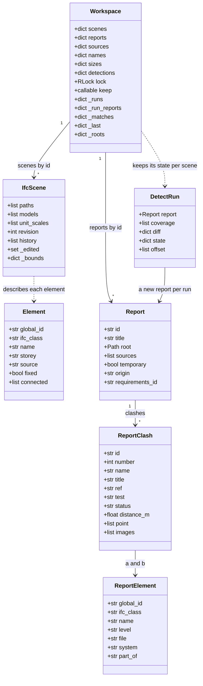
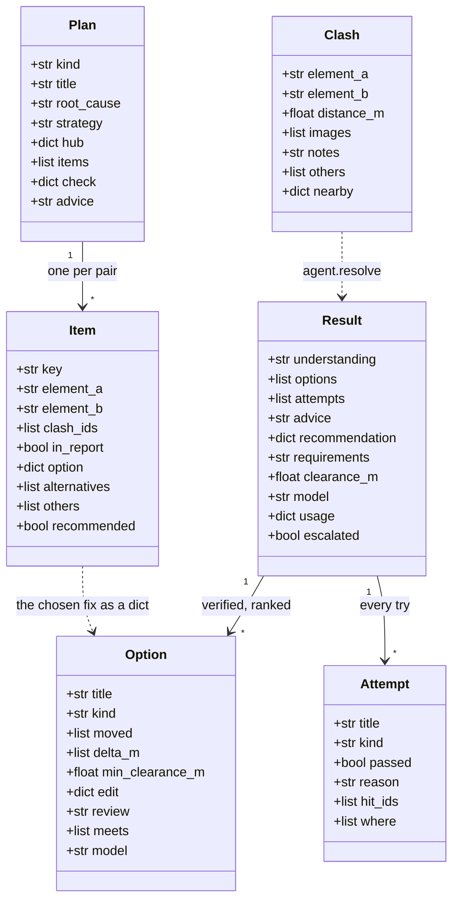
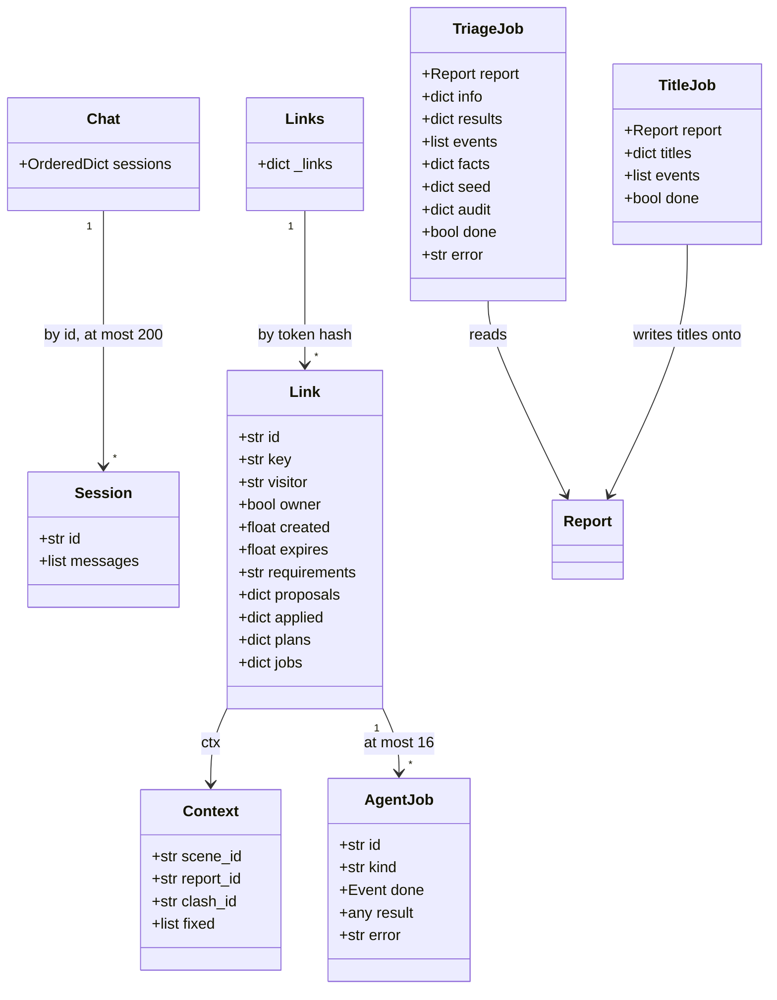
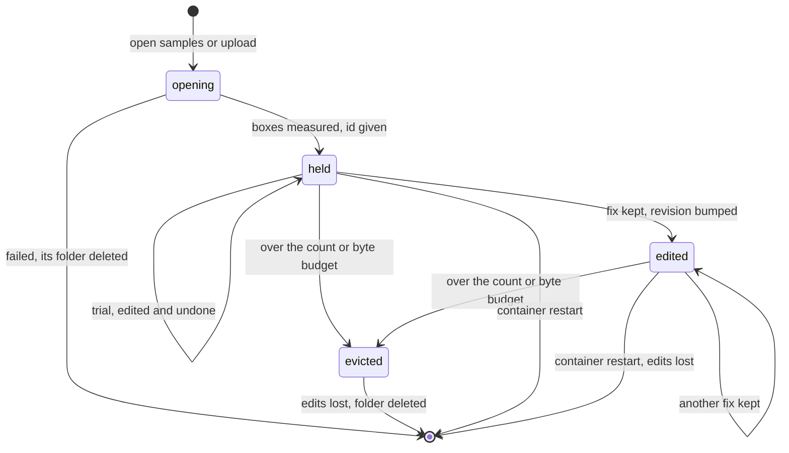
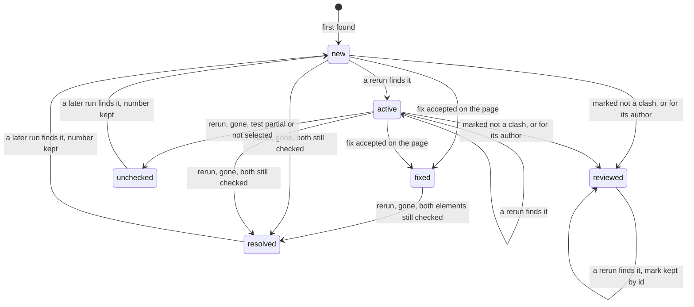
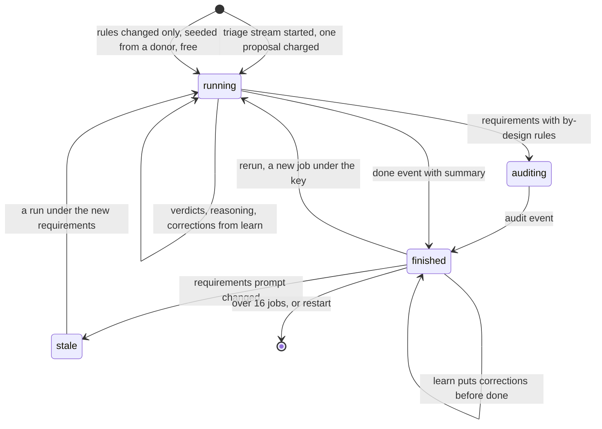
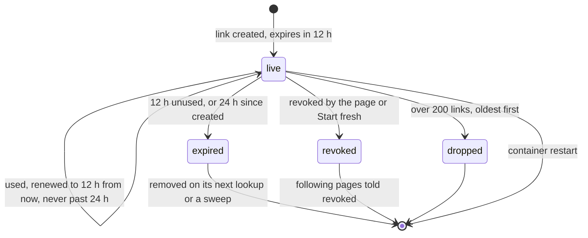

# 05 · Domain model and state

> **Covers:** `server/sightline/service.py`, `scene.py`, `reports.py`, `detect.py`, `agent.py`, `plans.py`,
> `triage.py`, `titles.py`, `chat.py`, `agents.py`, `requirements.py`, `settings.py`, `limits.py`, `spend.py`,
> `built.py`, `document.py`, `app.py` (its module-level stores), and the browser storage in `web/src/` (`App.tsx`,
> `Owner.tsx`, `Chat.tsx`, `Triage.tsx`, `Agent.tsx`, `ReportDoc.tsx`, `reqFile.ts`, `signoffs.ts`) ·
> **Checked against code:** 2026-10-30 (`104fda9`) · **Deeper design:** [docs/detection.md](../detection.md),
> [docs/requirements.md](../requirements.md), [docs/mcp.md](../mcp.md), [docs/escalation.md](../escalation.md),
> [docs/uploads.md](../uploads.md)

ORCA keeps almost everything in the memory of one server process: the open models with their edits, the clash
reports, the shared triage and title runs, chat sessions, agent links, the caps and the day's spend. Only a few
things touch disk (uploads, conversions, exports, picture caches, the settings file), one thing lives in a Modal
Dict (the settings for everyone), and the browser keeps a handful of conveniences in `localStorage`, including the
session it can resume. This doc names the objects, their fields and ids, how each one lives and dies, and where
every piece of state is kept, so you know what a change touches and what a restart loses.
[04](04-server-code-map.md) says which module each object lives in.

## The objects

`TriageJob` is `triage.Job`, `TitleJob` is `titles.Job`, `AgentJob` is `agents.Job` and `DetectRun` is `detect.Run`
(the diagrams need plain names).

### The scene: `IfcScene` (`scene.py`)

One federated set of IFC files that share coordinates, opened together. Elements are addressed by GlobalId
everywhere; express ids are file-local and never leave the server.

| Field | Holds |
|---|---|
| `paths`, `models` | The files it was opened from, and their `ifcopenshell` models, which carry every kept edit in memory |
| `unit_scales` | Each file's length unit in metres; placements and moves are always metres |
| `_bounds` | GlobalId → world box in metres, for every physical element; measured once (`bounds`), shifted by moves, recomputed for changed pieces (`refresh_bounds`) |
| `_edited` | Indexes of the files a kept fix changed: what `export` and `Workspace.file` write |
| `revision`, `history` | A counter bumped by every kept fix (`bump`), and `(revision, files it changed)` for each, so a page that missed an edit knows which files to reload |

`IfcScene.element(gid)` builds an `Element` on demand (class, name, tag, storey, file, `fixed` for
`FIXED_CLASSES`, port-connected neighbours); nothing caches it. `IfcScene.snapshot()` copies the models from their
current text, edits included, for the wider-fix search.

### The workspace: `Workspace` (`service.py`)

The one place the API and MCP find scenes and reports. `app.py` makes one (`ws`) for the whole process.

| Field | Holds | Bounded by |
|---|---|---|
| `scenes` | Scene id → `IfcScene` | `max_scenes` (`SIGHTLINE_MAX_SCENES`) and `budget` (`SIGHTLINE_SCENE_BUDGET_MB`, the IFC bytes opened), by `_evict` |
| `sizes`, `names`, `sources`, `_roots` | Per scene: IFC bytes, the file names as opened, for STEP files the original and its converter manifest, and the scene's own temporary folder | Dropped with the scene |
| `detections` | Scene id → the last detection run's coverage, diff, element count, seconds, requirements and report id, so a resumed page can redraw it | Dropped with the scene |
| `_runs`, `_run_reports` | Scene id → the last run's state (clash ids with test and pair, selections, `numbers`, requirements id), and its report id, for the next run's diff and carry-over | Not dropped on eviction (small) |
| `reports` | Report id → `Report` | `max_reports` (`SIGHTLINE_MAX_REPORTS`), by `_keep` |
| `_matches` | (report id, scene id) → which model element each clash side is | Never dropped |
| `_last` | (scene id, GlobalId, GlobalId) → (stamp, last try), for a second try to read | `LAST_KEPT` (200); dropped with the scene; valid only while the stamp (scene revision, requirements id) matches |
| `lock` | The RLock every geometry operation holds | |
| `keep` | A callable returning the ids to evict last; `app.py` sets it to `links.kept` | |
| `_context_proposals` | Added by `context_planner._store`: scene id → wider-fix proposals | 24 per scene, 16 scenes; scenes no longer open are pruned |

`model`, `hosts_model` and `escalation_model` are the model clients it hands to the fix agent: one shared Muse Spark
client (`MetaChatModel`), the triage model resolved per request, and a fresh Muse Wonder client per second try.

### Reports and clashes (`reports.py`, `detect.py`)

Navisworks reports and ORCA's own detection produce the same objects, so everything downstream reads one shape.

- **`Report`:** `id`, `title`, `root` (the folder its files and views live in), `sources` (XML paths, or the model
  file names for a detected run), `clashes`, `temporary` (the folder is deleted when the report is dropped), `origin`
  (`"navisworks"` or `"sightline"` for a detected run), `requirements_id` (a detected run: the id of the requirements
  it ran under, set by `Workspace.detect`; `None` for the defaults and for imports; in the report summary). `clash(id)`
  also accepts "#39" and "39".
- **`ReportClash`:** `id`, `name` (`plain_name`: "A × B"), `guid`, `test`, `test_type`, `tolerance_m`, `status`
  (from the XML for Navisworks; `"new"` or `"active"` for detected), `distance_m` (signed, negative is overlap),
  `point`, `grid`, `a`, `b`, `images` (label and server path: "A"/"B"/"C" or "Navisworks"), `source`, `number`,
  `title`, `ref`; property `label` ("#N title-or-name").
- **`ReportElement`:** `global_id`, `ifc_class`, `name`, `level`, `file`, `system`, `description`, `part_of`.
- **Detection** (`detect.py`): a `Test` (`id`, `name`, `a` and `b` as `Selection`s of files, teams, classes,
  systems or ids; `kind` hard, clearance or duplicate; `tolerance_m`, `clearance_m`, `rules`, `enabled`,
  `min_size_m`) yields a `Coverage` row per test, and `run` returns a `Run` with the report, coverage, `diff` (new,
  resolved, no longer checked), element count, seconds, the tree's `offset`, and the `state` the next run compares
  with.

### Fixes and plans (`agent.py`, `plans.py`)

- **Candidates** are not a class: they are the dicts in Muse's JSON reply (`title`, `kind`, `move` "A" or "B", the
  kind's parameters listed in `agent.PARAMS`, `rationale`, `also_needs`). Each is tried by `agent.TRIES[kind]`.
- **`Attempt`:** every try, failures included: `title`, `delta_m`, `passed`, `reason`, `kind`, `split_m`, `hit_ids`,
  `trim`, `edit`, `where`, `model`. Streamed as `attempt` events.
- **`Option`:** a verified fix: `title`, `moved`, `delta_m`, `rationale`, `also_needs`, `min_clearance_m`,
  `placements`, `kind`, `split_m`, `preview` and `before` (world triangles), `trim`, `cleanup`, `checked_against`,
  `meets`, `edit` (newer kinds' parameters with `summary` and `key`), `review`, `model`.
- **`Result`:** what `agent.resolve` returns: `understanding`, `options` (at most three, ranked), `attempts`,
  `advice`, `recommendation` (when nothing may be edited), `requirements`, `clearance_m`, `model`, `usage`,
  `escalated`. The Workspace keeps the last one per pair in `_last`.
- **`Plan` and `Item`:** a Fix-together or root-cause plan and its pairs (`key` is the two GlobalIds sorted, joined
  by `|`). `Item.option` is the chosen `Option` as a dict; `Plan.check` is `verify_together`'s verdict. Plans are
  returned to the caller, not kept on the server; an MCP link keeps the plans its agent built (`Link.plans`).
- **Kept fixes** have no object of their own: keeping one edits the scene's models and bumps its revision. The page
  records which clash it fixed (`fixes` in [12](12-web-app.md)).

### Shared jobs (`triage.py`, `titles.py`)

- **`triage.Job`:** one triage run over a report, shared by everyone who opens it. `results` maps clash id to a
  verdict dict: `verdict` (`real_clash`, `by_design`, `non_physical`, `modelling_error`, or `unknown`), `severity`,
  `responsible`, `action`, `fix_hint`, `confidence`, `understanding`, `source` (`rule` or `model`), and as they apply
  `basis` (non_physical, touch, same_element, requirement), `model_reading`, `reasoning`, `seconds`, `alike` and
  `alike_of`, `audit` and `audit_note`, `error`. `events` is the replay log, `facts` what the open model settles
  (`learn`), `seed` readings carried from a donor run, `audit` the rule audit.
- **`titles.Job`:** one titling run over a report: `titles` (clash id → title), `events`, `done`, `error`. Titles
  are also written onto each `ReportClash.title`.

### Chat, links and MCP jobs (`chat.py`, `agents.py`)

- **`chat.Chat`** holds `sessions`; a **`Session`** is an `id` and its `messages` (the system prompt first, at most
  `MAX_HISTORY` 40). The web chat has one `Chat` (`app._chat`); the MCP server builds its own per workspace
  (`mcp_server.build`), whose tools call `Chat._run` directly and use no sessions. A **`Context`** is what the page
  says is open: `scene_id`, `report_id`, `clash_id`, `fixed`.
- **`agents.Link`:** a pairing link: public `id`, `key` (sha256 of the token), `visitor` (who is charged), `owner`
  (no caps), `created`, `expires`, `ctx` (a `Context` the page keeps current), `requirements` (the page's
  requirements id), `last_call`, `calls`, `proposals` (clash id → the last proposal event, which `apply_fix` reads),
  `applied` (clash id → the title of the fix the agent kept), `plans`, `jobs`, and private subscriber queues and
  pending captures.
- **`agents.Job`:** an MCP tool call that may outlast one request: `id`, `kind`, `started`, `done` (an Event),
  `result`, `error`.

### Requirements, settings and limits

- **`requirements.Doc`:** `name`, `version`, `level` (1-5), `strictness`, `groups` (`Group`: `id`, `name`, `role`,
  `teams`, `classes`, `exclude_classes`, `systems`, `files`, `source`), `checks` (`Check`: `a`, `b`, `check`,
  `clearance_mm`, `tolerance_mm`, `reason`, `source`), `duplicates`, `rules`, `who_moves` (`Mover`: `group`, `edits`,
  `max_move_mm`, `trims`), `by_design` (`ByDesign`: `a_classes`, `b_classes`, `reason`, `source`), `guidance`,
  `notes`, `penetrations` (`PenRule`). Derived per use: `Params` (`resolve`: the level and strictness as numbers),
  `Matcher` (element → group, cached per scene), `Policy` per element (`edits`, `max_move_m`, `trims`). Format and
  meaning: [15](15-requirements-settings-and-config.md).
- **`settings.Settings`:** `open_weights`, `effort`, `triage_effort`, `escalation`, `escalation_effort`,
  `built_views`; `None` takes the environment's default.
- **`limits.ProposeLimit`:** per-visitor deques of timestamps (`_clients`) and one for everyone (`_all`), trimmed to
  the rolling hour and day. **`spend.py`:** module globals `_day` (UTC date), `_spent`, `_held`, and a context
  variable of this request's claims.
- **`hosts.Reading`** (cached by kind of host) and **`built`** results are covered in [07](07-fixes-and-edits.md) and
  [09](09-agent-workflows.md).

## Identifiers

| Id | Format | Made by | Stable across |
|---|---|---|---|
| Scene id | 12 hex characters (`uuid4().hex[:12]`) | `Workspace.open_paths` | The scene's life on this server. Opening the same files again makes a new scene, with no edits |
| Report id | 12 hex characters | `Workspace.open_report_sample`, `open_report_folder`, `detect.run` | The report's life. Every detection run is a new report with a new id |
| Navisworks clash id | `c` + 4-digit position (`c0053`) | `reports.load`, after duplicates are dropped | Every load of the same files (so every visitor's copy of a sample report has the same ids) |
| Detected clash id | `s` + the first 9 hex of sha1 of test id and the two GlobalIds sorted | `detect.clash_id` | Reruns, visitors and servers, while the test id and both GlobalIds stay the same |
| `number` (shown as #N) | Integer, unique across the whole report | Navisworks: the position. Detected: `state["numbers"]` | Navisworks: the files. Detected: reruns under the same requirements id; a new clash takes the next number and a gone one's is never reused. A run under different requirements (or the scene's first) starts again from 1 |
| `ref` | The source tool's own label ("Clash39"), repeated per test | `reports.read_xml` | The XML |
| `name` | "A × B" from the two elements | `reports.plain_name` | The elements' names |
| `title` | Muse's short title | `titles.Job`, written onto the clash | Carried by clash id to a rerun's report (`Workspace._carry`) and to every copy of a sample report (`app._with_titles`) |
| `label` | "#N title-or-name" | `ReportClash.label` | As number and title |
| `guid` | Navisworks result guid; for a detected clash, the clash id | `reports.read_xml`, `detect.run` | The source |
| GlobalId | IFC's 22-character id | The authoring tool; STEP parts: uuid5 of the file hash and label path (`step.write_ifc`); new pieces of an edit: IfcOpenShell (`root.copy_class`) | The file. An offset, route or resize keeps the original GlobalId on its first piece; a STEP file always converts to the same ids |
| Scene `revision` | Integer from 0, plus `history` | `IfcScene.bump` on every kept fix | Only grows. Apply replies carry `revision_before` and `revision`; wider-fix proposals are pinned to it |
| Requirements id | 16 hex of sha256 of the canonical file | `requirements.doc_id` (content-addressed) | Any server: the same file has the same id. The registry keeps 500 |
| Sign-off key (browser) | `sightline.signoffs:clash:<clash id>` for each clash of a detection run; `sightline.signoffs:import:<title>:<sorted file names as JSON>` for an imported report | `signoffs.signoffScope`, `loadSignoffs` (`web/src/signoffs.ts`) | Detected: every run of the same elements, whatever the requirements or the other models open (the id hashes the test and the GlobalId pair), and never another project. Imported: every opening of the same report (its title and files), since a Navisworks id is a place in its file |
| `model_key`, `rules_key` | 12 hex each | `requirements.model_key`, `rules_key` | The parts of the file that change the triage prompt, and the by-design rules |
| Triage job key | `report.id` (uploaded or detected report) or `sample:<root>`, plus `\|model_key\|rules_key` under requirements | `app._triage_key` | A sample report's run is shared by every visitor |
| Title job key | As the triage key, without requirements | `app._triage_key` | As above |
| Link token | `orca_` + 43 URL-safe characters | `agents.Links.create` | Shown once; only its sha256 (`Link.key`) is kept |
| Link id | 8 hex | `Links.create` | Public, for logs and the page |
| Event stream id, capture id | 10 and 12 hex | `Link.subscribe`, `Link.capture` | One stream, one capture request |
| MCP job id | 10 hex | `Link.start` | The link; 16 jobs kept per link |
| MCP plan id | `p` + 8 digits from Python's `hash` of the plan's kind and item keys | `mcp_server._plan_id` | This process only (string hashes are salted per process) |
| Plan item key | The two GlobalIds sorted, joined by `\|` | `plans.pairs_for`, `build_root_cause` | The pair |
| Pattern id | `ClassA\|ClassB\|fileA\|fileB` | `plans.patterns` | The classes and files |
| Detection test id | `pair:a\|b`, `self:file`, `duplicates`, `clearance:MEP\|Structure`; under requirements `req:a\|b`, `req:a`, `req:duplicates` | `detect.default_tests`, `presets`, `requirements.compile_tests` | The file names or group ids |
| Chat session id | 12 hex | `Chat.session` | The process; 200 sessions kept |
| Document id | 32 hex | `app._build_document` | 24 documents kept in memory, for `/api/documents/{doc_id}` |
| Built picture key | 32 hex of sha256 of the look PNG, the outline bits and `PROMPT_VERSION` | `built.Passes.key` | The cache folder: files `<key>.jpg`, `<key>-lines.png`, `<key>.json` |
| Built page key | The pair sorted, kind, title and the fix's numbers and edit key | `builtKey` in `App.tsx` | The page's own map of pictures per fix |
| Wider-fix proposal id | 32 hex | `context_planner.build` | The scene revision it was made at |
| Host kind key | 16 hex of sha256 of the host's kind facts | `hosts.profile` | The server's life (readings are cached by it) |

## Lifecycles

### A scene

- **Opening** (`Workspace.open_paths`): STEP files are converted first (cached by hash); room is made for the new
  scene's bytes before it is read (`_evict(incoming)`), the boxes are measured, then the id is assigned and the count
  is checked again with the new scene protected.
- **Eviction** (`_evict`, `_oldest`): the oldest scene that no live agent link points at goes first (`keep`), else
  the oldest. Its sizes, names, sources, detection summary, last tries and folder go with it. Reports are evicted on
  their own (`_keep`, same rule).
- **Edited** means the in-memory models differ from the files. `export` writes only the edited files; a reopen or a
  restart starts from the files again. A wider fix's accept replaces the scene's state with an evaluated private
  snapshot (same object, new revision).

### A detected clash across reruns

The server knows `new`, `active` and the run's diff; fixed, not a clash and reviewed are the page's marks.

- `ReportClash.status` is `"new"` when the id was not in the last run and `"active"` when it was. `resolved` and
  `no_longer_checked` (unchecked above) are lists in the run's `diff`, not statuses, because those clashes are not in
  the new report.
- A rerun compares with the last run only under the same requirements id. Under different requirements every clash
  is new and numbering starts again.
- Titles and captured views (A/B/C) carry over by id (`Workspace._carry`). On the page, a rerun clears `fixes` and
  keeps `reviewed` marks for ids that are still there (`runDetect` in `App.tsx`). "Not a clash" decided from the
  geometry (`noClash.ts`) is recomputed, not stored.

### A triage run

- A job is keyed by report and requirements (`app._triage_key`) and kept in `app._triage_jobs` (16, oldest
  dropped). Starting one costs one proposal; following one already started is free; a page that joins late replays
  every event except reasoning sent before it joined (`Job.follow`).
- `Job.learn` adds what the open model settles (one element on both sides). On a finished run, corrections go in
  before the final `done`, which is re-sent with a new summary.
- **Stale** is how a run is shown, not a state of the job: `GET .../triage` under requirements with a different
  prompt returns the latest run marked `stale`, its results re-read through the rules in force (`app._ruled`). Under
  requirements that changed only by-design rules, a finished run under the same prompt is a donor: a new run starts
  from its readings at no charge.
- Title runs (`titles.Job`, `app._title_jobs`, 32 kept) follow the same start, follow and done pattern without
  learn, audits or staleness; a finished run that left clashes untitled is replaced by one for those.

### A pairing link

- **Renewed by use** (`Links.get(touch=True)`): a context PUT, opening the events stream, a capture answer and every
  MCP tool call. Reading its state (`GET /api/links/{token}`), the `/mcp` gate's check, a page's leave beacon and the
  events stream's own polling do not renew it.
- While live, its scene and report are evicted last (`Links.kept` via `Workspace.keep`).
- The page keeps the token in `sightline.session` to resume; **Start fresh** revokes it.

## Where state lives

### Server memory (lost on restart)

| What | Where | Bounded by |
|---|---|---|
| Open scenes, their in-memory models and edits, boxes, revisions | `Workspace.scenes` (`IfcScene`) | `SIGHTLINE_MAX_SCENES` (code default 0, no limit; Modal 8) and `SIGHTLINE_SCENE_BUDGET_MB` (default 0, by count only; Modal 300), by `Workspace._evict`; live links' last (`Workspace.keep`) |
| Per-scene facts | `Workspace.sizes`, `names`, `sources`, `detections`, `_roots`, `_last` | Dropped with the scene; `_last` also capped at `LAST_KEPT` (200) |
| Last detection state per scene | `Workspace._runs`, `_run_reports` | One per scene ever opened; not dropped on eviction |
| Clash reports, titles on their clashes | `Workspace.reports` | `SIGHTLINE_MAX_REPORTS` (default 0; Modal 8), by `Workspace._keep`; live links' last |
| Report-to-model matches | `Workspace._matches` | Not bounded |
| Wider-fix proposals | `Workspace._context_proposals` | 24 per scene, 16 scenes |
| Triage runs | `app._triage_jobs` | 16 |
| Title runs | `app._title_jobs` | 32 |
| Built documents (PDF or zip bytes) | `app._documents` | 24 |
| Requirements previews | `app._previews` | 64 |
| Pattern readings | `Workspace._patterns` (`plans.read_patterns`; route, chat and MCP share them) | 64 (`service.PATTERNS_KEPT`), oldest first |
| Chat sessions | `app._chat.sessions` | 200 sessions, 40 messages each |
| Agent links, their proposals, plans and jobs | `app.links` (`agents.Links`) | 200 links, 12 h idle, 24 h total; 16 jobs per link; 200 queued events per following page |
| Registered requirements files | `requirements._registry` | 500, least recently used dropped |
| Host readings by kind | `hosts._cache` | The server's life |
| Pictures being drawn | `built._running` | Only while drawing |
| Settings for everyone (cached) | `settings._current` | Read from the store once |
| Caps | Each `ProposeLimit`'s deques in `app.py` | The rolling hour and day |
| Muse Wonder spend | `spend._day`, `_spent`, `_held` | The UTC day |
| Token usage | `MetaChatModel.usage` per client | The client's life |
| Per request | Context variables: the owner's settings (`owner.py`) and the requirements in force (`requirements._current`) | The request, and work started with `owner.spawn` / `owner.submit` |

### Server disk

Paths under "temp" are in the system temporary folder (`tempfile.gettempdir()`).

| What | Path | Kept until |
|---|---|---|
| Sample models, sample reports, shipped STEP cache | `samples/`, `samples/reports/<name>/`, `samples/step-cache/` | Read-only; part of the deploy image |
| Uploaded models and STEP conversions | temp `sightline-models/<folder>/` (`service.MODELS`, `Workspace._roots`) | The scene is evicted (or the open fails) |
| STEP conversion cache (when `samples/step-cache` is absent) | temp `sightline-models/step-cache/` (`Workspace.step_cache`) | Not cleaned |
| Uploaded Navisworks reports | temp `sightline-reports/<folder>/` (`app.UPLOADS`) | The report is dropped (it is `temporary`) |
| Detected report folders, with captured A/B/C views | temp `sightline-run-*/`, `views/<clash id>-<label>.png` | The report is dropped |
| Edited models served to the page, exports, document copies | temp `sightline-exports/` (`app.EXPORTS`): `<scene>-<index>-<file>`, `<scene>/`, `<scene>-orca.zip`, `<doc id>-<name>` | An hour (`EXPORTS_KEEP_S`), cleaned when a model file or an export is next requested |
| Exports made over the local (stdio) MCP server | temp `orca-export-*/` (`mcp_server` `export_models`) | Not cleaned |
| Show it built pictures | `SIGHTLINE_BUILT_CACHE`, default temp `sightline-built/` | Not cleaned |
| Settings for everyone, off Modal | `SIGHTLINE_SETTINGS_FILE`, default `server/.sightline-settings.json` (gitignored) | Kept |
| Meta and host keys, off Modal | `.env` at the repo root, read by `meta_client.load_env` (gitignored; real environment variables win) | Kept |

### Modal Dict

When `MODAL_TASK_ID` is set, `settings.py` keeps the settings for everyone in the Modal Dict `sightline-settings`
under the key `settings`. It is the only server state that survives a restart or a redeploy.

### The browser

`localStorage` only; there is no `sessionStorage` or IndexedDB. Every access is wrapped so a private window simply
does without.

| Key | Written by | Holds |
|---|---|---|
| `sightline.session` | `App.tsx` | The session to resume: `scene_id`, `report_id`, `files`, `fixes` (clash id → fix title), `link` (the agent link, token included), `saved_at`. Removed by Start fresh, or when the server no longer has the scene |
| `sightline.signoffs:clash:<clash id>` (a detection run) / `sightline.signoffs:import:<title>:<files>` (an imported report) | `signoffs.ts` (`saveSignoffs`, called by `App.tsx`) | Reviews (team, name, decision, note, time) for the PDF's sign-off: one entry per detected clash, or one per imported report by clash id (the sign-off key, under Identifiers). A clash with no review left is dropped, and an import's key when none has any. The old title-keyed `sightline.signoffs.<report title>` entries (every detection run shared "Coordination · N models") move over when a report with that title opens, for the clashes it has (`migrateTitleKeyed`); what is left waits for its own report |
| `sightline.reviewer` | `ReportDoc.tsx`, read by `App.tsx` | The reviewer's name |
| `sightline.requirements` | `reqFile.ts` | The requirements file and whether it is in use (`{doc, enabled}`); the page registers it with the server and sends its id |
| `sightline.owner` | `Owner.tsx` | The owner's "For me" settings, sent as `X-Sightline-Settings` (read by the server only with the owner cookie) |
| `sightline.left-w`, `sightline.right-w` | `App.tsx` | Side pane widths |
| `sightline.triage.compact` | `Triage.tsx` | Whether the Triage card is folded |
| `sightline.voice.handsfree` | `Chat.tsx` | Hands-free voice on or off |
| `sightline.agent.setup` | `Agent.tsx` | Set once this browser has made a link (folds the first-time setup) |
| `sightline.views.fly` | `App.tsx` | Fly to clash on or off (`"1"` / `"0"`, default on) |
| `sightline.views.layout` | `App.tsx` | The view layout (`single`, `two`, `quad`); a phone shows Single and a tablet at most Two whatever is kept |
| `sightline.views.<project>` | `App.tsx` (`saveViews`) | `{home, saved}`: the Home pose and the saved views (pose, projection, style, mode, filters, section box) for a set of models, keyed by `About.projectName` |

The browser also holds the `sightline_owner` cookie (HttpOnly, Secure, SameSite=Strict, path `/api`, 30 days),
which scripts cannot read. Everything else on the page (the open report, verdicts, `reviewed` marks, plans, clash views,
built pictures, filters and hides, what each pane shows) is React state that a reload loses; see [12](12-web-app.md).

### What survives a restart

| Survives | Lost |
|---|---|
| Settings for everyone (Modal Dict, or the settings file) | Every scene and its edits: reopening starts from the files |
| `samples/` and the shipped STEP cache | Reports, titles, triage and title runs |
| The browser's `localStorage` and the owner cookie (signed with a key made from the owner token, so it stays valid while the token does) | Chat sessions, agent links (a page's saved link stops working), MCP jobs and plans |
| Locally only: the temp folders. The STEP cache and built pictures are found again by hash; uploads, run folders and exports are orphaned | The requirements registry (the next request gets 409 `requirements_unknown` and the page registers again), host readings, caps and the day's spend |
| | On Modal: the temp folders (exports, uploads, run folders, built pictures), since a new container starts empty |

On arrival the page reads `sightline.session` and asks `GET /api/scenes/{scene_id}`; a 404 (or any failure) removes
the key and the page starts fresh. Otherwise the landing offers to pick up where it left off, and `resumeSession`
(`App.tsx`) reopens the scene's files with their server-side edits, reloads the report, the saved fixes and the
fixes the link's agent applied meanwhile (`Link.applied`), and follows the link again.

## When to update this doc

- A field is added to or removed from `Workspace`, `IfcScene`, `Report`, `ReportClash`, `ReportElement`,
  `detect.Test` or `detect.Run`, `agent.Option`, `Attempt`, `Result` or `Clash`, `plans.Plan` or `Item`,
  `triage.Job` or a verdict dict, `titles.Job`, `chat.Session` or `Context`, `agents.Link` or `Job`,
  `requirements.Doc` and its parts, or `settings.Settings`.
- An id changes format or what it is stable across: scene, report or clash ids, `number`, job keys, link tokens,
  requirements ids, built cache keys.
- A lifecycle changes: eviction rules, how a rerun numbers and diffs clashes, triage sharing or staleness, link
  renewal, expiry or caps.
- A new store appears or a bound changes: a module-level dict in `app.py`, a cache, a temp folder, the Modal Dict, a
  `SIGHTLINE_MAX_*` or budget variable.
- A browser storage key is added, renamed or changes what it holds (grep `web/src` for `localStorage`).
