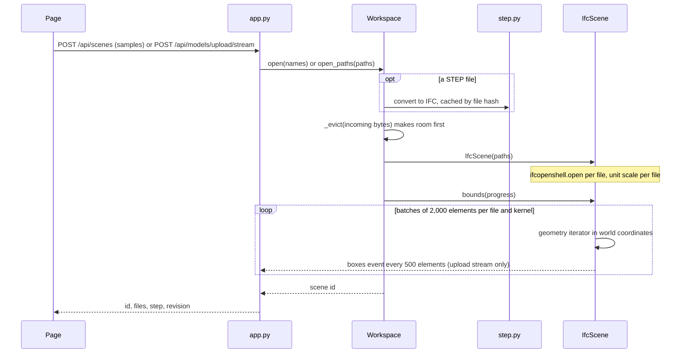
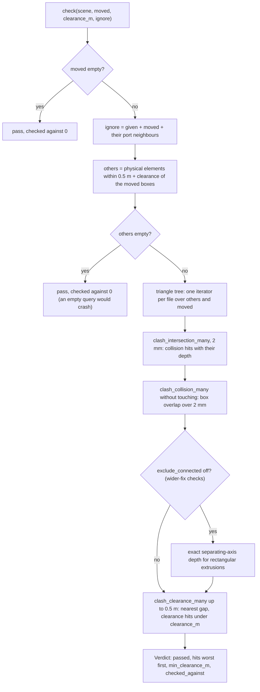
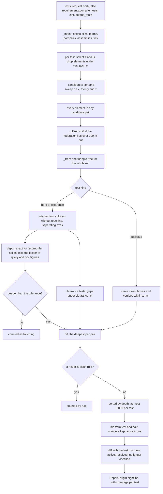

# 06 · Geometry engine and detection

> **Covers:** `server/sightline/scene.py`, `server/sightline/verify.py`, `server/sightline/detect.py`, the geometry
> parts of `server/sightline/service.py` (`Workspace.open_paths`, `verify_move`, `measure`, `detect`, `detect_tests`),
> `requirements.compile_tests`, `server/sightline/fixtures.py` · **Checked against code:** 2026-10-30 (`104fda9`) ·
> **Deeper design:** [docs/detection.md](../detection.md), [docs/uploads.md](../uploads.md)

Everything ORCA says about geometry comes from three modules. `scene.py` holds the open models as one federated
scene, in metres, with a cached box per physical element. `verify.py` is the check every fix must pass and the
authority for every clearance number the page shows. `detect.py` is ORCA's own clash detection, which turns the open
models into a clash report the rest of ORCA reads like an imported one. The fix kinds that edit the models are in
[07](07-fixes-and-edits.md); the AI loops that call the check are in [09](09-agent-workflows.md).

## The three modules

| Module | What it owns | Main symbols |
|---|---|---|
| `scene.py` | The open IFC files, units, element boxes, runs, placements, what is physical, the edit revision | `IfcScene`, `Element`, `not_physical`, `is_provision`, `opacity`, `meshes_only`, `step_source`, `FIXED_CLASSES`, `FITTINGS` |
| `verify.py` | The geometric check of elements that changed, and what a moved element stands on | `check`, `Hit`, `Verdict`, `supports`, `keep_supports`, `stands_on`, `is_run` |
| `detect.py` | Clash tests, the broad and narrow phase, depth, ids, numbers and reruns | `Test`, `Selection`, `default_tests`, `presets`, `run`, `measure_pair`, `clash_id`, `Coverage`, `Run` |

All three run inside the one server process on shared scenes, so callers hold `Workspace.lock` (an `RLock`) around
any use of a live scene's geometry ([02](02-system-architecture.md)). Two exceptions: opening a scene (the new
`IfcScene` is not shared until `Workspace.open_paths` adds it) and the wider-fix planner, which works on private copies
([07](07-fixes-and-edits.md)).

## Opening a scene (`scene.py`)

The routes, the upload's packing and the stream's events are in [10](10-http-api-and-streams.md) and
[14](14-files-in-and-out.md); STEP conversion is in [14](14-files-in-and-out.md) and [docs/step.md](../step.md).

### Federation and shared coordinates

- A scene is one or more IFC files that share coordinates (structure, MEP, architecture, site), because real clashes
  are between disciplines and so between files. Nothing is shifted to an origin: the server never moves a file, and
  the viewer loads with web-ifc's `COORDINATE_TO_ORIGIN` off for the same reason ([13](13-3d-viewer.md)).
- Elements are addressed by IFC GlobalId everywhere (browser, server, MCP), never by express id, which is file-local
  and changes when a file is rewritten. `IfcScene.index_of(gid)` finds the file that holds a GlobalId.
- `IfcScene.paths`, `models` (one `ifcopenshell.file` each, fully in memory) and `unit_scales` are parallel lists;
  `path`, `model` and `unit_scale` are single-file conveniences for tests and spikes.

### Units: metres everywhere

- `unit_scales[i]` is file *i*'s project length unit in metres (`ifcopenshell.util.unit.calculate_unit_scale`).
  Authoring tools often export millimetres; the main test fixtures can be built in millimetres too
  (`millimetres=True`).
- Geometry from IfcOpenShell's iterator and `create_shape` with `use-world-coords` comes out in metres, so boxes,
  check distances and preview meshes are metres.
- `IfcScene.placement(gid)` returns the world matrix in metres. `translate(gids, delta_m)` adds a metre delta and
  writes it back with `geometry.edit_object_placement(..., is_si=True)`.
- Edits that write raw geometry (`edits.py`) divide metres by the file's scale before writing coordinates, and place
  new fittings and voids with file-unit matrices (`is_si=False`). See [07](07-fixes-and-edits.md).

### Element boxes: `IfcScene.bounds()`

`bounds()` returns GlobalId → `[[min x, y, z], [max x, y, z]]` in metres for every physical element (next section),
computed once and cached. It is paid when the scene opens (`Workspace.open_paths` calls it with a progress callback),
so the first check does not pay it. Everything later reads these boxes: the check's neighbourhood, detection's broad
phase, `Workspace._nearby`, the hosts rules and the free-room scan.

How it triangulates:
- Elements are grouped by file and by `meshes_only(p)` (every body item an `IfcTriangulatedFaceSet` or
  `IfcPolygonalFaceSet`, no openings), then split into batches of `BOUNDS_BATCH` (2,000). An IfcOpenShell iterator
  holds what it made until it is dropped; one iterator over a 150 MB model went past 4.5 GB.
- **Kernel:** a mesh-only batch uses `MESH_KERNEL` (`hybrid-cgal-simple-opencascade`, about 1 ms an element against
  20-30 ms in OpenCASCADE, same vertices). When all files together reach `SIGHTLINE_BIG_MODEL_MB` (default 50),
  every batch uses it, extrusions too. Smaller models keep the default kernel for everything but meshes, so their
  boxes are as before.
- **Threads:** `THREADS`, the CPUs the process may use (`os.sched_getaffinity`), not the host's count.
- **Progress:** the callback gets `(done, total)` every 500 elements and once at the end. The upload stream turns it
  into `boxes` events.
- A batch whose iterator fails to initialise is skipped: its elements get no box, so nothing treats them as
  physical. The result keeps model order whatever kernel made each box.

Keeping the cache true:
- `translate` shifts the moved elements' cached boxes by the same delta.
- `refresh_bounds(gids)` re-triangulates elements whose shape changed or that were just created (default kernel). It
  never makes a box for something not physical.
- The trial helpers in `edits.py` copy the box dictionary before an edit and put it back after the undo
  ([07](07-fixes-and-edits.md)).

### What is physical

`IfcScene.products()` is "every physical element with a body": each `IfcElement` with a `Representation` that is not
`not_physical`. `not_physical(e)` is true for:
- `IfcFeatureElement` (openings and other features, already cut from their host) and `IfcVirtualElement`
  (`NOT_PHYSICAL`);
- a provision for void (`is_provision`: an `IfcBuildingElementProxy` with PredefinedType PROVISIONFORVOID, or
  ObjectType "ProvisionForVoid" in IFC2X3), the request ORCA writes for an opening ([07](07-fixes-and-edits.md)).

Spaces, zones, ports, grids and annotations are not `IfcElement`s, so they never get a box. The box dictionary is
therefore the working definition of "physical": detection, the check and `Workspace.measure` all read it.

`opacity(e)` reads the style's transparency (1 when none). A see-through `IfcBuildingElementProxy` (opacity under 0.5)
is a zone (a robot's restricted space, a panel's working space): the supports rule and the hosts rules treat it as
not a thing that stands or can be cut.

### Other `IfcScene` API

| Symbol | What it does |
|---|---|
| `element(gid)` | An `Element`: class, name, tag, storey (its spatial container), source file name, `fixed`, and `connected` (owners of the ports joined to its ports) |
| `stays(gid)` / `Element.fixed` | Fixed in place: the requirements' `stays` classes (by inheritance) or a group they allow no edits, else the domain's default classes (`domains.STAYS`: beam, column, slab, wall, footing, pile, member, plate). Used by combined steps, `agent._try_trim`, `connections.classify`, `Workspace._nearby`, `plans.merge_shared`, the wider-fix ranking and review, the second try's brief |
| `near(gids, margin_m)` | Elements whose box comes within `margin_m` of the union box of `gids` (every element when none of `gids` has a box) |
| `connected_run(gid)` | The element plus segments joined to it through ports, up to but not including fittings (`FITTINGS`). A part converted from STEP has no ports, so it falls back to `step_run` |
| `step_run(gid)` | Parts of the same STEP group (`ORCA_STEP` pset, `step_group`) whose boxes touch within 1 mm, transitively. A cable ladder's pieces move together; a fence post moves alone |
| `placement(gid)` / `translate(gids, delta_m)` | World matrix in metres; move by a metre delta, returning the new 4x4 matrices the page applies to its preview |
| `snapshot()` | A full copy of the in-memory models (through `to_string`), boxes, edited set and revision. The wider-fix planner searches on copies ([07](07-fixes-and-edits.md)) |
| `mark_edited(gid)` | Records that the file holding `gid` changed, so export writes it. `translate` does not call it: trials move and move back |
| `bump(files)` | A kept edit: `revision += 1` and `(revision, files)` appended to `history`, so a page that missed an edit knows which files to reload |
| `write_edited(out_dir, ".orca")` | Writes each edited file as `<name>.orca.ifc`; untouched files are not rewritten ([14](14-files-in-and-out.md)) |

Module helpers: `step_source(entity)` returns a converted part's `ORCA_STEP` pset (or the older `Sightline_STEP`,
so old caches still open). `STEP_PSETS`, `STEP_PSET`, `MESH_ITEMS` and `BIG_MODEL_BYTES` are the constants behind
the rules above.

## The check (`verify.py`)

`verify.check(scene, moved, clearance_m=DEFAULT_CLEARANCE_M, ignore=None, *, exclude_connected=True, touching=None)` (25 mm
unless the caller passes the pair's, `Workspace.clearance`) checks the
elements in `moved`, where they are now, against every other physical element. A fix passes when nothing penetrates
the moved elements and nothing sits closer than `clearance_m`.

### Step by step

1. **What to ignore.** The moved elements themselves, anything in `ignore` (a run's own pieces, the fittings at its
   ends), and, unless `exclude_connected=False`, every element joined to a moved one through ports: they touch by
   design.
2. **The neighbourhood.** Only elements whose cached box lies within `SEARCH_M` (0.5 m) plus the clearance of the
   moved elements' union box are triangulated, so a check costs a neighbourhood, not the model.
3. **Empty-set guard.** With nothing nearby the check passes at once. This is required: IfcOpenShell's `*_many`
   clash queries crash the process on an empty set.
4. **The tree.** `ifcopenshell.geom.tree(backend="opencascade.trianglebvh")`, filled with one iterator per federated
   file over just the needed elements. The default `opencascade.brep` tree has no `*_many` queries.
5. **Hard hits, first query.** `clash_intersection_many(tolerance=0.002, check_all=True)`. Intersection, not
   collision: collision only sees crossing triangles and misses one element wholly inside another (a pipe inside a
   duct). Each hit's distance is minus its depth; its location is the middle of the two witness points.
6. **Hard hits, second query.** `clash_collision_many(allow_touching=False)` for pairs the first missed: two boxes
   with flush faces (a curtain-wall transom 30 mm into a mullion, tops level) come back from intersection as nothing,
   and from the clearance query as a 0 mm gap. The depth is then `_box_overlap`, the boxes' overlap on their
   least-overlapping axis (exact for boxes), and it counts when over 2 mm.
7. **Flush rectangular solids.** Only with `exclude_connected=False` (the wider-fix evaluator,
   `context_eval._findings`): `_rectangular_penetration`, an exact separating-axis depth for two uncut rectangular
   extrusions, for pairs both queries missed. It never infers a hit from an arbitrary element's box (that would invent
   hits inside curved bends).
8. **Clearance.** `clash_clearance_many(clearance=SEARCH_M, check_all=True)` measures the true gap to everything
   within 0.5 m that is not already a hit. The smallest is `min_clearance_m` (None: nothing that close; the page
   says "nothing within 500 mm"). A gap under `clearance_m` is a `clearance` hit. Pairs in `touching` (joints the
   wider-fix evaluator validated) are waived for clearance only, never for penetration.

`Hit` carries `other`, `other_class`, `kind` ("collision" or "clearance"), a signed `distance_m` (negative is depth,
positive a gap) and `location`. `Verdict` carries `passed`, the hits sorted worst first, `min_clearance_m` and
`checked_against` (the number of neighbours tested, the option card's proof line).

### Who calls it

| Caller | What it checks |
|---|---|
| `agent._try_*` ([07](07-fixes-and-edits.md)) | Each candidate fix inside its trial: moved runs, or a split run's new pieces against everything and its shortened ends against the obstacles only |
| `plans.verify_together` ([09](09-agent-workflows.md)) | Every fix of a plan applied together, each against everything, the other fixes included |
| `Workspace.verify_move` (`POST /api/scenes/{scene_id}/verify`, chat and MCP `check_move`) | A move the person or an agent tries; with `obstacles` the supports rule applies |
| `Workspace.measure` | The "Now" measure of an imported (Navisworks) report clash: `check([a], clearance_m=0)` and the hit on `b` |
| `context_eval._findings` | Each changed piece of a wider fix, with `exclude_connected=False` and validated `touching` pairs |
| `verify.supports` | The contacts a moved element has before the move (next section) |

### What a move stands on: `supports` and `keep_supports`

A moved element's contact with what carries it used to count as a clash wherever it went (a fence post's anchors cast
70 mm into its slab hit the slab on every horizontal move). The supports rule, used only when the caller says what the
move must clear (its `partners`):

- **Runs stand on nothing.** `is_run`: `IfcFlowSegment` / `IfcFlowFitting` (ducts, pipes, trays and their fittings
  hang or are carried along their length), and see-through proxies (zones). So every service move is checked exactly
  as before, and Northbank's answer key is untouched.
- **Before the move** (`supports`): for each moved element that is not a run, the elements it touches now (from a
  `check`) whose top it stands on or sits in. `stands_on(e, h)`: its base at that top (within the clearance, at least
  3 mm), or no more than `EMBED_M` (300 mm) into it, the host reaching below the base, footprints overlapping. Never
  a partner (what the move must clear) and never a run. The result is a `Support`: hosts with their contact
  distance, the standers, the partners and the clearance.
- **After the move** (`keep_supports`): a contact with what it stood on, no deeper than before (2 mm slack), is set
  aside (`held`); so is one with something like it at no greater depth (the next bay of slab). An element that stood
  on something and now stands on nothing fails ("would leave … standing on nothing"); one pushed deeper fails ("sinks
  deeper into …"); anything else it cuts into is an ordinary hit.
- **Its clearance** is then measured with the held supports ignored, so a passing move reports the gap to what is near
  it, not to what carries it.

Used by `agent._try_move`, `plans.verify_together` (moves) and `Workspace.verify_move(obstacles=)`. A combined fix's
move steps keep the old rule (every contact counts). Design: [docs/edits.md](../edits.md), "A move keeps what it
stands on".

### Speed

- A check triangulates only the neighbourhood: 0.4-0.6 s per check on Northbank (CLAUDE.md, Oct 27).
- The boxes are paid once at open: about 3 s on Northbank (CLAUDE.md, Oct 27); 5.7 s for the four files with Site
  in the Oct 28 measurement ([docs/detection.md](../detection.md)).

## ORCA detection (`detect.py`)

Detection finds every clash in the open models and returns it as a `reports.Report` with `origin: "sightline"`, so
the list, triage, insights, plans, chat, the PDF and BCF work on it unchanged ([05](05-domain-model-and-state.md)).
It costs no model call. Design and the reasons behind each rule: [docs/detection.md](../detection.md).

### Tests

A `Test` asks one question of two selections, or of one selection against itself (`b` None).

| Field | Meaning |
|---|---|
| `id`, `name` | Stable key and the name shown ("MEP vs Structure") |
| `kind` | `hard` (overlap deeper than the tolerance), `clearance` (gap under `clearance_m`) or `duplicate` (the same thing twice) |
| `a`, `b` | `Selection`s: model files, teams (guessed per file by `document.guess_team`), IFC classes (subclasses included) and excluded classes, system names, particular GlobalIds. Empty fields mean any |
| `tolerance_m` | Hard: an overlap must be deeper than this. Default `TOLERANCE_M`, 1 mm |
| `clearance_m` | Clearance tests only |
| `rules` | Which never-a-clash rules apply (all on by default) |
| `enabled` | Off tests are listed but not run |
| `min_size_m` | Elements whose largest box side is under this are left out (early design levels, from the requirements) |

`Test.from_dict` reads a test from JSON (the page's or chat's tests) and refuses an unknown kind; requirements build
`Test`s directly.

**Where the tests come from**, in `Workspace.detect`:
1. tests in the request body (`POST /api/scenes/{scene_id}/detect/stream`), else
2. `requirements.compile_tests(doc)` when coordination requirements are in force ([15](15-requirements-settings-and-config.md)):
   one test per check cell that is not off, ids `req:a|b` and `req:a`, with the resolved tolerance, clearance (a
   `clearance` test when it is above 0) and `min_size_m`, plus `req:duplicates` when the file asks for duplicates;
   else
3. `default_tests(scene)`:
   - every pair of model files (`pair:<file>|<file>`), hard, 1 mm;
   - each file against itself (`self:<file>`, "Structure (within)");
   - `duplicates` across the building models.
   A file is named by its team ("Structure") when there are several files and its team is unique, else by its file
   stem (a machine cell keeps its file name). **Site is off:** a file whose team is Site is context for the building,
   so its tests are listed with `enabled=False` and duplicates cover the other files, unless Site is all that is
   open.

`presets(scene)` offers tests that are not run by default: "MEP vs Structure, 25 mm clearance" (the default
clearance) when both teams are present, which only a building's guesses make. Each file's team is guessed in the
scene's domain (`requirements._file_teams`, the same names requirements groups select by). `Workspace.detect_tests` (`GET /api/scenes/{scene_id}/detect/tests`) returns the default tests plus presets,
or the compiled requirement tests, with each file's team and element count and the rule labels.

### Never a clash

`_Index` builds the relations once per run, and `excluded_by(a, b, rules)` names the first rule that applies:

| Rule (`RULES`) | Shown as | What it removes |
|---|---|---|
| `same_element` | same element | Both sides are one element |
| `connected` | joined by ports | A pair joined port to port (`IfcRelConnectsPorts`) |
| `assembly` | one assembly | Parts of one element-level aggregate or nest (`IfcRelAggregates`, `IfcRelNests`), and the whole with its parts |
| `host` | door or window in its wall | A filler and the element whose opening it fills (`IfcRelFillsElement` through `VoidsElements`) |

The rules are applied to the measured hits, after measuring, and each removed hit is **counted** per rule in the
test's coverage, so nothing disappears silently. Touches (overlaps no deeper than the tolerance) are counted too and
never reported. Everything else is reported, including bolts in plates and beams into columns: triage, insights and
**Mark as not a clash** sort those ([09](09-agent-workflows.md)).

### The pipeline

### Broad phase: sort and sweep

`_candidates(ix, a, b, margin)` returns every pair whose boxes come within `margin` (the tolerance, or the clearance
for a clearance test). This is the **completeness argument**: a pair it does not return cannot overlap or come that
close, so it needs no further check, and its count is the test's `candidate_pairs`.

- Boxes on side B are sorted by their minimum x. For each box on side A, a binary search finds the window
  `[lo - widest, hi]` on x, then the y and z overlaps filter it.
- **The lower bound.** Without it the sweep was quadratic (a 500 MB synthetic model: 482 s down to 18 s with it,
  `evals/README.md`). The few very long boxes (wider than 99 in 100: a slab, a long wall) would widen the window for
  everyone, so they are checked against every box instead.
- A self test (`b` None) returns each unordered pair once and never an element with itself.

All tests' broad phases run first, so the triangle tree is built once over only the elements that appear in some
candidate pair.

### Narrow phase and depth

`_tree` builds one `opencascade.trianglebvh` tree, one iterator per file (threads: `os.cpu_count()`). `_measure` then
runs per test:

- **duplicate:** same IFC class, boxes equal within the tolerance (1 mm), and every vertex of each within the
  tolerance of a vertex of the other (`_same_shape`, a symmetric check over vertices; elements over 4,000 vertices are
  never called duplicates).
- **hard and clearance:**
  1. `clash_intersection_many(tolerance=0.0, check_all=True)` finds overlaps, including one element wholly inside
     another, with a depth figure and witness points.
  2. `clash_collision_many(allow_touching=False)` finds flush-face overlaps the first missed (no depth figure).
  3. `_Solids.depth`: for the pairs neither query saw whose boxes still overlap deeper than the tolerance, the exact
     separating-axis depth when both are uncut rectangular extrusions (a strut run 30 mm into a beam's end with every
     side face flush, two panels of one wall lapping).
  4. **clearance tests only:** `clash_clearance_many(clearance=clearance_m)` for pairs that do not overlap; a gap under
     `clearance_m` is kept as a positive distance.

**Depth** is how far one element must move to clear the other (`judge`):
- exact for two rectangular solids (`_Solids`, oriented boxes from the extrusion's axes; the same separating-axis
  test as `verify._rectangular_penetration`);
- otherwise the lesser of the intersection query's figure and `_box_depth` (how far one box must move to clear the
  other, which bounds the elements' own depth from above).

The query's figure alone is wrong both ways: a pipe half a millimetre into a beam's underside reads 200 mm (the beam's
width), a top rail 40 mm into a post reads 20 mm. So ORCA's depth can differ from Navisworks' (#042: ORCA −300 mm,
Navisworks −150 mm).

A depth at or under the tolerance is a touch (counted when above 0). Otherwise the pair is a hit with
`distance_m = -depth`. Per unordered pair the deepest result is kept. The clash point is the middle of the witness
points, else the middle of the boxes' overlap (`_box_point`).

### Far from the origin

The triangle tree silently drops real overlaps a few hundred metres from its origin. `_offset` returns zero when every
box lies within `FAR_M` (200 m) of the origin; otherwise minus the federation's middle, rounded to whole metres. Every
file's iterator gets the same `model-offset`, so the files stay aligned with each other, and witness points are moved
back before they are stored. `Run.offset` reports the shift.

### Cap, ids and numbers

- **Cap.** Hits are sorted by depth; a test with more than `CAP` (5,000) keeps the first 5,000 and is marked
  `partial` in its coverage.
- **Ids.** `clash_id(test_id, a, b)` is `s` plus the first 9 hex digits of a SHA-1 of the test id and the two
  GlobalIds, sorted. Running again gives the same ids, so fixes, reviews and views stay attached.
- **Numbers.** `#N` is unique across the report and kept across runs (`state["numbers"]`): a clash keeps its number,
  a new one takes the next, a resolved one's number is never reused.
- **Names.** `reports.plain_name` gives "A × B" from the two elements; Muse titles come later
  ([09](09-agent-workflows.md)).
- **The report** has a fresh id, the title "Coordination · N models" (N counts files with an element in some test),
  its own temporary folder (`sightline-run-*`, deleted when `Workspace._keep` drops the report) and `temporary=True`.

### Coverage and the result

Each test yields a `Coverage`: elements on each side, candidate pairs, clashes, touching pairs, hits removed per rule,
`partial` and seconds. `detect.run` returns a `Run`: the report, the coverage, the diff, the number of elements
checked, seconds, the offset and the `state` the next run compares against.

### Reruns: `Workspace.detect`

- `Workspace._runs[scene_id]` keeps the last run's `state` (clashes, selections per test, numbers) and the
  requirements id it ran under. A rerun compares with it only when both ran under the same requirements.
- `_diff`: each clash is `new` or `active`. A clash that has gone is **resolved** only when its test still ran
  complete (not partial) and both elements were still in its selections; otherwise it is **no longer checked**,
  which is not the same thing. The first run is all new.
- `Workspace._carry` copies each surviving clash's title and captured views (A/B/C) from the last run's report into
  the new one; the page keeps its own marks for ids still present ([12](12-web-app.md)).
- `Workspace.detections[scene_id]` keeps the coverage, diff and report id, so a page that reopens the scene can
  redraw the summary (`scene_info`).
- The whole run holds `Workspace.lock`.

### `measure_pair` and the clash panel's "Now"

`detect.measure_pair(scene, a, b)` measures one pair the way a run does (a zero-tolerance test over just the two),
returning negative metres or None when they do not overlap. `Workspace.measure` uses it for detected reports, so the
panel's "Now" agrees with the run; for an imported report it uses `verify.check` instead.

### Events

`detect.run(on_event=)` emits `phase`, `start`, `test` and `test_done`; the route adds `done` (the report, coverage,
diff, elements, seconds, offset, requirements) or `error`. The full protocol is in [10](10-http-api-and-streams.md).
Detection is capped per visitor (`SIGHTLINE_DETECT_PER_HOUR` / `SIGHTLINE_DETECT_PER_DAY`, [16](16-security-caps-and-cost.md)).

### Other callers

- Chat and MCP `detect_clashes` ([09](09-agent-workflows.md), [11](11-mcp-and-agent-links.md)): the same tests as the
  page, optionally with one tolerance for every hard test.
- `POST /api/scenes/{scene_id}/requirements/preview`: runs `detect.run` for a requirements file and for the defaults
  without opening a report, cached per scene and test set, to show how many clashes a file would find.

## Geometry facts learned the hard way

Each is a rule the code relies on, checked at `104fda9`.

| Fact | Where the code honours it |
|---|---|
| Placements, moves and clearances are always metres; `IfcScene` converts per file | `IfcScene.unit_scales`, `placement`, `translate`; `edits.py` divides by the file's scale before writing |
| `edit_object_placement` takes SI with `is_si=True` | `IfcScene.translate`, `edits._place_port` and the port frames in `_build_chain`; new fittings and voids pass file-unit matrices with `is_si=False` |
| `add_profile_representation(depth=)` takes SI | Only the test fixtures call it (`fixtures.py`, with a comment saying so) |
| Use the `opencascade.trianglebvh` tree: the default brep tree has no `*_many` queries | `verify.check`, `detect._tree` |
| Intersection, not collision, for hard clashes: collision misses one element wholly inside another | Both use intersection first; collision without touching only adds flush-face overlaps |
| Intersection misses flush-faced overlaps; clearance then reads 0 mm | Collision without touching plus box overlap (`verify`), plus separating axes (`detect._Solids`, `verify._rectangular_penetration`) |
| The clearance query gives true gaps | `min_clearance_m` and clearance hits come from `clash_clearance_many` |
| Never call the clash queries with an empty set: IfcOpenShell segfaults | `verify.check` returns before building a tree; `detect.run` builds none when no pair is a candidate and `_measure` returns on no pairs |
| Boxes once at open, checks on the neighbourhood | `IfcScene.bounds()` cached and paid in `open_paths`; `verify.check` triangulates only `scene.near(...)` |
| Port-connected neighbours touch by design | `verify.check(exclude_connected=True)` ignores them; detection's `connected` rule counts them |
| Openings (`IfcFeatureElement`) and virtual elements are not physical | `scene.NOT_PHYSICAL` and `not_physical`, which also covers provisions for void |
| The triangle tree drops overlaps far from the origin | `detect._offset` and `model-offset` past 200 m |
| three.js is Y-up, IFC Z-up: viewer delta = (dx, dz, −dy) | The viewer's conversion in `web/src/viewer/Viewer.ts` ([13](13-3d-viewer.md)) |

## Measured numbers

All from recorded runs; the build log keeps the dates ([22](22-build-log.md)).

| What | Number | Source |
|---|---|---|
| Northbank, default tests (Structure, MEP, Architecture; Site off) | 464 clashes in 1,732 elements, about 4 s | CLAUDE.md, Oct 28 |
| Northbank with Site on | 633 clashes in 1,961 elements, 7-12 s | `evals/runs/2026-10-28-northbank-detection/` |
| Answer key | #042 −300 mm, #057 −100 mm, #061 −77 mm, all found (Navisworks stored no #061) | [docs/detection.md](../detection.md) |
| Sampled Navisworks results ORCA also reports | 117 of 117 real overlaps (of the other 200: 129 not physical, 46 touches, 24 one element, 1 joined by ports) | `evals/README.md` |
| Palletising cell, Rev A / Rev B | 17/17 planted pairs, 95 by design, 0 unexpected / 0 planted, 93 by design (Oct 30, 161 / 185 parts, 0.8 s each) | `evals/runs/2026-10-30-cell-detection/` |
| Big synthetic models (4 CPUs) | 150 MB: boxes 37 s, detection 5 s; 500 MB: detection 18 s | `evals/README.md`, "Big models" |

## When to update this doc

- A change to how a scene opens or measures boxes: `IfcScene.__init__`, `bounds`, the kernel rule, `BOUNDS_BATCH`,
  `THREADS`, `SIGHTLINE_BIG_MODEL_MB`, or `Workspace.open_paths`.
- A change to what counts as physical (`not_physical`, `NOT_PHYSICAL`, `is_provision`, `products`) or to
  what stays in place (`IfcScene.stays`, `domains.STAYS`), `FITTINGS`, `connected_run`, `step_run`.
- A change to `verify.check` (queries, tolerances, `SEARCH_M`, the empty-set guard, what is ignored), to the supports
  rule (`EMBED_M`, `RUNS`, `stands_on`, `keep_supports`) or a new caller of the check.
- A new test kind, selection field, never-a-clash rule, default test or preset in `detect.py`, or a change to
  `compile_tests`.
- A change to depth, the sweep, `FAR_M`, `CAP`, `clash_id`, numbering or the rerun diff.
- A new or renamed detection event (also update [10](10-http-api-and-streams.md)).
- A new measured number for Northbank or the cell (keep the source).
