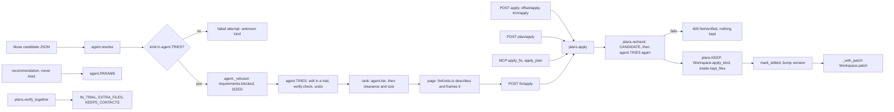
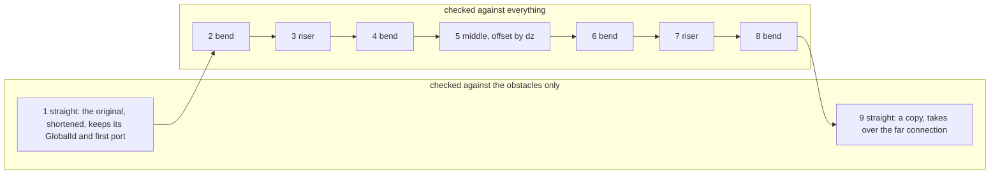
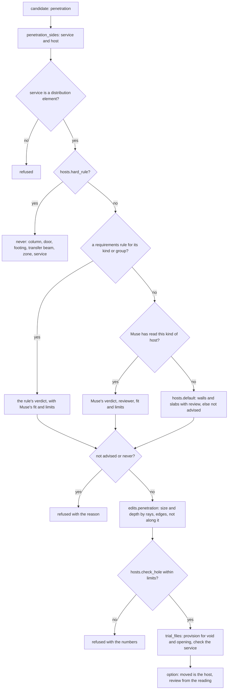
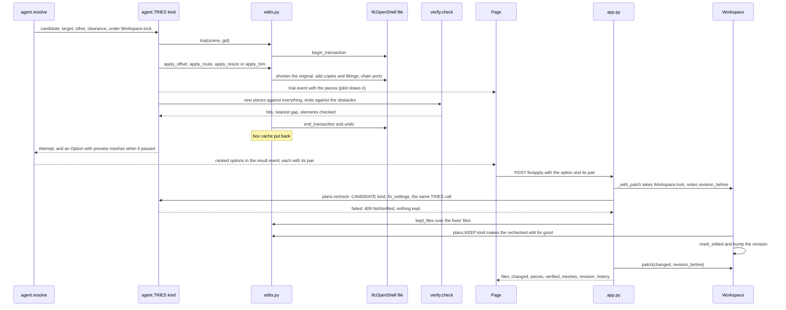
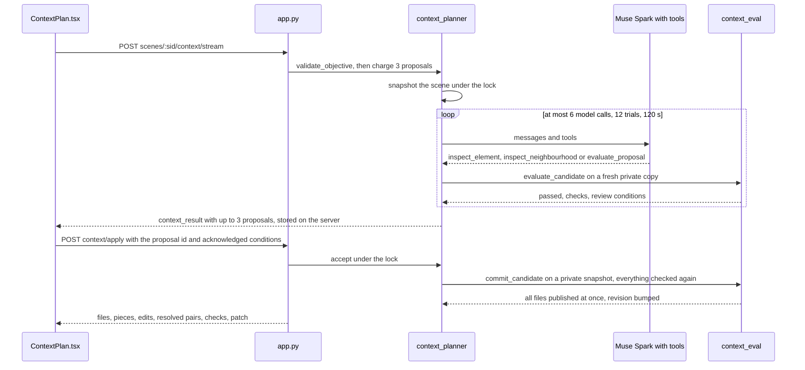

# 07 · Fixes and model edits

> **Covers:** `server/sightline/edits.py`, `server/sightline/hosts.py`, `server/sightline/context_eval.py`,
> `server/sightline/context_planner.py`, the fix parts of `server/sightline/agent.py` (`_try_*`, `TRIES`, `PARAMS`,
> `TIERS`, `tier`, `stays`, `combined_steps`), `server/sightline/plans.py` (`IN_TRIAL`, `EXTRA_FILES`,
> `KEEPS_CONTACTS`, `KEEP`, `CANDIDATE`, `recheck`, `apply`), `server/sightline/service.py` (`Workspace.apply*`, `check_*`, `patch`, `export`),
> `server/sightline/requirements.py` (`SIZED`, `change_size`, `blocked`, `can_cut`, `meets`), the prompts
> `domain_packs/construction.md`, `escalation.md`, `penetrations.md`, `context.md`, and `web/src/fixKinds.ts`,
> `web/src/ContextPlan.tsx`, `api.accept` in `web/src/api.ts` · **Checked against code:** 2026-10-30 (`4a19777`) ·
> **Deeper design:** [docs/edits.md](../edits.md), [docs/escalation.md](../escalation.md) (combined fixes)

Every fix ORCA offers is an edit to the real IFC elements. It is made inside an IfcOpenShell transaction, checked by
geometry ([06](06-geometry-and-detection.md)), and undone before anyone sees it; only a verified fix reaches the page,
and only an accepted one is made again for good. This doc covers the kinds of fix, the registry that ties each kind to
every layer, the geometry each kind builds, how a fix is tried and kept, and the separate "wider fix" planner. The AI
loop that proposes candidates (`agent.resolve`, plans, escalation) is in [09](09-agent-workflows.md).

## The kinds at a glance

Every candidate Muse proposes is JSON with `title`, `kind`, `move` ("A" or "B": which element changes; a combined fix
names it per step), `rationale` and `also_needs`, plus the kind's own fields (`domain_packs/construction.md`;
combined in `escalation.md`).

| Kind | What it does | Its fields | Tried by | Builds | Tier | Who reviews |
|---|---|---|---|---|---|---|
| `move` | Moves the element's straight run by a vector | `delta_m` | `agent._try_move` | `IfcScene.translate`, nothing new | 0 | none |
| `offset` | Splits a level segment either side of the obstacle, takes the middle up or down, with bends | `split_m`, `dz_m` | `agent._try_offset` | `edits.apply_offset` | 0 | none |
| `route` | Holds up to 3 stretches at offsets up and/or sideways, with bends | `steps` | `agent._try_route` | `edits.apply_route` | 0 | none |
| `trim` | Cuts a slender member's end back to butt the other's face | `by_m` (optional) | `agent._try_trim` | `edits.butt_trim`, `apply_trim` | 0 | none; `cleanup` when both are in one model |
| `seat` | Cuts an element that comes down into its support where it is inside, below the support's top, so it bears on it | none (the geometry decides) | `agent._try_seat` | `edits.seat`, `apply_seat` (a recess) | 0 | `domains.SEAT_REVIEW` (structure) |
| `combined` | 1 to 3 move/offset/route steps on different elements, checked together | `steps` | `agent._try_combined` | `agent.apply_combined` | 0.5 | none |
| `resize` | A flatter, wider section for a stretch of a rectangular duct or tray | `split_m`, `depth_m`, `keep` | `agent._try_resize` | `edits.resize_size`, `apply_resize` | 1 | `services` |
| `penetration` | Asks for an opening where a straight service crosses a host | none | `agent._try_penetration` | `edits.penetration`, `apply_penetration` | 2, or 2.5 for a host that is not a wall or slab | the host reading's reviewer |

A verified fix becomes an `agent.Option`: `kind`, `moved` (what changes in the viewer), `delta_m`, `split_m`, `trim`,
`edit` (the newer kinds' parameters with a `summary` and a `key` that tells two fixes apart), `preview` and `before`
(world triangles), `placements` (moves only), `min_clearance_m`, `checked_against`, `meets`, `review`, `cleanup` and
`model`. Failed tries are `Attempt`s with the reason, the hit ids and where the worst hits are (`where`), which Muse
reads next round.

## One registry across the layers

A kind is added by registering it in each layer. A kind nobody registered is refused ("unknown kind"), never tried as
a move.

| Layer | Registry | What it holds |
|---|---|---|
| Trying | `agent.TRIES` | kind → `(scene, candidate, target, other, clearance_m, on_trial, *, others=)` → `(Attempt, Option or None)` |
| Describing | `agent.PARAMS` | The candidate fields that describe each kind, carried into a refused attempt's `edit` and into a recommendation (never tried) |
| Ranking | `agent.TIERS`, `agent.tier` | combined 0.5, resize 1, penetration 2 (plus 0.5 when the host is not a wall or slab); every other kind 0 |
| Sizing | `agent._candidate_delta`, `requirements.SIZED`, `change_size` | How far each kind takes the element, and which kinds the requirements' "largest move" applies to (move, offset, route, resize, combined) |
| Allowing | `requirements.blocked`, `can_cut`, `meets` | What the requirements forbid per kind, whether a penetration's opening may be cut, what a verified option meets |
| A plan's joint check | `plans.IN_TRIAL` | kind → apply inside the plan's trial; returns what to check, the fix's own elements, and the obstacles its shortened ends are checked against (or, for a combined fix, its own check) |
| | `plans.EXTRA_FILES` | Files a fix changes beyond its moved elements' (penetration: the service's, for the provision for void) |
| | `plans.KEEPS_CONTACTS` | Kinds whose element keeps the contacts it had (trim, penetration): only new or worse contacts count |
| Keeping | `plans.CANDIDATE`, behind `plans.recheck` | kind → a kept option back as Muse proposes it (its parameters) and the element of its clash it changes, so it is tried again through `agent.TRIES` before it is kept |
| | `plans.KEEP`, behind `plans.apply` | kind → the `Workspace.apply_*` method that makes it for good |
| The page | `web/src/fixKinds.ts`, `FixKind` in `web/src/api.ts` | Name (`KIND_LABEL`), the edit in words (`editText`, `changeText`, `recEditText`), the clearance line (`clearanceText`), what to frame (`framePieces`), who reviews (`reviewText`), an opening's host rows (`hostRows`) |
| The prompt | `domain_packs/construction.md`, `escalation.md` | What Muse may propose, with a JSON example per kind |

The page keeps every kind through `POST /api/scenes/{scene_id}/fix/apply` (`api.accept`), which drops the page's
meshes and tries the fix again on the server from its kind, its parameters and the clash it names (`pair`). A plan
uses `POST /api/scenes/{scene_id}/plan/apply`; both go through `plans.apply`, as do the MCP tools `apply_fix` and
`apply_plan` ([11](11-mcp-and-agent-links.md)) and the three oldest routes (`/apply`, `/offset/apply`, `/trim/apply`),
which the page no longer uses. Routes in full: [10](10-http-api-and-streams.md).

### Adding a new fix kind: a checklist

1. **Geometry** in `edits.py`: an `apply_<kind>` that edits in place, raises `Unsupported` with a reason Muse can act
   on (checked before anything is edited where possible), builds a split run through `_build_chain`, and leaves
   `refresh_bounds` true for every changed or new element. A sizing helper if the kind is sized (like `resize_size`).
2. **Trying** in `agent.py`: a `_try_<kind>` with the `TRIES` signature that wraps the edit in `edits.trial` (one
   file) or `edits.trial_files` (several), emits the `trial` shape through `on_trial`, checks the right pieces, and
   returns an `Option` with `edit` (`summary`, `key`) and `review` when geometry alone cannot say it works. Register it
   in `TRIES` and `PARAMS`; add it to `TIERS` if it should rank after plain geometry; teach `_candidate_delta` its size.
3. **What Muse reads**: a `_<kind>_text` added to `_describe` that says when the kind applies here; the kind and a JSON
   example in `domain_packs/construction.md` (and `escalation.md` if a combined step may use it: `COMBINED_KINDS`).
4. **Requirements**: add it to `requirements.SIZED` if the largest-move limit applies; check `blocked` (under "move
   only" just `move` and `penetration` pass) and `meets`.
5. **Plans**: `plans.IN_TRIAL`, `EXTRA_FILES` if it changes another file, `KEEPS_CONTACTS` if its element keeps its
   contacts, `plans.CANDIDATE` (its option's fields back as a candidate, and the element of the clash it changes, so
   keeping tries it again), and `plans.KEEP` pointing at a new `Workspace.apply_<kind>` that holds `Workspace.lock`,
   calls `mark_edited` and `bump`, and returns `files`, `changed` and (for a split run) `pieces`.
6. **Tools**: a `Workspace.check_<kind>` and chat and MCP `check_<kind>` tools if people or agents should try it by
   hand ([09](09-agent-workflows.md), [11](11-mcp-and-agent-links.md)).
7. **The page**: the `FixKind` union in `api.ts`, and `KIND_LABEL`, `framePieces`, `changeText` and `REVIEW` in
   `fixKinds.ts`. Keeping needs nothing new: `api.accept` sends every kind to `/fix/apply` with its `pair`.
8. **Files out**: check STEP export (`service.step_changes` handles moved, replaced and new parts generically) and the
   PDF and BCF wording for its evidence ([14](14-files-in-and-out.md)).
9. **Tests**: `server/tests/test_fix_kinds.py` (registry, ranking, the one endpoint), a `test_<kind>.py` on a fixture
   built in `server/sightline/fixtures.py`, `test_accept_in_place.py` for the patch, `test_plans.py` for a plan with
   it, and `web/tests/fix-kinds.test.mjs`. Run the answer key (`evals/answer_key.py`): 3/3 first try at Rev04 heights
   must hold ([18](18-testing-and-evals.md)).
10. **Docs**: [docs/edits.md](../edits.md) (the design), this doc, [10](10-http-api-and-streams.md) for a new route
    or event, [11](11-mcp-and-agent-links.md) for a new tool, [13](13-3d-viewer.md) for framing, and an entry in
    [22](22-build-log.md).

## Each kind

### Move

- **Shape:** `{"kind": "move", "move": "A", "delta_m": [dx, dy, dz]}`, metres on the model's axes (+X east, +Y north,
  +Z up; `agent.move_words` says it in words).
- **What moves:** `connections.run(target)`: the element and the straight segments joined to it cap to cap (ports,
  or for STEP parts flow parts meeting face to face), the element first; a part that is not a flow element keeps
  `IfcScene.connected_run` without flow parts. Nothing new is built; `Option.placements` carries the new matrices for
  the page's preview. Design: [docs/connections.md](../connections.md).
- **Joints first** (`connections.plan_move`, `SIGHTLINE_CONNECTED_MOVES` carry by default): fittings and in-line valves
  beyond the run go along, a straight segment the move runs along gets longer or shorter at the joined end
  (`edits.stretch`), a rectangular segment covered end-on at its side (a ladder riser under its bend) grows that way.
  Equipment, terminals, structure, a branch, a piece left under 50 mm or more than 12 parts along refuse it before it
  is tried, naming why ("cannot keep its joints: …"); the joints are the attempt's hits, so the pilot shows them.
- **A move that carries** is tried in a trial (`connections.trial_move`): what moves is checked against everything
  but what it changes and what that is joined to; a stretched segment counts only contacts new or worse than before;
  `check_joints` proves every joint still meets. It stays kind `"move"`, with `edit` {summary, key, run, carried,
  stretched, joints} and `preview` (the stretched segments). Keeping it (`plans.recheck`) refuses an option whose
  `edit.key` no longer matches the fresh trial's: the move would now change the model differently.
- **Checked** (`_try_move`): the run is translated, checked, and translated back in a `finally` (no transaction is
  needed). The fittings at the run's ends (connected but outside it) are ignored. The supports rule applies, with the
  clash's partner and a plan item's `others` as what the move must clear ([06](06-geometry-and-detection.md)): what a
  post or stand sits on stays a contact, a lift off it fails.
- **Refused:** by the joints, by the requirements (`_refused`) or by a failed check.

### Offset

- **Shape:** `{"kind": "offset", "move": "A", "split_m": [from, to], "dz_m": 0.4}`: split points in metres along the
  segment from its start, middle up (+) or down (−).
- **Geometry** (`edits.apply_offset`): the segment's body must be one `IfcExtrudedAreaSolid` along its own axis
  (`_body`), horizontal, with a centred rectangle, circle, U, C, I or L profile (`_profile_size`) that is upright or on
  its side (a tray drawn on its side keeps profile Y across the run). `apply_offset` also takes `lateral_m` (a
  sideways offset along `cross(Z, run)`, never combined with `dz_m`), which the wider-fix planner uses; Muse's
  `offset` kind is vertical, and sideways detours are routes.
- **Refused:** a body that is not one straight extrusion; a segment that is not horizontal; non-finite values; a
  compound offset; an offset under 1 mm; an off-centre or unsupported profile; a tilted profile; split points that
  leave a straight piece under `MIN_PIECE_M` (50 mm) at either end or in the middle (each bend takes its radius of run
  either side); a branched segment with more than two ports; a single port that is not at one end.
- **Checked** (`_try_offset`, inside `edits.trial`): the new pieces (`pieces[1:-1]`: bends, risers, middle) against
  everything; the shortened end pieces only against the obstacle and a plan item's `others`, since they lost length
  and cannot have gained a clash elsewhere. Each piece's own siblings and their port neighbours are ignored.
- **Measured:** Muse Spark's first proposal passes on #042, #057 and #061 at Rev04's heights (duct +400, tray +250,
  cold water +280 mm), with bends, 3/3 first try (CLAUDE.md, `evals/results.csv`).

#### Bends

Offsets turn with radiused 90° bend fittings by default, the way Northbank's Rev04 does; `SIGHTLINE_OFFSET_CORNERS=square`
(read by `edits.default_corners`) switches to the old square corners, where risers overlap the straights by half a
depth.

- **Radius** (`edits.bend_radius(depth_m, dz_m)`): the centreline radius is one profile depth, or less when the rise
  is short: `min(depth, (|dz| − RISER_MIN_M) / 2)` with `RISER_MIN_M` 40 mm, which leaves a straight riser between the
  two bends. If that makes the inside radius (radius − half the depth) under 5 mm, the two bends meet with no riser
  (radius `|dz| / 2`). If even that folds, there is no bend. Rev04's radii come out exactly: 180 mm duct, 100 mm tray,
  54 mm pipe.
- **Square fallback:** when the radius is None, when the segment's class has no fitting class (`FITTING_CLASS`: duct,
  pipe, cable carrier and cable segments only), or when the setting says square.
- **The bend itself** (`_bend_mesh`, `_new_fitting`): an `IfcDuctFitting`, `IfcPipeFitting`, `IfcCableCarrierFitting`
  or `IfcCableFitting` with PredefinedType BEND; a closed `IfcTriangulatedFaceSet` swept through 90° in `BEND_STEPS` (8)
  facets, a round section in 16; its own placement (the segment's frame), storey and systems, two ports.

With bends and risers the chain has 9 pieces, 7 when the rise leaves no riser, 5 with square corners:

### Route

- **Shape:** `{"kind": "route", "move": "A", "steps": [{"from_m", "to_m", "up_m", "side_m"}, ...]}`, up to
  `ROUTE_STEPS` (3). Offsets are on the run's own axes (`edits.run_frame`): **up** is world Z made square to the run;
  **side** is `cross(up, run)`, to the left of its direction seen from above (Muse is told its compass direction).
  Between steps the run returns to its line; steps that share a boundary change straight from one offset to the next
  (`_transitions`).
- **Geometry** (`edits.apply_route`): each change of offset is a bend, a riser and a bend, with `bend_radius` on its
  own jump and the section's size in that bend's plane; straight pieces along the run keep the 50 mm minimum. Each
  change is one axis at a time; a round pipe may change both at once (a rolling offset in one diagonal plane). Square
  corners apply to the whole route if any bend would fold or the class has no fitting. Runs sloping up to 15° keep
  their fall on every piece parallel to the run. The pieces go through `_build_chain`, so a one-step route builds
  exactly an offset's meshes.
- **Refused:** a vertical run (`run_frame`); a slope over 15° (`ROUTE_SLOPE`); bad steps (`route_steps`: none, more
  than 3, outside the run, no offset, overlapping, not finite); a falling drainage pipe, or drainage stepping up or
  down (`is_gravity`: its systems are drainage, rainwater, sewage, storm or waste water, a gutter or culvert, or its
  names say so); a profile tilted against the run's up; a rectangular section changing both axes at once (with the
  words to say it instead); a straight piece under 50 mm.
- **Shortcut** (`_try_route`): a single step straight up or down on a level run that is not drainage is tried, and
  kept, as an offset.
- **Checked:** as an offset. `edit` carries the sorted steps, a `summary` ("reroute 200 mm north at 0.30-1.20 m,
  then …", `route_summary`) and a `key`.
- **What Muse is told:** the room past each obstacle (`edits.free_bands`, below) and, for a report clash, the moving
  element's other clashes within 3 m (`Workspace._nearby`: told, never required).
- **Measured:** the cell's C6 (PL-302 past columns C3 and C4): "Reroute pipe north past C3 and C4", 250 mm round each,
  53 mm clear, in 37 s (CLAUDE.md, Oct 29).

### Trim

- **Shape:** `{"kind": "trim", "move": "A"}`; ORCA works out which end and by how much (`by_m` may be given).
- **Geometry:** `edits.member_axis` finds the member's long axis: the extrusion depth, or a rectangle profile's X or
  Y when that is longer (Northbank's transoms are 1.65 m x 120 mm plans extruded 60 mm). `butt_trim(scene, gid,
  other)` finds the end that runs into `other` (the other must straddle that end) and by how much. `apply_trim`
  shortens the extrusion (cutting the start writes a new placement, since the old one may be shared) or writes a new,
  shorter rectangle profile and shifts its centre half the cut. On an extrusion-axis member a port at that end moves
  with it.
- **Refused:** a member that is not slender (`SLENDER`: length at least 3 times across, measured off its own mesh; a
  pad footing is as wide as it is long, and cutting it halves its bearing); an overlap part-way along (not a joint); an
  end that does not run in more than 1 mm; a cut that leaves under 50 mm; a fixed element when the other side is not
  fixed (`_try_trim`: the service moves instead; cutting a post for a tray weakens the guarding).
- **Checked:** the trimmed member may touch the other element but not run into it (more than 2 mm). Elsewhere it
  already touches what it is framed into, so only contacts new, or more than 2 mm worse than before the trim, count
  (`plans.KEEPS_CONTACTS` does the same in a plan).
- **Cleanup:** a trim between two elements of one model is marked `cleanup`: it tidies a joint for its author, not a
  coordination fix; the page shows "Model cleanup" and "Accept this cleanup" ([12](12-web-app.md)). `evals/not_a_clash.py`:
  3/3 such cases cleanup only, 0/3 touching what must stay (CLAUDE.md).

### Resize

- **Shape:** `{"kind": "resize", "move": "A", "split_m": [a, b], "depth_m": 0.22, "keep": "bottom" | "top" | "centre"}`.
- **Sizing** (`edits.resize_size`): ORCA picks the width. A rectangular duct keeps its equivalent diameter
  (Huebscher, `equivalent_diameter`), the width solved by `width_for` and rounded up to 5 mm, at most `MAX_ASPECT` 4:1
  (the refusal says the shallowest depth that would do). A cable tray keeps its cross-section, at least 50 mm deep.
- **Geometry** (`edits.apply_resize`): five pieces through `_build_chain`: the original shortened, a transition (an
  `IfcDuctFitting` TRANSITION or `IfcCableCarrierFitting` REDUCER, a lofted closed mesh whose faces turn at most 30°
  from the run: `transition_length`), the resized middle (a copy with a profile of its own, shifted so the `keep` face
  stays level), a transition back, and the rest. `_label_resize` writes the new size where a reviewer reads it: the
  middle's name ("600x300" becomes "795x240", else the size is added), the copied properties that held the old size,
  and an `ORCA_Resize` pset (ResizedFrom, Size, KeepLevel, Performance); transitions are named "… transition to …".
- **Refused:** anything but `IfcDuctSegment` / `IfcCableCarrierSegment` (a pipe's size is set by its flow); parts from
  STEP; any profile but exactly `IfcRectangleProfileDef` (hollow, rounded, channel and round sections are refused
  with why); a sloped run; a tilted section; a depth not smaller than now or not finite; a stretch that leaves no room
  for its transitions and 50 mm at each end; a `keep` that is not bottom, top or centre.
- **Checked:** as an offset (transitions and middle against everything, ends against the obstacles).
- **Size for the requirements:** `edits.face_move`: how far the moving face goes (the whole change with bottom or
  top kept, half with centre).
- **Review:** `services`, and `also_needs` gains "the services designer to confirm the new section (equivalent
  diameter …)".

### Seat

- **Shape:** `{"kind": "seat", "move": "A"}`, where `move` names the element that comes down into the other.
- **When:** `agent.seat_of` → `edits.seat`: it stands at least 50 mm above the support's top, its foot lands in the
  support (no more than 100 mm below its bottom), the support is a straight prism under its top, the cut takes at most
  half of it, neither is a run or a zone, and it is not seated on it already. Asked the other way round, the attempt
  names the element to seat.
- **Builds:** a recess (`IfcOpeningElement`, `RECESS`) voiding the element, shaped as the support's top face grown by
  a 1 mm bedding joint (`SEAT_JOINT_M`: flush faces read as overlaps in the clash queries), from below its foot to
  1 mm over the support's top; an `ORCA_Seat` pset names the support. Nothing moves; the element keeps its
  GlobalId.
- **Checked:** the support's contact is proved by construction, not measured; a merged item's others must clear; the
  rest only not closer than before. The option's `edit` carries `support`, `summary`, `size_m`, `share`, `top_m` and a
  `key`. Design: [docs/edits.md](../edits.md), "Seat".

### Penetration

- **Shape:** `{"kind": "penetration", "move": "A"}`, where `move` names the service. When Muse names the host instead,
  `agent.penetration_sides` swaps them.
- **Who decides** whether the host may take an opening: `hosts.py` (next section).
- **Geometry** (`edits.penetration`, reads only): the service must be a straight extrusion; the host's body must be
  extrusions (`not_penetrable`). The opening is the service's section plus the clearance and 5 mm all round, rounded
  up to 10 mm (annular), or plus 1 mm to the mm (fitted: a gland), round or rectangular like the service and square to
  it. Its depth comes from rays along the service round the opening's outline (every 30 mm, `_outline`) from both
  faces, then 10 mm proud of each face.
- **Refused by geometry:** a host that is not extrusions; a service that does not reach or pass through it; one that
  stops inside it (move or shorten it instead); a crossing more than 1 m deep (`MAX_THROUGH_M`: along the host, not
  through it); an opening the host would not surround by 50 mm (`OPENING_EDGE_M`: a hole at its edge is a notch).
  Also refused: a host the reading refuses, a hole over the reading's limits (`hosts.check_hole`), and a second
  request where one is already waiting (`provision_for`) and the host may still not be cut.
- **Written** (`edits.apply_penetration`):
  - **always** a provision for void in the service's model (`_write_provision`): an `IfcBuildingElementProxy`
    PROVISIONFORVOID (IFC2X3: ObjectType), in the service's storey, with `Pset_ProvisionForVoid` (Shape, Diameter or
    Width and Height, Depth, System), `ORCA_Provision` (Service, Host) so a second request reuses it, a see-through
    orange style, and, from STEP, the service's `ORCA_STEP` label. It is never physical ([06](06-geometry-and-detection.md));
  - **when cut**, an `IfcOpeningElement` in the host's model voiding the host (`feature.add_feature`), and the host's
    box refreshed.
- **Checked** (`_try_penetration`): both files in one `edits.trial_files`, always cut, then the service is checked. It
  must clear the host by the clearance (or, through a fitted gland, overlap it by no more than 1 mm), and every element
  a plan's merged item is for must clear too; anything else counts only when new or more than 2 mm worse (the service
  stays where it is). The option's clearance is the opening's gap round the service. `Option.moved` is the host (its
  geometry changes in the viewer); the preview is the provision for void and the host with its hole.
- **Kept** (`Workspace.apply_penetration`): sized again with the clearance the requirements ask for, the host decided
  and the hole checked again. The opening is cut only when `requirements.can_cut` allows (no requirements, or the
  host's group may be edited in any way); otherwise only the provision is written, the reply says `cut: false` with
  `blocked_by`, and the clash stays open as "Opening requested".
- **Review:** the reading's reviewer (structure for a slab or load-bearing wall, else architecture, by default); its
  conditions (a fire rating's fire-stopping) join `also_needs`.
- **Measured:** cell C7, the compressed-air main through the west wall: Ø130 mm, 220 mm deep, kept and cut, the STEP's
  wall 2,655 cm³ smaller; C8, the 400 V feed's 32 mm conduit through a 3 mm gland plate: a Ø34 mm fitted hole
  ([docs/edits.md](../edits.md), CLAUDE.md).

### Combined

- **Shape** (offered by Muse Wonder's prompt, `escalation.md`, though `TRIES` accepts it in any round):
  `{"kind": "combined", "steps": [{"kind": "move", "move": "<GlobalId>", "delta_m": [...]}, {"kind": "offset", "move":
  "A", "split_m": [...], "dz_m": 0.3}]}`.
- **Checked steps** (`agent.combined_steps`, raising `Refused`): 1 to `COMBINED_MAX` (3) steps of `COMBINED_KINDS`
  (move, offset, route), each on its own physical element ("A", "B" or a GlobalId), never anything fixed in place
  (`IfcScene.stays`: the requirements' list, else the domain's classes, by inheritance, so IFC2X3's
  `IfcWallStandardCase` too), nothing but services besides A
  and B, a moved run that holds neither, every moved element allowed by the requirements, and at least one step on A
  or B.
- **Tried** (`_try_combined`): all steps in one `trial_files` over every file they touch (`apply_combined`), then
  `check_combined`: a moved run's elements against everything; a split run's new pieces against everything and its
  shortened ends against A, B, the item's others and the other steps' elements; one hit per element, the worst.
  Preview meshes are tagged by run and part (`_tagged`: `origin`, `part`) so the page colours each run.
- **Kept** (`Workspace.apply_combined`, after `plans.recheck` tried the whole fix again through `_try_combined`): the
  steps are checked again with `combined_steps`, then made all or nothing in `edits.kept_files`; each split run's
  pieces come back on their own (`groups`).
- **Tier** 0.5: after one element's fix, but it ends the search. No reviewer is set (a step that moves another team's
  service does not add that team: known, not fixed).

## What Muse reads about the geometry

`agent._describe` builds the text Muse reads each round from the geometry (cached between rounds in a `memo`, since
every trial is undone):

| Helper | What it says |
|---|---|
| `_run_text` | A straight segment's start, end, length, direction and profile; where the obstacle (and each of `others`) sits along it; how much run the bends take; the openings in the obstacle on its line (`edits.passages`); the room past each obstacle (`_room_text`) |
| `_room_text` → `edits.free_bands` | Side offsets (and up offsets when the obstacle has no opening) at which the profile, with the clearance, clears everything along that stretch |
| `_resize_text` | For a rectangular duct or tray with an obstacle above or below: the depth that fits, the width that makes and what it keeps |
| `_nearby_text` | The element's other report clashes close by (told, not required) |
| `_joint_text` | When one element's end runs into the other: a trim of how much, and whether it is a cleanup within one model |
| `_penetration_text` | When a straight service crosses the other element: the opening it would ask for, the host reading, any limit it breaks, an opening already requested, and that a service running out of both faces must keep crossing |

Walls and slabs are not described as runs to split or resize. The two ray tools in `edits.py`:
- **`passages(scene, run, obstacle)`**: rays along the run through the obstacle every 5 mm of height, at the
  centreline and either side (half the width plus the clearance); a height none of them hits is an opening. Returns
  each opening and the `dz` range that passes the middle piece through it. Northbank's girder openings are cut into its
  geometry with no `IfcOpeningElement`, which is why this uses rays.
- **`free_bands(scene, run, obstacles, axis)`**: rays along the stretch where the obstacles sit, round the profile's
  outline every 30 mm and at its centre, against every physical element nearby (a fence beside a column counts). A
  ray inside a solid (its middle in an element's box) counts as blocked, and a band counts only if the run can reach it
  square from its line at both ends. Only triangles that reach the stretch are kept, binned by where they sit across
  the run; meshes triangulate through CGAL (`_kernel`); past `FREE_BANDS_MAX_TRIS` (200,000) the room is not told. A
  dense 28,800-triangle mesh beside a run: 52 s before the binning, 0.6 s after ([docs/edits.md](../edits.md)).

## The chain builder: `_build_chain`

Offsets, routes and resizes all turn one segment into a chain of pieces with `_build_chain(scene, element, place,
item, d, px, profile_x, pieces)`. Pieces are `("straight", start, axis, length[, profile])`, `("bend", start, from,
to, radius, width, depth)` and `("transition", start, axis, length, verts, faces[, shifts])`, in world file units.

- **The first piece is the element itself**, shortened (`item.Depth`), so it keeps its GlobalId, its first port and
  everything attached to it.
- **Straights are copies** (`root.copy_class`: class, type, properties, container, systems, placement), with a body of
  their own whose solid sits in the original's frame and shares its profile (a resized middle has its own). Tags get
  `-SL1`, `-SL2`, … ; bends `-BR1`, …; transitions `-TR1`, ….
- **Bends and transitions are new fittings** (`_new_fitting`): the segment's fitting class, PredefinedType BEND,
  TRANSITION or REDUCER, the segment's storey and systems, its `ORCA_STEP` source when it came from STEP, and two
  ports with the original's flow, predefined and system types.
- **Styles** are copied onto every new solid, so pieces draw in the original's colour.
- **Ports:** two per piece, chained in run order with `system.connect_port`; the last piece takes over the original's
  far connection; a one-port segment's authored port stays at its physical end; the authored external port frames and
  the peers' flow directions are put back. Port axes follow the IFC convention (SINK into the product, SOURCE out),
  with references along the profile's X.
- **Boxes:** `refresh_bounds` on every piece before it returns.

## Which hosts take an opening: `hosts.py`

A wall or floor is opened for services all the time; a transfer girder never; a steel beam's web sometimes; a machine
panel's gland plate is made to be drilled. `hosts.decide(scene, host, doc)` returns a `Reading` (verdict, reviewer,
fit, limits, conditions, reasoning, source), strictest first.

1. **Hard rules** (`hard_rule`, no model call, nothing overrides them): not physical or no box; the classes in
   `NEVER` (column, door, window, curtain wall, pile, footing, stair and flight, ramp and flight, railing, transport
   element, and any `IfcDistributionElement`: a service is never cut for another service); glazing (a plate or window
   whose name, object type or material says glass, glazing or vision); a see-through proxy (a zone); and a **transfer
   element**: a beam or member that a column or wall stands on (`stands_on`: its foot within 5 mm of the beam's top,
   overlapping in plan). That rule keeps Northbank's girder (column B3 stands on it) out of every proposal.
2. **The requirements** (`requirements.penetration_rule`): a rule for this kind of host in its group, else the group's
   own: allowed, review or never, a largest size (`max_size_m`) and a reviewer ([15](15-requirements-settings-and-config.md)).
3. **Muse's reading of each kind of host** (`hosts.read`, prompt `domain_packs/penetrations.md`, strict JSON on the
   triage model, one call for every kind not yet read, cached for the server's life): verdict (allowed, with_review,
   not_advised, never), reviewer, fit, limits, conditions and reasoning. A kind is `hosts.profile`'s key: class, type,
   object type, name words, materials, thinnest size, the standard `Pset_*Common` properties, discipline and STEP
   assembly. A project's own property sets never reach it (Northbank's demo pset holds its answer key). `_limits`
   keeps only numbers in range (`LIMITS`), conditions and reasoning are capped. It is read before a proposal's first
   round for every pair `agent.penetration_pairs` finds that no hard rule settles (sized as fitted, so a narrow plate
   is still read), and by `Workspace.check_penetration`. The model is `Workspace.hosts_model`, resolved per request
   with a 60 s timeout (`HOSTS_TIMEOUT_S`); see [08](08-ai-models-prompts-and-spend.md).
4. **The default** (`hosts.default`): walls and slabs `with_review` (structure for a slab or a load-bearing wall,
   `Pset_WallCommon.LoadBearing`, else architecture; a `FireRating` adds fire-stopping to the conditions); anything
   else not advised.

**Fit:** `annular` (clearance all round, filled by a sleeve or fire-stopping) or `fitted` (a gland or grommet: the
service plus 1 mm, and it may touch). A fitted option's `meets` says "a fitted gland, sealed round the service (no
clearance there)", never a clearance it does not have.

**The hole against the limits** (`hosts.check_hole(scene, pen, reading)` → problems, numbers): the host's depth is its
smaller size in the hole's plane (a beam's depth for a pipe through its web), its ends those of its longer size.
Limits: `max_depth_ratio`, `max_size_m` (requirements), `zone` middle third, `keep_from_ends_depths`,
`keep_from_edges_m` (rays from just outside the hole). The numbers ("hole 170 mm in 600 mm of host (28%)") go on the
option card (`hostRows` in `fixKinds.ts`) and in `edit.numbers`.

**Ranking:** an opening in anything but a wall or slab ranks after one in a wall or slab (`edit.plain_host`,
`agent.tier`). `evals/penetration_hosts.py`: 25/25 labelled hosts as a coordinator would say, on Muse Spark
(CLAUDE.md, Oct 29).

## Trying and keeping

### Transactions

| Helper | Scope | What it does | Used by |
|---|---|---|---|
| `edits.trial(scene, gid)` | The one file holding `gid` | `begin_transaction`, yield, `end_transaction` and `undo`; the box cache put back | `_try_offset`, `_try_trim`, `_try_route`, `_try_resize` |
| `edits.trial_files(scene, indexes)` | Several files | The same over each file; never nested inside `trial` (a file holds one transaction at a time) | `_try_penetration`, `_try_combined`, `plans.verify_together` |
| `edits.kept_files(scene, indexes)` | Several files, for good | All or nothing: an error part way undoes every file's edits, the boxes, the files marked edited and the scene's revision and history, then re-raises. Nested in another `kept_files`, a file the outer one holds is left to it (IfcOpenShell keeps one transaction per file) | `plans.apply` (every keep), `Workspace.apply_combined` (inside it) |
| `edits.scratch(scene, indexes)` | Edits that never stay | A transaction always undone (files already in one are left to it), boxes put back. A move there and back outside one left the history pointing at replaced placements and broke the next undo (`UndoSystemError`) | `_try_move` and `Workspace.verify_move` (around `IfcScene.translate` there and back), `Workspace.export` (`ORCA_Edit`) |

A trial edits the shared scene, so every `TRIES` call runs under `Workspace.lock` (`agent.resolve(lock=)`); plans
running agents in parallel threads overlap their model calls and take turns at the geometry ([02](02-system-architecture.md)).

### Keeping a fix

Nothing the page (or an agent) sends is kept as sent. `plans.apply(ws, scene_id, options)` is the one way in: every
keep route, the plan route and the MCP tools call it ([10](10-http-api-and-streams.md), [11](11-mcp-and-agent-links.md)).
Under `Workspace.lock` it:

1. **Refuses an unknown kind** (`ValueError`, 400) before anything else.
2. **Tries each option again** (`plans.recheck`), as its proposal tried it, on the model as it is now:
   - the clash it is for comes from `option_pair`: a penetration's `edit.service` and `edit.host`, a combined fix's
     `edit.pair`, any other kind's `pair` (`[A, B]`, which `agent.resolve` puts on every option, with `others` for a
     plan's merged item). No pair, an element not in the model, or a changed element that is neither side: 400;
   - `plans.CANDIDATE` turns the option back into Muse's parameters (`delta_m`; `split_m` and `dz_m`; `by_m`; route
     `steps`; resize `split_m`, `depth_m`, `keep`; combined steps through `agent.step_candidate`) and names the side it
     changes;
   - `Workspace.fix_settings` for that pair gives the clearance, the policies and recommend-only, exactly as for the
     proposal: recommend-only refuses ("nothing may be edited here"), `agent._refused` refuses what the requirements
     forbid (largest move, edits, trims), then `agent.TRIES[kind]` runs the same trial and check with
     `others=` (split ends checked against every obstacle);
   - no option back, or a trim whose joint is at the other end from the one sent, raises `plans.NotVerified` with the
     attempt's reason (409). A tampered `delta_m`, split or height fails here, and so does a fix proposed before
     another edit or a rule change made it fail.
3. **Checks several together** (`_check_together`): a plan's options also go through `verify_together` (each against
   the others in place), as when the plan was built; the first that fails raises `NotVerified` ("with the other fixes
   in place").
4. **Keeps the rechecked options, not the sent ones**, in one `edits.kept_files` over every file they change
   (`option_files`), each through `plans.KEEP`. What is kept is what the trial made: a move's whole run
   (`connected_run`, even when the page named one segment), the trim's end at the joint, a one-step route kept as an
   offset. A keep refused part way (`edits.Unsupported`, 422: a penetration whose host may no longer take it) undoes
   every option before it, the files marked edited and the revision included.

The reply adds `verified` (per option: `min_clearance_m`, `checked_against`). Each `Workspace.apply_*` takes
`Workspace.lock`, makes the edit for good, calls `mark_edited` on what changed (so export writes the file) and `bump`
with the files it changed, and returns `files` (indexes), `changed` (GlobalIds the page must redraw) and, for split
runs, `pieces` (the original first). They are the primitives behind `plans.KEEP` and do not check: nothing outside
`plans.apply` calls them for a request.

| Kind | Kept by | Notes |
|---|---|---|
| move | `Workspace.apply(moved, delta_m)` | Also returns `placements` (not passed on by `plans.apply`) |
| offset | `Workspace.apply_offset` | `split_m`, `dz_m`; default corners |
| route | `Workspace.apply_route` | |
| trim | `Workspace.apply_trim` | `pieces` is the member |
| resize | `Workspace.apply_resize` | |
| penetration | `Workspace.apply_penetration` | Re-reads the requirements: `cut`, `blocked_by`; marks the host edited only when cut |
| combined | `Workspace.apply_combined` | Re-checks the steps, then `kept_files` (nested in `plans.apply`'s) |
| wider fix | `context_planner.accept` | Below; its own fresh check, not `plans.apply` |

What the recheck trusts: the pair the request names. It cannot know which clash the person was looking at, so a fix
is verified against the clash it claims (cleared by that pair's clearance, nothing new hit anywhere), which is what the
proposal verified. Re-checking costs one trial per option (0.4-0.6 s per check on Northbank) plus, for a plan, one
joint check.

### Accept in place: `Workspace.patch`

`app._with_patch(scene_id, kept)` holds `Workspace.lock` from reading `revision_before` until the patch is taken, so
another tab's edit never lands in between. `Workspace.patch(scene_id, changed, revision_before)` returns:

| Field | Meaning |
|---|---|
| `scene_id`, `revision_before`, `revision` | The range this request moved the scene through |
| `meshes` | Every changed or new element's triangles after the request's edits (`edits.meshes(render=True)`: unwelded, with normals, the first style's colour and opacity or None, and the element's file index); None when one will not triangulate or past `PATCH_MAX_VERTS` (500,000 vertices) |
| `history` | `(revision, files)` for every kept edit, so a page behind `revision_before` reloads what it missed |

The page's `applyToViewer` (App.tsx) patches its batches when it is at `revision_before` and has meshes (via
`viewer/patch.ts`), and otherwise reloads the changed files ([12](12-web-app.md), [13](13-3d-viewer.md)). `meshes`
without `render` (rounded world triangles, no colours) is what previews and `Option.before` carry. Measured: an offset
on Northbank answers in 0.23 s with 9 meshes ([docs/edits.md](../edits.md)).

### Export

Edits accumulate in the scene's in-memory models; nothing is written until export. `Workspace.export` writes only the
files marked edited (`IfcScene.write_edited`, `<name>.orca.ifc`) and, for a model converted from STEP, writes it back
as `<stem>.orca.step` (`service.step_changes`, `step.export`). A restart or reopening the models starts clean. Full
detail, zips and the 409 when nothing changed: [14](14-files-in-and-out.md).

### The edit log

Every keep goes through `journal.Journal.record` ([docs/manual-edits.md](../manual-edits.md)): `plans.apply` (source
`fix`, `plan` or, from MCP, `agent`, with the clash ids the page or agent sends), `context_planner.accept` (`wider`,
its state before and after) and `manual.apply` (hand edits: `you`, `muse`, `agent`). The entry holds the new
transactions on each file, so `Workspace.undo_edit` and `redo_edit` take the newest entry back or forward (routes
`/edits/undo`, `/edits/redo`). `plans.apply` returns the `entry`.

### Hand edits: `manual.py` and `faces.py`

The Edit tool, chat, voice and MCP edit elements directly through ops (push_pull, align, move, void, cut_by, split,
remove_section, delete, clip), each resolved, gated by the requirements, checked in a trial and kept only when checked
again ([docs/manual-edits.md](../manual-edits.md)). An edit changes the face or element picked only; `carry: true`
(`manual.carries`) takes joined parts along: `manual._follows` for a pushed cap, `connections.run` and `plan_move` for
a move, as the fix kinds always do (owner decision, Nov 1; [docs/editing-parity.md](../editing-parity.md)). After the
edit, inside its transaction, `parametric.sync` brings what the model says besides the shape along (layer and profile
sets, `Axis`, base quantities, path joins; shared sets and a type's mapped shape copied for the element alone), and the
check reads `consistency` before and after: what still disagrees is refused in words. They share the fix kinds' primitives (`edits.stretch`,
`apply_trim`, `_build_chain`, `_void_rep`/`_void_place`, `_grown`, the ray casts) and add `stretch_radius`,
`offset_edge`, `face_axes`, `through_depth`, `misses`, `cut_void`, `cut_by_shape`, `split_axis`, `split`,
`remove_product_with`, `clip_to_plane`. `edits._body(clipped=True)` and `_frames(clipped=True)` look through a hand
edit's clip; the default stays strict, so the fix kinds and STEP export see a clipped element as before.

Hand edits reach every body through parameters the fix kinds leave at their defaults (Nov 1, second round):
- **Per solid:** `edits.solids` lists each item of the Body (an extrusion along its own axis, a mesh, or other, under
  any clips); `_body`, `_frames`, `stretch`, `stretch_radius`, `offset_edge` and `_sole_body` take `item` (its place in
  the Body).
- **Meshes:** `mesh_data`, `mesh_patches` (flat faces through shared corners, within 1° and 1 mm), `patch_at` and
  `push_mesh_face` (a flat face's corners moved along its normal; ports on it go along).
- **Sections and clips:** `stretch(sections=True)` changes an I, U, C, L or T section's overall width or depth
  (`SECTION_DIMS`), the opposite side held; `clip_planes` and `move_clip` push and pull a clip's plane;
  `_clip_items` clips every solid of a Body (meshes too).
- **Any body split:** `long_axis` and `split_by_clip` split any body with half-space clips.
- **Leniency for people:** `least_m` (people leave 5 mm, `manual.MIN_HAND_M`; fixes keep `MIN_PIECE_M`, 50 mm) on
  `stretch`, `split`, `apply_trim` and `clip_to_plane`, and `unique` (`make_unique`: a shared body copied for this
  element, styles kept; a type's mapped shape refused). `stretch` also takes a rectangle turned in its plane (its own
  axes).

With their defaults, the fix kinds' calls are unchanged.

### Trying by hand

`Workspace.check_offset`, `check_route`, `check_resize` and `check_penetration` call the same `_try_*` functions
without keeping anything; `verify_move` checks a move. They back `POST /api/scenes/{scene_id}/offset/check`,
`POST /api/scenes/{scene_id}/verify` and the chat and MCP `check_*` tools ([09](09-agent-workflows.md),
[11](11-mcp-and-agent-links.md)).

## Wider fixes: `context_planner.py` and `context_eval.py`

A "wider fix" (the page's **Explore wider fix**) searches for a complete arrangement of up to three edit groups,
including elements around the clash, for a clash the pair alone cannot solve. It is a separate, bounded planner with
its own checks; it does not use the `TRIES` registry. History of its design:
`docs/superpowers/specs/2026-10-28-context-fixes.md`.

**Starting** (`context_planner.validate_objective`): refused before charging when the models are over
`SIGHTLINE_WIDER_FIX_MAX_MB` (default 100: the search copies them several times; Propose fixes works at any size),
when the objective is not two distinct physical elements, or when a report clash is named that is not this pair. The
stream (`POST /api/scenes/{scene_id}/context/stream`) charges three proposals (`propose_limit.take_many`, none for the
owner) and emits `context_progress` (phases inspecting, thinking, checking, blocked) and `context_result`, or
`error` ([10](10-http-api-and-streams.md)). Chat can start one (`explore_wider_fix`) but cannot accept it.

**The search** (`context_planner.build`):
- **Limits** (`Limits.from_env`): `SIGHTLINE_CONTEXT_MODEL_CALLS` (6), `SIGHTLINE_CONTEXT_TRIALS` (12),
  `SIGHTLINE_CONTEXT_SECONDS` (120), `SIGHTLINE_CONTEXT_ALTERNATIVES` (3), `SIGHTLINE_CONTEXT_RADIUS_M` (2.5). These
  defaults are also the maximums: a larger value is refused. At most 48 tool calls are served per reply.
- **Inspection** (`Inspection`): what the model may edit is what it has discovered: the pair and everything within the
  radius of the middle of where they meet. `inspect_element` returns the element, its run members, constraints, ports
  and frames, systems, measured openings (`edits.passages`) and its `capabilities` (move; offset for a level fitting-
  class segment with a plain profile; trim for a slender member; none when `KeepFixed`). `inspect_neighbourhood` pages
  through 20 at a time, up to 10 m. Geometry blockers found by a failed trial are added to what is discovered.
- **The model** is `Workspace.model` called with tools (`model.chat(messages, TOOLS)`), prompt
  `domain_packs/context.md`.
- **Ranking** (`_rank`): no structural edit first, then fewer review conditions, fewer edit groups, fewer fittings,
  less displacement, more clearance. Duplicates are dropped (`_identity`). Passing proposals are stored in
  `Workspace._context_proposals` (16 scenes, 24 proposals each), each pinned to the scene revision it was searched on.

**The checks** (`context_eval.evaluate_candidate` → `_run`, always on a private snapshot):
- **Valid** (`_validate`): one to three operations of `move` (the whole connected run), `offset` (vertical or lateral,
  square to a horizontal run, exactly `IfcRectangleProfileDef` or `IfcCircleProfileDef` (`check_offset_profile`), real
  bend fittings required: the square fallback is refused) or `trim` (slender only), each on a discovered element with a
  reason, groups not overlapping, nothing `KeepFixed` (`Pset_SightlineConstraints.KeepFixed`, or requirements that
  allow no edit of its group: `element_constraints`).
- **Integrity** (`_integrity`): ports at the run's physical ends, every authored connection still joining the same
  owners, joint positions, frames, flows, systems and profiles compatible. An unchanged authored external frame defect
  is allowed only as a `legacy_port_frames` warning and review condition; a new one rejects.
- **Geometry** (`_findings`): every changed piece checked with `verify.check(exclude_connected=False)` (the exact
  separating-axis pass included), waiving clearance only for joints the integrity check validated and the two
  pieces either side of a generated bend (`_bend_clearances`). The original pair must be resolved; any new or worse
  hit rejects; an unchanged earlier conflict is kept as `existing_conflicts` with a review condition.
- **Review conditions** are collected for what geometry cannot judge: structural review for any fixed-class element,
  service performance and access for any service, missing ports, systems, flows or frames.

**Accepting** (`context_planner.accept`, `POST /api/scenes/{scene_id}/context/apply`): 404 for an unknown or expired
proposal, 409 when the scene's revision changed since the search, 422 unless every review condition is acknowledged
by its exact id. Then `context_eval.commit_candidate` re-runs every check on a private snapshot, marks the files edited
and bumps the revision, `_resolved_pairs` finds the report clashes it resolved, and the scene's state is replaced in
one step: every file changes or none does.

**The page** (`web/src/ContextPlan.tsx`): `ContextRun` and `contextStep` follow the stream; `ContextPlan` lists the
proposals with their evidence (`ContextEvidence`: each edit and its reason, geometry and integrity results, existing
conflicts) and a checkbox per review condition; **Accept complete proposal** is enabled only when the chosen proposal
passed and every condition is ticked ([12](12-web-app.md)).

**Limits:** moves, vertical or lateral offsets on horizontal straight services with plain rectangular or circular
profiles, and trims. No routes, resizes, penetrations or combined steps; no compound or sloped detours; no hollow,
rounded or U profiles. Structural adequacy and service performance always need a designer's review. Proposals live in
memory: a restart means generating again.

## When to update this doc

- A new, renamed or removed fix kind, or a change to any registry: `agent.TRIES`, `PARAMS`, `TIERS`,
  `COMBINED_KINDS`, `plans.IN_TRIAL`, `EXTRA_FILES`, `KEEPS_CONTACTS`, `CANDIDATE`, `KEEP`, `requirements.SIZED`, or
  `fixKinds.ts` (follow the checklist above).
- A change to what a kind builds or refuses in `edits.py` (`apply_offset`, `apply_route`, `apply_resize`,
  `apply_trim`, `butt_trim`, `penetration`, `apply_penetration`, `_build_chain`, `bend_radius`, the constants), or to
  how a `_try_*` checks it.
- A change to `SIGHTLINE_OFFSET_CORNERS`, the bend rule or the fitting classes.
- A change to the hosts layers, `hosts.NEVER`, the transfer-element rule, `check_hole` limits or the reading's schema.
- A change to the transaction helpers, `Workspace.apply_*`, `Workspace.patch`, `_with_patch`, the keep routes, or
  what `plans.recheck` / `plans.apply` check before keeping (`option_pair`, `NotVerified`, the together check).
- A change to the wider-fix planner or evaluator: its tools, limits (`SIGHTLINE_CONTEXT_*`,
  `SIGHTLINE_WIDER_FIX_MAX_MB`), checks, ranking, review conditions or accept rules.
- New measured results for a kind (the answer key, the cell's planted cases).
