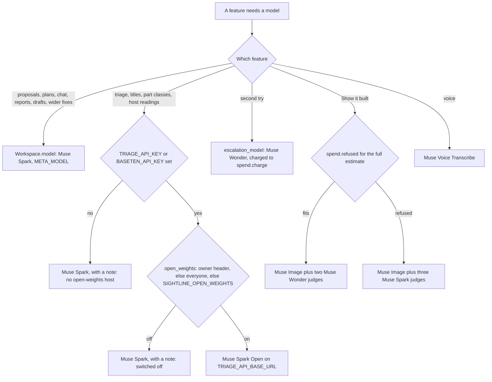
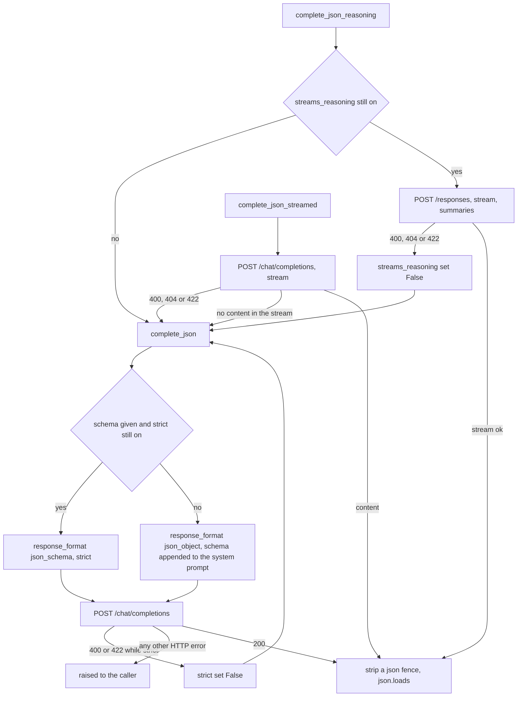
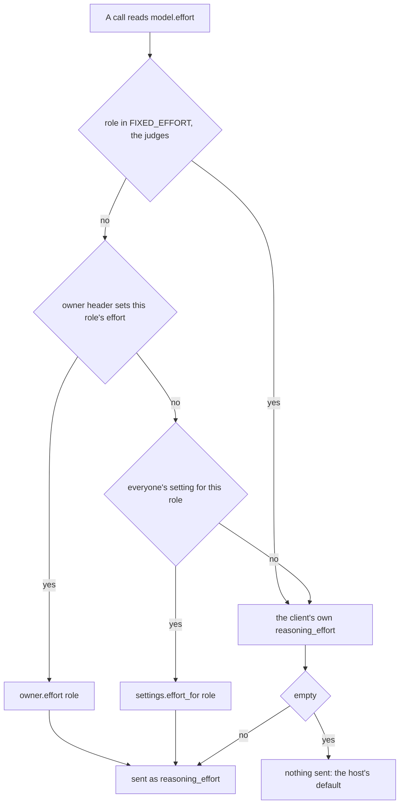
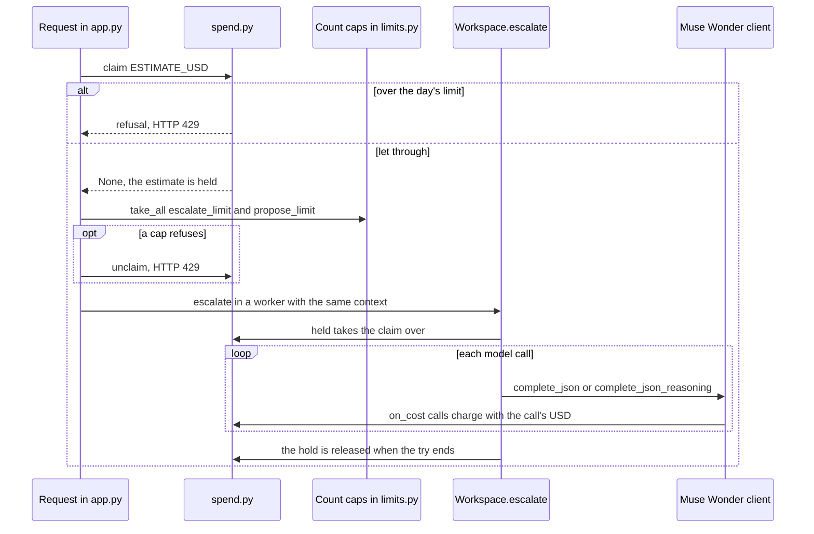

# 08 · AI models, prompts and spend

> **Covers:** `server/sightline/meta_client.py`, `server/sightline/spend.py`, the model parts of `settings.py`,
> `owner.py`, `built.py`, `voice_live.py`, `hosts.py` and `step.py`, and every prompt in
> `server/sightline/domain_packs/` and `domains.py` · **Checked against code:** 2026-10-30 (`fix/hardcoded-defaults`) ·
> **Deeper design:** [docs/escalation.md](../escalation.md), [docs/show-it-built.md](../show-it-built.md),
> [docs/voice.md](../voice.md)

ORCA talks to five models: Muse Spark (proposals, chat, plans, reports), Muse Spark Open on Baseten (triage,
titles, part classes, host readings, when switched on), Muse Wonder (second tries and picture judges), Muse Image
(Show it built) and Muse Voice Transcribe (voice). This doc is the plumbing under the AI workflows: which feature
calls which model on which host, how one client class (`MetaChatModel`) makes every text call, how reasoning effort
is chosen per request, what every prompt asks for, and how per-token spend is held to a daily budget. What each
workflow does with the replies is in [09 · Agent workflows](09-agent-workflows.md).

## The models

| Model (as people read it) | Default id | Host | Billed here | Used for |
|---|---|---|---|---|
| Muse Spark | `muse-spark-1.3-contributor` (`META_MODEL`) | `META_API_BASE_URL`, default `https://api.meta.ai/v1` | No (contributor tier; tokens counted, cost 0) | Proposals, plans, root causes, patterns, chat, wider fixes, requirements drafts, report text; triage and titles when the open-weights model is off |
| Muse Spark Open | `meta-models/muse-spark-open` (`TRIAGE_MODEL`) | `TRIAGE_API_BASE_URL`, default `https://inference.baseten.co/v1` | No (Baseten bills per hour, so it is off unless switched on) | Bulk triage, rule audits, clash titles, STEP part classes, host readings |
| Muse Wonder | `muse-wonder-1.0` (`META_ESCALATION_MODEL`) | Meta | Yes: $4 / $20 per million input / output tokens (`meta_client.PRICES`) | Second tries (escalation), Show it built's judges |
| Muse Image | `muse-image-1.0` (`META_IMAGE_MODEL`) | Meta, `/responses` with the `image_generation` tool | Yes: $0.01 a picture (`built.IMAGE_USD`) | Show it built's restyles |
| Muse Voice Transcribe | `muse-voice-transcribe-1.0` (`META_VOICE_MODEL`) | Meta, `/asr/transcribe` and the realtime socket | Capped by count, not priced | Voice messages, live captions |

`meta_client.model_label` turns an id into the name people read, by prefix (`LABELS`): every option, attempt and
stream event of a proposal carries it (`model: "Muse Wonder"`), and the page shows it as a chip.

## Which feature uses which model

Every AI feature, the model it calls by default, and what changes it. "Effort" is the reasoning effort sent with
the call; see [How effort is chosen](#how-effort-is-chosen) for the precedence. Env var meanings are in
[15](15-requirements-settings-and-config.md); caps and budgets in [16](16-security-caps-and-cost.md).

| Feature | Code | Model (default) | Host | Changed by | Effort (role, default) | Reply shape |
|---|---|---|---|---|---|---|
| Proposals (one clash) | `agent.resolve` via `Workspace.propose` | Muse Spark | Meta | `META_MODEL`, `META_API_BASE_URL` | `default`, `META_REASONING_EFFORT` (`low`) | JSON mode, no schema; streamed through `/responses` with reasoning summaries when someone watches |
| Fix together, root-cause fixes | `plans._resolve_items` → `agent.resolve` | Muse Spark | Meta | as above | `default`, `low` | JSON mode, chat completions only (plans run without `trials`) |
| Root cause reading | `plans.build_root_cause` | Muse Spark | Meta | as above | `default`, `low` | JSON mode, no schema |
| Pattern verdicts | `plans.triage_patterns` | Muse Spark | Meta | as above | `default`, `low` | JSON mode, no schema |
| Bulk triage | `triage.triage_report` in `triage.Job` | Muse Spark Open when switched on and keyed, else Muse Spark | Baseten or Meta | `TRIAGE_API_KEY` / `BASETEN_API_KEY`, `TRIAGE_MODEL`, `TRIAGE_API_BASE_URL`, `TRIAGE_IMAGES`, setting `open_weights` (`SIGHTLINE_OPEN_WEIGHTS`, default off) | `triage`: `TRIAGE_REASONING_EFFORT` (empty: none sent) on Open, `META_REASONING_EFFORT` on the Muse Spark fallback | Strict `triage.SCHEMA`, streamed with `reasoning_content` |
| Audit of by-design rules | `triage.audit_rules` | the triage model | as triage | as triage | `triage` | Strict `triage.AUDIT_SCHEMA` |
| Clash titles | `titles.title_batch` | the triage model | as triage | as triage | `triage` | Strict `titles.SCHEMA`, text only |
| STEP part classes | `step.classify` (model from `app._classifier`) | the triage model | as triage | as triage | `triage` | Strict schema with the `step.CLASSES` enum, text only |
| Host readings for openings | `hosts.read` via `Workspace.hosts_model` | the triage model, 60 s timeout | as triage | as triage | `triage` | Strict `hosts.SCHEMA`, text only |
| Requirements draft | `requirements.suggest` | Muse Spark | Meta | as proposals | `default`, `low` | Strict `requirements.SUGGEST_SCHEMA` |
| Chat | `chat.Chat.turn` | Muse Spark | Meta | as proposals | `default`, `low` | Tool calling (`chat.TOOLS`) |
| Wider fix (context arrangements) | `context_planner.build` | Muse Spark | Meta | as proposals | `default`, `low` | Tool calling (`context_planner.TOOLS`) |
| Report pages and summary | `document.explain`, `document.summarise` | Muse Spark | Meta | as proposals | `default`, `low` | Strict `EXPLAIN_SCHEMA`, `SUMMARY_SCHEMA` |
| Second try (escalation) | `Workspace.escalate` → `agent.resolve` | Muse Wonder, a fresh client per try | Meta | `META_ESCALATION_MODEL`, setting `escalation` (`SIGHTLINE_ESCALATION`, default `button`) | `escalation`, `META_ESCALATION_EFFORT` (`medium`) | JSON mode; `/responses` reasoning summaries when watched; every call charged |
| Show it built: restyle | `built.restyle` | Muse Image | Meta `/responses` | `META_IMAGE_MODEL`, setting `built_views` (`SIGHTLINE_BUILT_VIEWS`, default off) | none (the tool's `reasoning_strength: "high"`) | A PNG in an `image_generation_call` output |
| Show it built: judges | `built.judge` with `built.judge_model` | Muse Wonder (`META_ESCALATION_MODEL`) | Meta | as above | `judge`, fixed `medium` | Strict `built.JUDGE` |
| Show it built: lighter judges | `built.judge` with `built.spark_judge_model` | Muse Spark | Meta | used when the day's budget cannot cover Wonder's judges | `judge`, fixed `medium` | Strict `built.JUDGE` |
| Voice clip | `meta_client.transcribe` (`POST /api/transcribe`) | Muse Voice Transcribe | Meta `/asr/transcribe` | `META_VOICE_MODEL` | n/a | `{transcript, duration_ms}` |
| Live voice | `voice_live.relay` (`/api/voice/live`) | Muse Voice Transcribe | `META_VOICE_REALTIME_URL`, else `wss://<host of META_API_BASE_URL>/v1/asr/realtime` | `META_VOICE_MODEL`, `META_VOICE_REALTIME_URL` | n/a | Partial and final transcripts |

`Workspace.model` is one Muse Spark client for the whole process, built lazily in `service.Workspace.model`; the
chat and the MCP server's tools use the same one. The triage model is built per job (`meta_client.triage_model`,
called by `app._start_triage`, `app.titles_stream`, `app._classifier` and `Workspace.hosts_model`), so a change to
the open-weights setting applies to the next run.

### Which model

`meta_client.triage_model_info` makes the same decision without building a client and returns
`{model, open_weights, images, note?}`. `GET /api/models` sends it to the page with `escalation_info()` and
`settings.built_views()`, so the copy on the Triage card, the tour and the landing names the model that will
actually run ([12](12-web-app.md)).

## `meta_client.py`: the client

### Configuration and `.env`

- `meta_client.load_env()` reads `KEY=value` lines from the repo's `.env` (`ENV_FILE`, two folders above the
  package) into `os.environ` with `setdefault`, so real environment variables win. The package's `__init__.py` calls
  it, so it runs on the first import of any `sightline` module, before any setting is read
  ([15](15-requirements-settings-and-config.md)); `MetaChatModel.__init__`, `transcribe`, `escalation_info`,
  `escalation_model`, `triage_model_info`, `built.restyle`, `built.judge_model`, `built.spark_judge_model` and
  `voice_live.url` / `handshake` call it again before reading a key (harmless: a value already set is kept).
- `META_API_KEY` is read when a client is built (`os.environ["META_API_KEY"]`: a missing key raises `KeyError` at that
  point, which `Workspace.hosts_model` and `app._classifier` turn into "no model"). The browser never sees it; the
  live voice relay puts it in Meta's first socket frame (`voice_live.handshake`) and never logs it.

### `MetaChatModel`

One instance per model and host. Its fields:

| Field | Meaning |
|---|---|
| `base_url`, `api_key`, `model` | Host, key and model id (defaults from `META_API_BASE_URL`, `META_API_KEY`, `META_MODEL`) |
| `reasoning_effort` | This client's own effort: the constructor's, else `META_REASONING_EFFORT` (default `low`; `""` means the API's default) |
| `role` | `"default"`, `"triage"`, `"escalation"` or `"judge"`: which owner and everyone settings apply (below) |
| `client` | One `httpx.Client` with the client's timeout (120 s unless given) |
| `usage` | A `Usage` counter: calls, input, output and reasoning tokens |
| `on_cost` | Called with each priced call's cost in USD (`spend.charge` on Muse Wonder clients) |
| `strict` | Cleared, for the rest of this client's life, the first time the host refuses `json_schema` |
| `streams_reasoning` | True when `base_url` contains `api.meta.ai`; cleared the first time `/responses` is refused |

The ways it calls a model:

| Method | Endpoint | Streams | What it reads | Falls back to | Usage counted | Used by |
|---|---|---|---|---|---|---|
| `complete_json(system, text, images, schema)` | `POST /chat/completions` | No | `choices[0].message.content`, fence stripped, `json.loads` | itself in JSON mode, on 400/422 while strict | Yes (`_post`) | Everything that wants one JSON reply |
| `complete_json_streamed(..., on_reasoning)` | `POST /chat/completions`, `stream: true` | Yes | `delta.reasoning_content` (or `delta.reasoning`) to `on_reasoning`; `delta.content` collected | `complete_json` on 400/404/422, or when no content came | No | Triage (`triage.triage_one` when the Job asks for reasoning) |
| `complete_json_reasoning(..., on_reasoning)` | `POST /responses`, `stream: true`, `reasoning: {summary: "auto", effort}` | Yes | `response.reasoning_summary_text.done` to `on_reasoning`; `response.output_text.delta` collected; usage from `response.completed` / `incomplete` / `failed` | `complete_json` when `streams_reasoning` is off, or on 400/404/422 (and clears it) | Yes | `agent.resolve` and `agent._recommend` when `trials` and someone watches |
| `chat(messages, tools, timeout_s=)` | `POST /chat/completions` with `tools` | No | the assistant message (content and/or `tool_calls`) | none | Yes | `chat.Chat.turn`, `context_planner.build` |

Every text call sends `temperature: 0.2` and `reasoning_effort` (or `reasoning.effort`) only when `effort` is set.
Images go as base64 data URLs (`image_url` parts on chat completions, `input_image` on Responses). A Responses
stream that reports `response.failed` or `error` raises `RuntimeError` naming the model. A proposal passes
`schema=None`, so proposals always run in plain JSON mode: the prompt's example is the contract, and the agent reads
fields defensively (`reply.get("candidates", [])`).

### The JSON fallbacks

Both flags are sticky per client. That matters for `Workspace.model`, which every visitor shares: one refusal of
strict output or of `/responses` switches the whole process to the fallback until restart. The triage model is a
new client per job, so it re-tries strict output each run. `tests/test_meta_client.py` and `tests/test_triage.py`
pin the fallbacks.

### Timeouts and retries

The client itself never retries; each caller decides.

| Client or call | Timeout | On failure |
|---|---|---|
| `Workspace.model` (`MetaChatModel()`) | 120 s per request | Proposals stream `error`; plan items record the error; chat streams `error` |
| `triage_model()` | 120 s | Triage: 3 attempts per clash with 1, 2, 4 s back-off (`triage_report`), then `verdict: "unknown"` with `error`; titles: the batch is skipped (`batch_error`) |
| Host readings (`service.HOSTS_TIMEOUT_S`) | 60 s | The defaults stand (walls and slabs only) and the agent emits a `note` |
| `escalation_model()` | 240 s | The first try's result stands, with a `note` (automatic mode) or the stream's `error` |
| `built.judge_model` / `spark_judge_model` | 240 s | A failed judge counts as unfaithful (`built.judge`) |
| `built.restyle` | 300 s | That picture fails the gate; the other may pass |
| `transcribe` | 60 s | `POST /api/transcribe` answers 502 |
| `context_planner.build` | what is left of `Limits.seconds` (120 s) per `chat` call | The search stops and keeps the arrangements already verified |
| Live voice (`voice_live.relay`) | 10 s to open, 10 s for Meta's ack, `END_WAIT_S` 15 s for the last words | An `error` frame in words people can act on (`CLOSED`) |

### How effort is chosen

`MetaChatModel.effort` is read on every call, so the same client gives each request the effort its context asks
for. The owner's settings ride in the `X-Sightline-Settings` header, which `app._OwnerContext` reads only for a
request with a valid owner cookie and puts into context variables (`owner.enter`); `owner.spawn` and `owner.submit`
copy them into stream workers and thread pools. Everyone's settings live in `settings.py` (a Modal Dict on the
deployment, else a JSON file).

| Role | Owner header key | Everyone setting | Client default |
|---|---|---|---|
| `default` (Muse Spark: proposals, plans, chat, reports, drafts) | `effort` | `effort` | `META_REASONING_EFFORT`, `low` |
| `triage` (the triage model, whichever it is) | `triage_effort` | `triage_effort` | `TRIAGE_REASONING_EFFORT` on Open (default empty, nothing sent); `META_REASONING_EFFORT` when it falls back to Muse Spark |
| `escalation` (Muse Wonder second tries) | `escalation_effort` | `escalation_effort` | `META_ESCALATION_EFFORT`, `medium` |
| `judge` (Show it built) | ignored | ignored | `medium`, fixed (`meta_client.FIXED_EFFORT`) |

Allowed values are `settings.EFFORTS` (`minimal`, `low`, `medium`, `high`). Measured: `low` cut a Northbank
proposal from about 58 s to 23 s (`meta_client` docstring, `evals/README.md`). The judges keep their own effort
because their accuracy was measured at `medium` (S0, [docs/show-it-built.md](../show-it-built.md)).

### Factories

- `triage_model(timeout_s=120)` → `(MetaChatModel, info)`: Open on Baseten with `TRIAGE_REASONING_EFFORT`, or a
  plain Muse Spark client; `role = "triage"` either way.
- `triage_model_info()`: the decision only. Open needs a host key (`TRIAGE_API_KEY`, else `BASETEN_API_KEY`) **and**
  `settings.open_weights()` (the owner's header, else everyone's setting, else `SIGHTLINE_OPEN_WEIGHTS`, default
  `0`). `images` follows `TRIAGE_IMAGES` on Open (`0` for a text-only host) and is always true on Muse Spark.
- `escalation_info()` → `{model, label, mode, available}`: `mode` is `settings.escalation()` (`off`, `button`,
  `auto`); `available` is whether `META_API_KEY` is set.
- `escalation_model(timeout_s=240)`: a new Muse Wonder client each time, `role = "escalation"`,
  `on_cost = spend.charge`. A fresh client per try means its `usage` is that try's alone.
- `built.judge_model()` / `built.spark_judge_model()`: Wonder (charged) or Spark (not), both `role = "judge"`.

### Usage and prices

- `Usage.of(raw)` reads both shapes of `usage` (chat completions' `prompt_tokens` / `completion_tokens` /
  `completion_tokens_details.reasoning_tokens`, Responses' `input_tokens` / `output_tokens` /
  `output_tokens_details`). `Usage.add` is thread-safe; `snapshot` and `as_dict(model_id, since)` give one run's
  share on a client other runs use.
- `cost(model_id, tokens_in, tokens_out)` prices by id prefix from `PRICES` (only `muse-wonder`; reasoning counts as
  output). `MetaChatModel._count` adds each call's usage and, when it costs anything, calls `on_cost`.
- `agent.resolve` reports `Result.usage` only for a priced model (`cost(model, 1, 1) > 0`): a second try's tokens and
  dollars reach the page; Muse Spark's shared client reports none.
- Gap: `complete_json_streamed` (triage on Baseten) does not count usage. Nothing priced runs through it today.

### Muse Image

`built.restyle(look, lines, extra)` posts straight to `<META_API_BASE_URL>/responses` with httpx (not through
`MetaChatModel`): one user message with `built.PROMPT` (+ `extra` on a retry) and two input images (ORCA's view and
its outline), and `tools: [{type: "image_generation", reasoning_strength: "high", output_format: "png",
enable_web_search: false, enable_image_search: false}]`, `store: false`. It takes the first
`image_generation_call` output's `result` (base64 PNG), charges `built.IMAGE_USD` ($0.01) to `spend.charge`, and
raises when none comes back. How the picture is checked is in [09](09-agent-workflows.md#show-it-built).

### Voice

- **A clip** (`meta_client.transcribe(wav, keywords)`): multipart `POST <base>/asr/transcribe` with a `request` JSON
  part (`model`, `audioEncoding: "WAV"`, `mode: "PUSH_TO_TALK"`, `languageBias: ["English"]`, `keywords`) and the
  `audio` part. `app.transcribe_voice` checks the WAV first (mono, 16-bit, 16 or 24 kHz, at most
  `MAX_VOICE_BYTES`), takes one voice cap, and runs it in a thread.
- **Live** (`voice_live.relay`): the server opens `voice_live.url()` and sends `handshake(mode, keywords)` first,
  with the key in `authorization.accessToken`, `audioEncoding: "PCM_16KHZ"`, `mode` `PUSH_TO_TALK` (hold) or
  `ENDPOINTING` (hands-free, `voice_live.MODES`), `partialMode: "CUMULATIVE"`; a reply without `sessionId` is a
  refusal. Audio is paced so it never runs more than `AHEAD_S` (1.5 s) ahead of real time. The browser-side
  protocol (`ready`, `partial`, `final`, `speech`, `limit`, `error`) is in [10](10-http-api-and-streams.md); the
  design and measurements in [docs/voice.md](../voice.md).
- **Keywords** (`app._voice_words`): `app.VOICE_WORDS` plus up to 40 element names and Muse titles from the open
  report, shortest first, so recognition leans to "supply air duct" rather than "supply adequate".

## Prompts

Every prompt file lives in `server/sightline/domain_packs/` and is read from disk on each call (the chat's on each
turn), so a prompt edit takes effect without a restart. A system prompt is usually a pack plus lines
added at run time: the coordination requirements' `requirements.prompt_text(doc, "triage" | "fixes")` (which says
only what differs from ORCA's defaults; see [15](15-requirements-settings-and-config.md)), the second try's pack,
or the recommend-only text.

### How the domain is chosen

ORCA has two demos, a building (Northbank, IFC) and a machine cell (the palletising cell, opened from STEP), and the
prompts follow the work. `domains.of(ws, scene_id)` is the one place that decides: the scene's effective requirements
say (`Doc.domain`: the user's file, else a demo's own, `Workspace.requirements_for`); else a scene whose every model
was opened from STEP (`Workspace.sources` has an entry for each of its files) is `machines`; IFC, a mix of IFC and
STEP or no scene is `construction` (`domains.infer`). Callers never test for STEP themselves.

- **The fix pack.** `agent.resolve(..., pack=)` reads `domain_packs/<pack>.md` whole. `Workspace.propose`,
  `Workspace.escalate` and `plans.build_batch` (Fix together, root-cause partners) pass `pack=domains.of(...)`, so the
  cell gets `machines.md` and Northbank `construction.md`. The two packs share the seven fix kinds and the JSON contract
  (parsing is unchanged; `tests/test_domains.py` pins the kinds and the JSON keys); the opening, the rules of thumb
  and the examples differ. No example in either pack, nor in `escalation.md`, is a demo's answer (Northbank Rev04's
  +400 mm duct, the cell's C6 route): the numbers are neutral.
- **The shared prompts.** `chat.md`, `triage.md`, `report.md`, `report_summary.md`, `patterns.md` and `root_cause.md`
  say who ORCA is through one `{role}` placeholder, filled by `domains.prompt(name, domain)` from `domains.ROLES`:
  "a senior BIM coordinator" for construction (so Northbank's prompts are byte for byte what they were), "a senior
  mechanical integration engineer on a machine and automation cell" for machines. The domain reaches them from the
  scene: the chat per turn (`Context.scene_id`), triage through `app._start_triage` (`triage.Job(domain=)`), reports
  through `app._build_document` (`document.generate(domain=)`), patterns and root causes through their scene id.
  A triage run started before any scene was open (a Navisworks report alone) reads as construction, and the run is
  shared per report, not per domain.
- `titles.md` names the meeting the titles are read out in (`{meeting}`: "a BIM coordination meeting", "a machine
  cell design review"; `titles.Job(domain=)`, from the `?scene_id=` the page sends), and `triage.AUDIT` takes the
  role (`domains.fill`). `domains.fill` also fills `{teams}`: `triage.md` and `report.md` name the report's teams, and
  an empty list drops the " ({teams})" clause. No team names are fixed in any prompt or schema (below).
- `escalation.md` and `context.md` go through `domains.prompt` too (`{role}` in `context.md`). Neither names a model
  or a property set; "fixed in place" stands where "structure" was a rule. `report.md` says the `{clearance}` the
  requirements set (at least 25 mm without them). `titles.md` shows each domain's own `{examples}`
  (`domains.EXAMPLES`); triage's tolerance is the clash test's own (each clash's text gives it), and no prompt says
  "2.5 m" (the context radius shrinks for small models).
- Written for any industry already: `penetrations.md`, `requirements.md`, `step_classes.md`.
- **Names and prices** come from `meta_client.LABELS` / `PRICES`, with `SIGHTLINE_MODEL_LABELS` /
  `SIGHTLINE_MODEL_PRICES` over them for another host's models; `GET /api/models` sends each role's name
  (`meta_client.labels`) and the page's words use it (`web/src/aiNames.ts`). Whether a host streams reasoning is
  `META_STREAMS_REASONING`, else Meta's own host only.

### The prompt inventory

| Prompt | Loaded by | Model | Asks for | Output | Notable rules |
|---|---|---|---|---|---|
| `domain_packs/construction.md` | `agent.resolve` (`pack="construction"`, for a scene that is not wholly from STEP: `domains.of`), as the system prompt with `guidance` appended | Muse Spark; Muse Wonder on a second try | An understanding, up to 5 candidate fixes best first, and advice for the reviewer | JSON object (not schema-held): `{understanding, candidates: [{title, kind, move: "A" or "B", delta_m, or split_m and dz_m, or steps, or split_m and depth_m and keep, rationale, also_needs}], advice}` | Six kinds (move, offset, route, resize, trim, penetration) with when to use each. Structure stays and services move; drainage never rises; smallest move with margin; resize only when moves, offsets and routes fail; never trim structure, a post or guarding to let a service pass; a penetration's `move` names the service; severity from numbers, not pixels; A red, B green, images A/B/C |
| `domain_packs/machines.md` | `agent.resolve` (`pack="machines"`, for a scene opened from STEP: `domains.of`), as the system prompt with `guidance` appended | Muse Spark; Muse Wonder on a second try | The same as `construction.md` | The same JSON object as `construction.md` (its fix kinds and output contract are copied word for word) | Persona: a senior mechanical integration engineer coordinating a machine and automation cell (frames, guarding and fencing, conveyors and pallet stations, robot bases, cable chains, pneumatics). ORCA checks static geometry only: never claim robot reach or motion is clear. Plant structure, anchored frames and robot bases stay; trays, air lines and conduits move; guarding and safety zones stay intact; keep maintenance access and removal room; conveyors keep line and height; keep a cable chain's envelope clear |
| `domain_packs/escalation.md` | `Workspace._escalate` appends it to the fix guidance (`domains.prompt("escalation", domain)`) | Muse Wonder | A second, longer try that beats the first | Adds the `combined` kind: `{kind: "combined", steps: [{kind: move, offset or route, move: "A", "B" or a GlobalId, ...}]}` | Never repeat an idea that failed; beat the first try's fixes (a plain fix over a resize or an opening, more clearance, a smaller change); look past the two elements; structure and anything marked "stays" never moves; only services move to make room; one step must change A or B; prefer one element |
| `domain_packs/triage.md` | `triage.triage_one` (`domains.prompt`, `{role}`, `{teams}`: the teams guessed for the report's models, `app._report_teams`), plus `prompt_text(doc, "triage")` | the triage model | One verdict for one clash (or for a group of alike clashes) | Strict `triage.SCHEMA`: `understanding`, `verdict` (`real_clash`, `by_design`, `non_physical`, `modelling_error`), `severity`, `responsible` (one of those teams or none: `triage.schema_for`; free text when none is known), `action`, `fix_hint`, `confidence` | Most raw results are noise; the test name can be wrong, trust classes and names; 0 mm or within the tolerance is a touch; severity from numbers |
| `domain_packs/titles.md` | `titles.title_batch` (`domains.prompt`, `{meeting}`, `{examples}`) | the triage model | A title per clash line, up to 40 lines per call | Strict `titles.SCHEMA`: `{titles: [{number, title}]}` | At most 12 words, sentence case; never an IFC class, a GlobalId or "Clash"; how they meet from the depth (touches at 5 mm or less, clips, runs into, sits inside, is n mm from); "modelled twice" only in a duplicates test; the element that would change first; describe, don't judge |
| `domain_packs/patterns.md` | `plans.triage_patterns` (`domains.prompt`, `{role}`), plus `prompt_text(doc, "triage")` | Muse Spark | A verdict per pattern (P1, P2, ...) | JSON mode: `{patterns: [{id, verdict, cause, action, rule}]}`; an unknown verdict becomes `real_problem` | `by_design` (a clash rule hides it), `modelling_error` (fix once at the source), `real_problem`; a constant overlap usually means a convention or a systematic error |
| `domain_packs/root_cause.md` | `plans.build_root_cause` (`domains.prompt`, `{role}`), plus `prompt_text(doc, "fixes")` | Muse Spark | The cause behind one element's clashes and a strategy | JSON mode: `{root_cause, strategy, reason}`; a strategy outside the three becomes `fix_partners` | `move_hub` only for elements that can move; `fix_partners` keeps the hub (a transfer girder) and changes what crosses it; `as_designed` edits nothing; say the cause in design terms; cover clashes the geometry found that the report missed |
| `domain_packs/chat.md` | `chat.Chat.session`, and set again at each `Chat.turn` in the voice of the turn's scene (`domains.prompt`, `{role}`) | Muse Spark | Short, plain answers using tools | Tool calls from `chat.TOOLS` (26 functions), then text | Each user message starts with a `[context]` line; call a clash "#39 title"; numbers only from tools, saying whose measure; propose_fixes, find_root_causes, find_patterns, check_* and detect_clashes each for its job; show what you talk about (show_clash); kinds of element by class, level, model or property with set_filters (until clear_filters); detect_clashes with a and b for a check of some elements (a user's filter by name from [context], or described); you cannot accept a fix; explore_wider_fix costs three proposals |
| `domain_packs/context.md` | `context_planner.build` (`domains.prompt("context", domain)`, `{role}`) | Muse Spark | Complete arrangements of up to three edit groups for one clash | Tool calls from `context_planner.TOOLS` (`inspect_element`, `inspect_neighbourhood`, `evaluate_proposal`) | Only discovered GlobalIds; at most 3 edit groups, 6 model calls, 12 trials, 120 s, 3 alternatives; `Pset_SightlineConstraints.KeepFixed` forbids edits; offsets split along the run, vertical or lateral; never claim engineering adequacy; an empty search is "inconclusive", never "no solution" |
| `domain_packs/penetrations.md` | `hosts.read` | the triage model | A reading per kind of host a service would pass through | Strict `hosts.SCHEMA`: `{readings: [{kind, verdict, reviewer, fit, limits: {max_depth_ratio, keep_from_ends_depths, keep_from_edges_m, zone}, conditions, reasoning}]}` | Verdicts `allowed`, `with_review`, `not_advised`, `never`, each with examples (a transfer beam or column never); one reviewer; `annular` or `fitted`; limits null when they do not apply; thin facts lean to `with_review` |
| `domain_packs/requirements.md` | `requirements.suggest` | Muse Spark | A draft of the project's coordination requirements from an inventory of the models | Strict `requirements.SUGGEST_SCHEMA`: `{summary, groups, checks, who_moves, by_design, guidance: {triage, fixes}}` | Any industry, the models' own words; only teams and classes that appear in the files; 2 to 8 groups; one check per pair and per group against itself; at L5 every group is `none`; by-design pairs few and certain |
| `domain_packs/step_classes.md` | `step.classify` | the triage model | An IFC class and type for each STEP part, 200 parts per call | Strict schema: `{parts: [{i, class, type}]}`, `class` limited to `step.CLASSES` | From the name and groups only, never invented; a name that says nothing becomes a proxy with its group's name; conduits are `CONDUITSEGMENT` |
| `domain_packs/report.md` | `document.explain` (`domains.prompt`, `{role}`, `{teams}`: the team names the user typed, `{clearance}`), up to 3 images per page | Muse Spark | The text of one clash's report page | Strict `document.EXPLAIN_SCHEMA`: `{explanation, recommended_action, review_points: [{team, point}]}` | A draft every named team reviews; a verified fix means "clash gone, 25 mm clear, nothing new hit" and no more (structural approval, cost and access are for the teams) |
| `domain_packs/report_summary.md` | `document.summarise` (`domains.prompt`, `{role}`) | Muse Spark | The report's opening summary and actions per team | Strict `document.SUMMARY_SCHEMA`: `{summary, team_actions: [{team, actions}]}` | Three to five sentences; numbers, no marketing, no restating every clash |

### Prompts written in code

| Prompt | Where | Used for |
|---|---|---|
| `triage.AUDIT` with `triage.AUDIT_SCHEMA` (`{answer: consistent, looks_real or unsure, note}`) | `triage.audit_rules`, plus `prompt_text(doc, "triage", rules=False)` | Checking a by-design rule against the deepest clashes it set aside |
| `requirements.RECOMMEND` | appended by `agent.resolve` when nothing may be edited | Asks for recommendations for the designer: nothing will be tried or applied |
| `requirements.prompt_text(doc, role)` | appended to triage, patterns, root cause and fix prompts | The project's level, strictness, clearances, who moves, limits, openings rules and the team's guidance, only where they differ from the defaults |
| `built.PROMPT` (`PROMPT_VERSION` `"1"`, part of the picture cache key) | `built.restyle` | Restyle ORCA's view without adding, removing, moving or resizing anything; keep every outline line |
| `built.JUDGE_SYSTEM` with `built.JUDGE` (`{model_view_objects, differences: [{kind, what, where, size}], verdict}`) | `built.judge` | Compare the restyle with the model view region by region; image 3 (the ids picture) only to read image 1 |

Changing a prompt's version-free text changes behaviour silently: run the eval that covers it
([18](18-testing-and-evals.md)). The triage prompt (construction's voice, `domains.prompt("triage")`) and schema are shared
with `evals/navisworks_triage.py`, so its scores describe the app.

## Money

### What costs money

| Spend | Charged when | Amount |
|---|---|---|
| Muse Wonder tokens (second tries, judges) | Each call lands: `MetaChatModel._count` → `on_cost` → `spend.charge` | `cost()` from `PRICES` |
| Muse Image pictures | Each picture returned: `built.restyle` → `spend.charge(IMAGE_USD)` | $0.01 |
| Muse Spark, Muse Spark Open, Muse Voice Transcribe | Never (not priced here) | Held by count caps instead ([16](16-security-caps-and-cost.md)) |

### `spend.py`: the day's budget

One budget for every per-token and per-picture call, in memory per process, by UTC day:
`SIGHTLINE_WONDER_MAX_USD_DAY` (default 25; 0 means no limit; a bad value falls back to 25). A restart starts the
day's count again.

| Symbol | What it does |
|---|---|
| `_spent`, `_day` | What today's calls cost so far (reset when the UTC date changes) |
| `_held` | Estimates of paid work still running, until it ends |
| `charge(usd)` | Adds a landed call's cost to today |
| `spent()`, `limit()` | Today's total, the limit |
| `refused(estimate, exempt)` | Why paid work may not start (`_spent + _held + estimate > limit`), or None. Checks only |
| `claim(estimate, exempt)` | Checks and holds the estimate in one lock, so two requests on a nearly spent day cannot both pass; remembers the claim in this request's context (`_claims`, a list shared with the threads `owner.spawn` starts) |
| `unclaim(estimate)` | Gives a claim back when a cap refused the work after the budget let it through |
| `held(estimate)` | Context manager around the paid work: takes this request's claim over (or holds now) and releases it when the work ends |
| `reset()` | Tests |

The owner's requests are `exempt`: they skip the limit (and the demo caps) but are still charged, so they count
against everyone else's day. While a try runs, its landed calls are in `_spent` and its whole estimate is still in
`_held`, so the check is conservative.

### Who claims what

| Work | Estimate held | Claimed in | Then |
|---|---|---|---|
| A second try | `escalation.ESTIMATE_USD`, $1 (about two rounds of Muse Wonder) | `app.escalation_refused` (button requests, automatic second tries through `_escalation_check`, chat, MCP) | `Workspace.escalate` runs inside `spend.held` |
| Show it built, full check | `built.ESTIMATE_USD`, $0.62 (two rounds: four pictures and eight Wonder judgements) | `app.built_stream` | `built.make` runs inside `spend.held` |
| Show it built, lighter check | `built.PICTURES_USD`, $0.04 (the pictures alone) | `app.built_stream` | three Muse Spark judges (`built.SPARK_JUDGES`), result labelled `judge: "Muse Spark"` |

How Show it built degrades: `built_stream` asks `spend.refused(built.ESTIMATE_USD)`. If the full check fits, it
claims $0.62 and Muse Wonder judges. If not, it claims only $0.04 and Muse Spark judges; if even that is refused the
request gets 429. A picture already cached costs nothing; one being drawn now (`built.running`) is shared at no
cost; a cached picture that was checked the lighter way is drawn and checked again by Wonder once the budget can pay
(`built_stream` drops the hit and `built._make` re-checks). Measured cost: about $0.31 a click, $0.62 with the second
pair ([docs/show-it-built.md](../show-it-built.md)).

### Budgets and caps

`spend.py` limits dollars per day for the whole server; `limits.ProposeLimit` limits uses per visitor per hour and
for everyone per day. Paid work needs both: a second try is one `escalate_limit` use and one `propose_limit` use
(`ProposeLimit.take_all`, both or neither) plus the budget claim, and is refused outright when the `escalation`
setting is `off` (403); Show it built needs `settings.built_views()`, a `built_limit` use and the claim. Every cap,
its env vars and who is exempt are owned by [16 · Security, caps and cost controls](16-security-caps-and-cost.md).

## When to update this doc

- A new model, model id default, host, or env var that picks one (`META_*`, `TRIAGE_*`, `BASETEN_API_KEY`).
- A new `MetaChatModel` method, endpoint, fallback, timeout or retry, or a change to `strict` / `streams_reasoning`.
- A new role, a change to `FIXED_EFFORT`, or to the owner / everyone / environment precedence for effort or for the
  open-weights choice.
- A new feature that calls a model (add a row to "Which feature uses which model").
- A new, renamed or removed file in `server/sightline/domain_packs/`, a change to what a prompt asks for or the schema
  it is held to, or a new prompt written in code (`tests/test_docs_map.py` checks the inventory).
- A new domain, a change to how `domains.of` picks one, or a new placeholder in the shared prompts.
- A change to `PRICES`, `Usage`, `spend.py`, an estimate (`escalation.ESTIMATE_USD`, `built.ESTIMATE_USD`,
  `built.PICTURES_USD`, `built.IMAGE_USD`) or how Show it built falls back to lighter judges.
- A change to the voice request shapes (`transcribe`, `voice_live.handshake`).
