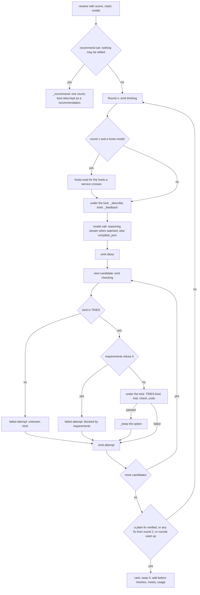
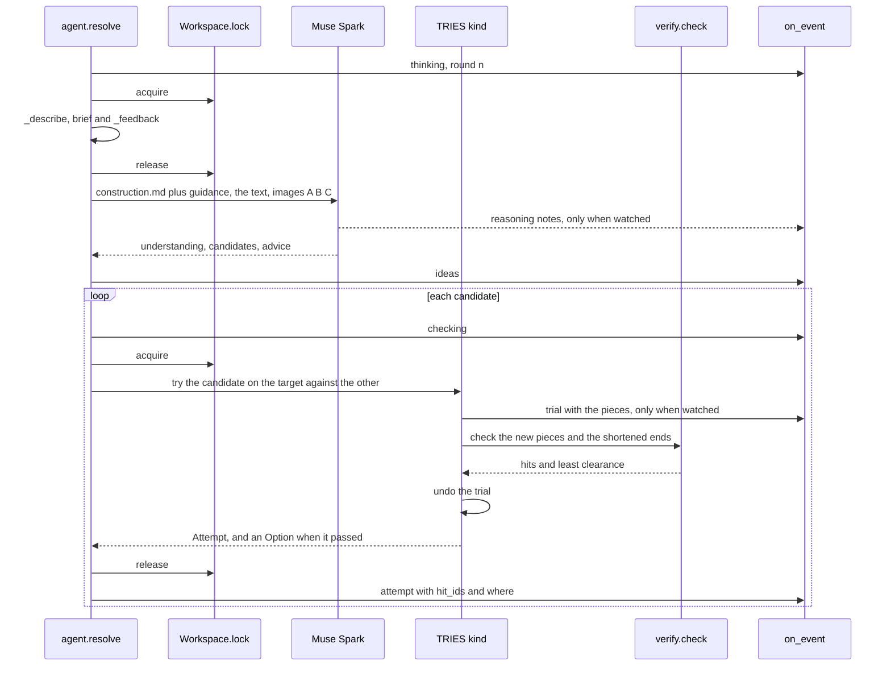
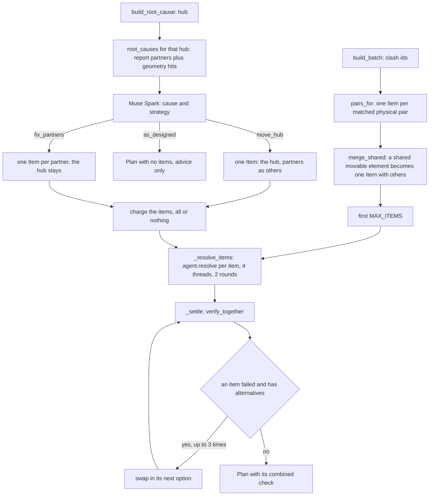
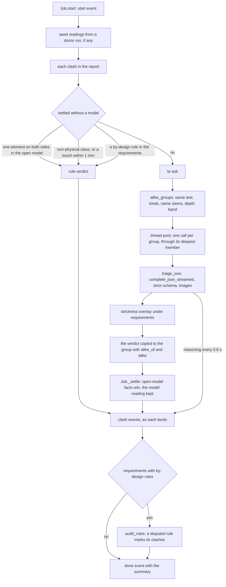
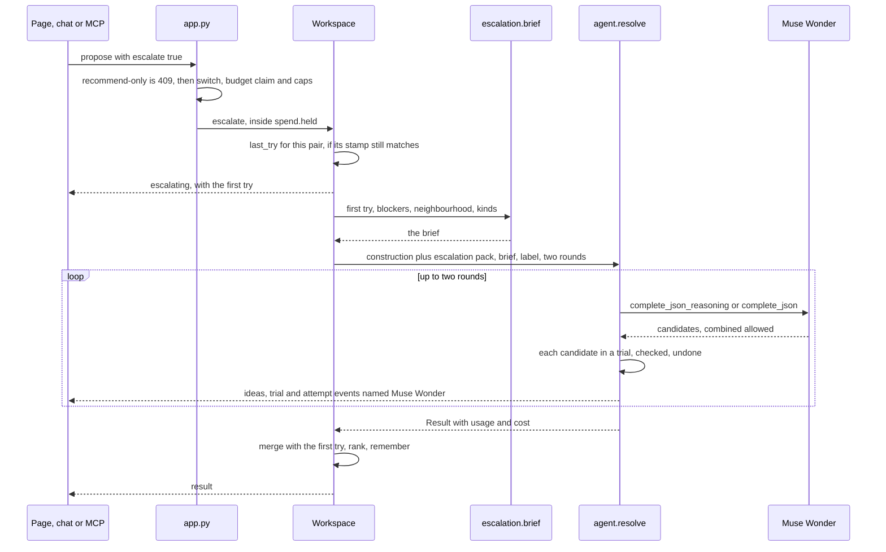
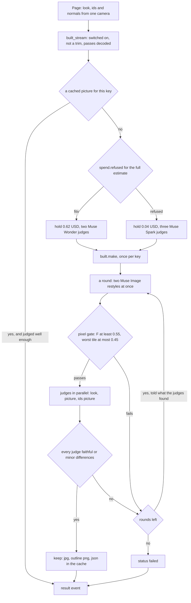

# 09 · Agent workflows

> **Covers:** `server/sightline/agent.py`, `plans.py`, `triage.py`, `titles.py`, `chat.py`, `hosts.py` (reading),
> `escalation.py`, `built.py`, `context_planner.py`, the suggest path of `requirements.py`, and the AI parts of
> `service.py` (`Workspace.propose`, `escalate`, `fix_settings`, `clash_for`, `last_try`) ·
> **Checked against code:** 2026-10-30 (`104fda9`) · **Deeper design:** [docs/edits.md](../edits.md),
> [docs/escalation.md](../escalation.md), [docs/show-it-built.md](../show-it-built.md),
> [docs/requirements.md](../requirements.md)

Every AI workflow in ORCA has the same shape: the server gathers facts from the geometry, asks a model for a
judgement, and checks or bounds what comes back before anyone sees it. A fix is never shown until `verify.check`
passes it; a triage verdict that a rule can settle never reaches a model; a restyled picture is gated by pixels and
judged by a second model. This doc is the server-side internals of each workflow: what the model is told, how its
replies are used, the loops and their stop rules, the shared jobs, and the events each one emits. The model plumbing
under them (clients, hosts, effort, prompts, money) is [08](08-ai-models-prompts-and-spend.md); the geometry of each
kind of fix is [07](07-fixes-and-edits.md); the wire format of every event is [10](10-http-api-and-streams.md).

## The workflows at a glance

| Workflow | Entry point | Model | Started by | Emits |
|---|---|---|---|---|
| Propose fixes for one clash | `Workspace.propose` → `agent.resolve` | Muse Spark | `POST /api/scenes/{scene_id}/propose[/stream]`, chat `propose_fixes`, MCP | `thinking`, `reasoning`, `ideas`, `checking`, `trial`, `attempt`, `note`, then `result` |
| Second try | `Workspace.escalate` → `agent.resolve` | Muse Wonder | the same routes with `escalate: true`, automatic mode, chat, MCP | `escalating`, then as above with `model` |
| Fix together | `plans.build_batch` | Muse Spark, one agent per item | `POST /api/scenes/{scene_id}/plan/stream` (`clash_ids`), chat `plan_fixes_together` | `plan_items`, `item`, `checking_plan`, then `plan` |
| Root cause | `plans.root_causes`, `plans.build_root_cause` | Muse Spark | `GET .../root_causes/{scene_id}`, plan stream (`hub`), chat | `thinking`, `root_cause`, then as Fix together |
| Patterns | `plans.patterns`, `plans.read_patterns` → `triage_patterns` | Muse Spark (one call, once) | `GET .../patterns/{scene_id}`, `POST .../patterns/{scene_id}/triage`, chat and MCP `find_patterns` | none (one reply) |
| Bulk triage | `triage.Job` → `triage.triage_report` | triage model | `POST /api/reports/{report_id}/triage/stream` | `start`, `clash`, `reasoning`, `audit`, `done`, `ping` |
| Titles | `titles.Job` → `titles.title_report` | triage model | `POST /api/reports/{report_id}/titles/stream` | `start`, `titles`, `batch_error`, `done`, `ping` |
| Chat | `chat.Chat.turn` | Muse Spark with tools | `POST /api/chat`, and the MCP tools reuse `Chat._run` | `session`, `thinking`, `tool`, `tool_result`, `ui`, `agent`, `proposal`, `plan_*`, `detect_event`, `context_event`, `message`, `done` |
| Wider fix | `context_planner.build` | Muse Spark with tools | `POST /api/scenes/{scene_id}/context/stream`, chat `explore_wider_fix` | `context_progress`, `context_result` |
| Host readings | `hosts.read`, `hosts.decide` | triage model | the first round of `agent.resolve`, `Workspace.check_penetration` | (an agent `note` on failure) |
| Requirements draft | `requirements.suggest` | Muse Spark | `POST /api/scenes/{scene_id}/requirements/suggest` | none (one reply) |
| Show it built | `built.make` | Muse Image, then Muse Wonder or Muse Spark judges | `POST /api/scenes/{scene_id}/built/stream` | `drawing`, `gate`, `judging`, `judged`, `retry`, `result` |
| STEP part classes | `step.classify` | triage model | opening or uploading a STEP file | `classifying`, `classify_failed` (open events) |
| Report text | `document.explain`, `document.summarise` | Muse Spark | `POST /api/reports/{report_id}/document/stream` | `progress` ([14](14-files-in-and-out.md)) |

Every workflow that runs in a worker thread starts it with `owner.spawn` or `owner.submit`, so the owner's settings
and the request's coordination requirements (both context variables) follow it. Every geometry operation takes
`Workspace.lock`, an `RLock`; model calls are made outside it, which is what lets several agents run at once.

## The fix agent: `agent.resolve`

`agent.resolve(scene, clash, model, ...)` is the loop at ORCA's heart: **propose → verify → retry with the failure
reason → rank**. Nothing reaches `Result.options` without passing the geometry check of its kind.

### What it is given

- **`agent.Clash`**: `element_a` (red), `element_b` (green), `distance_m`, `images` (A, B, C), `notes`, `others`
  (more elements A runs into, for a plan's merged item: one fix must clear all) and `nearby` (other clashes of A or
  B close by: told, never required).
- **`Workspace.clash_for`** builds it. For a report clash it takes the report's distance and pictures, adds a source
  line to `notes` ("Found by ORCA's own detection: test, name." or "From a Navisworks clash report: ..."; "Images are
  views of this clash." when there are some), and fills `nearby` from `Workspace._nearby`: per side that can move,
  up to 3 of its other hard clashes with physical partners, within 3 m of where A and B meet (`NEARBY_M`,
  `NEARBY_MAX`), never the fixed side's partners. With an edit log for the scene, `Workspace._with_edits` adds to
  `notes` the edits already kept or undone on A or B (`journal.entry_lines`: "E2 (you, 14:05): …; follows E1",
  "[undone]"), so Muse builds on them and does not propose again what the person took back; nothing when there are none.
- **`Workspace.fix_settings`**: with coordination requirements in force, the `clearance_m` the pair must keep, a
  `policy` per element (`requirements.Policy`), the `guidance` lines (`requirements.prompt_text(doc, "fixes")`), the
  `doc`, and `recommend` (why nothing may be edited) when neither side may be edited. With none, `{}`: today's
  defaults (`requirements.DEFAULT_CLEARANCE_M`, 25 mm). `Workspace.clearance` is the same value for a check by hand,
  by chat or over MCP, so it agrees with keeping the fix.
- **`hosts_model`**: the triage model, for reading which hosts may take an opening (below).
- **On a second try**: `brief` (what Wonder reads beyond the clash) and `label` ("Muse Wonder").

### What Muse is told

The system prompt is `domain_packs/construction.md` + `guidance` (+ `domain_packs/escalation.md` on a second try,
+ `requirements.RECOMMEND` in recommend mode). The user message is the images plus this text, rebuilt each round
under the lock:

| Part | Function | When |
|---|---|---|
| A and B: class, name, level, GlobalId; the reported signed distance | `_describe` | Always |
| The straight segment (ends, length, direction, profile), where the other element sits along it, what an offset's bends, risers and straights take | `_run_text` (via `edits.run_of`) | For each side that is a straight run; walls and slabs (`edits.PENETRABLE`) are not described as runs |
| Openings through the obstacle on the run's line, with the `dz` range that passes with the clearance | `edits.passages` in `_run_text` | Where the obstacle has openings |
| Room past the obstacle: side (named by compass) and up offsets that keep the clearance along that stretch | `_room_text` → `edits.free_bands` | Memoised per proposal (`memo`): every trial is undone, so the room cannot change |
| Each of `others` along the run, and the room past all of them at once, or "No side offset clears all of them in one stretch" | `_run_text` | Merged plan items and move-the-hub plans |
| How deep a rectangular duct or tray can be over or under the obstacle, and the width that keeps its performance | `_resize_text` → `edits.resize_size` | An obstacle wholly above or below a resizable section |
| Other clashes of this element along its run | `_nearby_text` | From `Clash.nearby` |
| A joint: which end runs how far into the other, what a trim takes; "both in the same model" (often by design, a trim only tidies) | `_joint_text` → `edits.butt_trim` | One element's end runs into the other |
| A bearing: an element that comes down into the other and stands above its top, what a seat would cut and its share | `_seat_text` → `seat_of` → `edits.seat` | One element lands in the other (not a run, a straight-prism support) |
| A penetration: the opening it would ask for, who cuts it, the reading of that kind of host, limits it breaks, an opening already requested, "runs out of both faces: cross it, don't cut it off" | `_penetration_text` → `hosts.decide`, `edits.penetration`, `hosts.check_hole` | A straight service crossing a non-service |
| Notes | `Clash.notes` | Source line, plan notes ("Move element A (the hub)..."), "It also runs into..." |
| The second try's brief | `escalation.brief` | Second tries only |
| What was already tried: each idea, its edit in words (`edit_text`), and "passed" or "FAILED, reason at [x, y, z]"; "Propose different fixes." | `_feedback` | From round 2 |

### The loop

1. **Recommend mode.** With `recommend` set (no side may be edited), `_recommend` runs one round and returns its best
   candidate as `Result.recommendation` (title, kind, element, `delta_m`, `split_m`, `edit`, rationale, `also_needs`,
   `blocked_by`, two other titles). Nothing is tried or applied.
2. **Round start.** Emit `thinking`. In round 1, with a `hosts_model`, read every host a service in the pair crosses
   (`penetration_pairs`, minus those a hard rule settles) with `hosts.read`; a failure emits `note` and leaves the
   defaults.
3. **Ask.** Build the text under the lock, then call the model outside it: `complete_json_reasoning` (reasoning
   summaries streamed as `reasoning` events) when `trials` is set, someone listens and the client streams reasoning;
   else `complete_json`. Keep the first round's `understanding` and the latest `advice`. Emit `ideas`.
4. **Try each candidate.** Emit `checking`. The target is A when `move` is `"A"` or the kind is `combined`, else B.
   A kind not in `agent.TRIES` is a failed attempt ("unknown kind"). With a `policy`, `_refused` turns a candidate the
   requirements forbid into a failed attempt (`requirements.blocked`, the reason Muse reads next round) before any
   geometry runs. Otherwise `TRIES[kind]` runs under the lock: make the edit in a trial, emit `trial` with the pieces
   when `trials`, check, undo. Emit `attempt`. A verified option goes through `_keep`.
5. **Stop or go round.** Stop when any option is a plain geometry fix (tier below 1: move, offset, trim, route,
   combined), or when any option exists from round 2 on, or after `max_rounds` (3 for a single proposal, 2 for plan
   items and second tries). A round whose only fixes are a resize or a penetration gets one more round to beat them.
6. **Rank and finish.** Sort, keep `want` (3), add each option's `before` meshes (`edits.meshes`, for the
   before/after view), `meets` under requirements (`requirements.meets`), the model label, and `usage` for a priced
   model.



One round, as the locks and calls interleave:



### Candidates and how each kind is tried

`agent.TRIES` maps each kind Muse may name to its try function; `agent.PARAMS` names the candidate fields that
describe it (carried into a recommendation). The geometry of each edit is [07](07-fixes-and-edits.md); this is what
the agent checks.

| Kind | Try | What is checked | The option carries |
|---|---|---|---|
| `move` | `_try_move_fix` → `_try_move` | The whole connected run (`scene.connected_run`) against everything, its end fittings ignored; what it stands on is kept, lifted off or sunk deeper fails (`verify.supports`, `keep_supports`; partners are B and `others`) | `placements` for the preview |
| `offset` | `_try_offset` | Bends, risers and middle against everything; the shortened end pieces only against the obstacles | `split_m`, `preview` meshes |
| `trim` | `_try_trim` | Only contacts new or worse than before count; the trimmed end may touch its partner; refused when the target is fixed and the other side can move | `trim`, `cleanup` when both are in one model |
| `route` | `_try_route` | As an offset; a single step straight up on a level run that is not drainage is tried as an offset | `edit` (`steps`, `summary`, `key`) |
| `resize` | `_try_resize` | As an offset | `edit`, `review: "services"`, a performance line in `also_needs` |
| `seat` | `_try_seat` | `seat_of` may refuse (see [07](07-fixes-and-edits.md)); then, with the recess cut in a trial, the support's contact is not measured (proved by construction), others must clear, the rest only not closer than before | `edit` (`support`, `summary`, `size_m`, `share`, `key`), `review` from `domains.SEAT_REVIEW` |
| `penetration` | `_try_penetration` | First `hosts.decide` and `hosts.check_hole` may refuse; then, with the opening cut in a trial over both files, the service must clear the host (or touch a fitted gland), every `others` element must clear, nothing else gets worse | `edit` (service, host, size, fit, reading, numbers), `review` (the reading's reviewer), the opening's gap as clearance |
| `combined` | `_try_combined` | `combined_steps` checks the rules (1 to 3 steps of move, offset or route, each on its own element, never structure, only services besides A and B, one step on A or B, none the requirements forbid); `check_combined` checks every step together | `edit` (`steps`, `pair`, `summary`, `key`), tagged preview meshes |

`combined` is in `TRIES` for every try, but only `domain_packs/escalation.md` describes it, so in practice only a
second try proposes one.

### Attempts and options

- **`agent.Attempt`**: `title`, `delta_m`, `passed`, `reason`, `kind`, `split_m`, `hit_ids` (elements hit, worst
  first, at most 8: the viewer paints them), `trim`, `edit`, `where` (the worst hits' locations, at most 3, to the
  centimetre: Muse reads which part of an idea ran into something), `model`.
- **`reason`** comes from `_reason`: one entry per kind of hit and class, "collision with IfcDuctSegment x5 (worst
  -249 mm)"; or a refusal starting "cannot ..." or "blocked by requirements: ...".
- **`agent.Option`**: `title`, `moved`, `delta_m`, `rationale`, `also_needs` (cleaned by `plain_needs`),
  `min_clearance_m`, `placements`, `kind`, `split_m`, `preview`, `before`, `trim`, `cleanup`, `checked_against`,
  `meets`, `edit`, `review`, `model`.
- **`_keep`** drops a second copy of the same fix (same kind and elements, within 10 mm, same `edit.key`), keeping the
  one with more clearance.

### Ranking

```text
key = (tier(kind, edit), not comfortable, sum of |delta_m|, -(min_clearance_m or 1.0))
```

- `agent.TIERS`: plain geometry 0, `combined` 0.5, `resize` 1, `penetration` 2; a penetration through anything but a
  wall or slab (`edit.plain_host` false) adds 0.5. A fix that changes how a service performs, or needs another team to
  build it, ranks below any plain fix whatever its size.
- `comfortable`: no clearance limit, or at least twice the required clearance.
- Then the smallest change, then the most clearance. Simple and explainable; the page shows both numbers.

### Under coordination requirements

| Mechanism | Where | Effect |
|---|---|---|
| `policy` | `_refused` → `requirements.blocked` | A candidate on an element that may not be edited, may only move whole, may not be trimmed, or would move further than its limit, is refused before any geometry, as a failed attempt Muse reads |
| `guidance` | system prompt | The project's fix lines (clearance, who moves, limits, openings rules, the team's guidance) |
| `clearance_m` | every check | `requirements.fix_clearance` for the pair |
| `doc` | each kept option | `meets`: what of the requirements it meets, in plain words |
| `recommend` | `_recommend` | Muse is asked once; its best idea comes back as a recommendation for the designer |

### Parallel use

`lock` serialises every use of the scene: plans pass `Workspace.lock` and run up to four agents in threads, so their
model calls overlap while their trials (which edit the model and undo) take turns. Every proposal passes the same
lock, and there is one `Workspace.lock` for all scenes, so no two trials run at once anywhere in the process.

### Events

All carry `model` (the label) when the model has an id, except in recommend mode. Field-level wire format: [10](10-http-api-and-streams.md).

| Event | Fields | When |
|---|---|---|
| `thinking` | `round` | A round starts |
| `note` | `text` | A host reading failed (also used by `Workspace.propose` for "No second try: ..." and a failed automatic second try) |
| `reasoning` | `round`, `text` | A reasoning summary, while Muse thinks (watched, on a host that streams them) |
| `ideas` | `round`, `seconds`, `understanding`, `count`, `candidates` (each idea's `title` and `kind`, before any is checked; not in recommend mode) | The model replied |
| `checking` | `index`, `title`, `kind` | Before each candidate |
| `trial` | `index`, `kind`, `moved`, `delta_m`, `pieces` (world triangles; null for a move), `summary` (route, resize, penetration, combined) | The candidate is in place, before its check (`trials=True` only) |
| `attempt` | `index`, every `Attempt` field, and `seconds` (the check, timed inside the lock) and `checked` (elements a passing fix was tested against), none for an idea refused before any geometry | After each candidate |
| `escalating` | `model`, `first`, `first_try` (`understanding`, `advice`, `attempts`, `options`) | A second try starts (`Workspace._escalate`) |

The streaming route ends with `{"type": "result", ...Result}` or `{"type": "error", "detail"}`. The page's pilot
(`web/src/pilot.ts`, [12](12-web-app.md)) plays `trial` and `attempt` in the viewer.

## Plans: `plans.py`

A single fix is checked against the model as it is. Several fixes can each pass alone and still collide (two
services raised into the same space), so a plan is checked as a whole.

### Fix together

1. **Pairs** (`pairs_for`): each report clash → its matched element pair in the open model; clashes not in the
   model, or with a space or port on one side, are listed as skipped. One `Item` per distinct pair (several tests can
   report one pair).
2. **One problem, one fix** (`merge_shared`): pairs that share an element that can move (a pipe through two rails)
   become one item, the shared element as A and its partners as `others`, so one agent clears them all. A shared
   element that stays put (the girder hit by three services) is not merged.
3. **At most `MAX_ITEMS` (8)**, each costing one proposal, all or nothing (`ProposeLimit.take_many` in the route).
4. **Resolve** (`_resolve_items`): one `agent.resolve` per item in a 4-thread pool, `max_rounds=2`, the plan note
   ("being fixed together with others; prefer fixes that stay close"), the items' `others`, and each item's
   requirements via `fix_settings`. Each result is remembered for a second try (`Workspace._remember`). The best option
   becomes `Item.option`, the rest `alternatives`; no option gives `Item.error` from `failure_summary`; a
   recommendation marks `Item.recommended`. One item failing never sinks the plan.
5. **Settle** (`_settle`): `verify_together`; while some item fails and has alternatives, swap in its next option and
   check again (up to 3 times).

### `verify_together`

All chosen fixes are applied in one multi-file trial (`edits.trial_files`), each changed element is checked against
everything including the other fixes, then everything is undone. Per kind it uses `plans.IN_TRIAL` (apply inside
the trial and say what to check), `plans.EXTRA_FILES` (files a fix changes beyond its moved elements: a penetration's
provision for void) and `plans.KEEPS_CONTACTS` (trims, seats and penetrations: only contacts new or worse count; a
seat's support is not measured). Moves keep
what they stand on (`verify.supports`). A hit on another item's element is a conflict (`conflicts: [{a, b,
detail}]`). Each item keeps its own clearance from `fix_settings`.

### Root causes

- **`root_causes(ws, scene, report, fixed, top=6, only=)`**: from the report's real clashes (both elements physical
  and in the model, overlap over 1 mm, not fixed), every element with at least two partners is a hub. Hubs with
  partners in other files rank first (by how many), then by partner count. For each, the geometry is asked what else
  it runs into (`verify.check` at zero clearance): a hit deeper than 10 mm in another file, not connected, is added
  as "not in the report". `only` returns one hub's cluster even with a single report clash left (the girder after one
  of its services is fixed).
- **`build_root_cause(..., hub, charge=)`**: describe the cluster (`_describe_cluster`: hub, its run, each partner
  with depth and whether the report has it, openings through the hub on each partner's line), ask Muse Spark
  (`domain_packs/root_cause.md` + the requirements' fix lines) for the cause and a strategy, emit `root_cause`, then:

| Strategy | Items | Agent is told |
|---|---|---|
| `as_designed` | none: a plan with `advice` and a passing empty check | (no agent runs) |
| `move_hub` | one item: the hub as A, the first partner as B, the rest as `others` | "Move element A (the hub) so that it also clears: ... Do not move B." |
| `fix_partners` (also the fallback) | one item per partner (at most 8), the partner as A, the hub as B | "Move or offset element A; element B is the hub and stays." |

  The cause itself costs one proposal (charged by the route); `charge(n)` is asked for the items only when the
  strategy needs edits, so a cause that is as designed costs one. A `move_hub` plan's check records `covers` (every
  partner that must now be clear).



### Patterns

`plans.patterns` groups real clashes by the two element classes and their files; a group with at least 3 distinct
pairs is a pattern (`id` `"classA|classB|fileA|fileB"`, counts, levels, overlap range, `constant` when the overlap
varies by 2 mm or less, examples). Cross-discipline patterns come first. `triage_patterns` makes one Muse Spark call
over all of them (`domain_packs/patterns.md` + the requirements' triage lines) and returns `{pattern id: {verdict,
cause, action, rule}}`. `read_patterns(ws, scene_id, report_id, pats, charge)` makes that reading once per report,
scene, set of pattern ids and triage prompt (`requirements.model_key`) and keeps it on the Workspace (`_patterns`, the
last `service.PATTERNS_KEPT` 64). The route, the chat and MCP `find_patterns` all go through it:

- only a reading not made yet asks `charge` (one proposal); a refusal comes back as `(None, words)` and calls nothing;
- a caller who comes while the same reading is being made waits on its lock (`_pattern_locks`) and gets it free;
- no patterns: `{}`, no call and no charge.

So the page's automatic reading also answers the chat and an agent, and asking again is free.

### Failures and keeping

- **`failure_summary(scene, result)`**: why nothing passed, one line per idea (at most 4) in plain words, "up 150 mm:
  hits Cable tray LV-TRAY-1" by name, then the agent's advice. The Plan panel shows it; a second try can follow.
- **`plans.apply(ws, scene_id, options)`**: keeps every fix of an accepted plan (or one accepted option, which is
  how `POST .../fix/apply` and MCP `apply_fix` work), all or nothing, under the lock: each option is tried again as
  its proposal tried it (`plans.recheck`, against its `pair` and `others`), several are checked together
  (`verify_together`), and only then does `plans.KEEP` make them in one `edits.kept_files`. A fix that no longer
  passes raises `plans.NotVerified` (409). It returns the files changed, the pieces per run with the original first,
  `groups` per fix, `changed`, `not_cut` for penetrations only requested and `verified`. Keeping is
  [07](07-fixes-and-edits.md)'s.

### Events

| Event | Fields |
|---|---|
| `thinking` | `what: "root cause"` |
| `root_cause` | `root_cause`, `strategy`, `reason` |
| `plan_items` | `items` (each `Item`), `skipped` |
| `item` | `key`, `status` (`thinking`, `checking` with `attempt`, `passed` and, when the attempt has them, `seconds`, `checked` and `reason`, `done` with `ok` and `title`) |
| `checking_plan` | `retry` (the keys whose option was swapped), absent the first time |

The route ends with `{"type": "plan", ...Plan}` (`kind`, `title`, `root_cause`, `strategy`, `hub`, `items`, `check`,
`seconds`, `advice`).

## Bulk triage: `triage.py`

A verdict on every clash in a report before anyone opens one: real clash, by design, non-physical or modelling
error, with severity, the discipline that should act and one sentence of understanding.

### The pipeline



### Verdicts with a `basis`

A verdict that is not simply the model's own carries `basis`. The first four are settled without a model call: their
understanding starts "Not a clash:" and names the elements, and their `fix_hint` says which clash rule stops it coming
back. The fifth changes a model answer.

| `basis` | Settled by | Verdict |
|---|---|---|
| `same_element` | `Job.facts` from `app._triage_facts`: both sides resolve to one element in the open model (a port and its own valve) | `by_design` |
| `non_physical` | `triage.by_rule`: a space, port, opening, virtual element or zone on either side (`NON_PHYSICAL`) | `non_physical` |
| `touch` | `triage.by_rule`: \|distance\| at most 1 mm (`TOUCH_M`) | `by_design` |
| `requirement` | `requirements.settle`: a by-design class pair in the requirements (with `rule`, its index) | `by_design` |
| `strictness` | `requirements.overlay` on a model answer: under Strict (below 0.6) or Exacting (below 0.8), a low-confidence `by_design` becomes `real_clash`, keeping `model_verdict` | `real_clash` |

The order is: open-model facts, then `by_rule`, then the requirement rule. A requirement rule over a clash the model
already read keeps that reading as `model_reading`. The browser adds its own overlay (`basis: "reviewed"`, and
noClash's geometry): [12](12-web-app.md).

### Alike clashes

A model checked against itself repeats the same joint many times (48 holding-down bolts, 44 beam ends).
`alike_groups` groups clashes by test, the sorted pair of (class, name stem) and a depth band
(`DEPTH_BANDS_MM` 5, 20, 60, 150, 400). `_stem` drops grids, levels and tags but keeps section sizes ("UB
457x191x67 - grid C" and "... - grid 4" are alike; a different section is not). A group of `ALIKE_MIN` (3) or more is
read once, through its deepest member, with `_alike_note` telling the model its verdict applies to every one; the
others get the same verdict with `alike_of` and `alike` (the group's size). Measured: a detected Northbank run of
633 clashes took 98 model calls (Oct 28, [22](22-build-log.md)).

### The model call

`triage_one(model, clash, images, on_reasoning, note, guidance)` sends `domain_packs/triage.md` + the requirements'
triage lines, the clash as text (`describe`: test, tolerance, both elements with class, name, file, level, assembly,
system; signed distance; clash point) and the A/B/C pictures when the host takes images. With `on_reasoning` it uses
`complete_json_streamed`; `triage_report` passes a callback that batches the reasoning into `reasoning` events every
`REASONING_EVERY_S` (0.6 s) per clash and keeps the whole of it on the verdict (`reasoning`, cut at
`REASONING_KEPT`, 6,000 characters). Each group gets 3 attempts with 1, 2 and 4 s back-off; then `verdict:
"unknown"` with the error. Workers: `SIGHTLINE_TRIAGE_WORKERS` (default 8).

### The shared `Job`

One run per report is shared by every visitor; late subscribers replay what has landed.

- **Keys** (`app._triage_key`): a sample report is the same files for everyone, so its key is `sample:<root>`; an
  uploaded report uses its id; the list of a scene's kept checks uses `scene:<scene id>`, one run per scene. Under
  requirements the key adds `requirements.model_key` (what changes the prompt) and `requirements.rules_key` (the
  by-design rules). At most 16 jobs are kept.
- **Verdicts follow the clash** (ORCA's checks; [docs/detection.md](../detection.md), "Kept checks"): each reading the
  model makes is kept with the scene's checks as it lands (`Job(on_reading=…)`, `checks.Register.keep_reading`: the
  pair and depth it was read at, under the prompt key). A later list of the checks gets them free (`carried`) while
  the pair is the same and the depth moved no more than 1 mm (`Register.carried`): `GET .../triage` starts a run that
  asks nothing (`_start_triage(ask=False)`), and `unread` says what is left. `POST .../triage/stream?scope=<check>`
  asks the model only about the unread clashes of that check (`Job(only=…)`, `triage_report(only=…)`), one proposal;
  nothing unread costs nothing. What settles a clash without the model is one test for the run and for the charge
  (`triage.settled_by`). A failed read is never kept (`Register.keep_reading`) and counts as unread. A run that asks
  nothing makes no audit call: it keeps the last run's audit (`Job(prior_audit=…)`). While a run is under way, a new
  ask follows it when it reads those clashes anyway (`app._reading`), else is charged once and queued behind it
  (`Job(after=…, prepare=…)`: what to read is worked out when the first ends; its `start` says `queued`, then an
  `asking` event). Following a run over an earlier list, the stream passes only what it says of clashes unchanged
  here (`app._same_in`, `checks.same_clash`) and its `start` says `following`. Jobs under a key used again move to the
  end of the cap (`app._keep_job`). The seed is filtered to the report's own clashes, without its alike groups.
- **Donor** (`app._triage_donor`): a finished run under the same prompt but other rules donates its model readings
  (`seed`), so adding a rule from Insights re-asks nothing and costs nothing. `GET .../triage` starts such a run at
  once.
- **Stale** (`app._triage_latest`): when only a run under another prompt exists, `GET .../triage` returns it marked
  `stale`, with the rules in force now applied by `app._ruled`, until a run under these requirements is started.
- **`learn(facts)`**: facts from the open model (same element) settle clashes not yet asked and correct answers
  already in (the model's answer kept as `model_reading`); on a finished run the corrections go in before the final
  `done`, which is re-sent with the new summary.
- **`follow()`**: every event so far, then each new one; `ping` after 15 s of quiet; `reasoning` sent before a
  subscriber joined is skipped (each verdict keeps its own).
- **Cost**: starting a run takes one proposal (`propose_limit`); following one, or a donor-seeded run, is free.

### Auditing the rules

After a run under requirements with by-design rules, `Job._audit` calls `audit_rules`: for each rule that settled
any clash (at most `AUDIT_RULES`, 8), one call with the `triage.AUDIT` prompt, the rule and its deepest
`AUDIT_SAMPLES` (3) clashes, and the first one's pictures. An answer of `looks_real` re-emits every clash that rule
settled with `audit: "disputed"` and `audit_note`; then an `audit` event with every rule's answer.

### Events

| Event | Fields |
|---|---|
| `start` | `total` and the model info (`model`, `open_weights`, `images`, `note`, `requirements`) |
| `clash` | `id`, `source` (`rule` or `model`), the verdict fields, and any of `basis`, `rule`, `alike_of`, `alike`, `model_reading`, `model_verdict`, `reasoning`, `seconds`, `audit`, `audit_note`, `error` |
| `reasoning` | `id`, `text` (what the model wrote since the last one) |
| `audit` | `rules`: `{index: {answer, note, rule, samples, settled}}` |
| `done` | `summary` (counts per verdict, `by_rule`, `by_model`), `seconds`, `error` |
| `ping` | none |

## Titles: `titles.py`

Every clash gets a short title a coordinator would call it by, so nobody reads "Clash39". A title is wording, never
evidence: nothing is decided from it.

- `title_report` takes the untitled clashes in number order, in batches of `BATCH` (40), `WORKERS` (8) calls at a
  time, each with `facts` lines ("#12: A IfcPipeSegment 'Cold water main' (Level 02, ...); B ...; test '...' (hard);
  overlap 77 mm") and strict `titles.SCHEMA`. `_tidy` cuts a title at a word past `MAX_CHARS` (90). A number the
  model leaves out stays on its plain name; a failed batch emits `batch_error` and the rest go on.
- `titles.Job` is shared like triage's, keyed by `app._title_key(report)` (the triage key without requirements;
  `scene:<id>` for ORCA's lists of checks, so a new list follows the run under way; at most 32 kept); for ORCA's
  checks each batch is also kept with the scene's checks (`Job(on_titles=…)`) and every list takes them
  (`app._kept_titles`). Its `start` names the list it titles (`report_id`): a page that followed another list's run
  asks once more for its own untitled clashes.
  A finished run that left clashes untitled is started again for those only. `app._with_titles` copies a shared run's
  titles onto each visitor's copy of a sample report. Starting a run takes one `title_limit` use.
- The page starts titling as soon as a report opens. Measured: 633 detected clashes in 60 s on Muse Spark Open (Oct
  28, [22](22-build-log.md)).
- Events: `start` (`total`, `missing`, model info), `titles` (`items`: `{id: title}`), `batch_error` (`detail`),
  `done` (`titled`, `seconds`, `error`), `ping`.

## Chat: `chat.py`

Muse Spark with tools over the open report and model. The tools are the same operations the web API uses
(`service.Workspace`), so the chat can do what the UI can; the MCP server calls the same `Chat._run`
([11](11-mcp-and-agent-links.md)).

### The tool loop

1. `Chat.session(id)` returns the session (LRU, `MAX_SESSIONS` 200) or a new one whose first message is
   `domain_packs/chat.md`.
2. `Chat.turn` works on a deep copy of the session's messages, so a turn in flight never sees another's tool history.
   It appends the user message with a `[context]` line from `chat.Context` (whether a model is open, the report with
   its size and source, the selected clash, what is fixed, the element the user has selected and the Edit tool's
   chosen face (`selected`), the last three edits kept, from the edit log). The turn remembers whose it is and what
   the user said, for the hand-edit consent gate (`edit_keep`, `undo_edit`; [docs/manual-edits.md](../manual-edits.md)).
3. Up to `MAX_STEPS` (8) model calls: emit `thinking`, call `model.chat(messages, TOOLS)`. No tool calls: that text is
   the answer. Otherwise run each call through `_run`, emit `tool` and `tool_result` (a one-line summary), and append
   the result (JSON, at most 12,000 characters). A tool that raises returns `{"error": ...}` to the model, which keeps
   going. Pictures from `look_at_clash_images` go in as the next user message, because tool results are text only.
4. Out of steps: "I ran out of steps on that one. Ask me to carry on, or narrow the question."
5. Emit `message`, then publish the turn's history only if no newer turn has published (`_published_turn`), trimmed to
   `MAX_HISTORY` (40) messages without splitting a tool call from its results. A cancelled turn (the browser went
   away) publishes nothing.

Caps are captured per turn, not on the shared `Chat`: `propose_allowed`, `propose_allowed_many`,
`escalate_allowed` and `detect_allowed` come from the request (`app.chat_turn`: the visitor's caps, none for the owner)
or from the agent link (MCP: `mcp_server` `caps(link)`, charged to the link's creator). Each message takes one
`chat_limit` use. A tool that does what a capped route does takes that route's cap: `propose_fixes` and the plans
take proposals as their routes do, `find_patterns` the pattern route's one proposal (once, shared), and
`detect_clashes` one detection run like `POST /detect/stream`. A refusal is the tool result `{"error": …}`.

### The tools

| Tool | What it does | Costs | Page events |
|---|---|---|---|
| `report_summary`, `list_clashes`, `get_clash` | Counts per test and class pair (and the kept checks); filtered rows (`check`: one kept check's, each row naming the checks that found it); one clash in full | none | none |
| `look_at_clash_images` | Attaches the clash's A/B/C pictures for the model to see | none | none |
| `measure_clash` | ORCA's own measure of the clash | none | none |
| `describe_element`, `find_elements` | An element (and its run); a search by name, tag or class | none | none |
| `find_openings` | Openings through an obstacle on a segment's line, with the `dz` that passes | none | none |
| `check_move`, `check_offset`, `check_route`, `check_resize`, `check_penetration`, `check_seat` | A specific idea checked against the whole model, not kept | none | none |
| `list_faces` | An element's faces to edit by hand, named (east end, north face, top), with what each allows; "selected" for the user's selection | none | none |
| `edit_check` | A hand edit checked (`manual.check`), not kept; remembered as the conversation's pending edit. `carry` and `scope: "type"` only when the user asks to take joined parts along or to change the type, or every element of it (`domain_packs/chat.md`) | none | ui `edit_preview` (the Edit tool shows it with Keep) |
| `edit_keep` | Keeps the pending edit (`manual.apply`, source `muse`) only when the user's own message this turn says so (`chat.consents`); never in the turn Muse checked it unless the message is only "keep it"; one with clashes also needs `accept_clashes` and the person to say it with them ("keep it with the clash", `chat.accepts`, not "keep it if it makes no clashes"), one that leaves a joint open likewise ("keep it with the open joint") | none | ui `edit_kept` (with the patch) |
| `undo_edit`, `list_edits` | The newest kept edit undone, only when the user's message asks ("undo", "revert", "take it back"); the log | none | ui `edit_stepped` (undo) |
| `edit_property` | What the model says about an element changed and kept at once (`property_edits.edit`, source `muse`), only when the user's own message this turn says the new value, or names the type, material, storey or classification (`chat._said`; refused when it also says don't, cancel, stop, wait) | none | ui `edit_kept` |
| `propose_fixes` (`escalate`) | `Workspace.propose`, or `Workspace.escalate` with `escalate: true`; the reply lists verified options and failed ideas, and suggests a second try when nothing (or only a resize or an opening) passed | one proposal; a second try's caps and budget | `ui` `select_clash`, `agent` (each agent event), `proposal` |
| `find_root_causes` | `plans.root_causes` | none | none |
| `find_patterns` | `plans.patterns`, then the shared reading (`plans.read_patterns`) | one proposal for a reading not made yet (as the route); a kept reading is free | none |
| `plan_root_cause`, `plan_fixes_together` | `plans.build_root_cause` (one for the cause, the fixes only if edits are needed), `plans.build_batch` (one per pair) | as Plans | `plan_started`, `plan_event`, `plan` |
| `detect_clashes` (`tolerance_mm`; or a check: `a`, `b`, `kind`, `clearance_mm`, `name`; or `check`: a kept check's name, or `"all"`) | `Workspace.detect` (or `detect_all`), kept as a check ([docs/detection.md](../detection.md), "Kept checks"); the list of every kept check's clashes becomes the open report for the rest of the answer, and the summary counts this check's clashes, with `open_list` and `kept_checks`; an unknown `check` is refused before a run is spent. With sides, one check on filters (`Chat._check`, `_side`): a side is one of the user's filters by name (`Context.filters`; one colouring by value takes what it colours), what the user's filters show together (`{"shown": true}`: `page_view` from `Context.filters` and `Context.filter_view`), elements described as for `set_filters` (`facets.resolve`), or for B everything (the models the full check covers, `check_defaults`' `everything`) / itself; resolved and counted first (`side_count`: the Filters panel's numbers, rooms included, with `rooms_not_checked`), so a name the models lack or an empty A is refused (with the closest names) before a run is spent; named as the user knows its sides ([docs/filters.md](../filters.md), "Checks") | one detection run (`detect_limit`, as `/detect/stream`), Run all again too; none when refused | `detect_event`, `ui` `open_report` (its `detection.tests`, `check`, `checks`) |
| `explore_wider_fix` | `context_planner.build` for one clash | three proposals | `context_event` |
| `show_clash`, `set_view` | Select a clash and fly to it; change the view mode or section box | none | `ui` `select_clash`, `ui` `set_view` |
| `set_filters`, `clear_filters` | Filters by property on the page: `facets.resolve` turns each (classes, levels, models, `where`, action, colour, `by`, invert) into the page's rule against the index, says how many it finds, and fails with the closest names when the models lack one; clear removes chat's own ([docs/filters.md](../filters.md)) | none | `ui` `filters` |
| `show_it_built` | Asks the page to draw the chosen or kept fix (the page's request pays) | the page's built-view caps | `ui` `select_clash`, `ui` `show_it_built` |

### Events

`session` (`id`, from the route) · `thinking` · `tool` (`name`, `args`) · `tool_result` (`name`, `summary`) · `ui`
(`action`: `select_clash`, `open_report`, `set_view`, `filters`, `show_it_built`) · `agent` (`event`: an `agent.resolve` event)
· `proposal` (`clash_id`, `element_a`, `element_b` and the whole result) · `plan_started` (`kind`) · `plan_event`
(`event`) · `plan` · `detect_event` (`event`) · `context_event` (`event`) · `message` (`text`) · `done` · `error`
(`detail`). The `chat.py` docstring lists only the first six of its own.

## Wider fixes: `context_planner.py`

A bounded search, with Muse Spark's tool calling, for complete arrangements of up to three edit groups around one
clash, which may move surrounding elements. It works on a private `scene.snapshot()`, so nothing it tries touches
the live scene; only `context_planner.accept` publishes, after a fresh check under the lock.

- **The loop** (`build`): the system prompt is `domain_packs/context.md`; the first user message is the objective,
  both elements inspected, the clash's neighbourhood and the limits. Each `model.chat` call (with what is left of
  the time as its timeout) may call `inspect_element`, `inspect_neighbourhood` (paged, radius up to 10 m) or
  `evaluate_proposal` (one complete arrangement, evaluated by `context_eval.evaluate_candidate`). Elements a failed
  arrangement hits become discoverable; a passing one is kept with an id and the scene revision, ranked (`_rank`),
  best `alternatives` only. At most 48 tool calls per reply.
- **Limits** (`context_planner.Limits`, from `SIGHTLINE_CONTEXT_MODEL_CALLS`, `_TRIALS`, `_SECONDS`, `_ALTERNATIVES`,
  `_RADIUS_M`, each capped at the defaults: 6 calls, 12 trials, 120 s, 3 alternatives, 2.5 m). Models over
  `SIGHTLINE_WIDER_FIX_MAX_MB` (100) are refused.
- **Cost**: three proposals (`take_many(who, 3)` in the route, `allowed_many(3)` in chat).
- **Events**: `context_progress` (`phase`: `inspecting`, `thinking`, `checking`, `blocked`; `message`), then
  `context_result` (`proposals`, `message`, `seconds`, `trials`, `model_calls`, `blockers`). An empty search says it
  was bounded and inconclusive.

## Host readings: `hosts.read` and `hosts.decide`

Which elements may take an opening for a service. The geometry of an opening is [07](07-fixes-and-edits.md); this is
the judgement.

- **Order** (`hosts.decide`): a hard rule (`hosts.hard_rule`: columns, doors, windows, curtain walls, piles, footings,
  stairs, ramps, railings, lifts, services and equipment, glazing by name or material, see-through proxies, anything
  not physical, and a transfer element: a beam or member a column or wall stands on, `hosts.stands_on`) wins; then the
  requirements' `penetrations` rule for the host's group (and kind); then Muse's cached reading of that kind of host;
  then `hosts.default` (walls and slabs with review, reviewer structure for a slab or load-bearing wall, else
  architecture; nothing else).
- **Reading** (`hosts.read(model, profiles)`): `hosts.profile` describes a host from standard facts only (class, type,
  object type, a name without numbers, materials, thinnest size, `Pset_*Common` properties such as `LoadBearing`,
  `IsExternal`, `FireRating`, the discipline, the STEP assembly), never a project's own property sets. Hosts alike in
  everything but place and number share a kind key (a hash), and every kind not read yet goes into one call with
  `domain_packs/penetrations.md` and strict `hosts.SCHEMA`. Readings are cached by kind for the server's life;
  `_limits` keeps only numbers in range (a ratio of 40 meant as a percentage is dropped).
- **When**: `agent.resolve` reads, in round 1, the hosts the clash's services cross; `Workspace.check_penetration`
  reads one host before its check. The model is `Workspace.hosts_model` (the triage model, 60 s), or none when only a
  scripted proposal model was given (tests).
- **Then** `hosts.check_hole` checks the actual hole against the reading's limits (share of the host's depth,
  distance from ends and edges, middle third), and the option shows the numbers. Measured: 25/25 on
  `evals/penetration_hosts.py`, 18 kinds in one call, 34 to 41 s (Oct 29, [22](22-build-log.md)).

## Requirements draft: `requirements.suggest`

`POST /api/scenes/{scene_id}/requirements/suggest` takes one proposal, builds `requirements.inventory(scene)` (files
with guessed teams and class counts, systems, storeys, STEP groups, default groups) and calls
`requirements.suggest(ws.model, inv, level, strictness, name)`: one Muse Spark call with `domain_packs/requirements.md`,
the facts as JSON and strict `SUGGEST_SCHEMA`. Everything returned is marked `source: "orca"` and validated by
`requirements.parse` against the inventory's classes and teams (no invented class or team survives); a reply with no
usable group keeps the default groups, so a draft is never empty. The summary is cut at 600 characters. The file
format and what it compiles into are [15](15-requirements-settings-and-config.md).

## Escalation: a second try on Muse Wonder

When Muse Spark found no verified fix (or only a resize or an opening), the clash can go to a larger model with
more to read. Ideas are tried and checked exactly as before. Design and measurements:
[docs/escalation.md](../escalation.md).

### When it runs

| `settings.escalation()` | Behaviour |
|---|---|
| `off` | `app.escalation_refused` answers 403; the chat does not suggest one |
| `button` (default, `SIGHTLINE_ESCALATION`) | The page offers "Ask Muse Wonder" after a failed proposal (or a failed Fix-together item) and "Look for a better fix with Muse Wonder" under verified options; the request has `escalate: true` |
| `auto` | `Workspace.propose` goes on to a second try at once when the first ends with no options and no recommendation, if `escalate_check` (the caller's caps and budget) allows; never after a successful run, never in a plan |

Before anything is charged, a pair under requirements that allow no edit is refused (409: a recommendation is all
there is). Then the switch, the budget claim (`escalation.ESTIMATE_USD`, $1) and the caps (one escalation and one
proposal, both or neither); see [08](08-ai-models-prompts-and-spend.md#money).

### What it reads

- **The first try** (`Workspace.last_try`): the last `agent.Result` remembered for this scene and pair, only while
  its stamp (`scene.revision` and the requirements id) still matches: a kept edit or a rule change makes its verified
  options stale. Up to `LAST_KEPT` (200) pairs are kept; plan items are remembered too.
- **`escalation.brief`**, appended to `_describe` each round, at most `MAX_CHARS` (60,000):
  - `first_try`: what it read and advised, every idea with its edit in words and "FAILED: reason; hit <names> at
    <where>", and the fixes it verified ("propose better ones, or none");
  - `blockers`: for the `BLOCKERS` (3) elements the first try ran into most (not A or B), whether a combined fix may
    move it, openings through it on A's or B's line, and the room past it;
  - `neighbourhood`: up to `NEAR_MAX` (80) elements within `NEAR_M` (5 m) of where A and B meet (`zone`), nearest
    first, with class, name, level, box, distance and tags ("stays (structure)", "may move (a service)", "joined to A
    or B");
  - the kinds of fix ORCA can try, from `agent.TRIES`, so none is offered that is not.
- **The prompt**: `domain_packs/construction.md` + the requirements' guidance + `domain_packs/escalation.md`, which
  adds the `combined` kind.

### What comes back

`Workspace._escalate` runs `agent.resolve` with a fresh Muse Wonder client (`meta_client.escalation_model`),
`max_rounds=2`, the brief and the label. The reply has the first try's options and the second's in one list,
ranked with the same key (not cut to three, and not de-duplicated against each other), the attempts of both, the
second try's understanding and advice (else the first's), `escalated: true` and the try's `usage` with its cost. It
is remembered as the new last try.



Measured (E0, `evals/escalation.py`): on the 6 of 21 real clashes Spark left unfixed, Spark again 0/6, Spark with the
brief 3/6, Wonder with the brief 5/6, $2.01 in all, about 2 minutes each (Oct 29,
[docs/escalation.md](../escalation.md)).

## Show it built

Muse Image restyles ORCA's own view of a verified fix as a presentation render, and the picture is checked against
the model before anyone sees it. The capture is the page's (`Viewer.captureBuilt`, [13](13-3d-viewer.md)); the
design and the S0 measurements are in [docs/show-it-built.md](../show-it-built.md).

1. **The request** (`app.built_stream`): refused when `settings.built_views()` is off (403) or the fix is a trim (422).
   The body has three PNG passes from one camera: `look` (true colours), `ids` (one flat 24-bit colour per element) and
   `normals`. `built.passes` decodes them (square, 256 to 2048 px, the same size, header checked before any pixel) and
   draws the model's outline (`model_lines`: where the element changes, and creases over 25°).
2. **The key** (`Passes.key`): a hash of the look, the outline and `PROMPT_VERSION`. A cached picture is returned at
   once; one being made now (`built.running`) is shared; otherwise the budget decides the full or the lighter check
   ([08](08-ai-models-prompts-and-spend.md#who-claims-what)) and one `built_limit` use is taken.
3. **`built.make`** runs `_make` once per key at a time. Per round (`ROUNDS`, 2): two restyles at once (`PICTURES`),
   each through the pixel gate (`gate`: coarse edges' F-score against the look at least `F_MIN` 0.55, and the worst of
   8 x 8 tiles' share of new edges at most `TILE_MAX` 0.45). Each picture that passes goes to the judges in parallel
   (`JUDGES` 2 Muse Wonder, or `SPARK_JUDGES` 3 Muse Spark), each given the look, the picture and the ids picture
   (`ids_picture`, to read the model view by). A judge that says `unfaithful`, or fails, fails the picture. The first
   picture all judges pass is kept (`_keep`: JPEG, outline PNG and JSON written whole, the JSON last).
4. **Retry**: with no faithful picture, the next round's prompt is told the medium and large differences the judges
   found (`big_differences`). After the last round: `status: "failed"`, "Muse Image couldn't keep to the model here:
   ...".



Events: `drawing` (`round`, `pictures`, `shared` when waiting on another request), `gate` (`round`, `picture`, `f`,
`tile`, `passed`, or `error`), `judging` (`round`, `picture`), `judged` (`round`, `picture`, `verdicts`), `retry`
(`why`), then `result` (`status: "done"` with `key`, `image_url`, `lines_url`, `gate`, `verdicts`, `tried`,
`seconds`, `judge`, `cached`; or `status: "failed"` with `tried`, `seconds`, `why`) or `error`. Measured in S0: 17 of
19 bad pictures rejected, 10 of 12 faithful ones passed (`built.py` docstring).

## STEP part classes and report text

Two smaller model uses, owned by [14](14-files-in-and-out.md):

- **`step.classify(parts, model, batch=200)`**: during `step.convert`, the triage model (`app._classifier`) names each
  part's IFC class and type from its name and group path (`domain_packs/step_classes.md`, a strict schema whose class
  enum is `step.CLASSES`). Parts it leaves out stay proxies; a failure emits `classify_failed` and the conversion goes
  on. Results are cached with the conversion by file hash.
- **`document.explain` / `document.summarise`**: Muse Spark writes each report page (`domain_packs/report.md`, 6
  pages at a time) and the opening summary (`domain_packs/report_summary.md`), both marked AI-drafted; a failure
  leaves the page with triage's reading.

## When to update this doc

- A change to `agent.resolve`'s loop, stop rule, ranking (`TIERS`, the sort key), `want`, `max_rounds`, or what
  `_describe` and its helpers tell Muse.
- A new kind in `agent.TRIES` (also [07](07-fixes-and-edits.md)), or a change to what a try checks.
- A new event type or field from `agent.resolve`, `Workspace.propose` / `escalate`, `plans`, `triage.Job`,
  `titles.Job`, `chat.Chat`, `context_planner` or `built` (also [10](10-http-api-and-streams.md)).
- A change to plans: `merge_shared`, `MAX_ITEMS`, `verify_together`, root-cause ranking or strategies, patterns.
- A change to triage: a new `basis`, the rule order, alike grouping, workers, retries, the Job's keys, donor, stale or
  learn behaviour, or the audit.
- A new or removed chat tool, a change to `MAX_STEPS`, `MAX_HISTORY`, sessions, or what a tool costs.
- A change to the escalation brief, `last_try`'s stamp, the modes, or how options are merged.
- A change to Show it built's rounds, gate thresholds, judges or cache key.
- A new AI workflow (add it to the table at the top).
