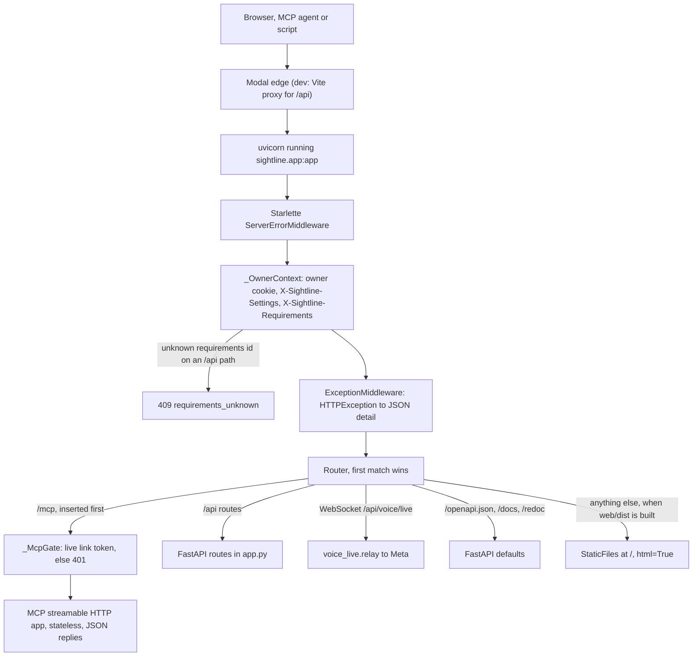
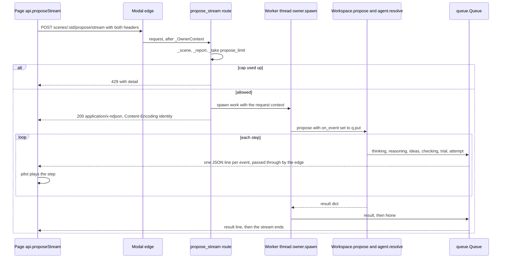
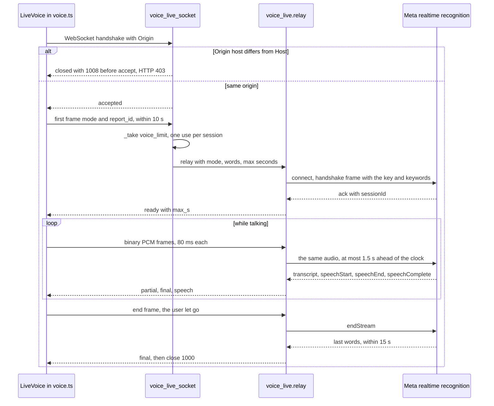

# 10 · HTTP API and streams

> **Covers:** `server/sightline/app.py`, `server/sightline/voice_live.py`, the request side of
> `server/sightline/owner.py` and `server/sightline/limits.py`, `web/src/api.ts`, `LiveVoice` in `web/src/voice.ts`,
> `web/src/uploads.ts`, the ASGI entry in `deploy/modal_app.py` · **Checked against code:** 2026-10-30 (`4a19777`) ·
> **Deeper design:** [docs/voice.md](../voice.md), [docs/uploads.md](../uploads.md), [docs/mcp.md](../mcp.md)

ORCA's server is one FastAPI app, `app` in `server/sightline/app.py`, that the page, the MCP server and anything
else talk to. It serves 64 decorated routes under `/api/`, one WebSocket (live voice), the MCP endpoint at `/mcp`,
and the built web app from the same origin. Long work answers as newline-delimited JSON (NDJSON) so the page can
show the agent working. This doc is the inventory of every route, stream event, header and error, and how
`web/src/api.ts` reads them. Other docs link here rather than list routes again. What each route's work does
inside is in [09](09-agent-workflows.md) and [07](07-fixes-and-edits.md); the caps' meaning is in
[16](16-security-caps-and-cost.md); the MCP side of `/mcp` is in [11](11-mcp-and-agent-links.md).

## How the server is put together

- **One app, one process.** `app = FastAPI(title="ORCA")`, with one `Workspace` (`ws`) holding scenes, reports and
  jobs in memory ([05](05-domain-model-and-state.md)). The repo's `.env` is loaded by the package's `__init__.py`
  (`meta_client.load_env()`), which runs on the first import of any `sightline` module and so before `app.py` or
  any module it imports reads a setting: the caps, the owner token and the settings modules read at import time
  (`SIGHTLINE_MAX_SCENES`, `SIGHTLINE_SCENE_BUDGET_MB` and the others marked "import" in
  [15](15-requirements-settings-and-config.md)) all come from `.env` when the real environment does not set them
  (real environment variables win). Locally: `uv run uvicorn sightline.app:app --reload`. On
  Modal, `deploy/modal_app.py` imports the same `app` under `@modal.asgi_app()`, one container, up to 64 requests at
  once (`@modal.concurrent(max_inputs=64)`: linked pages each hold an events stream), 10-minute request timeout
  ([17](17-deployment-and-operations.md)).
- **Middleware:** only `_OwnerContext` (below). There is no CORS middleware and no compression middleware: the page,
  the API and `/mcp` share one origin. In development Vite proxies `/api` (with `ws: true`, Host kept) to
  `localhost:8000` (`web/vite.config.ts`); `/mcp` is not proxied there.
- **Routing order:** the `/mcp` Starlette `Route` is inserted first (`app.router.routes.insert(0, …)`), then
  FastAPI's own `/openapi.json`, `/docs` and `/redoc` (added when the app is made, left at their defaults), the `/api`
  routes in the order they are declared, and last the static mount at `/`. No paths overlap, so the order matters
  only for the static mount, which must come after everything else.
- **Static files:** when `SIGHTLINE_WEB_DIST/index.html` exists (default `web/dist`, the output of
  `cd web && npm run build`), `app.mount("/", StaticFiles(directory=WEB_DIST, html=True), name="web")` serves it,
  declared last so `/api` wins. There is **no SPA fallback** and none is needed: the app is one page with no client
  routes (the owner's `#owner` is a hash), so an unknown path is a plain 404.
- **Lifespan:** `_lifespan` replaces the router's lifespan. On start it builds the MCP transport
  (`_mcp_gate.inner = _mcp_transport()`) and runs `_mcp.session_manager.run()` for the server's life
  ([11](11-mcp-and-agent-links.md)).

### `_OwnerContext`

A plain ASGI middleware (`app.add_middleware(_OwnerContext)`) that runs on every HTTP and WebSocket request:

1. Reads the `sightline_owner` cookie (`owner.COOKIE`) and checks it (`owner.cookie_ok`: `v1.<expiry>.<HMAC>`,
   keyed on `SIGHTLINE_OWNER_TOKEN`).
2. `owner.enter(is_owner, header)` sets context variables for this request: owner or not, and, only for the owner,
   the settings in `X-Sightline-Settings` (efforts, `no_caps`, `open_weights`, `escalation`, `built_views`).
   `owner.leave` resets them when the request ends.
3. A WebSocket stops here: only owner/no-caps matters for live voice.
4. For HTTP, reads `X-Sightline-Requirements`. An id the server does not know, on a path under `/api/`, is answered
   at once with **409 `{"detail": "requirements_unknown"}`** (a restart forgot it), so the page registers its file
   again instead of running without it. A known id is entered with `requirements.enter`, so `requirements.current()`
   is that file for the whole request.

Work that leaves the request's thread keeps this context: `owner.spawn` starts each stream's worker thread and
`owner.submit` each pool task with `contextvars.copy_context()`, which carries the owner's settings and the
requirements together. `/mcp` passes through `_OwnerContext` too, but MCP tools take their requirements from the link
(`requirements.using`, [11](11-mcp-and-agent-links.md)) and their caps from who made the link.

## Headers and cookies

| Name | Direction | Set by | Read by | What it carries |
|---|---|---|---|---|
| `X-Sightline-Settings` | request | `api.ts` `settingsHeader()` when the owner has settings (`setOwnerSettings`) | `_OwnerContext` → `owner.settings` | The owner's own settings as JSON. Ignored unless the owner cookie checks out. |
| `X-Sightline-Requirements` | request | `api.ts` `settingsHeader()` once `setRequirements(id, doc)` | `_OwnerContext` → `requirements.enter` | The id of a registered requirements file ([15](15-requirements-settings-and-config.md)). |
| `sightline_owner` cookie | both | `POST /api/owner/unlock` | `_OwnerContext` | Signed `v1.<expiry>.<sig>`; HttpOnly, Secure, SameSite=Strict, Path=/api, 30 days (`owner.DAYS`). Path=/api: it never reaches `/mcp` or the static files. |
| `Authorization: Bearer <token>` or `?key=<token>` | request | the MCP client | `_McpGate`, `agents.token_from` | An agent link token ([11](11-mcp-and-agent-links.md)). |
| `X-Forwarded-For` | request | a proxy in front (Modal's edge strips it and sets none) | `limits.client_id` | The visitor's address for per-visitor caps only with `SIGHTLINE_TRUST_FORWARDED=N`: the N-th entry from the right. Else, and on Modal, the socket peer. |
| `X-Forwarded-Host`, `X-Forwarded-Proto` | request | the proxy | `create_link`, `mcp_server.base_url` | The public `mcp_url` and download links. |
| `Content-Length` | request | the browser | `_receive_models` | Required on model uploads (411 without it); checked against the cap before the body is read. |
| `Origin`, `Host` | request | the browser | `voice_live.same_origin` | The live-voice socket opens only when they match (or no Origin is sent). |
| `Content-Encoding: identity`, `Cache-Control: no-store, no-transform`, `X-Accel-Buffering: no` | response | `_ndjson` (`NDJSON_HEADERS`), and `_McpGate` adds the first | the edge | Keep streams flowing (below). |
| `Cache-Control: no-store` | response | `GET /api/scenes/{scene_id}/files/{index}` | the browser | The same URL serves the edited model after a kept fix. |
| `Cache-Control: private, max-age=86400` | response | `GET /api/built/{name}` | the browser | A checked picture never changes for its key. |
| `Content-Disposition: attachment` | response | `GET /api/documents/{doc_id}`, `FileResponse(filename=…)` on export | the browser | The download's file name. |
| `WWW-Authenticate: Bearer realm="orca"` | response | `_McpGate` on 401 | MCP clients | Say a token is needed. |

## Errors and refusals

Every refusal is an `HTTPException`, so the body is FastAPI's `{"detail": "<words>"}`. The words are written for
people; the page shows them as they are. FastAPI's own validation of a request body (a missing field, a wrong type)
is a 422 whose `detail` is a list, not a string.

| Status | When | Examples of `detail` |
|---|---|---|
| 400 | A request the server cannot use | an upload that is not IFC/STEP, a file given twice, a truncated `.gz`, a model IfcOpenShell cannot read, a report upload with no XML, a fix with no element, a fix that does not say which clash it is for ("Not a fix ORCA can apply: the fix does not say which clash it is for (pair: [A, B])"), or whose changed element is neither side of it, a STEP conversion error, a bad setting value |
| 401 | `/mcp` without a live link token | `{"error": "An ORCA agent link token is required: …"}` (the gate's own body, not `detail`) |
| 403 | Not allowed | owner-only settings; a wrong owner token (under the unlock cap); second tries switched off; Show it built switched off; a live-voice socket from another origin (closed before the handshake, which the server answers as HTTP 403) |
| 404 | Gone or never there | "Model not loaded. Open it again." (`_scene`), "Clash report not loaded. Open it again." (`_report`), "This agent link has expired or was revoked." (`_link`), "That report has expired. Build it again.", "No such picture.", "No such image.", "No such clash.", "No owner is configured on this server.", "Proposal expired or unknown. Generate a new wider fix." |
| 409 | The state does not allow it | `requirements_unknown` (middleware); "Nothing has been changed yet. Accept a fix first." (export); "Triage the report first: …" (document); "Nothing may be edited here (…), so there is no second try to make."; "Only clashes found by ORCA take captured views."; a wider fix whose scene changed or whose fresh check failed; a fix that does not pass when tried again before it is kept (`plans.NotVerified`, every keep route): "'Offset up 400' does not pass ORCA's check on the model as it is now (collision with IfcSlab (-50 mm)), so nothing was kept. The model or the requirements may have changed since it was proposed: propose again.", or for a plan "Fix 2 of 3, '…', does not pass …" and "… with the other fixes in place (…)" |
| 411 | Model upload without `Content-Length` | "Send the upload with its length (Content-Length)." |
| 413 | Too big | model upload over `SIGHTLINE_MODEL_UPLOAD_MAX_MB` (checked on `Content-Length`, then on the unpacked size); report upload over `SIGHTLINE_UPLOAD_MAX_MB` or `SIGHTLINE_UPLOAD_MAX_FILES`; a requirements file over 64 KB (`requirements.MAX_BYTES`); a captured view over 4 MB; a capture reply over 6 MB; a voice clip over 3 MB; models too big for a wider fix (`SIGHTLINE_WIDER_FIX_MAX_MB`) |
| 415 | A captured view that is not a PNG | "Send a PNG." |
| 422 | Valid JSON, wrong content | "Say which element the offset goes around (other).", "Say which element the trim butts against (other).", "Say what moves (moved) and what it must clear (obstacles): …", "Cannot apply this fix: …" (`edits.Unsupported` while keeping), "Check the tests: …", "Pick the clashes to fix.", a requirements file that does not parse, a trim sent to Show it built, oversized or malformed built-view passes, a WAV that is not mono 16-bit at 16 or 24 kHz |
| 429 | A cap or budget is used up | the words from `ProposeLimit`: "You've used 20 proposals this hour. Try again later.", "The demo has used today's proposals. …", "That needs 3 proposals; you have 1 left this hour. …", or the Muse Wonder day budget's refusal (`spend.claim`) |
| 502 | A model call behind the route failed | "Muse Spark could not draft requirements: …", "Transcription failed: …" |

- **Caps are charged before work starts**, so a 429 is a plain HTTP reply even on a streaming route. A failure
  *after* a stream has started is an `error` event in the stream (`{"type": "error", "detail"}`; the document stream
  uses `message`, the upload stream adds `status`).
- **The owner** (cookie plus `no_caps`, the default) skips every visitor cap (`_take` returns `None` when
  `owner.no_caps()`) and is never refused by the Muse Wonder day budget, though the owner's spend still counts
  towards it (`spend.claim(exempt=True)`, [16](16-security-caps-and-cost.md)).

### How `web/src/api.ts` handles replies

- **`send(url, init)`** wraps `fetch`: on a 409 whose `detail` is `requirements_unknown`, it registers the file again
  (`reRegister`: `POST /api/requirements` with the saved document, no requirements header) and retries the request
  once with the new id.
- **`call<T>(path)`** sends JSON with `jsonHeaders()` (both headers above) and throws `ApiError(detail, status)` on
  any non-2xx; components read `e.status` where it matters (a 404 on any agent-link call drops the link; a 409 or 404
  on a wider-fix accept marks the proposal stale).
- **`ndjson<T>(path, body, onEvent, signal, method)`** POSTs (or GETs) through `send`, throws `ApiError` before the
  stream if the reply is not OK, then reads the body with a `TextDecoder`, splits on `\n`, parses each line and calls
  `onEvent`; a handler that returns `true` ends the read. It always cancels and releases the reader. Each stream
  helper (`detect`, `planStream`, `built`, `chat`, `titles`, `triageStream`, `document`, `contextStream`,
  `linkEvents`) stops on its own final event and turns an `error` event into a thrown error; a stream that ends
  without its final event is an error too ("The server stopped before …").
- **`proposeStream`** reads the same way by hand: it throws on `error`, returns the `result` event as the
  `Proposal`, and passes every other event to the pilot.
- **`uploadModelsStream`** gzips each file over 1 MB (`pack`, `CompressionStream`), posts with `XMLHttpRequest` for
  upload progress (`upload` events made in the browser, after `packing` ones), parses the NDJSON from
  `responseText` as it grows, and retries once on a 409 `requirements_unknown`. `uploads.uploadRefusal` checks size
  and count against `GET /api/models` before anything is sent.
- Raw `fetch` (no headers) for downloads and small posts that need neither header: model files, `saveView`,
  `uploadReport`, `linkCapture`; `navigator.sendBeacon` for `leaveLink`.

## Route inventory

Every route in `app.py`, grouped by area. Paths are exactly as declared. "Caps" names what a call charges; "free"
means no cap. All caps are skipped for the owner unless noted. Body models (`Move`, `Propose`, …) are the pydantic
classes in `app.py`.

### Owner and settings

| Method | Path | What it does | Body / params | Reply | Caps / auth |
|---|---|---|---|---|---|
| `GET` | `/api/owner` | Whether an owner is configured and whether this request is the owner's | none | `{available, owner}` | free |
| `POST` | `/api/owner/unlock` | Checks the owner token once (`owner.check_token`, constant time) and sets the signed cookie | `{token}` | `{owner: true}` and `Set-Cookie: sightline_owner` | 404 with no token configured; wrong token 403, capped by `unlock_limit` (5 per visitor per hour, 50 a day) → 429 |
| `POST` | `/api/owner/lock` | Clears the cookie | none | `{owner: false}` | free |
| `GET` | `/api/models` | Which model titles and triage use for this request (`triage_model_info`), the escalation model and mode (`escalation_info`), whether Show it built is on, the upload cap | none | `{triage, escalation, built_views, model_upload_max_mb, model_upload_max_files}` | free |
| `GET` | `/api/settings` | The settings for everyone (`settings.current`), their defaults, whether an open-weights host key is set | none | `{everyone, defaults, host}` | owner only (403) |
| `PUT` | `/api/settings` | Changes settings for everyone (`settings.update`) | partial settings dict | as `GET` | owner only (403); 400 on a bad value |

### Models and scenes

| Method | Path | What it does | Body / params | Reply | Caps / auth |
|---|---|---|---|---|---|
| `GET` | `/api/samples` | Model files in `samples/` (`Workspace.list_samples`) | none | `[name]` | free |
| `POST` | `/api/scenes` | Opens sample models; a STEP sample is converted first (cached by hash) with the triage model naming parts | `Open {samples}` | `{id, files, step, revision}` | free; 404 unknown name, 400 STEP error |
| `POST` | `/api/models/upload` | Opens the visitor's own IFC/STEP files (`_receive_models`, then `Workspace.open_paths`) | multipart `files` (each may be `<name>.gz`); `Content-Length` required | `{id, files, step, revision}` | `model_upload_limit` (`SIGHTLINE_MODEL_UPLOADS_PER_HOUR`/`_DAY`); 411, 413, 400, 429 |
| `POST` | `/api/models/upload/stream` | The same, with the opening streamed (below) | as above | NDJSON | as above; refusals before the files are in are plain HTTP errors |
| `GET` | `/api/scenes/{scene_id}` | A scene the page had open, to resume it (`Workspace.scene_info`) | none | `{id, files, step, detection, revision}` | free; 404 once evicted |
| `GET` | `/api/scenes/{scene_id}/files/{index}` | One model file as it is now: the original, or the edited model written out (`Workspace.file`); tidies exports older than an hour | none | IFC bytes, `no-store` | free; 404 |
| `GET` | `/api/scenes/{scene_id}/elements/{global_id}` | One element's class, name, level, file, and its links by kind with names, systems and assembly (`Workspace.describe`) | none | element dict | free |
| `GET` | `/api/scenes/{scene_id}/classes` | Every physical element's class and name, for a built view's cutaway (`Workspace.classes`) | none | `{GlobalId: [class, name]}` | free |
| `GET` | `/api/scenes/{scene_id}/connections` | What is linked to what, for the connection highlight (`Workspace.connections` → `connections.graph`; contacts from the scene's last check; cached until the scene changes) | none | `{revision, edges: [[a, b, kind, source]], stops, systems, assemblies, names, kinds}` | free |

### Fixes

| Method | Path | What it does | Body / params | Reply | Caps / auth |
|---|---|---|---|---|---|
| `POST` | `/api/scenes/{scene_id}/verify` | Checks a move without keeping it (`Workspace.verify_move`); with `obstacles`, what the moved elements stand on is kept | `Move {moved, delta_m, clearance_m=0.025, obstacles=[]}` | verdict `{passed, hits, min_clearance_m, checked_against, reason?, placements}` | free |
| `POST` | `/api/scenes/{scene_id}/propose` | Runs the fix agent (`Workspace.propose`), or a second try (`Workspace.escalate`), one JSON reply | `Propose {element_a, element_b, distance_m?, notes, report_id?, clash_id?, escalate=false}` | the proposal (`understanding, options, attempts, advice, recommendation, requirements, clearance_m, model, usage, escalated?`) | one proposal (`propose_limit`); a second try: 409 if nothing may be edited, 403 if switched off, then the Wonder budget and one escalation plus one proposal (`escalation_refused`) |
| `POST` | `/api/scenes/{scene_id}/propose/stream` | The same, streamed (below); `api.proposeStream` | as above | NDJSON | as above |
| `POST` | `/api/scenes/{scene_id}/apply` | Keeps a move through `plans.apply` (tried again first against `obstacles[0]`, the rest as `others`; the requirements' clearance, not the body's `clearance_m`) and returns the patch (`_with_patch`); the page no longer calls it | `Move` (`obstacles` required) | as `fix/apply` | free; 422 without `moved` or `obstacles`, 409 when it does not pass |
| `POST` | `/api/scenes/{scene_id}/context/stream` | The wider-fix search over whole arrangements (`context_planner.build`) | `ContextObjective {element_a, element_b, report_id?, clash_id?}`, extra fields refused | NDJSON | three proposals at once (`take_many(who, 3)`); `context_planner.ContextError` statuses (422, 404, 413) before charging |
| `POST` | `/api/scenes/{scene_id}/context/apply` | Accepts a wider-fix proposal by its server-held id, checked afresh (`context_planner.accept`) | `ContextApply {proposal_id, acknowledged_conditions}` | `{files, pieces, edits, resolved_pairs, checks}` plus the patch | free; 404 expired, 409 scene changed or check failed, 422 conditions |
| `POST` | `/api/scenes/{scene_id}/offset/check` | Checks a local offset without keeping it (`Workspace.check_offset`) | `Offset {element, split_m, dz_m, other, clearance_m}` | `{passed, reason, min_clearance_m, preview}` | free; 422 without `other` |
| `POST` | `/api/scenes/{scene_id}/trim/apply` | Keeps a trim through `plans.apply` (tried again first against `other`; an `end` that is not the joint's is refused); the page no longer calls it | `TrimBody {element, end, by_m, other}` | as `fix/apply` | free; 422 without `other`, 409 when it does not pass |
| `POST` | `/api/scenes/{scene_id}/offset/apply` | Keeps an offset through `plans.apply` (tried again first against `other`); the page no longer calls it | `Offset` (`other` required) | as `fix/apply` | free; 422 without `other`, 409 when it does not pass |
| `POST` | `/api/scenes/{scene_id}/fix/apply` | Keeps one option of any kind through `plans.apply`: `preview` and `before` are dropped, the fix is tried again on the server (`plans.recheck`: its kind's `agent.TRIES` with the clearance and requirements `Workspace.fix_settings` sets for the clash it names) and what that trial makes is kept ([07](07-fixes-and-edits.md)) | `FixApply {option}`; the option names its clash in `pair` (`[A, B]`, plus `others` for a plan's merged item; a penetration and a combined fix name theirs in `edit`) | `{files, pieces (first run), groups (first fix), changed, not_cut, verified, cut?, blocked_by?}` plus the patch | free; 400 no element, no `pair` or not a fix, 409 `NotVerified`, 422 `Unsupported` while keeping |

"The patch" is `Workspace.patch`: `{scene_id, revision_before, revision, meshes, history}`, which lets the page
update its model in place (`applyToViewer`, [07](07-fixes-and-edits.md), [13](13-3d-viewer.md)). `_with_patch` holds
`Workspace.lock` from reading `revision_before` to building the patch, so another tab's edit cannot fall between.

### Export

| Method | Path | What it does | Body / params | Reply | Caps / auth |
|---|---|---|---|---|---|
| `GET` | `/api/scenes/{scene_id}/export` | Writes the edited files (`Workspace.export`: IFC, plus `<name>.orca.step` for STEP models); one file as is, several as a zip | none | the file, or `<project>-orca.zip` (`orca-export.zip` when the files share no name) | free; 409 when nothing was kept |

### Reports

| Method | Path | What it does | Body / params | Reply | Caps / auth |
|---|---|---|---|---|---|
| `GET` | `/api/reports/samples` | Sample report folders in `samples/reports/` | none | `[name]` | free |
| `POST` | `/api/reports` | Opens a sample Navisworks report (`Workspace.open_report_sample`) | `OpenReport {sample}` | the report (`id, title, sources, clashes, origin, requirements_id`; the last is a detected run's requirements id, else null) | free; 404 |
| `POST` | `/api/reports/upload` | Opens uploaded Navisworks XML with its pictures; folder paths kept (`_safe_relpath`), only `.xml`, `.png`, `.jpg`, `.jpeg` written | multipart `files` | the report | free; 413 over `SIGHTLINE_UPLOAD_MAX_FILES` (5000) or `SIGHTLINE_UPLOAD_MAX_MB` (200), 400 no XML or unreadable |
| `GET` | `/api/reports/{report_id}` | The report as the page reads it (`Workspace.report_summary`) | none | the report | free; 404 |
| `GET` | `/api/reports/{report_id}/clashes/{clash_id}/images/{index}` | One of a clash's pictures (Navisworks or captured) | none | the image | free; 404 |
| `POST` | `/api/reports/{report_id}/clashes/{clash_id}/images` | Saves a view A, B or C the page captured of a detected clash (`Workspace.save_capture`), for the agent, triage and the PDF | multipart `label`, `image` (PNG, at most 4 MB) | `{images: [labels]}` | free; 413, 415, 404, 409 (not a detected report), 422 (label) |
| `GET` | `/api/reports/{report_id}/match/{scene_id}` | Each clash's two sides matched to model elements (`Workspace.match`) | none | `{clash_id: {a, b, how, show}}` | free |
| `GET` | `/api/reports/{report_id}/clashes/{clash_id}/measure/{scene_id}` | ORCA's own measure of one clash (`Workspace.measure`) | none | `{matched, physical, distance_m}` | free; 404 |

### Detection

| Method | Path | What it does | Body / params | Reply | Caps / auth |
|---|---|---|---|---|---|
| `GET` | `/api/scenes/{scene_id}/detect/tests` | The tests a run would use (defaults and presets, or what the requirements compile to) (`Workspace.detect_tests`) | none | `{tests, teams, elements, file_elements, rules, requirements}` | free |
| `POST` | `/api/scenes/{scene_id}/detect/stream` | Runs detection (`Workspace.detect` → `detect.run`), opening the result as a report | `DetectRequest {tests: [...] or null}` | NDJSON | `detect_limit` (`SIGHTLINE_DETECT_PER_HOUR`/`_DAY`); 422 bad tests |

### Requirements

| Method | Path | What it does | Body / params | Reply | Caps / auth |
|---|---|---|---|---|---|
| `GET` | `/api/requirements/scale` | The design levels and strictness steps (`requirements.scale`) | none | `{levels, strictness, format, roles, checks, edits}` | free |
| `POST` | `/api/requirements` | Registers a requirements file (content-addressed id) | the file as the raw JSON body | `{id, doc, params, label, model_key}` | `requirements_limit` (`SIGHTLINE_REQUIREMENTS_PER_HOUR`, default 120, `_PER_DAY`) for ids not yet known only; 413, 422 |
| `GET` | `/api/scenes/{scene_id}/requirements/default` | An L3 Coordinated, balanced starting file from the open models, and what they contain (`requirements.default_doc`, `inventory`); does not wait for `Workspace.lock` | none | registered fields plus `inventory` | free |
| `POST` | `/api/scenes/{scene_id}/requirements/suggest` | Muse Spark drafts a file for the open models (`requirements.suggest`) | `RequirementsDraft {level=3, strictness="balanced", name}` | registered fields plus `summary`, `inventory` | one proposal; 502 when the draft fails |
| `POST` | `/api/scenes/{scene_id}/requirements/preview` | How many clashes the file finds, and the defaults find, without opening a report (`detect.run` under `Workspace.lock`, cached in `_previews`, 64 entries) | the file as the raw JSON body | `{clashes, seconds, tests, baseline, params}` | `preview_limit` (`SIGHTLINE_PREVIEW_PER_HOUR`, default 60, `_PER_DAY`) unless both counts are cached |

### Insights

| Method | Path | What it does | Body / params | Reply | Caps / auth |
|---|---|---|---|---|---|
| `GET` | `/api/reports/{report_id}/root_causes/{scene_id}` | Elements in several real clashes, plus geometry hits missing from the report (`plans.root_causes`) | `?fixed=` comma-separated clash ids | `[RootCause]` | free |
| `GET` | `/api/reports/{report_id}/patterns/{scene_id}` | The same kind of clash many times over (`plans.patterns`), no model call | `?fixed=` | `[Pattern]` | free |
| `POST` | `/api/reports/{report_id}/patterns/{scene_id}/triage` | One Muse Spark call judging every pattern (`plans.read_patterns` → `triage_patterns`), kept on the Workspace by report, scene, pattern ids and the requirements' `model_key`, and shared with chat and MCP `find_patterns` | `PatternTriage {fixed}` | `{pattern_id: {verdict, cause, action, rule}}` | one proposal, only when not cached |

### Triage and titles

| Method | Path | What it does | Body / params | Reply | Caps / auth |
|---|---|---|---|---|---|
| `GET` | `/api/reports/{report_id}/triage` | The report's triage so far (`triage.Job.state`), with facts the open model settles (`_triage_facts`). Under requirements that only change rules since a finished run, starts a run from its readings at no charge; under a different prompt, returns the last run with `stale: true` | `?scene_id=` | `{results, done, total, seconds, error, summary, audit, model, open_weights, …}`, plus `stale` for an older run, or `{results: {}, done: false, started: false}` | free |
| `POST` | `/api/reports/{report_id}/triage/stream` | Starts or follows the report's shared triage run (`_start_triage`, `triage.Job.follow`) | `?rerun=true` to run a finished one again, `?scene_id=`; empty body | NDJSON | one proposal to start a run; following one, or carrying readings over to new rules, is free |
| `GET` | `/api/reports/{report_id}/titles` | Titles so far (from the shared run, `_with_titles`) | none | `{titles: {id: title}, running}` | free |
| `POST` | `/api/reports/{report_id}/titles/stream` | Starts or follows the report's shared titling run (`titles.Job`); a finished run with untitled clashes starts again for those | empty body | NDJSON | `title_limit` (`SIGHTLINE_TITLES_PER_HOUR`/`_DAY`) to start; following is free |

Shared runs are keyed by `_triage_key`: a sample report by `sample:<root>` (every visitor's copy has the same ids),
an uploaded or detected one by its id, and under requirements also by `model_key|rules_key`. The server keeps 16
triage jobs (`_triage_jobs`) and 32 titling jobs (`_title_jobs`).

### Plans

| Method | Path | What it does | Body / params | Reply | Caps / auth |
|---|---|---|---|---|---|
| `POST` | `/api/scenes/{scene_id}/plan/stream` | Fix together (`plans.build_batch`) or the root cause around one element (`plans.build_root_cause`) | `PlanRequest {report_id, clash_ids=[], hub?, fixed=[]}` | NDJSON | Fix together: one proposal per distinct pair (at most `plans.MAX_ITEMS`, 8), all or nothing (`take_many`); a root cause: one, then its fixes only if it needs edits; 422 with no clashes |
| `POST` | `/api/scenes/{scene_id}/plan/apply` | Keeps a plan's chosen options, all or none (`plans.apply`: each tried again alone, then all together with `verify_together`, then kept in one transaction) | `PlanApply {options}`, each with its `pair` and `others` | `{files, pieces, groups, changed, not_cut, verified}` plus the patch | free; 400, 409 `NotVerified` (which fix and why), 422 |

### Chat and voice

| Method | Path | What it does | Body / params | Reply | Caps / auth |
|---|---|---|---|---|---|
| `POST` | `/api/chat` | One chat message, answered by Muse Spark with tools (`chat.Chat.turn`); the message is cut to 4,000 characters | `ChatTurn {message, session_id?, scene_id?, report_id?, clash_id?, fixed=[]}` | NDJSON | `chat_limit` (`SIGHTLINE_CHAT_PER_HOUR`/`_DAY`) per message; the tools charge proposals and second tries as the page's own buttons do; 422 on an empty message |
| `POST` | `/api/transcribe` | A recorded clip to text with Muse Voice Transcribe (`meta_client.transcribe`), biased to BIM words and the open report's element names and titles (`_voice_words`) | multipart `audio` (WAV, mono 16-bit, 16 or 24 kHz, at most 3 MB), optional `report_id` | `{transcript, duration_ms}` | `voice_limit` (`SIGHTLINE_VOICE_PER_HOUR`/`_DAY`); 413, 422, 502 |
| `WEBSOCKET` | `/api/voice/live` | Live voice: the microphone relayed to Meta's realtime recognition and the words back as they are said (below) | JSON first frame, then PCM | JSON frames | one `voice_limit` use per session; same origin only |

### Documents

| Method | Path | What it does | Body / params | Reply | Caps / auth |
|---|---|---|---|---|---|
| `GET` | `/api/reports/{report_id}/teams` | Each model with the team its content suggests (`document.guess_teams`) | `?scene_id=` | `{teams, models: [{file, guess, elements}]}` | free |
| `POST` | `/api/reports/{report_id}/document/stream` | Builds the coordination report: PDF(s) combined, per team or per model, plus BCF (`document.generate` via `_build_document`) | `DocumentRequest {scene_id?, scope, teams, bcf, evidence, reviews, marks, triage}` | NDJSON | one proposal; 422 bad scope; 409 when fewer than half the clashes have a verdict (the page's `triage`, else the server's finished run) |
| `GET` | `/api/documents/{doc_id}` | Downloads a built report (kept in memory, 24 at most) | none | PDF or zip, as an attachment | free; 404 once dropped |

### Agent links

| Method | Path | What it does | Body / params | Reply | Caps / auth |
|---|---|---|---|---|---|
| `POST` | `/api/links` | Makes an agent link for what this visitor has open (`agents.Links.create`); the token is shown once | `LinkContext {scene_id?, report_id?, clash_id?, fixed=[]}` | `{token, mcp_url, id, expires_at, max_expires_at, server_time, calls, last_call, browser, context, applied}` | `link_limit` (`SIGHTLINE_LINKS_PER_HOUR`/`_DAY`) |
| `GET` | `/api/links/{token}` | The link's state (`Link.public`); does **not** renew it | none | as above, without `token` and `mcp_url` | 404 expired or revoked |
| `PUT` | `/api/links/{token}/context` | The page keeps the link's view current (what is open, selected, fixed, and its requirements id); renews the link | `LinkContext` | `Link.public()` | 404 |
| `GET` | `/api/links/{token}/events` | What the agent does, for the page to follow (below); renews the link | none | NDJSON | 404 |
| `POST` | `/api/links/{token}/captures/{capture_id}` | The page's answer to a capture request: a PNG, or an empty body (a clash's views went to the report); renews the link | raw PNG body, at most 6 MB | `{ok: true}` | 404 when nobody waits any more; 413 |
| `POST` | `/api/links/{token}/leave/{stream_id}` | The page is closing (a `pagehide` beacon): that stream stops counting as a browser at once | none | `{left: bool}` | 404 |
| `DELETE` | `/api/links/{token}` | Revokes the link (`Links.revoke`) | none | `{revoked: bool}` | free |

### Built views

| Method | Path | What it does | Body / params | Reply | Caps / auth |
|---|---|---|---|---|---|
| `POST` | `/api/scenes/{scene_id}/built/stream` | Show it built: Muse Image restyles the page's view of a fix and the picture is checked against the model (`built.make`); a cached or in-progress picture for the same passes costs nothing | `BuiltBody {look, ids, normals, fix_kind, title}` (PNG data URLs, each at most 12,000,000 characters) | NDJSON | 403 when switched off; 422 for a trim or refused passes; the Wonder day budget (`spend.claim`, else Muse Spark's lighter check while the pictures fit) and `built_limit` (`SIGHTLINE_BUILT_PER_HOUR`/`_DAY`) |
| `GET` | `/api/built/{name}` | A checked picture `<key>.jpg` or its outline `<key>-lines.png` (`built.path_of`, a strict name pattern) | none | JPEG or PNG | free; 404 |

### Not declared with a decorator

| Method | Path | What it is |
|---|---|---|
| `GET`, `POST`, `DELETE` | `/mcp` | The MCP endpoint: a Starlette `Route` inserted first, `_McpGate` in front of the streamable HTTP app. 401 without a live link token. See [11](11-mcp-and-agent-links.md). |
| `GET` | `/` and every other path | `StaticFiles(directory=WEB_DIST, html=True)`: the built web app, when `web/dist/index.html` exists. |
| `GET` | `/openapi.json`, `/docs`, `/redoc` | FastAPI's defaults, not switched off. |

## NDJSON streams

### Why `_ndjson` sends `Content-Encoding: identity`

Every stream goes out through `_ndjson(events)`: a `StreamingResponse` with media type `application/x-ndjson` and
`NDJSON_HEADERS` (`Cache-Control: no-store, no-transform`, `X-Accel-Buffering: no`, `Content-Encoding: identity`).
Modal's edge zstd-compresses responses for browsers that accept it and held a stream back until a buffer filled:
triage's first verdicts reached the browser after 77-170 s, and Muse Spark's reasoning arrived with its result
(measured Oct 28, CLAUDE.md). The edge ignores `no-transform`; an explicit `Content-Encoding: identity` makes it pass
the stream through. `_McpGate` adds the same header to `/mcp` replies. Test a stream with
`Accept-Encoding: gzip, deflate, br, zstd`, as browsers send.

### How a stream is fed

| Pattern | Routes | How it works | When the reader goes away |
|---|---|---|---|
| Queue and worker thread | `propose/stream`, `detect/stream`, `plan/stream`, `document/stream`, `models/upload/stream` | The route charges, makes a `queue.Queue`, starts `work` with `owner.spawn` and returns a sync generator that yields `json.dumps(event) + "\n"` until the `None` sentinel (Starlette iterates it in its thread pool). The upload stream yields `{"type": "tick"}` after 5 s with no event. | The work runs to the end; the queue is unbounded. |
| `_RequestEvents` | `chat`, `context/stream`, `built/stream` | A bounded queue (64) that never blocks a worker, even under `Workspace.lock`. When full it drops or evicts progress events (`thinking`, `tool`, `tool_result`, `trial`, `reasoning`, `ideas`, `checking`, `attempt`, `context_progress`, `item`, `checking_plan`, and wrapped ones) to keep results, errors and the end; if results alone fill it, the request ends with `error` "Request cancelled: too many unread result events. Please retry." The async reader polls every 50 ms and checks `request.is_disconnected()`. | Sets `cancel`: the chat turn and the wider search stop at their next check; a built view's work carries on. |
| Shared job, replayed | `triage/stream`, `titles/stream` | One `triage.Job` / `titles.Job` per report key; `Job.follow()` yields every event so far, then new ones, and `{"type": "ping"}` after 15 s of quiet. A late follower of triage skips reasoning sent before it joined. | Other followers and the job carry on. |
| Link channel | `links/{token}/events` | An async generator polling the subscriber's queue every 0.1 s; `heartbeat` after 15 s idle; ends after about 240 s (under Modal's request limit), when the page leaves, or when the link is gone. | The subscriber is removed. |

One stream from worker to page, for a proposal:

### Events per stream

Fields are the main ones; `api.ts` has the full TypeScript types (`AgentEvent`, `DetectEvent`, …).

**`POST /api/scenes/{scene_id}/propose/stream`** (emitters: `agent.resolve`, `agent._recommend`,
`Workspace.propose`, `Workspace._escalate`). Every event from `agent.resolve` carries `model`, the label of the
model that ran it ("Muse Spark", "Muse Wonder").

| Type | Fields | When |
|---|---|---|
| `thinking` | `round` | A model call starts |
| `reasoning` | `round`, `text` | A reasoning summary as Muse thinks (only when someone watches and the model streams them) |
| `ideas` | `round`, `seconds`, `understanding`, `count` | The model's candidates are in |
| `checking` | `index`, `title`, `kind` | One candidate is about to be tried |
| `trial` | `index`, `kind`, `moved`, `delta_m`, `pieces`, `summary?` | The candidate in place before its check (a move's delta, or new pieces as triangles) |
| `attempt` | `index`, `title`, `delta_m`, `passed`, `reason`, `kind`, `split_m`, `trim`, `hit_ids`, `edit`, `where`, `model` | Its verdict |
| `note` | `text` | A host could not be read; no second try, and why; a second try failed and the first stands |
| `escalating` | `model`, `first`, `first_try {understanding, advice, attempts, options}` | A second try starts (button or automatic) |
| `result` | the whole proposal | Last |
| `error` | `detail` | The model or the check failed |

**`POST /api/scenes/{scene_id}/detect/stream`** (`detect.run`, `Workspace.detect`):

| Type | Fields |
|---|---|
| `phase` | `text` ("Reading the models", "Building geometry for n elements") |
| `start` | `elements`, `tests [{id, name, kind}]` |
| `test` | `index`, `id`, `name`, `candidates` |
| `test_done` | `index`, `coverage` (test, name, kind, elements, candidate pairs, clashes, touching, excluded, partial, seconds) |
| `done` | `report`, `coverage`, `diff {new, resolved, no_longer_checked, first}`, `elements`, `seconds`, `offset`, `requirements` |
| `error` | `detail` |

**`POST /api/reports/{report_id}/triage/stream`** (`triage.Job`, `triage.triage_report`):

| Type | Fields |
|---|---|
| `start` | `total`, the model info (`model`, `open_weights`, `images`, `note`, `requirements`) |
| `clash` | `id`, the verdict (`verdict`, `severity`, `responsible`, `action`, `understanding`, `fix_hint`, `confidence`, `source` rule or model, `seconds`, `basis`, `rule`, `model_reading`, `reasoning`, `alike`, `alike_of`, `audit`, `audit_note`, `error`) |
| `reasoning` | `id`, `text` (what the triage model wrote since the last one) |
| `audit` | `rules` (Muse's check of each by-design rule) |
| `done` | `summary`, `seconds`, `error?` |
| `ping` | keep-alive |

A correction from the open model (`Job.learn`) re-sends a `clash` event; on a finished run it goes in before the
`done`, which is sent again with the new summary.

**`POST /api/reports/{report_id}/titles/stream`** (`titles.Job`, `titles.title_report`): `start {total, missing,
model…}`, `titles {items: {id: title}}` per batch, `batch_error {detail}`, `done {titled, seconds, error?}`, `ping`.

**`POST /api/scenes/{scene_id}/plan/stream`** (`plans.build_batch`, `plans.build_root_cause`, `plans._resolve_items`,
`plans._settle`):

| Type | Fields |
|---|---|
| `thinking` | `what` ("root cause") |
| `root_cause` | `root_cause`, `strategy` (move_hub, fix_partners, as_designed), `reason` |
| `plan_items` | `items`, `skipped` |
| `item` | `key`, `status` (thinking, checking, done), `attempt?`, `passed?`, `ok?`, `title?` |
| `checking_plan` | `retry?` (the items given their next-best option) |
| `plan` | the whole plan (`kind, title, root_cause, strategy, hub, items, check, seconds, advice`) |
| `error` | `detail` |

**`POST /api/reports/{report_id}/document/stream`** (`document.generate`): `progress {step, done?, total?}` with
step `explaining`, `summarising`, `rendering` or `bcf`; `ready {url, name, bytes}` (the url is
`/api/documents/<id>`); `error {message}`. (`api.ts`'s `DocEvent` also lists a `drawing` step, which the server
never sends.)

**`POST /api/scenes/{scene_id}/built/stream`** (`built.make`):

| Type | Fields |
|---|---|
| `drawing` | `round`, `pictures`, `shared?` (waiting for the same picture another request is making) |
| `gate` | `round`, `picture`, `f`, `tile`, `passed`, `error?` (the pixel check) |
| `judging` | `round`, `picture` |
| `judged` | `round`, `picture`, `verdicts` |
| `retry` | `why` |
| `result` | `status` done or failed, `key`, `image_url`, `lines_url`, `gate`, `verdicts`, `tried`, `seconds`, `judge`, `cached?`, `why?` |
| `error` | `detail` |

**`POST /api/scenes/{scene_id}/context/stream`** (`context_planner.build`): `context_progress {phase, message}`
(phase inspecting, thinking, checking, blocked), then `context_result {proposals, message, seconds, trials,
model_calls, blockers}`, or `error {detail}`.

**`POST /api/chat`** (`chat.Chat.turn`, `chat.Chat._run`):

| Type | Fields |
|---|---|
| `session` | `id` (first, so the page keeps the conversation) |
| `thinking` | a model call starts |
| `tool` | `name`, `args` |
| `tool_result` | `name`, `summary` |
| `ui` | `action`: `select_clash {clash_id}`, `set_view {mode?, section_box?}`, `open_report {report_id, detection}`, `show_it_built {clash_id}` |
| `detect_event` | `event` (a detection event, above) |
| `agent` | `event` (a proposal event, above, `escalating` included) |
| `proposal` | `clash_id`, `element_a`, `element_b`, the whole proposal |
| `context_event` | `event` (a wider-fix event, above) |
| `plan_started` | `kind` (batch, root_cause) |
| `plan_event` | `event` (a plan event, above) |
| `plan` | the whole plan |
| `message` | `text`, the answer |
| `error` | `detail` |
| `done` | last |

**`POST /api/models/upload/stream`** (`app.upload_models_stream`, `Workspace.open_paths`, `step.convert`):

| Type | Fields |
|---|---|
| `received` | `bytes` (unpacked, all files) |
| `reading`, `classifying`, `classify_failed`, `meshing`, `converted` | the STEP conversion: `file`, `parts`, `seconds`, `cached`, `detail` |
| `opening` | `files` |
| `boxes` | `done`, `total` (elements measured, `IfcScene.bounds`) |
| `tick` | every 5 s with nothing else |
| `done` | `id`, `files`, `step`, `revision` |
| `error` | `status`, `detail` |

`packing` and `upload` are made in the browser by `api.uploadModelsStream`, not sent by the server.

**`GET /api/links/{token}/events`** (`Link.publish` from `agents.py` and `mcp_server.py`):

| Type | Fields |
|---|---|
| `hello` | `stream` (this subscriber's id, for `leave`), and `Link.public()`: `id`, `expires_at`, `max_expires_at`, `server_time`, `calls`, `last_call`, `browser`, `context`, `applied` |
| `heartbeat` | after 15 s idle |
| `agent_call` | `tool`, `args` (long lists cut), `expires_at` |
| `agent_result` | `tool`, `summary` |
| `capture_request` | `id`, `what` (view or clash), `report_id?`, `clash_id?`, `a?`, `b?` |
| `ui` | `open_models {names}`, `applied {files, pieces, pairs, titles, clash_ids, scene_id, revision_before, revision, meshes, history}`, `follow_triage` |
| `revoked` | published by `Links.revoke`; the stream usually closes first (it stops as soon as the link is gone), so the page mostly learns from the 404 when it reconnects |
| the chat's events | `ui select_clash`, `ui set_view`, `ui open_report`, `detect_event`, `agent`, `proposal`, `plan_started`, `plan_event`, `plan`: the same tools, run by the agent |

An internal `bye` (from `Link.leave`) ends the stream and is never sent. What the page does with each is in
[11](11-mcp-and-agent-links.md).

## Live voice WebSocket

`WEBSOCKET /api/voice/live` (`voice_live_socket` in `app.py`, `voice_live.relay`). Meta's realtime recognition reads
the API key from the first frame of its stream, not a header, so the browser cannot connect itself: the server adds
the key and the vocabulary, keeps the audio at real time, and passes the words back in ORCA's own small protocol.
Design and measurements: [docs/voice.md](../voice.md).

| Direction | Frame | Meaning |
|---|---|---|
| Browser → ORCA | `{mode: "hold" or "hands_free", report_id}` (text, first) | Hold to talk (Meta `PUSH_TO_TALK`) or hands-free (`ENDPOINTING`); `report_id` biases the words to its elements' names and titles (`_voice_words`). Missing within 10 s: closed with 1008. |
| Browser → ORCA | binary | 16 kHz mono 16-bit little-endian PCM (the browser sends 80 ms, 2,560 bytes). A frame over 32,768 bytes (`MAX_FRAME`) or of odd length is refused: `error` "That isn't 16 kHz microphone audio." and the session ends. |
| Browser → ORCA | `{"type": "end"}` | The user let go (hold): ORCA sends `endStream` and waits up to 15 s (`END_WAIT_S`) for the last words. |
| ORCA → browser | `ready {max_s}` | The session is open: 60 s for hold (`VOICE_HOLD_MAX_S`), `SIGHTLINE_VOICE_LIVE_MAX_S` (default 120 s) for hands-free. |
| ORCA → browser | `partial {text}` | Everything heard so far in this turn (`partialMode: CUMULATIVE`). |
| ORCA → browser | `final {text, turn?}` | Hold: once, at the end. Hands-free: each sentence at the speaker's pause (Meta's `speechComplete`). |
| ORCA → browser | `speech {on}` | Speech started or stopped. |
| ORCA → browser | `limit` | The time ran out (audio sent reached `max_s`, or nothing arrived by `max_s + 5` s). |
| ORCA → browser | `error {detail}` | A refused cap, a refused session, a bad frame, or Meta's close code in words (1008 refused, 1011 a problem, 1013 busy; a duration close says it was the longest a session can run). Network or key failures say only the kind of error, never the details. |

- **Origin check** (`voice_live.same_origin`): an `Origin` whose host differs from `Host` is closed before accepting,
  so another site cannot spend the Meta budget. A client that sends no Origin (not a browser) is let through and
  held to the same caps.
- **Caps:** one session is one `voice_limit` use, hands-free included; a refusal is an `error` frame then close 1000.
  The owner has no cap (the cookie reaches the socket through `_OwnerContext`).
- **Pacing:** audio may run at most 1.5 s (`AHEAD_S`) ahead of real time; the browser records while the socket
  connects and sends that at once, and Meta garbles a 5 s burst (measured Oct 29, `voice_live.py`).
- **Handshake to Meta** (`voice_live.handshake`, never logged or sent to the browser): the key, `PCM_16KHZ`, the model
  `META_VOICE_MODEL` (default `muse-voice-transcribe-1.0`), the mode, cumulative partials, English bias, keywords.
  The URL is `META_VOICE_REALTIME_URL`, else `wss://<host of META_API_BASE_URL>/v1/asr/realtime`.
- **Fallback:** when the socket fails before `ready` (or takes over 8 s) with no refusal, hold to talk records a
  clip instead (`VoiceRecorder`) and sends it to `POST /api/transcribe` (`LiveVoiceError` kind "fallback", handled
  in `Chat.tsx`); hands-free says live voice is unavailable.

## When to update this doc

- A route added, removed, renamed or with a new method in `server/sightline/app.py` (the docs-map test checks every
  decorated route against the tables above), or a route added another way (`app.router.routes`, `app.mount`).
- A new body field, reply field, status code or refusal message on a route; a new cap charged by a route.
- A new NDJSON stream, a new event `type` or field from `agent.resolve`, `detect.run`, `triage.Job`, `titles.Job`,
  `plans`, `document.generate`, `built.make`, `context_planner.build`, `chat.Chat`, `step.convert`,
  `Workspace.open_paths`, or `Link.publish`.
- A change to `_ndjson`, `NDJSON_HEADERS`, `_RequestEvents` (size, what counts as progress), keep-alives, or how
  long the link events stream lives.
- A new header or cookie, or a change to `_OwnerContext`, `_McpGate`, the lifespan or the static mount.
- A change to the live-voice protocol, its limits or its origin check in `voice_live.py`.
- A change to how `web/src/api.ts` reads replies or streams (`send`, `call`, `ndjson`, `proposeStream`,
  `uploadModelsStream`).
