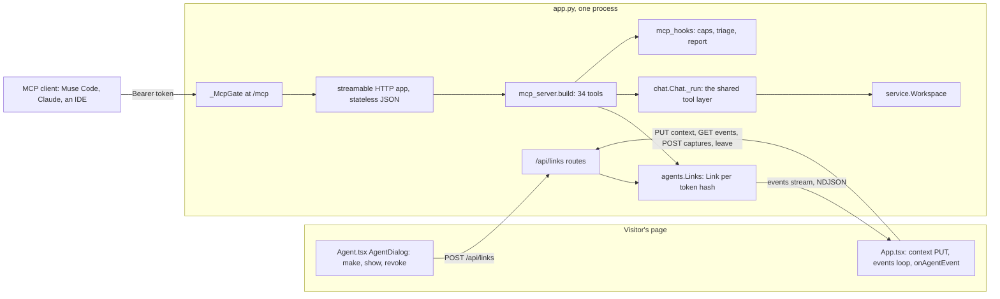
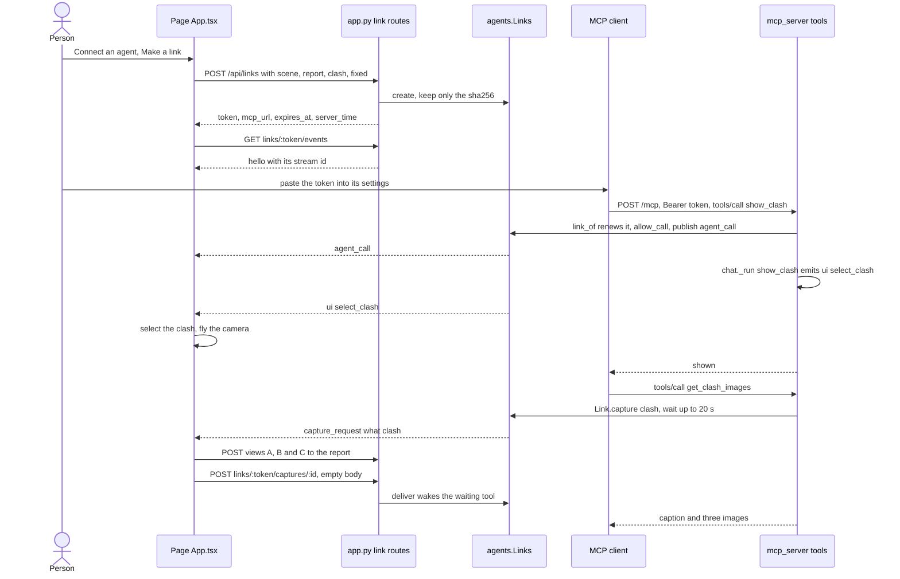
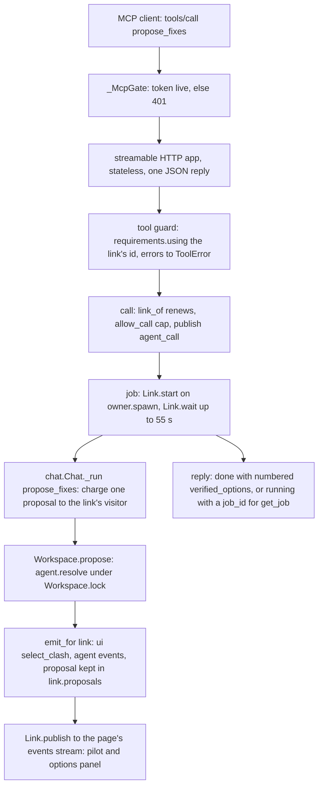

# 11 · MCP and agent links

> **Covers:** `server/sightline/mcp_server.py`, `server/sightline/agents.py`, the link routes, `mcp_hooks`,
> `_McpGate`, `_mcp_transport` and the lifespan in `server/sightline/app.py`, `web/src/Agent.tsx`, the agent and
> saved-session parts of `web/src/App.tsx`, the link calls in `web/src/api.ts` · **Checked against code:** 2026-10-30
> (`104fda9`) · **Deeper design:** [docs/mcp.md](../mcp.md)

Any MCP client (Muse Code, Claude Code or Desktop, an IDE) can work on an ORCA session. A visitor makes a **pairing
link** in the page; the agent presents its token to `/mcp` and then works on what that visitor has open, while their
page follows along: the camera goes to the clash the agent shows, the page takes the pictures the agent asks for,
and fixes appear as the agent applies them. The MCP tools are the in-app chat's tools (`chat.Chat._run`, over the
same `service.Workspace`), plus what only an outside agent needs: what is open, pictures, jobs for long work,
applying a fix, triage, the report and export. A second way in, over stdio, gives a local session with no browser.
The routes are listed in [10](10-http-api-and-streams.md); the chat's own loop is in
[09](09-agent-workflows.md); caps are in [16](16-security-caps-and-cost.md).

## The parts

## Pairing links (`agents.py`)

### The token and the link

- **A link is a capability.** `Links.create(visitor, owner, ctx)` makes `"orca_" + secrets.token_urlsafe(32)`, keeps
  only its sha256 (`Link.key`; the dict of links is keyed by the hash) and returns the token once. Whoever holds the
  token can act on that session until it expires or is revoked.
- **`Link` fields:** `id` (8 hex characters, public, for logs and the page; never the secret), `key`, `visitor`
  (`limits.client_id` of the creator: MCP calls are charged to them), `owner` (`owner.no_caps()` when it was made:
  the owner's links have no demo caps), `created`, `expires`, `ctx` (a `chat.Context`: `scene_id`, `report_id`,
  `clash_id`, `fixed`), `requirements` (the page's requirements id), `last_call`, `calls`, `proposals` (clash id →
  the last proposal, with its full options), `applied` (clash id → the title of the fix the agent applied), `plans`
  (plan id → the plan), `jobs`, and private `_subscribers`, `_captures`, `_lock`.
- **Lifetime:** `TTL` 12 h after the last use, never more than `MAX_AGE` 24 h after it was made. A use renews it to
  `min(created + MAX_AGE, max(expires, now + TTL))` (`Links.get(touch=True)`). An expired link is dropped when next
  looked up, and `create` sweeps expired ones. At most `MAX_LINKS` (200): the oldest goes first.
- **Links live in memory**, like the scenes they point at: a restart ends every link.

What renews a link and what does not:

| Call | Renews |
|---|---|
| `POST /api/links` | starts it: `expires = now + 12 h` |
| `PUT /api/links/{token}/context` | yes |
| `GET /api/links/{token}/events` (each connection, so every reconnect of an open page) | yes |
| `POST /api/links/{token}/captures/{capture_id}` | yes |
| Any MCP tool call (`link_of` in `mcp_server.build`) | yes |
| `GET /api/links/{token}` (the page's minute poll), `POST /api/links/{token}/leave/{stream_id}` | no (`touch=False`) |
| `_McpGate`'s check of the token | no |
| `DELETE /api/links/{token}` | ends it (`Links.revoke`, then a `revoked` event to its pages) |

`Link.public()` is what the page sees: `id`, `expires_at`, `max_expires_at`, `server_time`, `calls`, `last_call`,
`browser` (a page is listening), `context` (ids, and the number fixed) and `applied`. `server_time` lets the page
count time left on the server's clock: it keeps `clock_offset = server_time − its own time`.

### The page's channel

- **Context.** The page `PUT`s what is open, selected and fixed whenever that changes (debounced 250 ms), so the
  agent sees what the person sees. The same call stores the page's requirements id (`requirements.current_id()` from
  its `X-Sightline-Requirements`), which every tool call then runs under (`requirements.using`). `POST /api/links`
  stores both at creation.
- **Events.** `GET /api/links/{token}/events` subscribes a bounded queue (`Link.subscribe`, `EVENTS_PER_SUBSCRIBER`
  200; when it is full the oldest event goes, so a page that stops reading loses old events, never the agent's
  time). The stream starts with `hello` (this subscriber's `stream` id plus `public()`), sends `heartbeat` after
  15 s idle, and ends after about 240 s (under Modal's request limit), when the link is gone, or when the page leaves.
  Every event type is in [10](10-http-api-and-streams.md).
- **Several pages** may follow one link: `Link.publish` sends to every subscriber. `Link.browser` is true while any
  is subscribed.
- **Leaving.** On `pagehide` the page sends a beacon to `POST /api/links/{token}/leave/{stream_id}`. `Link.leave`
  removes that subscriber at once and puts an internal `bye` in its queue, which ends its stream. Behind a proxy a
  dropped stream is only noticed on a later write, so without this the agent would be told a browser is there.

### Pictures from the page

`Link.capture(what, wait_s=15, **details)` returns `None` at once when no page listens. Otherwise it registers a
waiter under a fresh id, publishes `{"type": "capture_request", "id", "what", …}` and waits:

- `what: "view"`: the page draws its current view (`Viewer.capture(1024)`) and posts the PNG to
  `POST /api/links/{token}/captures/{capture_id}`; the tool gets the bytes.
- `what: "clash"` (with `report_id`, `clash_id`, `a`, `b`): the page takes A, B and C (`captureViews`), saves each on
  the report through `POST /api/reports/{report_id}/clashes/{clash_id}/images`, then posts an empty capture reply;
  the tool reads the clash's pictures from the report, where the fix agent, triage and the PDF use them too.

`Link.deliver` wakes the waiter (404 when nobody waits any more); a reply over 6 MB is refused (413). No reply in
time is `None`, and the tool says so.

### Jobs for long work

`Link.start(kind, work, spawn)` runs `work` on `hooks.spawn` (`owner.spawn` from the web server) as a `Job` (`id`,
`kind`, `started`, `done` event, `result`, `error`); `Link.wait(job, wait_s)` waits at most 55 s. `Job.state()` is
`{job_id, kind, status: "running", seconds, note}` (call `get_job`), `{…, status: "failed", error}` or
`{…, status: "done", result}`. A link keeps `JOBS_PER_LINK` (16) jobs; the oldest finished ones go first. This keeps
clients with short tool timeouts safe: a proposal takes 20-60 s (the tool's own docstring).

### What the server keeps for later

- `Link.proposals` and `Link.plans` are filled by `emit_for(link)` as the chat tools emit `proposal` and `plan`
  events; `apply_fix` and `apply_plan` read them, so an agent applies exactly what was verified.
- `Link.applied` records each fix the agent applied (clash id → title). `GET /api/links/{token}` returns it, so a
  page that resumes later marks those clashes fixed.
- `Links.kept()` is the set of scenes and reports that live links point at. `app.py` sets `ws.keep = links.kept`,
  so `Workspace` evicts those last.

### Caps

| Cap | Env var | Counted on | Modal value (`deploy/modal_app.py`) |
|---|---|---|---|
| Links made | `SIGHTLINE_LINKS_PER_HOUR` per visitor, `SIGHTLINE_LINKS_PER_DAY` for everyone (`link_limit`) | `POST /api/links` | 10 an hour, 500 a day |
| Tool calls | `SIGHTLINE_AGENT_CALLS_PER_HOUR` per link id (`agent_call_limit`; no day cap) | every MCP tool call (`hooks.allow_call`) | 600 an hour |
| Proposals, second tries and detection runs | the page's own caps (`propose_limit`, `escalation_refused`, `detect_limit`), charged to `link.visitor` | the tools that spend (table below) | as the page's (detection runs: no cap) |

The owner's links (`link.owner`) skip the proposal and detection caps and are not refused by the Muse Wonder budget; the per-link
call cap still applies to them.

## The MCP server (`mcp_server.py`)

### `build(ws, hooks, local)`

`build(ws: Workspace | Callable[[], Workspace], hooks: Hooks | None = None, local: agents.Link | None = None)` returns
an `MCPServer("orca", title="ORCA", instructions=INSTRUCTIONS, website_url=…)` from the `mcp` package
(`mcp.server.mcpserver`). `website_url` is `SIGHTLINE_PUBLIC_URL` (the deploy sets its own address), else none: no
address is written into the code.

- **`ws`** is a Workspace or a function returning the current one (`app.py` passes `lambda: ws`; tests swap the web
  server's workspace). `T()` keeps one `chat.Chat` per workspace, used only for `_run`: the MCP side never runs
  the chat's own Muse Spark conversation loop.
- **`hooks.links` set** (remote): each call finds its link by the token in the request headers (`link_of`). **Unset**
  (stdio): every call works on `local`.
- **`INSTRUCTIONS`** tell the agent to start with `get_session`, read clashes, test its own ideas with the `check_*`
  tools or run `propose_fixes`, that nothing changes until `apply_fix` or `apply_plan`, that distances are metres
  with Z up (negative is overlap), and that `show_clash`, `set_view`, `set_filters` and `capture_view` act on the person's page.

`Hooks` is what the hosting server lends the tools (`None` parts are not available):

| Field | Default (a bare `build`) | What `app.mcp_hooks()` lends |
|---|---|---|
| `links` | `None` | `app.links` (stdio sets it back to `None`) |
| `charge(link, n)` | always allowed | `None` for an owner link, else `propose_limit.take_many(link.visitor, n)` |
| `escalate(link)` | `_local_escalate`: refused when switched off, else `spend.claim(…, exempt=True)` | `escalation_refused(link.visitor, link.owner)` |
| `detect(link)` | always allowed | `None` for an owner link, else `detect_limit.take(link.visitor)` (`mcp_hooks.detect_run`) |
| `allow_call(link)` | always allowed | `agent_call_limit.take(link.id)` |
| `start_triage(report_id, scene_id, link)` | `None` | `app._start_triage(…, charge one proposal)` |
| `triage_state(report_id, scene_id)` | `None` | the `GET /api/reports/{report_id}/triage` route function, called directly |
| `build_document(report_id, scene_id, scope)` | `None` | `app._build_document` with the server's finished triage verdicts (a `RuntimeError` when fewer than half the clashes have one) |
| `spawn(fn)` | `None` (plain daemon threads) | `owner.spawn` |

### The `tool` decorator

`tool(read_only=False, **kw)` registers a function with `mcp.tool(...)`:

- **Annotations:** `ToolAnnotations(read_only_hint=read_only, destructive_hint=False if read_only else None,
  open_world_hint=False)`. `read_only` means it changes neither the model, the open report nor the allowance;
  clients such as Muse Code run those without an approval prompt.
- **Guard:** the call runs inside `requirements.using(link.requirements)` (`_link_requirements` finds the MCP
  `Context` among the arguments), so detection, triage and fixes follow the page's requirements file. An id the
  server has forgotten runs with none.
- **Expected failures reach the agent in words:** `ToolError` passes through; a `KeyError` becomes
  `ToolError(<its key or message>)`; `PermissionError`, `LookupError`, `FileNotFoundError`, `ValueError`,
  `RuntimeError` and `edits.Unsupported` become `ToolError(str(e))`. Anything else stays a crash.
- A refused allowance *inside* a chat tool comes back as the result `{"error": "<words>"}` (the chat's convention),
  while a refused call cap or an expired link is a `ToolError` raised by `call()`.

### The helpers every tool uses

| Helper | What it does |
|---|---|
| `link_of(ctx)` | The link for this call: `local`, or `hooks.links.get(token_from(ctx.headers))` (renews it); none is `PermissionError` "This agent link has expired or was revoked. Make a new one in ORCA: Connect an agent." |
| `call(ctx, tool, args)` | `link_of`, then `hooks.allow_call` (refusal → `PermissionError`), counts the call, sets `last_call`, publishes `agent_call {tool, args (long lists cut by _short), expires_at}` |
| `done(link, tool, summary)` | Publishes `agent_result {tool, summary}` |
| `emit_for(link)` | The `emit` the chat tools get: keeps `proposal` events in `link.proposals` and `plan` events in `link.plans` (by `_plan_id`), and publishes every event to the page |
| `caps(link)` | The chat tools' caps for this link: `propose_allowed`, `propose_allowed_many`, `escalate_allowed`, `detect_allowed`, each a `hooks` charge on the link |
| `run(ctx, name, args)` | `call`, then `T()._run(name, args, link.ctx, emit_for(link), **caps(link))`, then `done` |
| `job(ctx, name, args, wait_s, after)` | The same as `run`, inside `Link.start`, waited on up to `wait_s` (`after` shapes the result: numbered options, the plan id) |
| `need_report(link)` | The link's open report (the list of the scene's kept checks made again if the server let it go: `Chat._open_report`), else `LookupError` "No clashes are open. Call detect_clashes to check the open models." |
| `base_url(ctx)` | `proto://host` from the forwarded headers, for download links |

`_run` works on `link.ctx` itself, so a tool that changes it (`detect_clashes` sets `report_id`) changes what the
link points at; the page adopts the new report from its `ui open_report` event and its next context PUT agrees.

## Every tool

All 32 `@tool`-decorated functions in `mcp_server.build`. Every call first publishes `agent_call`; "Page events"
lists what else the page receives. `agent_result` follows at the end unless the row says otherwise. "Chat" means the
call goes through `chat.Chat._run` under the same name.

| Tool | Read-only | What it does | Reuses | Page events |
|---|---|---|---|---|
| `get_session` | yes | What is open: model files and element count, the report (title, clashes, found by ORCA or Navisworks), triage state, the kept checks (`checks`: name, clashes, stale) and the one the person's list shows (`viewing_check`, from `LinkContext.check`), the selected clash, what is fixed, the person's filters by name (the page shares them with the link: `LinkContext.filters`) and how many they show together (`filters_show`, from `LinkContext.filter_view`), whether a browser follows; a `next` step or a `note` that the page is closed | `Workspace` scenes and reports, `hooks.triage_state` | none |
| `list_models` | yes | The models ORCA can open (IFC, STEP) | `Workspace.list_samples` | none; no `agent_result` |
| `open_models` | no | Opens sample models that share coordinates and checks them | with a browser: the page's own open and check (waits up to 60 s for the page's context to show the new report, else returns `opening`); without: `Workspace.open` then chat `detect_clashes`, one detection run (refused: open, with a `note` "Opened, not checked: …") | `ui open_models {names}` when a browser follows |
| `detect_clashes` | no | ORCA's own detection on the open models, kept as a check ([docs/detection.md](../detection.md), "Kept checks"); the open report becomes the list of every kept check's clashes; a rerun of a check says what was resolved since its own last run; `check` runs a kept check again by its name, or `"all"` every one (one detection run). With `a` (and `b`, `kind`, `clearance_mm`, `name`): one check of what side A takes against B, a side being one of the person's filters by name (one colouring by value takes what it colours), what their filters show together (`{"shown": true}`), or elements described as for `set_filters`, B also everything (the models the full check covers) or itself ([docs/filters.md](../filters.md)). One detection run (`hooks.detect`); a refused check spends none | chat → `Workspace.detect` | `detect_event` per step, `ui open_report` |
| `report_summary` | yes | Counts per test and per class pair: deepest overlap, touches, non-physical sides, how many fixed | chat | none |
| `list_clashes` | yes | Clashes filtered by words, test, a kept check (`check`, by name) or in-model only; each row names the checks that found it | chat | none |
| `get_clash` | yes | One clash by id or `#N`: both elements, depth, point, model ids, fixed, pictures | chat | none |
| `get_clash_images` | yes | The A/B/C pictures as MCP images with a caption (A red, B green); for a detected clash with none yet, asks the page to take them | `Report.clash`, `Workspace.match`, `Link.capture("clash")`, `Image` | `capture_request {what: "clash"}` when needed |
| `measure_clash` | yes | ORCA's signed distance for one clash | chat → `Workspace.measure` | none |
| `show_clash` | yes | Selects a clash in the page and flies the camera to it | chat | `ui select_clash` |
| `set_view` | yes | Shaded, x-ray, context or isolate, and the section box | chat | `ui set_view` |
| `set_filters` | yes | Filters by property on the page ([docs/filters.md](../filters.md)): each finds elements by classes, levels, models and `where` conditions and colours, colours by value, hides or isolates them, and greys or hides the rest (`grey_rest`, `hide_rest`); replaces the agent's own filters, pauses the person's; names the models lack fail with the closest | chat → `facets.resolve` | `ui filters {mode: replace, filters, grey_rest?, hide_rest?}` |
| `clear_filters` | yes | Removes the agent's filters; the person's come back | chat | `ui filters {mode: clear}` |
| `capture_view` | yes | A picture of the person's current view | `Link.capture("view")`, `Image` | `capture_request {what: "view"}` |
| `describe_element` | yes | An element's class, name, tag, level, file, connections, and a straight segment's run | chat → `Workspace.describe`, `edits.run_of` | none |
| `find_elements` | yes | Search elements by name, tag or class | chat | none |
| `find_openings` | yes | Openings through an obstacle in line with a segment, with offset heights that pass | chat → `edits.passages` | none |
| `check_move` | yes | A move checked without keeping it; with `obstacle`, what the elements stand on is kept | chat → `Workspace.verify_move` | none |
| `check_offset` | yes | A local offset checked without keeping it | chat → `Workspace.check_offset` | none |
| `check_route` | yes | A route of up to three steps checked without keeping it | chat → `Workspace.check_route` | none |
| `check_resize` | yes | A flatter section checked without keeping it | chat → `Workspace.check_resize` | none |
| `check_penetration` | yes | An opening through a wall or slab checked without keeping it | chat → `Workspace.check_penetration` | none |
| `check_seat` | yes | An element seated on what it comes down into, checked without keeping it | chat → `Workspace.check_seat` | none |
| `list_faces` | yes | An element's faces to edit by hand, named (east end, north face, top), with what each allows | chat → `faces.faces` | none |
| `check_edit` | yes | A hand edit checked without keeping it (`manual.check`); the page previews it (`edit_preview`) | `manual.check` | none |
| `apply_edit` | no | A hand edit kept (`manual.apply`, checked again first; `accept_clashes` for one kept with its clashes, `accept_joints` for one that leaves the joints its check lists open), logged as the agent's; the page redraws it (`edit_kept` with the patch) | `manual.apply`, `Workspace.patch` | none |
| `list_edits` | yes | The edit log: every kept edit, who kept it, its clash and the fix it follows, kept or undone | `Journal.summary` | none |
| `undo_edit` | no | The newest kept edit undone (a hand edit or a fix); the page redraws (`edit_stepped`) | `Workspace.undo_edit` | none |
| `redo_edit` | no | The edit undone last made again | `Workspace.redo_edit` | none |
| `propose_fixes` | no | ORCA's fix agent on one clash, numbered verified options (`option` from 1); `escalate` for a second try on Muse Wonder. One proposal, or one escalation and one proposal | `job` + chat → `Workspace.propose` / `Workspace.escalate` | `ui select_clash`, `agent` events (the pilot), `proposal` (the options panel) |
| `plan_fixes_together` | no | One plan for several clashes, checked together; returns a `plan_id`. One proposal per distinct pair | `job` + chat → `plans.build_batch` | `plan_started`, `plan_event`, `plan` |
| `find_root_causes` | yes | Elements in several real clashes, with clashes the report missed | chat → `plans.root_causes` | none |
| `plan_root_cause` | no | The cause and one coordinated plan for a hub; returns a `plan_id`. One proposal, its fixes only if it needs edits | `job` + chat → `plans.build_root_cause` | `plan_started`, `plan_event`, `plan` |
| `find_patterns` | no | Patterns judged by design, modelling error or real problem. One proposal for a reading not made yet; the route, chat and MCP share readings | chat → `plans.patterns`, `plans.read_patterns` | none |
| `get_job` | yes | A long call's state, waiting up to `wait_s` (default 30, at most 55) | `Link.jobs`, `Link.wait` | none; no `agent_result` |
| `apply_fix` | no | Keeps option N of the last proposal for a clash, tried again first against that clash (a `ToolError` with why when it no longer passes); a penetration whose host may not be cut is only requested (`requested_only`) | `link.proposals`, `plans.apply`, `Workspace.patch` under `Workspace.lock` | `ui applied` (patch fields included) |
| `apply_plan` | no | Keeps every verified fix of a plan, all or none, each tried again alone and all together first | `link.plans`, `plans.apply`, `Workspace.patch` | `ui applied` |
| `triage` | no | Starts or follows the report's shared triage, waits up to `wait_s`, returns counts and the real clashes (at most 40), or a `job_id` for the rest. Starting a run costs one proposal | `hooks.start_triage`, `hooks.triage_state` | `ui follow_triage` (the page follows the run itself) |
| `generate_report` | no | The PDF (combined, per team or per model) with BCF, from the server's finished triage; `check`: only one kept check's clashes, by name; a download URL (remote) or a file path (stdio). One proposal | `hooks.charge`, `hooks.build_document` in a job | none besides `agent_result` with the file name |
| `export_models` | no | The edited models: remote, the `/api/scenes/{scene_id}/export` URL; stdio, files written to a temp folder | `Workspace.export` | none |

Notes on the table:

- **Read-only is declared, not inferred:** `show_clash`, `set_view`, `set_filters`, `clear_filters` and `capture_view` are read-only (they change
  only the person's view), while `find_patterns` is not (it spends a model call).
- **A report built by an agent** carries none of the page's evidence, reviews or marks (`build_document` passes only
  the scope), so its pages say what the server knows: the triage, not the fixes the person reviewed.
- **The export URL needs no token**: like the page's own download, it is keyed only by the scene id.
- **The page and the agent share the work.** A proposal the agent runs fills the person's options panel, where they
  can accept it too; a plan fills the Plan tab.

## Two ways in

### Remote: `/mcp` on the web server

- **Mount.** `app.router.routes.insert(0, Route("/mcp", endpoint=_mcp_gate, methods=["GET", "POST", "DELETE"]))`, so
  `/mcp` is matched before anything else. `_mcp = mcp_server.build(lambda: ws, mcp_hooks())` is built at import.
- **`_McpGate`** (HTTP only): reads the token from `Authorization: Bearer <token>` or `?key=<token>`
  (`agents.token_from`). Without a live link it answers 401 with a JSON `error` and `WWW-Authenticate: Bearer
  realm="orca"`, before the MCP layer runs. A `?key=` token is added to the scope as an `Authorization` header (that
  is where the tools read it). Every reply gets `Content-Encoding: identity`, so Modal's edge does not hold it back.
- **`_mcp_transport()`** builds `_mcp.streamable_http_app(stateless_http=True, json_response=True,
  transport_security=TransportSecuritySettings(enable_dns_rebinding_protection=False))`: one plain JSON response per
  call and no long-held SSE stream, because Modal cuts requests at ten minutes and its edge buffers streams. The
  DNS-rebinding check (meant for servers on localhost) is off because every request must carry a token.
- **Lifespan.** `_lifespan` sets `_mcp_gate.inner = _mcp_transport()` and runs `_mcp.session_manager.run()`. A
  session manager runs only once, so each server start (and each test client) builds a new transport.
- **In development** Vite proxies only `/api`; an agent connects to the uvicorn port directly.

### Local: stdio

`cd server && uv run python -m sightline.mcp_server` runs `mcp_server.main()`. It imports the web app module (the
same `Workspace`, caps and helpers), makes a local `agents.Link("local", "", "local", True, now, inf)` (owner, never
expires), takes `app.mcp_hooks()` with `links = None`, and runs `build(web.ws, hooks, local=local).run()` over stdio.
It is a session of its own with no browser: `open_models` opens samples itself, the picture tools say there is no
browser, and `generate_report` and `export_models` return local file paths. The owner link means no proposal caps;
second tries still respect the off switch, and Wonder spend is counted.

## A pairing, end to end

## One tool call through the layers

`propose_fixes`, the longest common call:

## The page side

### `web/src/Agent.tsx`

- **`AgentDialog`** (`link`, `log`, `now`, `creating`, `error`, `canCreate`, `onCreate`, `onRevoke`, `onClose`).
  Without a link: **Make a link for this session** (disabled until models are open, `canCreate={!!sceneId}`) and
  what a link allows. With one: a status line (agent connected and its last call, or waiting), the time left
  (`ExpiryChip`: "expiring soon" under 30 minutes, the exact times in a tooltip, a note once it reaches the 24-hour
  limit), the **Token** (masked as its first 5 and last 4 characters, show and copy) and **Server** rows
  (`CopyField`), what the agent did (the last 8 entries), and **Revoke this link**.
- **"First time? Set up your agent"** folds the client settings away once this browser has made a link
  (`sightline.agent.setup` in `localStorage`). Tabs: Muse Code (the settings JSON: `schema_version` 1,
  `mcpServers.orca` with `transport: "streamable_http"`, the URL, the `Authorization` header and `mode: "optional"`,
  so a run carries on when the link expires; written into `~/.config/muse/settings.json`; `"Bearer ${ORCA_TOKEN}"`
  lets only an environment variable change per session), Claude Code (`claude mcp add --transport http …`), Claude
  Desktop (`npx mcp-remote …`), other clients (the URL, the header, and `?key=` for clients without headers), and
  local stdio. There is no `muse mcp add` command, so Muse Code takes the JSON.
- **`secondsLeft(link, now)`** and **`timeLeft`** count on the server's clock (`expires_at − (now + clock_offset)`);
  App's header pill and menu use them.

### `web/src/App.tsx`

| Piece | What it does |
|---|---|
| `agentLink` state, `setAgentLink` | The link, with `clock_offset` measured from `server_time` whenever the server sends it |
| `connectAgent`, `disconnectAgent` | `api.createLink` with what is open; `api.revokeLink` |
| Context effect | `api.linkContext` 250 ms after the scene, report, clash, fixed list or requirements id changes; a 404 drops the link |
| Follow loop | `api.linkEvents` in a loop while the link lives: when a stream ends, reconnect after 1 s; after an error, back off up to 15 s; a 404 drops the link |
| Clock and poll | A 2 s tick for "last call 4 s ago" and the time left; `api.linkState` every 60 s for the expiry (which does not renew it); a 404 drops the link |
| `pagehide` | `api.leaveLink(token, stream)` as a beacon, so the server stops counting this page at once |
| `onAgentEvent(e)` | `hello`: keep the stream id, expiry and clock offset. `heartbeat`: nothing. `revoked`: drop the link. `agent_call` / `agent_result`: the pill's last call and the dialog's log. `capture_request`: a view's PNG (`viewer.capture(1024)`), or a clash's A/B/C saved on the report (`captureViews`), then `api.linkCapture`. `ui open_models`: `openDemo(names)` unless busy. `ui follow_triage`: `runTriage(false)` unless a run is going. `ui applied`: `applyToViewer` (patch in place, else reload the files), record the new pieces, `markFixed`, reset the options and re-measure, as when the person accepts. Anything else goes to `onChatEvent`, so an agent's `show_clash`, `set_view`, detection, proposals and plans look exactly like the chat's. |
| Header and menu | The **Connect an agent** button becomes a pill ("Agent · `<last tool>`" or "Agent · waiting") with the time left |

### Resuming with a link

The page keeps its session in `localStorage` under `sightline.session` (`SavedSession`: `scene_id`, `report_id`,
`files`, `fixes`, `link` with its own `clock_offset`, `saved_at`), updated as the scene, report, files, fixes or
link change.

1. On arrival it asks `GET /api/scenes/{scene_id}` (404: forget the saved session), the report, and
   `GET /api/links/{token}` for a saved link, whose `applied` (fixes the agent made while no page was open) joins the
   saved fixes. The landing then shows "Pick up where you left off".
2. **Resume** (`resumeSession`) reopens the same scene (`open(files, existing)`: the files come from
   `/api/scenes/{scene_id}/files/{index}`, edited ones included), reloads the report, restores the fixes and the last
   detection, and sets the link back, which restarts the context PUT and the follow loop.
3. **Start fresh** (`startFresh`) forgets the saved session and revokes its link.

When the tab is closed the agent keeps working: the link and the models live on the server. Only the page tools
stop (`capture_view`, pictures of detected clashes, `show_clash`, `set_view`, `set_filters`, `clear_filters`), and `get_session` says so in its
`note`.

## How it differs from the chat

| Only over MCP | Only in the chat |
|---|---|
| `get_session`, `list_models`, `open_models`, `capture_view`, `get_clash_images` (the chat's `look_at_clash_images` sends the pictures to Muse instead), `get_job`, `apply_fix`, `apply_plan`, `triage`, `generate_report`, `export_models` | `explore_wider_fix` (the wider-fix search), `look_at_clash_images`, `show_it_built` |

The chat cannot accept a fix (the person does, in the options panel or Plan tab); an agent can, with `apply_fix` and
`apply_plan`.

## When to update this doc

- A tool added, removed, renamed, or its read-only flag, charge or page events changed in `mcp_server.build` (the
  docs-map test checks every `@tool` function against the table above).
- A change to `Hooks` or to what `app.mcp_hooks` lends.
- A change to `agents.py`: token format, `TTL`, `MAX_AGE`, `MAX_LINKS`, queue or job limits, what renews a link,
  the capture protocol, `Link.public()` fields, `Links.kept`.
- A change to the `/mcp` mount, `_McpGate`, `_mcp_transport` or the stdio entry point.
- A new chat tool that MCP should expose, or a change to `chat.Chat._run` that changes what a tool returns or emits.
- A change to the page side: `Agent.tsx` (dialog, client settings), the agent part of `App.tsx` (`onAgentEvent`,
  the follow loop, the context PUT), or the saved session and resume.
- Link caps (`SIGHTLINE_LINKS_PER_HOUR`, `SIGHTLINE_LINKS_PER_DAY`, `SIGHTLINE_AGENT_CALLS_PER_HOUR`); update
  [16](16-security-caps-and-cost.md) too.
