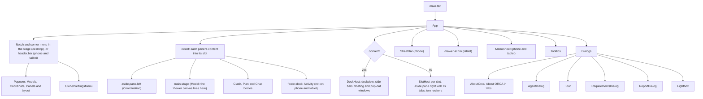
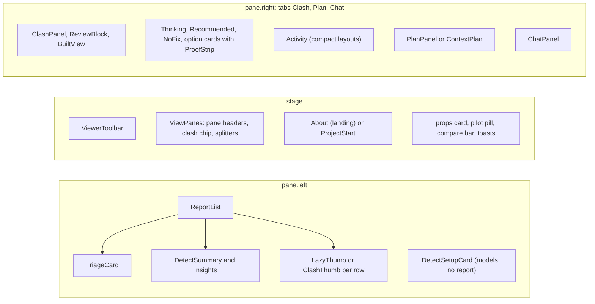
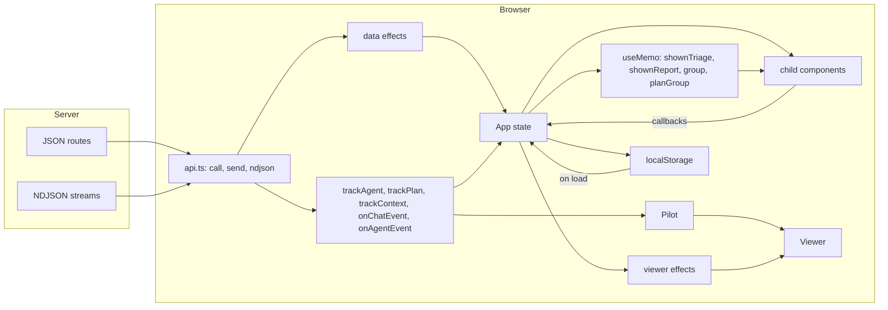
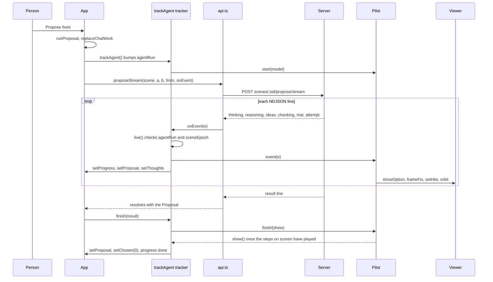

# 12 · Web app: structure and state

> **Covers:** `web/src/` (all but `viewer/`, which is [13](13-3d-viewer.md)), `web/index.html`, `web/vite.config.ts`,
> `web/tsconfig.json`, `web/package.json`, `web/scripts/`, `web/public/`, `assets/brand/orca/` · **Checked against code:**
> 2026-10-30 (`main` at `b74d70b`; the dock again on `fix/dock-empty-bars-tooltips`; the notch, menu and brand on `claude/laughing-allen-29oggh`; demos, model names and the requirements' domain on `fix/hardcoded-defaults`) · **Deeper design:** [docs/mobile.md](../mobile.md),
> [docs/views.md](../views.md), [docs/panels.md](../panels.md), [docs/brand-assets.md](../brand-assets.md)

The web app is a single-page React 19 app built with Vite and TypeScript. One component, `App` in `App.tsx`, owns
almost all of the page's state and every call that changes it; the other components draw what `App` hands them and
report back through callbacks. A handful of plain modules hold logic that the tests exercise on their own (layout,
fix wording, requirements files, uploads, review sign-offs, the chat's turn ownership). The page talks to the server
only through `api.ts`, mostly as NDJSON streams, and draws the models through the `Viewer` class
([13](13-3d-viewer.md)). There is no router, no state library and no CSS framework: `useState`/`useRef`/`useMemo`/
`useEffect` and one global stylesheet.

## Every file in `web/src/`

| File | What it is | Main exports | Used by |
|---|---|---|---|
| `main.tsx` | Entry: mounts `<App />` in `StrictMode` on `#root`, imports the stylesheet | (none) | `web/index.html` |
| `App.tsx` | The whole page: state, handlers, effects, the notch and corner (desktop) or the compact header, panes, sheet, dialogs. Also small local components `ProofStrip`, `Recommended`, `NoFix`, `Thinking` and helpers `keepPlaces`, `movedPairs`, `clampPane`, `shortName` | `App` | `main.tsx` |
| `index.css` | The one stylesheet: tokens, layout grid, every feature's styles, then the "Responsive" block | (CSS) | `main.tsx` |
| `api.ts` | Every server call, the NDJSON reader, the wire types, the two request headers | `api`, `ApiError`, `setOwnerSettings`, `setRequirements`, `requirementsInUse`, ~100 types | everything |
| `aiNames.ts` | The name of the AI model behind each role (proposal, escalation, triage, image, voice) as the server reports it (`GET /api/models` labels), for every panel's words; App sets them, the defaults until then | `aiName`, `setAiNames`, `DEFAULT_AI_NAMES`, `AiRole`, `AiNames` | `App`, `Activity.tsx`, `pilot.ts`, `PlanPanel.tsx`, `BuiltView.tsx`, `Triage.tsx`, `Insights.tsx`, `ReportDoc.tsx`, `ClashPanel.tsx`, `ReportList.tsx`, `Requirements.tsx`, `Owner.tsx`, `Workings.tsx`, `workingsGraph.ts` |
| `names.ts` | Model files' names as people read them: no extension, and no prefix the set shares, whatever the project is called | `shortNames`, `sharedPrefix` | `App` |
| `About.tsx` | Landing page in the empty viewer (hero, demo cards, resume card, before/after picture, the "Go deeper" card that opens About ORCA) | `About`, `Resume`, `projectName` | `App` |
| `AboutOrca.tsx` | About ORCA: a full page over the app in six tabs (Overview, How it works, The fixes, The AI, Under the hood, Proof and limits), with animated SVG pictures (the ORCA loop, the girder clash before and after, each fix kind, the propose-check loop), count-up numbers and sections that fade up as they scroll in; reduced motion shows it all still. Its numbers are the landing's measured ones | `AboutOrca` | `App` |
| `aboutRoute.ts` | The About page's tabs and address: `#about` and `#about/<tab>`, pushed when it opens (Back closes it), replaced on a tab change | `ABOUT_TABS`, `AboutTab`, `aboutTabFromHash`, `aboutHash`, `nextTab`, `currentHash`, `showAboutHash` | `App`, `AboutOrca.tsx` |
| `Activity.tsx` | The Activity panel: the one-line status, then Steps (the table of ideas tried, why each failed) or Workings, with the switch between them, Workings' off button and, when it is off, Turn it on | `Activity`, `ActivityView`, `statusLine`, `Progress` (re-exports `editText`, `KIND_LABEL`) | `App` |
| `Workings.tsx` | Workings ([docs/workings.md](../workings.md)): the picked run drawn on a canvas that pans, zooms, follows the newest step, marks the step the pilot shows, and replays a finished run (the timeline strip, speeds); a check pointed at or pinned goes to `onPeek`, so its trial shows in the 3D viewer; timers and sizes come from the window the panel is in, so it works floated or in a pop-out window | `Workings`, `curve` | `Activity.tsx` |
| `workingsGraph.ts` | A run's events as a graph to draw (lanes, columns, steps, edges, timeline bars), one builder per kind of run, as it stood at any moment | `graphOf`, `sec`, `Graph`, `Step`, `Edge`, `Lane`, `Part`, `Peek` | `Workings.tsx`, `App` (`Peek`) |
| `runlog.ts` | The runs the page watched, for Workings: each run's events (meshes dropped, but a trial's pieces kept for the newest three proposals) with when they arrived, its origin (you, the chat, an agent over MCP, a tour replay); kinds: propose, plan, triage, built, detect, chat (a Chat panel turn); 12 kept, never letting a live one go | `runs`, `RunLog`, `lean`, `Run`, `RunHandle`, `RunKind`, `Origin`, `RUNS_KEPT`, `TRIALS_KEPT` | `App`, `Workings.tsx` |
| `Agent.tsx` | "Connect an agent" dialog: token and server fields, client set-up snippets, time left, the agent's log | `AgentDialog`, `timeLeft`, `secondsLeft`, `AgentLogEntry` | `App` |
| `AppMenu.tsx` | ORCA's menu, on every layout: a panel from the right with every action by name (Models, Coordinate, this session, Panels and layout on a desktop, Help) | `MenuSheet` | `App` |
| `Brand.tsx` | ORCA's identity in the page: the wordmark, the split-O (`OrcaMark`, still, orbiting or settling once), the app icon, the notch at the model's top edge (grows with a `NotchStatus` while ORCA works), the loading card while the first models open (`LoadCard`, fed by `LoadProgress`) and the kept-fix toast | `Wordmark`, `OrcaMark`, `AppIcon`, `Notch`, `NotchStatus`, `LoadCard`, `LoadProgress`, `KeptToast` | `App`, `AppMenu.tsx` |
| `BuiltView.tsx` | Show it built's picture over ORCA's view, the wipe, "Lines from the model", the check's tooltip | `BuiltView`, `builtStep`, `cutText`, `BuiltRun` | `App`, `PlanPanel.tsx` |
| `Chat.tsx` | "Chat with ORCA": turns, tool steps, suggestions, the mic (hold to talk, hands-free, upload fallback); tells the page what was asked (`asked`) before each request, so Workings draws the turn | `ChatPanel`, `Turn`, `Step` | `App` |
| `ClashPanel.tsx` | The selected clash's card (both sides, how each matched, Navisworks or captured views, triage reading), the image dialog, thumbnails | `ClashPanel`, `Lightbox`, `ClashThumb` | `App`, `ReportList.tsx` |
| `ContextPlan.tsx` | The "wider fix" (context proposal) review in the Plan tab: alternatives, checks, review conditions to acknowledge | `ContextPlan`, `contextStep`, `ContextRun` | `App` |
| `dock.tsx` | The desktop's panels on dockview: a slot per panel that `App` draws into (`inSlot`), `SlotHost` (where a slot sits, in the dock or the classic grid), `DockHost` (the dock, its tabs, buttons, right-click menu, saving) and `DockHandle` (show, reset, gather, and `fitBar`, which grows the bottom bar for Workings and gives it back only from that height) | `DockHost`, `SlotHost`, `inSlot`, `usePanelSlots`, `DockHandle`, `Slots` | `App` |
| `dockLayout.ts` | The panels and their homes, which saved layouts load (`validLayout`), pop-outs back home on save (`withoutPopouts`), storage, what showing a panel takes (`showSteps`) | `PANELS`, `PANEL_IDS`, `homeOf`, `isPanel`, `validLayout`, `withoutPopouts`, `readLayout`, `writeLayout`, `showSteps`, `LAYOUT_KEY`, `CLASSIC_KEY` | `App`, `dock.tsx` |
| `Detect.tsx` | ORCA's check: the set-up card (tests to run), the run summary (coverage, new/resolved, Detect again; with no check of the open models kept, "Only <check>" and Check the open models), and the check picker over the list (All checks or one kept check, Run again, Remove a check on filters, Run all again, which checks ran before a fix; [docs/detection.md](../detection.md), "Kept checks") | `DetectSetupCard`, `DetectSummary`, `CheckPicker`, `DetectProgress` | `App` |
| `Insights.tsx` | Root causes and patterns, with their fix, filter, tick, mark and Add to requirements buttons | `Insights` | `App` (into `ReportList`'s `insights` slot) |
| `Owner.tsx` | The owner's gear: unlock, "For me" and "For everyone" settings; marked while the owner's own settings are on, what is set in its tip (`note`) | `OwnerSettingsMenu` | `App` |
| `PlanPanel.tsx` | A Fix-together or root-cause plan: its items, their status, the joint check, Accept | `PlanPanel`, `PlanRun` | `App` |
| `Properties.tsx` | The selected object's properties under its card: the element (class, every attribute, GlobalId, storey, file, size), its type, materials, classification, groups, documents, then each property and quantity set (Type badges, every kind of value, lengths in mm); each row's facet key for the filters; a filter, click to copy | `PropertySets` (row tools: copy, filter by, colour by, isolate all with; collapse all; links open an object), `RowActions`, `sections`, `filtered`, `shown`, `words`, `classWords` | `ElementCard.tsx` |
| `ElementCard.tsx` | The selected element's card ([docs/panels.md](../panels.md), "Properties"): header, breadcrumbs that open a parent's own properties (with a back arrow; a storey's isolate, hide, filter), the icon bar (A, B, zoom, hide, isolate, section box, links, More for the class), what it is linked to (`Links`), then `PropertySets` (folded under All properties on the card over the model) | `ElementCard`, `CardActions`, `Links` | `App` (`elementCard`, `cardActions`) |
| `FiltersPanel.tsx` | The Filters panel ([docs/filters.md](../filters.md)): the list of filters (on, colour or action, name, count, up, down, zoom to them, delete; Show colours, The rest: Show · Grey · Hide, Colour by…), and the editor (models, classes and floors with counts, property conditions, Colour / By value / Hide / Isolate, swatches, Invert, the Value / Items / Colour table, the live count); with `check`, each row's What do these hit? and the Check clashes block under the list ([docs/filters.md](../filters.md), "Checks") | `FiltersPanel`, `blankRule`, `FiltersPanelProps` | `App` (the dock's Filters panel, or a sheet without the dock) |
| `ProjectStart.tsx` | The blank project's drop zone (IFC/STEP models, or a Navisworks report or folder) | `ProjectStart` | `App` |
| `ReportDoc.tsx` | The coordination report dialog (scope, all kept checks or only the one the list shows, a typed team name per model, build PDF and BCF) and the per-clash review block | `ReportDialog`, `ReviewBlock`, `reviewersOf` | `App` |
| `ReportList.tsx` | The left pane over a report: Clashes / Insights tabs, impact bar, the report's line (tests, in the model, a "Naming n…" pill while titles land), the check picker (`picker`, from App), the search on its own row and the filters under it, each only when it would change the list (In the model when some clashes are not in the open models; by status once anything is fixed or reviewed: All, To fix, Fixed, Reviewed, also from the header's "N fixed" and "N reviewed" chips; "n shown"), the list with lazy thumbnails, and each row's quick actions on hover, keyboard focus or the selected row (`RowActions`: Propose fixes when both elements are in the model and it may need one, Mark as not a clash, and its same-element clashes with their count, narrowing the list to the clashes sharing either element, `sameElements`, through `onFocus`) | `ReportList`, `sameElements`, `clashLabel`, `mm`, `linkState`, `Review` | `App`, `ClashPanel.tsx`, `ContextPlan.tsx`, `PlanPanel.tsx`, `ReportDoc.tsx` |
| `Requirements.tsx` | The requirements dialog: level cards, strictness, the check matrix, who moves, the kind of project (building or machine) and what is fixed in place, rules and Muse's audit, openings | `RequirementsDialog` | `App` |
| `Sheet.tsx` | The phone's bottom sheet bar: handle, drag and flick, snap heights | `SheetBar` | `App` |
| `Tour.tsx` | Both guided tours (steps, spotlight, "Show me", recorded-run offer) | `Tour`, `TourState`, `TourActions`, `TOUR`, `CELL`, `TOUR_QUESTION`, `BUILDING_STEPS`, `CELL_STEPS` | `App` |
| `Triage.tsx` | The Triage card (a head with the Step 1 pill and a full-width Triage all button before a run; two stages; verdict bar and rows; "Triage N unread" when readings carried from other checks leave some to read, a failed read counted among them; a run queued behind the one under way, or following an earlier list's, says so; compact mode, folded to the head and the button or bar) | `TriageCard`, `TRIAGE`, `TriageRun` | `App`, `ClashPanel.tsx`, `ReportList.tsx` |
| `ViewerToolbar.tsx` | The viewer's icon rail (modes, styles, tools, camera, views and layouts, saved views, visibility), or one Tools menu on a phone | `ViewerToolbar`, `ToolbarState`, `ViewsControls`, `STYLES` | `App` |
| `MeasurePanel.tsx` | The Measure panel beside the rail while measuring: snap toggle, what to click next, the measurements (copy or delete each, Copy all, Clear all); its header drags it and folds it ([docs/measure.md](../measure.md)) | `MeasurePanel` | `App` |
| `ViewPanes.tsx` | Each pane's header over the viewer (view picker, view range or depth and crop, pin, go to the clash, fit, maximise), the clash chip, and the lines between panes to drag | `ViewPanes` | `App` |
| `filters.ts` | Filters, pure ([docs/filters.md](../filters.md)): the index's types, conditions and rules, `matching` (as the server's `facets.matching`), `found`, `evaluate` (what every rule that is on hides, isolates and colours: a `RuleView`), counts, facet names, the palette clear of every reserved colour, `migrate` for kept and saved states, `shareable` (the filters as chat and the agent link see them) | `evaluate`, `found`, `matching`, `prepare`, `count`, `valueCounts`, `describe`, `sets`, `nameFor`, `nextColour`, `migrate`, `shareable`, `PALETTE`, `RESERVED`, `Rule`, `FilterState`, `RuleView`, `FacetIndex` | `App`, `FiltersPanel.tsx`, `api.ts` (type), `viewer/Viewer.ts` (type) |
| `checks.ts` | Checks on filters, pure ([docs/filters.md](../filters.md), "Checks"): a filter as a detection test's side (its complete conditions; colouring by value, what it colours), what the filters show together as a side (`viewOf`, counted from `evaluate`), the check's name as the user knows it, the test with the server's defaults and no id (Everything: the server's `check.everything`), what a side takes counted as the filter list counts it, with the rooms among it a check cannot test and the line that says so, whether a run was a check; and the kept checks' list as one check shows it, which fix marks a run leaves, a check's picker line ([docs/detection.md](../detection.md), "Kept checks") | `sideFilter`, `sideOf`, `viewOf`, `sideName`, `checkName`, `checkTest`, `sideCounts`, `shownCounts`, `roomsLine`, `checkOf`, `narrow`, `pruneFixes`, `checkLabel`, `sameClash`, `Side`, `CheckKind` | `FiltersPanel.tsx`, `Detect.tsx`, `App` |
| `chatRequest.ts` | Who owns the chat's current turn, so a newer action can cut off an older stream | `ChatRequestOwner`, `ChatRequest` | `App`, `Chat.tsx` |
| `clashImage.ts` | Reads a Navisworks clash picture by colour (red A, green B, where they meet) | `readClashImage`, `focusSquare`, `drawOverlay`, `ClashRead`, `Box` | `ClashPanel.tsx` |
| `fixKinds.ts` | Every fix kind in words: label, edit text, clearance, framing, reviewer, host rows; rejected options as the next proposal's notes | `KIND_LABEL`, `kindLabel`, `editText`, `changeText`, `clearanceText`, `needsText`, `framePieces`, `hostRows`, `moveWords`, `reviewText`, `recEditText`, `optionKey`, `rejectionNotes`, `Rejection` | `App`, `Activity.tsx`, `PlanPanel.tsx` |
| `links.ts` | The connection highlight's logic: index the graph, an element's direct links by kind, its run (Shift), the groups and colours to light, the hover label's counts | `indexGraph`, `linksOf`, `runOf`, `highlightGroups`, `countsText`, `LINK_COLOURS`, `LINK_WORDS`, `LINK_ORDER`, `Graph`, `LinkIndex`, `LinkKind` | `App`, `api.ts` (the `Graph` type) |
| `layout.ts` | Desktop / tablet / phone by width, touch detection, sheet snapping, `follow()` | `useLayout`, `layoutFor`, `useCoarse`, `isCoarse`, `follow`, `nearestSnap`, `nextSnap`, `SNAPS`, `PHONE_MAX`, `TABLET_MAX` | `App`, `Sheet.tsx`, `About.tsx` |
| `noClash.ts` | Why a reported clash needs no fix (same element, not physical, a touch, no overlap, by design), and triage as shown (`shownVerdicts`: what is settled in this browser over the model's verdict; a fixed clash keeps its own) | `noClash`, `shownVerdicts`, `oneElement`, `sameWhy`, `NoClash` | `App`, `ReportList.tsx`, `ClashPanel.tsx` |
| `pilot.ts` | Lets the fix agent drive the viewer while it works; its status names the idea on screen (`step`), for Workings | `Pilot`, `PilotStatus` | `App` |
| `reqFile.ts` | Requirements files in the browser: load/save, upload/download, cell edits, add rules, the domain and the classes fixed in place (`setDomain`, `setStays`) | `load`, `save`, `shortLabel`, `addByDesign`, `addPenetration`, `hasByDesign`, `hasPenetration`, `setCell`, `setMover`, … | `App`, `Requirements.tsx` |
| `signoffs.ts` | Where review sign-offs are kept in the browser (a detected clash by its id, an imported report by its title and files), and moving the old title-keyed ones over | `signoffScope`, `loadSignoffs`, `saveSignoffs`, `migrateTitleKeyed`, `Signoffs` | `App` |
| `ui.tsx` | Shared UI bits: `IconButton`, `Popover` (a `note` of what is set now goes on the trigger's name and tip and marks it `set`; kept inside its window, or the dock panel that clips it (`roomFor`): it moves left or up, and scrolls inside when taller, so it never makes the page scroll or gets cut off; Esc closes only the menu; it listens on its own document, so it works in a pop-out window; on a phone its sheet renders into the body, above the bottom sheet), and the tooltip layer (`Tooltips`, one per document: the page and each pop-out window) | `IconButton`, `Popover`, `Tooltips` | `App`, `Owner.tsx`, `ViewerToolbar.tsx` |
| `uploads.ts` | The size check before an upload and the words for each upload stage | `uploadRefusal`, `uploadStatus`, `localFile` | `App` |
| `voice.ts` | Live voice over a socket, and the record-then-upload fallback | `LiveVoice`, `VoiceRecorder`, `LiveVoiceError`, `MAX_SECONDS`, `VoiceMode` | `Chat.tsx` |
| `viewer/Viewer.ts`, `viewer/ifcLoader.ts`, `viewer/patch.ts`, `viewer/views.ts`, `viewer/cube.ts`, `viewer/drawing.ts`, `viewer/annotate.ts` | The viewer: 3D, the view cube and the drawing views | see [13](13-3d-viewer.md) | `App`, `pilot.ts`, `ViewPanes.tsx`, `ViewerToolbar.tsx`, `api.ts` (types) |

## The component tree

`App` renders one `div.app` whose classes carry the layout (`docked`, `landing`, `starting`, `phone`/`tablet`,
`snap-*`, `list-open`, `resizing`) and whose CSS variables `--left-w` / `--right-w` carry the dragged pane widths.
Each panel's content (the left pane, the stage, the Clash, Plan and Chat bodies, Activity) is drawn into a slot of its
own (`dock.tsx`, [docs/panels.md](../panels.md)), and the slots are placed in one of two ways:

- **The dock** (`docked`: a desktop, not the landing, Classic layout off): `DockHost` (dockview) with the model in the
  middle and side bars that collapse, float and pop out.
- **The classic layout** (phones, tablets, the landing, Classic layout on): the old grid, the slots placed with
  `SlotHost` as `display: contents`, so the five regions are grid items as before and CSS re-places them (phone: the
  panes become the sheet's body).

Nothing remounts when a panel moves or the layout changes: only the slot elements move.

- In the dock every panel draws its content whatever `tab` says (Clash and Chat can both be on screen); in the classic
  layout the Clash, Plan and Chat bodies are hidden by `tab` as before.
- `ChatPanel` is always mounted (hidden when another tab is open) with `key={sceneId:chatReport}`, so it keeps its
  history across tabs and restarts only when the scene changes or the user opens another report. A report the chat
  opened itself (`adoptChatReport`) does not change `chatReport`, so the turn that opened it keeps answering.
- The Plan tab holds either `PlanPanel` (a batch or root-cause plan) or `ContextPlan` (a wider fix), switched by
  `planKind`; a segmented control appears when both exist.
- `About` is the landing when nothing is open (`landing = !stats && !report && !blank`). **About ORCA**
  (`AboutOrca`) is a separate full page over everything, open while `aboutTab` is set: the header's About ORCA
  button, the phone menu and the landing's "Go deeper" card call `openAbout`, and `#about` / `#about/<tab>` in the
  address opens it on load or on Back and Forward (`hashchange` / `popstate`). `aboutPushed` remembers that the page
  added the history entry, so closing goes Back over it.

## `App.tsx`: state by concern

`App` holds about 100 `useState` and 50 `useRef` values. The table groups the main ones. State that drives rendering
is `useState`; refs hold what callbacks must read without re-rendering (counters, queues, the viewer, the pilot).

| Concern | State | Refs | Derived |
|---|---|---|---|
| Scene and files | `sceneId`, `stats`, `modelNames`, `sceneFiles`, `stepFiles`, `samples`, `demos`, `picked`, `uploadMax`, `blank`, `labels`, `triageWorkers` | `viewer`, `host`, `sceneRevision`, `modelInput` | `landing`, `starting`, `startLabel`, `cellSample`, `cellOpen` |
| Report | `report`, `reportSamples`, `matches`, `clash`, `measure`, `remeasure`, `titles`, `naming`, `views`, `capturing`, `lightbox` | `reportRef`, `captures`, `folderInput`, `filesInput` | `shown()`, `shownReport`, `shownClash` |
| Detection | `detectSetup`, `detecting`, `checks` (the scene's kept checks), `viewCheck` (the one the list shows, null for all), `ranCheck` (the last run) | `lastTests`, `pendingDetect`, `unionSerial` (the list on screen: a later one is higher), `reportNow`, `clashRef` | `listReport` (`checks.narrow` of the list by `viewCheck`), `shownCheck` (whose run the summary shows), `listTriage`, `unread` |
| Selection and the view's tools | `a`, `b`, `standIns`, `selected`, `tool` (`ToolbarState`: mode, style, ortho, grey, edges, section, measure, links, hidden models), `measurePts`, `measured`, `toast` | `down`, `longPress`, `flashTimer`, `sides` | `group` |
| Measuring ([docs/measure.md](../measure.md)) | `snapping`, `measureAt` (the viewer keeps the measurements; `viewsTick` redraws the panel) | `measureFrame` (one snap per animation frame) | `rail3d()` (where the 3D view's tools go) |
| Filters ([docs/filters.md](../filters.md)) | `facetIndex` (`api.facets`, read with the classes and storeys: `[sceneId, infoRev]`), `filterState` (kept per set of models in `sightline.filters.<project>`), `filterDraft` (the filter being edited, shown live), `filtersOpen` (the sheet where there is no dock) | `lastFilters`, `restoredFilters` (what the filters were, and a state read back from a project or a saved view: applying zooms, restoring does not) | `prepared`, `ruleView` (`filters.evaluate`, to `Viewer.setRules`; then the filters just applied, `filters.applied`, are framed in every view, `zoomTarget`, `Viewer.frameEverywhere`), `rulesOn` (the tab's badge), `sharedFilters` (`filters.shareable`, into the chat context, `createLink` and the link-context effect) and `filterView` (`{hide_rest, colours}`, alongside them as `filter_view`), `filterCheck` (both panels' `check`: the check defaults from `detectSetup.check`, busy, and `runDetect([test])`) |
| Views and navigation ([docs/views.md](../views.md)) | `fly`, `filters`, `temporary`, `savedViews`, `viewsTick` (the viewer's `onChange`: history, Home, panes or hides changed; at most one tick a frame), `viewLayout`, `drawingsShow` (what drawing views show: filtered, follow or whole), `infoRev` (bumped after a kept fix, so classes and storeys are read again for its new elements) | `sectionTo`, `viewsQueued` | `shownLayout` (phone Single, tablet at most Two), `viewsControls`, `counts`, `clashBusy` |
| Proposal and options | `proposal`, `chosen`, `rejected` (the pair's options set aside, by `optionKey`, with why; never chosen; sent as the next proposal's notes; cleared with the clash), `peek` (a trial from Workings, over the option), `progress`, `thoughts`, `compare`, `tab`, `fixAnyway`, `pilotStatus`, `escalation`, `manual`, `manualDz`, `manualPreview` | `pilot`, `agentRun`, `previewRequest`, `directAgent`, `golden`, `peeked`, `optionsHead` and `landed` (a result that lands scrolls the Clash panel to Verified options once: `scrollInPane`, the panel's own scroll box, never the page) | `option`, `proposing`, `notAClash`, `hideFix`, `canEscalate`, `wonder`, `nextClash` |
| Kept work | `edits` (element → pieces a fix added), `fixes` (clash id → fix title), `reviewed`, `evidence`, `checked` | | `resolved`, `resolvedSet`, `fixedCount` |
| Plan and `viewPlan` | `plan`, `planRun`, `planError`, `viewPlan`, `planKind` | `planRequest`, `planRevision`, `directPlan`, `chatPlan`, `planThisTurn` | `planGroup`, `planOptions`, `planStale`, `planning` |
| Wider fix (context) | `context`, `contextChosen`, `contextNames`, `acknowledged`, `viewContext` | `contextRequest`, `directContext`, `chatContext` | `contextProposal`, `contextWorking`, `activeContext`, `contextGroup` |
| Chat and `chatReport` | `chatReport`, `chatAsk` | `chatOwner` (`ChatRequestOwner`), `chatAgent`, `chatEscalating` | |
| Triage and `shownTriage` | `triage`, `triageRun`, `triageLive`, `triageFilter`, `triageAudit`, `triageStale`, `triageModel` | | `shownTriage`, `triageDone` |
| Insights and `keepPlaces` | `rootCauses`, `patterns`, `verdicts`, `explaining`, `leftView`, `listFocus` | `resolvedNow`, `explained` | `insightsOpen` |
| Requirements | `reqSaved` (`{ doc, enabled }`), `reqId`, `reqOpen` | | `reqLabel` |
| Coordination report | `modelTeams`, `signoffs`, `docOpen`, `docReady` | | `signoffKey` |
| Show it built | `builtOn`, `builtRuns` | `sceneClasses`, `builtFixes`, `builtDone`, `builtPending`, `latest` | `buildable`, `canBuild`, `builtKey` |
| Owner | `ownerSettings`, `modelsAsked` | | |
| Agent link and session | `agentLink`, `agentOpen`, `agentLog`, `agentBusy`, `agentError`, `resumable` | `agentStream`, `agentHandler` | |
| Models the server let go of | `goneIds` (`{ scene, report }`: the ids the server said are gone) | `holding` (the ids on screen, for the handler), `sceneUploaded`, `sampleReports` (report id → sample), `goneWords` (the server's words for it, never shown as an error line) | `goneScene`, `goneReport`, `gone` (only while those ids are on screen), `reopenable()`, `reopenLabel`, `builtReopen` |
| Tour | `touring`, `tourWhich`, `replaying`, `about` | | `tourState`, `tourActions` |
| Layout and sheet | `widths`, `resizing`, `listOpen`, `snap`, `menuOpen` | `followed` | `layout`, `compact`, `coarse`, `peekLine` |
| Panels (docs/panels.md) | `tab` (set through `setTab`, which also shows the panel in the dock), `classic`, `popouts` (pop-out windows open now) | `dock` (`DockHandle`), `dockedNow`; `slots` (`usePanelSlots`) | `docked`, `dockTabs`, `showPanel`, `layoutMenu` |
| Selected element | `selected` (GlobalId and `api.element`'s card data), `elementProps` (`api.properties`, read on each selection) | | `elementCard` (`ElementCard` with `cardActions`: the card, its breadcrumbs, icon bar, links and sets; folded on the card over the model), `idsWith` (a facet value's elements, for isolate all with / this level); the card shows over the model in the classic layout (sets under All properties) and in the dock's Properties panel |
| Thumbnails queue | `thumbs` | `thumbQueue`, `thumbPaused`, `thumbTimer`, `thumbSource` | |
| Status | `busy`, `error`, `now` | `sceneEpoch`, `workspaceEpoch` | `working`, `fixing` |

Notes on the less obvious ones:

- **`viewPlan`** says what the viewer shows: the selected clash, or the plan. It follows the latest activity, not
  the open tab: a plan started from chat takes the view while the chat stays open; picking a clash, proposing or the
  Clash tab gives it back (`selectClash`, `trackAgent`, `showClashTab`); the Plan tab takes it again (`showPlanTab`).
  `viewContext` / `activeContext` do the same for a wider fix.
- **`shownTriage`** is triage as shown: a model verdict of real or model error gives way to what this browser already
  settled (marked not a clash, or `noClash` geometry), with the model's reading kept as `model_reading`.
- **`keepPlaces(prev, next)`** keeps root causes in the order already on screen; a hub that drops out stays as a done
  row, new ones go after, so the Insights list never jumps.
- **`listFocus`** and **`triageFilter`** are one filter at a time: `setListFocus` clears the triage filter and
  `setTriageFilter` clears the focus. Both and `leftView` reset when the report changes.
- **`sceneRevision`** is the server's revision of the scene this page's model shows (from the open, upload or
  scene-info reply). A kept fix is patched in place only from that revision (`applyToViewer`, [13](13-3d-viewer.md)).
  `planRevision` records the revision a plan was checked at; `planStale` blocks Accept when they differ.
- **`standIns`** are elements drawn in place of a side the model cannot draw (a port's pipe or valve); a pipe that
  stands in for both sides is `"ab"` (purple). `group` adds the pieces accepted offsets added to A or B.
- **The clash and the camera are independent.** `goToClash(c, m, force)` marks the clash and, with `fly` on (or
  `force`, from F or a click on the clash), takes every unpinned view to it (`Viewer.focusClash(…, fly)`).
  `leaveClash()` clears the pair, stand-ins, marker and previews and leaves the camera, style and visibility as they
  are; Esc reaches it last (`views.escStep`) and the ✕ on the clash chip calls it, but not while ORCA works on the clash
  (`clashBusy`), nor in a clash plan or a wider fix (`viewPlan`, `activeContext`), where the chip is hidden too. `focusNow` (F) frames the selected element first.
- **Saved views and Home** are per project (`viewsKey`, from `About.projectName` of the open files): `saveView` keeps
  the pose, projection, style, mode, filters and section box; `applyView` puts them back. The element card adds Zoom
  to it, Hide, Isolate, Section box round it (`sectionRound`) and Hide all / Isolate all of its class (temporary hides,
  shown by a cyan frame and a "N hidden · Reset" chip).
- **`evidence`** (clash id → `Evidence`) is what the PDF shows per clash: proposed (captured 1.4 s after an option is
  picked), accepted, or recommended, with before/after pictures and the built picture.
- **When the server lets go of the models.** A restart or redeploy (or eviction) drops the open scene and report; the
  next call about either answers 404 with `X-Sightline-Gone` ([10](10-http-api-and-streams.md)). `api.ts` hands it to
  the handler App registers with `setGoneHandler`, which records the id in `goneIds` only for the scene or report on
  screen (`holding`); a gone report also asks after the scene (`api.sceneInfo`), since a restart drops both. `gone` is
  derived while rendering (the recorded ids still on screen), so new models or a new report end it in the same
  render, with no effect to clear it. Then: one notice over the viewer ("The server no longer holds your models … The
  fixes you kept went with them."), hidden while `busy` or `detecting` (a reopen's check may still ask after the old
  report); the server's words never show as an error line (`goneWords`); `fixes` and accepted `evidence` are dropped
  (the edits went with the scene, so the list and the PDF stop claiming them); Export is hidden; a failed Show it built
  offers the reopen instead of Try again (`BuiltView`'s `reopen`).

## The main handlers

All are functions inside `App`. Names confirmed at HEAD.

| Handler | What it does |
|---|---|
| `open(source, existing?)` | Opens samples (`api.open`), uploads (`uploadRefusal`, `api.uploadModelsStream`) or a held scene (`existing`, for resume). Bumps the epochs, retires running work, reads each file's bytes (`localFile` for an uploaded IFC, else `api.file`), `viewer.load`s them, sets `sceneRevision` and resets per-scene state. Returns the scene id. |
| `openDemo(source?)` | `open`, then `runDetect(null, id)`: the golden path's first half. |
| `startGolden()` | Sets `golden`, then `openDemo`; an effect then selects `clashOfPair(TOUR.duct)` (else the deepest clash) and calls `propose`. |
| `loadReport(get, what)` | Replaces the report (refused while `busy`), resets report state, sets `chatReport`. |
| `upload(list)` | Navisworks XML and images → `loadReport(api.uploadReport)`. |
| `proposeFromList(c)` | A row's Propose fixes: selects the clash and, once its own pair is picked (`proposeNext`), proposes as the panel's button does; on a clash already proposed for, it only shows that proposal. A row's Mark as not a clash is `review([id], "by_design", note)`, its same elements `setListFocus`. |
| `runDetect(tests, sid, again)` | `api.detect` with `onDetectEvent` (progress into `detecting`), then `adoptRun` with the done event's list; from an import (or nothing) it keeps `reviewed` marks whose ids survive and re-selects the selected clash. `again`: `{check}` runs a kept check again by its key (Run again, Detect again), `{all: true}` every kept check (Run all again). A check on filters is `runDetect([test])`; Check the open models is `runDetect(null)`. `lastTests` keeps what ran, for reopening after a restart. |
| `adoptRun(report, checks, ran, ranKeys)` | ORCA's kept checks after a run or a removal ([docs/detection.md](../detection.md), "Kept checks"): from an import or nothing, `loadReport`; otherwise the light path keeps the selected clash, plans, views and the chat, prunes `reviewed` and `checked` to ids still listed and `fixes` by `checks.pruneFixes` (a mark goes when a check that ran still finds the clash, or nothing lists it). A list older than the one on screen (`serial`) is ignored. The list then shows what ran (`viewCheck`). |
| `adoptChatReport(id, checks, check)` | The chat or an agent ran a check: `adoptRun` on its list without restarting the chat (from an import, the list opens without ending the chat's turn); `lastTests` becomes the tests it ran. |
| `removeCheck(key)`, `backToChecks()` | Drop a check on filters (`api.removeCheck`), or go from an imported report back to the scene's list (`api.checks`, made again if the server let it go), both through `adoptRun`. |
| `selectClash(c, keepPlan)` | Select a report clash and fly to it (`goToClash`); with `keepPlan` only select it while a plan keeps the view. |
| `goToClash(c, m, force)` | `Viewer.focusClash` on the matched (or shown) elements and the report's point; it moves the views only with Fly to clash on or `force`. |
| `leaveClash()` | Leave the clash (Esc's last step, the chip's ✕): clears the pair, stand-ins, marker and previews; the camera stays. |
| `onClick`, `pickSide`, `pressStart` / `pressMove` / `pressEnd` | Mouse and touch picking (see [13](13-3d-viewer.md), "Keyboard, mouse and touch"). |
| `propose()`, `escalate()`, `escalateItem(it)`, `runProposal(second, pick?)` | Start a proposal (or a second try on Muse Wonder) through `api.proposeStream`; for a detected clash without views, `captureViews` first (waits up to 4 s). |
| `trackAgent(first?)` | Returns `{ onEvent, finish, live, retire }` for one proposal run (below). |
| `accept(o)` | Captures before/after (`captureFix`) and Show it built's passes, `api.accept` with the clash pair, then `applyToViewer`, `edits`, `markFixed`, `evidence`, `buildAccepted`. A penetration returned `cut: false` is recorded as requested, not fixed; a fix the server's re-check refuses (409) shows its reason and changes nothing. |
| `runPlan(body)`, `trackPlan(kind)`, `acceptPlan()` | Fix together (`clash_ids`) or root cause (`hub`) through `api.planStream`; accept keeps every passing item through `api.applyPlan`. |
| `exploreContext(objective?)`, `trackContext`, `acceptContext()`, `staleContext()` | The wider-fix search (`api.contextStream`) and its accept (`api.applyContext`, all review conditions acknowledged). |
| `applyToViewer(sid, kept, pieces, live)` | Patch the kept fix into the viewer in place, or reload the changed and missed files ([13](13-3d-viewer.md)). |
| `markFixed(pairs, titles)`, `clashIdsOf(pairs)`, `review(ids, kind, note)` | Map element pairs to every report clash of that pair (one pair can be in several tests); mark fixed or reviewed. |
| `checkManual()` | "Try a move yourself": `api.verify` of a vertical move of A against B. |
| `replayPropose(which)`, `replayPlan(which)` | Play a recorded run from `web/public/tour/` through the same trackers at its recorded pace. |
| `runTriage(rerun)` | `api.triageStream` into `triage`, `triageRun`, `triageLive`, `triageAudit`. |
| `explainPatterns(quiet)` | `api.triagePatterns`; run automatically once per report and models. |
| `applyRequirements`, `addRule`, `addPenRule` | Keep a requirements file (and optionally check again); add a by-design or opening rule, starting a file from `api.requirementsDefault` when there is none. |
| `onChatEvent(e)` | Turns chat events into page state (below). |
| `connectAgent`, `disconnectAgent`, `onAgentEvent(e)` | The MCP agent link ([11](11-mcp-and-agent-links.md)). |
| `resumeSession()`, `startFresh()` | Reopen the saved session (an imported report as it was, else the list of the scene's kept checks as the server holds it now, on the check it showed), or forget it and revoke its link. |
| `reopenGone()` | The notice's button: reopen the same sample models (`open(sceneFiles)`; the visitor's own files go back to the file picker), then the same clashes: with the models still held, the list of their kept checks made again (`api.checks`, no run); else the check on screen run again (its tests, or the open models'); or the same sample report (`sampleReports`), or a line asking to import an uploaded report again. A Navisworks report the server still holds is kept. |
| `drawBuilt`, `builtPasses`, `showBuilt`, `buildAccepted`, `redrawKept`, `builtFromChat`, `prepareReport` | Show it built ([docs/show-it-built.md](../show-it-built.md)): one request per key (`builtKey`), shared while drawing. |
| `captureViews(report, clash, a, b)` | A/B/C pictures of a detected clash (`Viewer.captureClash`), saved with `api.saveView`; once per clash. |
| `needThumb(c)`, `pumpThumbs()` | The list-thumbnail queue (below). |
| `retireDirectWork()`, `replaceChatWork()`, `resetWork()`, `clearManual()` | End work that newer work replaces. |

### Effects that load data

| Runs when | Calls | Sets |
|---|---|---|
| Mount | `new Viewer`, `new Pilot`, `api.samples`, `api.reportSamples` | `samples`, `demos` (server: `demos.py`), `picked` (the first demo's own files, else the first sample), `reportSamples`; the start label, the cell's sample and `cellOpen` come from `demos`, never a file-name pattern |
| `ownerSettings`, `modelsAsked` change | `api.models` | `triageModel`, `uploadMax`, `escalation`, `builtOn` |
| `report`, `sceneId` | `api.match` | `matches` |
| `report`, `sceneId`, `matches` | `api.patterns` (and clears root causes) | `patterns` |
| the same plus `resolved` | `api.rootCauses` | `rootCauses` via `keepPlaces` |
| `reqSaved` | `reqFile.save`, `api.registerRequirements`, `setRequirements` | `reqId` |
| `report`, `reqId` | `api.triage`; a run still going is followed with `runTriage()` | triage state |
| `triageDone` with matches | `api.triage` again (the server settles one-element pairs from the open model) | `triage` |
| `report`, `sceneId` | `api.teams` | `modelTeams` |
| `signoffKey` (`signoffScope`: a run's files, or an import's title and files), and the report | `migrateTitleKeyed`, then `loadSignoffs` for the report's clash ids | `signoffs`; a new `signoffKey` also clears `evidence` |
| `report.id` | `api.titles` (stream) | `titles`, `naming` |
| `sceneId`, `reqId` | `api.detectTests` | `detectSetup` |
| `clash`, `matches`, `remeasure` | `api.measure` | `a`, `b`, `standIns`, `measure` |
| a detected clash selected, no views, idle | after 1.5 s, `captureViews` | `views` |
| patterns found, nothing running | `explainPatterns(true)` | `verdicts` |
| `builtOn`, `sceneId` | `api.classes` | `sceneClasses` |
| `agentLink` and page context | `api.linkContext` (250 ms debounce), `api.linkEvents` (reconnects with back-off), `api.linkState` every 60 s | link state |
| mount; then `sceneId`, report, files, fixes, link | `api.sceneInfo` / `api.report` / `api.linkState`; `localStorage` | `resumable`; the saved session |

Other effects drive the viewer from state: `setFocus` (A/B, `group`, `planGroup`, `contextGroup`), `setMode`,
`setEdges`, `setSection`, `setMeasuring` and `setSnap`, and the preview (`showOption` for the chosen option, `showOptions` for a plan
or wider fix, `preview` for a manual move), plus framing (`frameFix`, `frameMeshes`).

## How a stream event becomes UI

Every long piece of work (proposal, plan, wider fix, triage, titles, detection, chat, built picture, report document,
agent link) is an NDJSON stream read by `api.ts`, which calls a handler per line. For the three kinds of fix work,
`App` makes a **tracker** first (`trackAgent`, `trackPlan`, `trackContext`): an object `{ onEvent, finish, live,
retire }` that closes over the counters current when it was made. Every event and the final result go through
`live()` first, so a run that newer work replaced (another clash, another scene, a replay) can no longer change the
page. The same trackers serve direct work, chat (`chatAgent`, `chatPlan`, `chatContext`) and replays.

Other streams are simpler: `runTriage` and the titles effect set state straight from each event, `onDetectEvent`
folds detection events into `detecting`, `uploadStatus` turns upload events into the `busy` line, `builtStep` turns
built-picture events into `builtRuns[key].step`. Event types are listed in [10](10-http-api-and-streams.md).

- **Chat:** `ChatPanel` calls `api.chat` and passes every event to `App.onChatEvent`, but only while the scene and
  workspace epochs are the ones it rendered with. `onChatEvent` opens trackers when a tool starts
  (`agent` events start `trackAgent` on round 1, `plan_started` starts `trackPlan`, `explore_wider_fix` or a
  `context_event` starts `trackContext`), feeds them (`agent`, `plan_event`, `context_event`) and finishes them
  (`proposal`, `plan`). It also carries out `ui` actions: `select_clash` (keeping a plan on screen if this turn built
  one: `planThisTurn`), `set_view`, `filters` (chat's or an agent's filters replace their own; the user's that were on pause, `Rule.paused`, and come back on clear), `open_report` (`adoptChatReport`), `show_it_built`, and detection progress.
- **Agent link:** `api.linkEvents` (a GET stream that the server ends every few minutes; the effect reconnects with
  back-off up to 15 s) calls `agentHandler.current`, which is always the latest `onAgentEvent`. It handles `hello`,
  `revoked`, `agent_call` / `agent_result` (the log), `capture_request` (a view PNG or a clash's A/B/C views, posted
  back with `api.linkCapture`), `ui` `open_models`, `follow_triage` and `applied` (through `applyToViewer`, as an
  accept does), and passes anything else to `onChatEvent`.
- **Ownership counters:** `sceneEpoch` (bumped by `open`, `loadReport`, unmount), `workspaceEpoch` (`open`,
  `loadReport`), `agentRun` (each proposal; plans and wider fixes bump it to stop a proposal), `planRequest`,
  `contextRequest`, `previewRequest` (the manual move and the option's evidence capture), and `chatOwner`, whose
  `invalidate()` aborts the chat's stream when the person starts direct work (`replaceChatWork`). `ChatRequestOwner`
  is in `chatRequest.ts` so the tests can drive it.

## Client modules

### `api.ts`

- **Transport.** `call<T>(path, init)` sends JSON to `/api{path}` and throws `ApiError(detail, status)` on a non-2xx
  reply. `ndjson<T>(path, body, onEvent, signal, method)` POSTs (or GETs) and reads the body line by line; it stops
  when `onEvent` returns `true` or the signal aborts, and cancels the reader in `finally`. `proposeStream` has its own
  reader (it resolves on `result`, throws on `error`, and throws if the stream ends first). `uploadModelsStream` uses
  `XMLHttpRequest` for upload progress and parses `responseText` as it grows. `file`, `uploadReport` and `linkCapture` use
  plain `fetch` (`saveView` goes through `send`); `leaveLink` uses `navigator.sendBeacon` so it still goes while the page unloads.
- **Headers.** `settingsHeader()` adds `X-Sightline-Settings` (the owner's own settings as JSON, set by
  `OwnerSettingsMenu` through `setOwnerSettings` only once the owner is unlocked) and `X-Sightline-Requirements`
  (the registered requirements id, set by `App` through `setRequirements`). Every `call`, `ndjson`, `proposeStream`,
  `uploadModels`, `uploadModelsStream` and `transcribe` sends them.
- **Gateway failures.** `callAgain` (for `triagePatterns`, a reading the server makes once and keeps) asks again after a
  502, 503, 504 or no answer, after 1.5 s and then 4 s (`GATEWAY_WAITS`); a refusal or a server error stands. Those come
  from the edge in front of the server, not from it, and asking again never charges twice: the server keeps the
  reading, and a caller who comes while it is being made waits for it.
- **Re-register.** `send(url, init)` retries once when the server answers 409 with detail `requirements_unknown` (it
  forgot the id, e.g. after a restart): `reRegister()` posts the kept document to `/api/requirements` and the request
  goes again with the new id. `uploadModelsStream` does the same by hand.
- **Gone.** On a 404 with `X-Sightline-Gone`, `send` calls the handler set by `setGoneHandler` with `goneOf(reply)`
  (`{ kind: "scene" | "report", id }`) and the reply's `detail`; the caller still gets its `ApiError`. App turns it
  into one notice ("When the server lets go of the models", above).
- **Packing.** `pack(file)` gzips files over 1 MiB with `CompressionStream` before an upload (sent as `name.gz`).

| Group | Functions | Notes |
|---|---|---|
| Models and scenes | `samples`, `open`, `uploadModelsStream`, `uploadModels`, `file`, `sceneInfo`, `element`, `exportUrl`, `classes` | `uploadModels` (no progress) is not called by the app at HEAD |
| Fixes | `proposeStream`, `propose`, `verify`, `accept` | `accept(id, o, pair)` sends every kind to `/fix/apply` with `preview`/`before` dropped and the option's `pair` (else the clash on screen: recorded tour runs carry none); a 409 is the server's re-check refusing it, shown with its reason. `propose` (not streamed) is unused at HEAD |
| Plans | `planStream`, `applyPlan` | resolves with the `plan` event |
| Wider fix | `contextStream`, `applyContext` | throws if the stream ends without `context_result` or `error` |
| Detection | `detectTests`, `detect` (with `{check}` or `{all}`), `checks`, `removeCheck` | `detect` resolves with the `done` event |
| Reports | `report`, `reportSamples`, `openReport`, `uploadReport`, `match`, `measure`, `imageUrl`, `saveView`, `titles` | |
| Triage and Insights | `triage`, `triageStream`, `patterns`, `triagePatterns`, `rootCauses` | |
| Coordination report | `teams`, `document` | `document` stops at the first event that is not `progress` |
| Show it built | `built` | resolves with the `result` event |
| Chat and voice | `chat`, `transcribe` | live voice is a WebSocket in `voice.ts`, not here |
| Requirements | `requirementsScale`, `registerRequirements`, `requirementsDefault`, `suggestRequirements`, `previewRequirements` | |
| Owner and settings | `owner`, `unlock`, `lock`, `settings`, `saveSettings`, `models` | |
| Agent links | `createLink`, `linkState`, `linkContext`, `linkEvents`, `linkCapture`, `leaveLink`, `revokeLink` | |

Routes, bodies and events: [10](10-http-api-and-streams.md). The wire types in `api.ts` are hand-written mirrors of
the server's replies; `ElementMesh` is imported from `viewer/patch.ts`.

### `pilot.ts`

`Pilot` lets the fix agent drive the viewer ([13](13-3d-viewer.md) has the Viewer calls). `App` makes one on mount
with a getter for the viewer, a framing function (`frameFix` on the trial's pieces) and `setPilotStatus`.

- `start(model)` takes the view and orbits while the model thinks; `model(name, offset)` switches to a second try's
  model, numbering its ideas after the first try's.
- `event(e)` queues each `trial` and pairs it with its `attempt`. `play()` shows each candidate in amber
  (`#f5a623`), frames it, waits for its attempt and at least 1.1 s (0.5 s when two or more are queued), then shows it
  teal (`#12b5cb`, passed) or lights what it hit in magenta (`Viewer.setHits`), and holds 1.4 s (0.6 s).
- `takeOver()` (the viewer's `onUserCamera`: any drag, wheel or click) stops driving and clears what it drew; the
  agent keeps working and the activity table still fills. `resume()` ("Let ORCA drive") drives again from the next
  step. `finish(then)` shows the result once the steps on screen have played; `cancel()` drops everything (a
  `generation` counter makes late waits harmless).

### `layout.ts`, `Sheet.tsx`, `AppMenu.tsx`

- `layoutFor(width)`: `phone` at or below `PHONE_MAX` (760 px), `tablet` at or below `TABLET_MAX` (1100 px), else
  `desktop`; `useLayout()` follows window resizes. `useCoarse()` follows `(pointer: coarse)`, independent of width.
  The CSS uses the same numbers.
- `follow(what, snap)` says what the sheet does when something happens: `report` and `models` open the list,
  `select` and `result` show the right pane, `work` drops to `peek`; each raises `peek` to `half` but leaves a sheet
  the visitor raised further alone. `App`'s one effect (next to `viewPlan`) compares `followed` with now, collects the
  happenings and applies them only on phone and tablet; with a result it also scrolls the right pane to the first
  option card, no-fix card or recommendation.
- `SheetBar` (phone only) is the sheet's bar: the handle (tap steps `nextSnap`: peek, half, full, peek; arrow keys
  step too), the peek line and the Clashes · Fix · Plan · Chat tabs (rendered by `App`). Dragging sets
  `--sheet-drag`; release settles with `nearestSnap` (a flick over 0.5 px/ms goes one step its way). Heights: peek is
  the bar's own height (published as `--peek-h`), half is 55% of the window, full is up to the header. The panes under
  it are `App`'s own left and right panes, placed by CSS.
- `MenuSheet` (phone and tablet) holds every header action by name; the Models and Coordinate bodies are the same
  render functions the desktop popovers use (`modelsMenu`, `coordinateMenu`). Escape or the scrim closes it.
- The tablet keeps the right pane and shows the list as a drawer (`listOpen`, header **Clashes**, `drawer-scrim`).

### `dock.tsx`, `dockLayout.ts`

The desktop's panels ([docs/panels.md](../panels.md)). `usePanelSlots` makes a slot per panel once; `App` draws each
panel's content into its slot with `inSlot` (a portal), and `SlotHost` puts a slot into whatever element hosts it: a
dock panel, or the classic grid (where slot and host are `display: contents`). `DockHost` wraps dockview's
`DockviewReact` with ORCA's theme (`dockview-theme-orca` in `index.css`):

- **Default layout** (`build`): the model locked in the middle (no tab, no drops into it); side bars (edge groups)
  left (Coordination), right (Clash, Plan, Chat) and bottom (Activity), sized from `sightline.left-w` / `right-w`.
- **Tabs** (`Tab`): icon, title and `App`'s `dockTabs` (a count, a spinner), `data-tour` for the tour. A click is the
  user choosing the panel (`onTab`, which `App` maps to its classic tab handlers); in a side bar it opens the bar and
  never closes it.
- **Buttons** (`Actions`, at the end of a group's tabs): collapse the side bar (`collapseEdge`: the tabs go down the
  outer edge first, so the strip is narrow), float (`floatPanel`, each one a step down and left of the last), open in a
  window (`popOut`: a bar's only panel floats first, dockview won't pop it out of the bar, and `returnToBars` puts it back
  when the window closes), put it back (`moveHome`), and for Properties outside the right bar, dock it on the right. The
  right-click menu has Float, Open in New Window, Put it back and Close.
- **Properties' place** (`propsHome`, `sightline.dock.properties`, read by `dockLayout.readPropsHome`): floating or the
  right side bar, as last put there (its button, Float, or a drag, seen in `onDidMovePanel`); `addHome`, `moveHome` and
  `atHome` use it. In a bar with more than three tabs, `Tab` shows the tabs behind the front one as icons with a tooltip.
- **Empty side bars** (`fitEdges`): a bar with no panel is hidden (dockview's `setEdgeGroupVisible`) and the model takes
  its room; it shows again, at its width, when a panel docks there. Fitted after every panel added, removed or moved,
  a layout change, a loaded layout and a pop-out window opening or closing.
- **Saving:** `toJSON` into `sightline.dock.v1` a moment after a layout change or a collapse (`writeLayout`, which
  puts pop-out panels back in their bars first); on load `readLayout` and `fromJSON`, else the default.
- **`DockHandle`** for `App`: `show(id, { dock })` (`showSteps`: reopen at home, open the bar, focus the window or bring
  it home), `reset()`, `gather()` (the tour: closed panels reopened, every panel back in this window, every bar open),
  `isOpen(id)`. `DockHost` reports `onReady(handle)`, `onGone(handle)` on a real unmount (App lets go only if it is still
  the handle it holds), `onShown(id)` when Clash, Plan or Chat comes to the front however it got there (`tab` follows),
  `onTab(id)` for a tab click, and `onWindows` (the pop-out windows; none on unmount). The side widths are one constant,
  `dockLayout.PANE`, shared with the classic resizers.
- Side panels use dockview's `renderer: "always"`, so a panel behind another tab stays in the page, hidden: the tour
  finds its targets and `reveal` shows their panel.
- Pop-out windows load `web/public/popout.html`; `App` adds its keys to each window and mounts a `Tooltips` there
  (`onWindows`).
- **Stacking:** `.dock-area` is a layer of its own (`isolation: isolate`): dockview's floating panels (z-index 999 and
  up) stay under the page's tooltips and dialogs. A `.rail` or `.pane-head` holding an open `Popover` rises to 5000, over
  the floating panels, while it is open.

### `Tour.tsx`

- **Two tours:** `BUILDING_STEPS` (30 steps in 10 acts: design coordination, triage, one fix live, a joint, the root
  cause, not everything needs a fix, your standard, people decide, hand-off, and a closing act named ORCA) and
  `CELL_STEPS` (12 steps in 6 acts). `Tour` takes `which`; `App` keys it by `tourWhich`.
- **A step** has a `target` (a CSS selector, often a `data-tour` attribute, or a function of `TourState`), `done`
  (when the app reaches the state, the tour moves on after 1.1 s), `show` ("Show me": runs an action or clicks the
  target), `enter` (set the page up), `reveal` (open the target's `
`) and `fallback` (offer a recorded run).
- **`TourState`** is built by `App` each render (`tourState`): what is open, triage counts, the tab, the proposal's
  progress and seconds and its options' kinds (`optionKinds`, best first, so copy can name the option on screen), the
  plan's, reviews and sign-offs, the report dialog, requirements, and the tour's clashes
  found by element pair (`clashOfPair(TOUR.duct)`, `TOUR.joint`) or, for the cell, by part names
  (`clashOfNames(CELL.…)`). **`TourActions`** (`tourActions`) are what "Show me" can do beyond a click: filter real
  clashes, select a tour clash, open the cell, fix the pipe, compare, replay, ask the tour question in chat, add a
  sign-off, and `reveal`.
- **Recordings:** a live Muse step offers "Watch a recorded run" after 45 s (a plan after 75 s), on an error, or when
  the proposal ended with no option (`liveMissed`: a failed run also ends "done"); a plan-starting step counts a plan
  error as done, so the tour moves to the step that offers the plan's recording. The
  runs are `web/public/tour/c0053.json` (duct), `c0051.json` (joint), `girder-plan.json`, `cell-ladder.json` and
  `cell-pipe-plan.json`: `{ events: [{ t, event }] }`, replayed by `replayPropose` / `replayPlan` through the same
  trackers at their recorded times. `replayPlan` re-points the recording's clash ids at this report's clashes of the
  same element pairs. Accepting a replayed fix edits the model for real.
- **Finding the control:** `find()` runs every 250 ms, takes the visible copy of the target (a phone has some
  twice), scrolls it into view for 1.5 s after it appears, and spotlights it (`tour-hole`). When no copy is visible
  it calls `actions.reveal(selector, el)` once: `App` switches the left pane's tab (`[data-left-view]`), and on phone
  and tablet opens the drawer, the sheet's tab or the header menu that hides it.
- **Card:** beside the target, else below or above; on a phone it spans the width at the top or bottom. On a touch
  screen its copy says tap instead of click. Escape ends the tour unless a dialog (`.about-dialog`) or About ORCA (`.orca-about`) is open.

### Smaller modules

- **`noClash.ts`:** `noClash(clash, match, measure, triage)` returns why a clash needs no fix, or null: one element on
  both sides (`oneElement`), a non-physical side (`IfcSpace`, ports, openings, virtual elements, zones) or ORCA
  measuring it non-physical, a touch (Navisworks at most 1 mm and no ORCA overlap), no overlap in the open model, or
  triage `by_design` / `non_physical`. Used for the clash panel's "Mark as not a clash", list tags and `shownTriage`.
  `shownVerdicts(clashes, triage, reviewed, matches, selected, measure, fixes)` is `shownTriage`: a mark or that
  reading over a model verdict of real or model error, the live measure only for the selected clash, and a clash with
  a kept fix keeping its verdict (so selecting it never drops it from a list filtered by verdict). The list keeps the
  selected row under a verdict filter for the same reason.
- **`clashImage.ts`:** `readClashImage(url)` reads a Navisworks picture on a 512 grid by colour (red A, green B, their
  blend or seam where they meet), cached per URL; `focusSquare` crops thumbnails to the meeting zone, `drawOverlay`
  draws outlines in the image dialog.
- **`fixKinds.ts`:** the client half of the fix-kind registry ([07](07-fixes-and-edits.md)). `framePieces` says what
  to frame (a split run's middle pieces, a penetration's provision for void, every piece of a combined fix; none for a
  move, trim or seat, which frame where they meet the other side); `clearanceText` says "butt joint" for a trim and
  "bears on it" for a seat. A new fix kind needs a line here.
- **`reqFile.ts`:** the requirements file (`orca-requirements/1`) in the browser: `load`/`save` (key
  `sightline.requirements`, `{ doc, enabled }`), `serialise`, `parseUpload`, `download`, cell, mover and penetration
  edits, `addByDesign` / `addPenetration` and their `has…` checks. Pure functions, shared by `App` and the dialog.
- **`signoffs.ts`:** where a report's sign-offs (clash id → reviews) are kept. A detection run's, per clash under its
  id (`sightline.signoffs:clash:<id>`): the id hashes the test and the GlobalId pair, so a rerun, a requirements change
  or a different set of open models finds the same clash's reviews, and another project never does. An imported
  report's, under its title and sorted files (`sightline.signoffs:import:…`): a Navisworks id is the clash's place in
  its file, and opening the same report again finds them. `signoffScope(report)` says which (and when the page moved
  to other models, which clears `evidence`); `loadSignoffs(scope, ids)` reads the report's own clashes;
  `saveSignoffs` writes inside `try` (a clash with no review left is dropped). `migrateTitleKeyed(report)` moves the
  pre-Oct 30 `sightline.signoffs.<report title>` entries over for the clashes this report has, never over newer ones,
  and leaves the rest for their own reports. Every detection run was titled "Coordination · N models", so those were
  shared between projects and runs, and the PDF's DRAFT depends on them.
- **`uploads.ts`:** `uploadRefusal` (at most 8 files, `.ifc`/`.step`/`.stp`, the server's cap from `api.models`
  counted before packing), `uploadStatus` (the busy line per upload event), `localFile` (an uploaded IFC is drawn from
  the visitor's own file, a STEP comes back converted). Design: [docs/uploads.md](../uploads.md).
- **`voice.ts`:** `LiveVoice` streams 16 kHz PCM from an AudioWorklet over `/api/voice/live` (hold to talk, or
  hands-free); `VoiceRecorder` records a clip and converts it to 16 kHz mono WAV for `api.transcribe` when the socket
  can't open. Design: [docs/voice.md](../voice.md).
- **`chatRequest.ts`:** `ChatRequestOwner.begin()` gives a turn its `AbortSignal` and an `isCurrent()` check;
  `invalidate()` closes the boundary and aborts; `capture()` lets voice callbacks check they are still current.
- **`ui.tsx`:** `IconButton` (its tooltip is its accessible name), `Popover` (closes on outside `pointerdown` or
  Escape; a sheet from the bottom on a phone), and `Tooltips`: one fixed layer for every `data-tip` (side from
  `data-tip-side`), flipped and clamped to the window. On touch, press and hold any control with a tip to read it
  (500 ms, not on the canvas), and a tap on a `data-tip-tap` element shows its tip for 3.5 s.

### `index.css`

One global stylesheet, no CSS modules. It opens with the tokens on `:root` (colours `--red` / `--green` for sides A
and B, `--accent`, `--wonder` for Muse Wonder, IBM Plex Sans and Mono) and base rules, then the layout grid (`.app`:
three columns from `--left-w` / `--right-w`, rows for header, body and dock), then one commented section per feature
roughly in the app's order (buttons, tooltips, popovers, rail, list, tabs, clash, option cards, plan, activity, chat,
lightbox, Insights, Triage, pilot, About, NoFix, escalation, Show it built, landing, reasoning, clash pictures, voice,
reviews, tour, owner, wider fix, detection, agent dialog, requirements). `.app.landing` drops the panes, dock and
resizers so the start page fills the window. The **Responsive** block at the end (after its long comment) holds the
toast and pop-sheet base, touch targets (`@media (pointer: coarse)`: 44 px, 36 for small buttons), the menu panel,
`.app.tablet` (drawer), `.app.phone` (the sheet: `--sheet-h` per `snap-*`, `--peek-h`, `--sheet-drag`, `.list-open`
choosing which pane shows), what floats over the model, popovers as sheets, full-screen dialogs, the requirements
matrix as a list, the left pane's tabs, and the blank project. Near the top, one rule hides the header buttons'
`.lbl` text below 1280 px (About ORCA, Tour, Requirements, the agent button), leaving their icons.

## Browser storage

Everything is `localStorage`, read and written inside `try` (a private window just loses it). Keys keep the old
`sightline.` prefix on purpose. What they mean as state: [05](05-domain-model-and-state.md).

| Key | Written by | Holds |
|---|---|---|
| `sightline.session` | `App` (`SESSION_KEY`) | `SavedSession`: scene id, report id, files, fixes, agent link, time, the check the list showed; read on load for "Pick up where you left off" |
| `sightline.left-w`, `sightline.right-w` | `App` (`stored`, `remember`) | Dragged pane widths in the classic layout (clamped by `PANE`); the dock's default side bar widths |
| `sightline.dock.v1` | `dockLayout.ts` (`writeLayout`), for `DockHost` | `{ v: 1, layout }`: the dock's layout (dockview's `toJSON`), pop-out panels put back in their bars |
| `sightline.dock.properties` | `dock.tsx` (`setPropsHome`; read by `dockLayout.readPropsHome`) | `float` or `right`: where Properties opens |
| `sightline.dock.classic` | `App` | `"1"`: the Classic layout switch is on (fixed panes on the desktop) |
| `sightline.signoffs:clash:<clash id>` (a detection run) / `sightline.signoffs:import:<title>:<files>` (an imported report) | `signoffs.ts`, for `App` (`signoffKey`, `changeSignoffs`) | Team reviews per detected clash, or per imported report. The old `sightline.signoffs.<report title>` keys move over as their reports open (`migrateTitleKeyed`) |
| `sightline.reviewer` | `ReportDoc.tsx` (read by `App`'s tour sign-off) | The reviewer's name |
| `sightline.requirements` | `reqFile.ts` | The requirements file and whether it is in use |
| `sightline.owner` | `Owner.tsx` | The owner's own settings (the token is never stored: the server sets an HttpOnly cookie) |
| `sightline.triage.compact` | `Triage.tsx` | Whether the Triage card is folded |
| `sightline.voice.handsfree` | `Chat.tsx` | Hands-free voice on or off |
| `sightline.agent.setup` | `Agent.tsx` | Whether this browser has made a link (folds "First time? Set up your agent") |
| `sightline.views.fly` | `App` | Fly to clash: whether picking a clash takes every view to it (default on) |
| `sightline.views.layout` | `App` | The view layout: `single`, `two` or `quad` |
| `sightline.views.<project>` | `App` (`viewsKey`, `saveViews`) | `ViewsStore`: Home pose and saved views for this set of models (a saved view keeps the filters too) |
| `sightline.filters.<project>` | `App` (`filtersKey`) | `FilterState`: the filters for this set of models (`filters.migrate` reads it back) |
| `sightline.measure.snap` | `App` | Snapping while measuring, on or off (default on) |
| `sightline.measure.at` | `App` | Where the Measure panel was dragged to (`{x, y}` in the stage) |

No `sessionStorage` or IndexedDB is used.

## Build, assets and tests

- **Brand assets:** [`assets/brand/orca/`](../../assets/brand/orca/README.md) holds the direction-05 library (vector
  masters, exports, icons, motion). The app does not import it: `Brand.tsx` carries the wordmark and symbol paths, and
  `web/public/brand/` holds copies of the icons it serves (favicon `.ico`, Apple touch, Android and maskable icons,
  `site.webmanifest`, the Safari pinned tab, `og.png` from `social/og-light.png`, and `orca-spinner.svg`, the optical
  micro symbol that `.spinner` uses as a mask). `web/public/favicon.svg` is the kit's adaptive favicon. Motion follows
  the kit's semantics: Orbit only while work runs, Settle only after the server kept a fix (`markFixed`), Reveal once
  in the boot splash; reduced motion stills all three. Design and commands: [docs/brand-assets.md](../brand-assets.md).

- **`package.json` scripts:** `dev` (Vite dev server), `build` (`tsc --noEmit && vite build` into `web/dist/`),
  `test` (`node --test tests/*.test.mjs`), `preview`, `copy-wasm`, and `postinstall` (runs `copy-wasm`).
  Dependencies are pinned: `react` / `react-dom` 19.3.1, `three` 0.186.1, `web-ifc` 0.0.77, `lucide-react` 1.48.0,
  `dockview-react` 8.5.1 (with `overrides` holding `dockview` and `dockview-core` at 8.5.1; the free MIT core only,
  [docs/panels.md](../panels.md)), and `three-mesh-bvh` 0.9.16, which nothing in `web/src` imports at HEAD.
- **`vite.config.ts`:** the React plugin, and a dev proxy sending `/api` (WebSockets included, for live voice) to
  `http://localhost:8000`, keeping the Host header so the server's same-origin check passes.
- **`tsconfig.json`:** strict, `noUnusedLocals`/`noUnusedParameters`, includes `src` and `vite.config.ts` only, so
  `web/spikes/` (the Show it built spike, `built.ts` / `built.html`) is outside the build.
- **`web/scripts/copy-wasm.mjs`:** copies `web-ifc.wasm` (and `web-ifc-mt.wasm` when present) from
  `node_modules/web-ifc` to `web/public/wasm/` (gitignored), where `ifcLoader.ts` loads it from `/wasm/`.
- **`web/scripts/capture-demos.cjs`:** Playwright opens each demo against a running server (default
  `http://localhost:8765`), waits for the check, picks a view, saves the viewer's screenshot and writes
  `web/public/demos/northbank.webp` and `cell.webp` (cropped to 16:10 with Pillow). Recapture after visual changes;
  the landing's demo cards and the README use these pictures.
- **`web/scripts/capture-proposals.cjs`** (with **`timelapse.py`**): records live proposal runs in the app (a clash,
  Propose fixes, the verified options, Before / After, then the run's Workings replayed in Activity's own window) from
  the browser's screencast and writes animated WebP time-lapses to `docs/media/proposals/` for the README's "See it
  work". Needs `META_API_KEY` on the server: every capture is a real proposal. Not served by the app.
- **`web/public/`:** `favicon.svg`, `brand/` (above), `popout.html` (the page a panel's own window opens: dockview moves the panel in
  and copies the styles), `demos/*.webp`, `tour/*.json` (the five recordings), and the generated `wasm/`.
- **`web/index.html`:** the shell (`#root`, `viewport-fit=cover`, the IBM Plex fonts from Google Fonts, title "ORCA ·
  AI design coordination", theme colour navy `#052640`, the icon and manifest links, the Open Graph image). `#root`
  starts with the boot splash: the wordmark's letters arrive once (inline CSS) until React mounts and replaces it.
- **Serving:** in production the server mounts `web/dist` at `/` when `index.html` exists (`app.WEB_DIST`, env
  `SIGHTLINE_WEB_DIST`); see [17](17-deployment-and-operations.md).
- **Tests:** `web/tests/` runs on Node's test runner without a browser. `app-host.mjs` compiles a source file with the
  TypeScript transpiler into a data URL, replacing named imports, and `appHost()` runs the real `App` render and its
  effects with React hooks, the API and the viewer replaced. **A new import in `App.tsx` must be added to both stub
  lists, in `web/tests/app-host.mjs` and in `web/tests/app-replacement.test.mjs`**, or `npm test` cannot resolve it;
  `fixKinds`, `chatRequest`, `uploads`, `signoffs`, `aboutRoute`, `dockLayout` and `ContextPlan` are compiled for real,
  the rest are stubbed (`./dock`'s `inSlot` returns what it is given, so the tests see each panel's content in place).
  The transform cannot read `for (const [a, b] of …)` in `App`: iterate keys. Other tests cover `dockLayout.ts`, `layout.ts`,
  `uploads.ts`, `signoffs.ts`, `reqFile.ts`, `fixKinds.ts`, and `Viewer.load` / `viewer/patch.ts` with real three.js
  batches. More in [18](18-testing-and-evals.md).

## When to update this doc

- A new, renamed or removed file in `web/src/` (the docs-map test checks every file is named here or in 13).
- A new import in `App.tsx` (also update both stub lists, above).
- A new state group, handler or data effect in `App`, or a change to how `viewPlan`, `shownTriage`, `listFocus`,
  `keepPlaces` or `sceneRevision` behave.
- A new stream consumer, tracker, chat `ui` action or agent-link event handled by the page.
- A new `api.ts` function group, request header, retry rule or transport.
- A new `localStorage` key.
- A change to the breakpoints, `follow()`, the sheet's snaps, or the Responsive CSS's structure.
- A new or renamed panel, a change to the default layout, the side bars' buttons, what is saved, or how `setTab` and
  the dock follow each other (also [docs/panels.md](../panels.md)).
- A new tour, act, `TourState` field, `TourActions` action or recording in `web/public/tour/`.
- A change to the build: scripts, dependencies, the Vite proxy, `copy-wasm.mjs`, `capture-demos.cjs`, `capture-proposals.cjs`, `web/public/`.
- The identity or motion library in `assets/brand/orca/`, or its adoption by the app.
