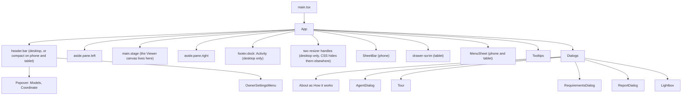
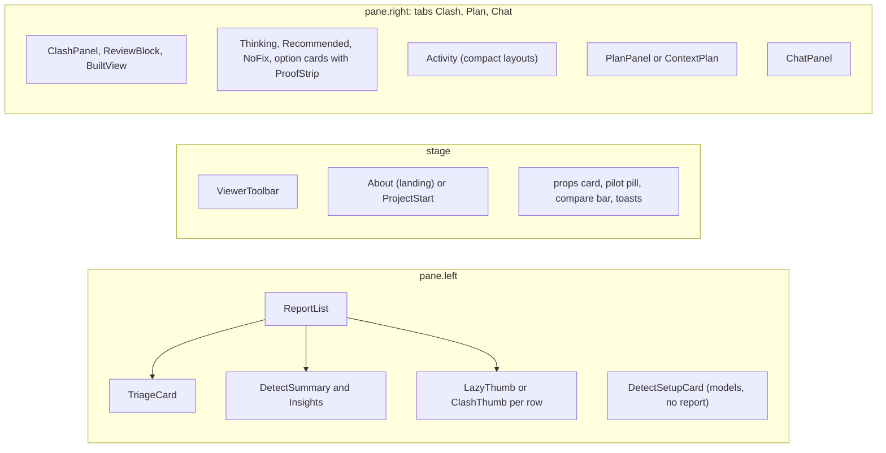
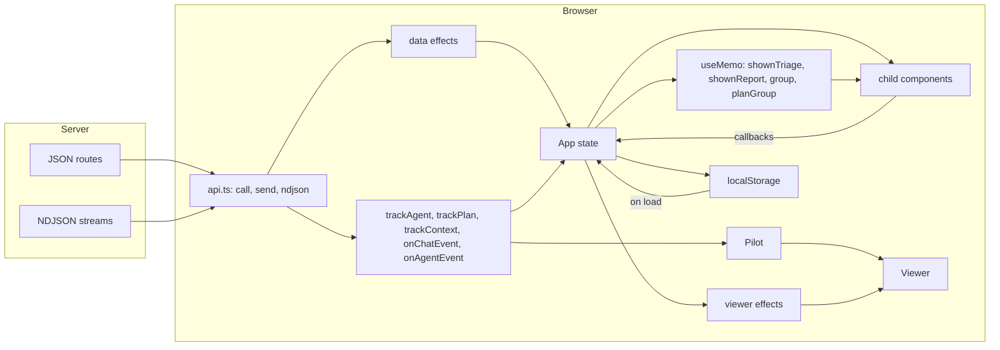
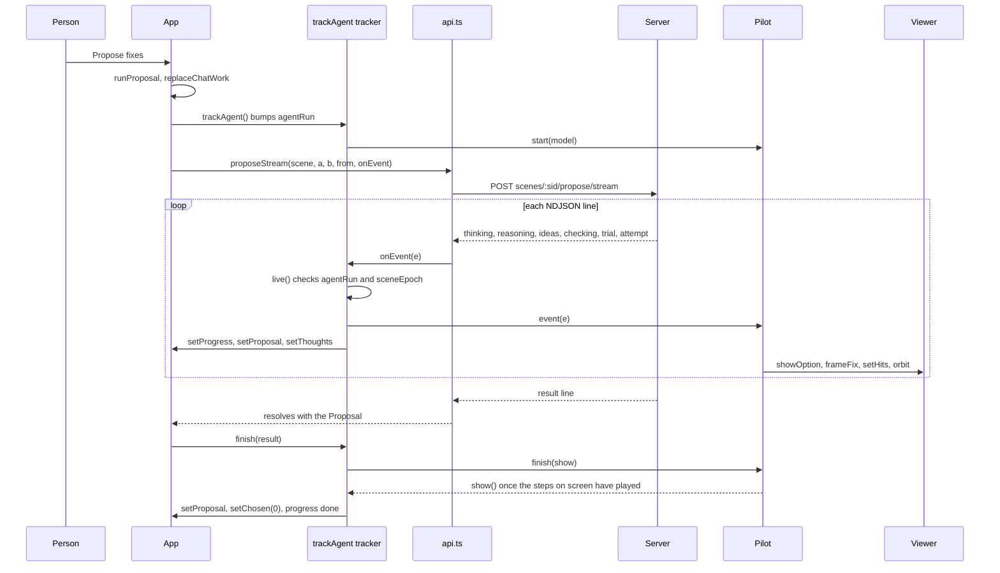

# 12 · Web app: structure and state

> **Covers:** `web/src/` (all but `viewer/`, which is [13](13-3d-viewer.md)), `web/index.html`, `web/vite.config.ts`,
> `web/tsconfig.json`, `web/package.json`, `web/scripts/`, `web/public/` · **Checked against code:** 2026-10-30
> (`104fda9`) · **Deeper design:** [docs/mobile.md](../mobile.md)

The web app is a single-page React 19 app built with Vite and TypeScript. One component, `App` in `App.tsx`, owns
almost all of the page's state and every call that changes it; the other components draw what `App` hands them and
report back through callbacks. A handful of plain modules hold logic that the tests exercise on their own (layout,
fix wording, requirements files, uploads, the chat's turn ownership). The page talks to the server only through
`api.ts`, mostly as NDJSON streams, and draws the models through the `Viewer` class ([13](13-3d-viewer.md)). There is
no router, no state library and no CSS framework: `useState`/`useRef`/`useMemo`/`useEffect` and one global stylesheet.

## Every file in `web/src/`

| File | What it is | Main exports | Used by |
|---|---|---|---|
| `main.tsx` | Entry: mounts `<App />` in `StrictMode` on `#root`, imports the stylesheet | (none) | `web/index.html` |
| `App.tsx` | The whole page: state, handlers, effects, header, panes, sheet, dialogs. Also small local components `ProofStrip`, `Recommended`, `NoFix`, `Thinking` and helpers `keepPlaces`, `movedPairs`, `clampPane`, `shortName` | `App` | `main.tsx` |
| `index.css` | The one stylesheet: tokens, layout grid, every feature's styles, then the "Responsive" block | (CSS) | `main.tsx` |
| `api.ts` | Every server call, the NDJSON reader, the wire types, the two request headers | `api`, `ApiError`, `setOwnerSettings`, `setRequirements`, `requirementsInUse`, ~100 types | everything |
| `About.tsx` | Landing page in the empty viewer (hero, demo cards, resume card, before/after picture) and the "How it works" dialog | `About`, `Resume`, `projectName` | `App` |
| `Activity.tsx` | The agent activity table (ideas tried, why each failed) and the one-line status | `Activity`, `statusLine`, `Progress` (re-exports `editText`, `KIND_LABEL`) | `App` |
| `Agent.tsx` | "Connect an agent" dialog: token and server fields, client set-up snippets, time left, the agent's log | `AgentDialog`, `timeLeft`, `secondsLeft`, `AgentLogEntry` | `App` |
| `AppMenu.tsx` | The header's menu on phones and tablets: a panel from the right with every header action | `MenuSheet` | `App` |
| `BuiltView.tsx` | Show it built's picture over ORCA's view, the wipe, "Lines from the model", the check's tooltip | `BuiltView`, `builtStep`, `cutText`, `BuiltRun` | `App`, `PlanPanel.tsx` |
| `Chat.tsx` | "Chat with ORCA": turns, tool steps, suggestions, the mic (hold to talk, hands-free, upload fallback) | `ChatPanel`, `Turn`, `Step` | `App` |
| `ClashPanel.tsx` | The selected clash's card (both sides, how each matched, Navisworks or captured views, triage reading), the image dialog, thumbnails | `ClashPanel`, `Lightbox`, `ClashThumb` | `App`, `ReportList.tsx` |
| `ContextPlan.tsx` | The "wider fix" (context proposal) review in the Plan tab: alternatives, checks, review conditions to acknowledge | `ContextPlan`, `contextStep`, `ContextRun` | `App` |
| `Detect.tsx` | ORCA's check: the set-up card (tests to run) and the run summary (coverage, new/resolved, Detect again) | `DetectSetupCard`, `DetectSummary`, `DetectProgress` | `App` |
| `Insights.tsx` | Root causes and patterns, with their fix, filter, tick, mark and Add to requirements buttons | `Insights` | `App` (into `ReportList`'s `insights` slot) |
| `Owner.tsx` | The owner's gear: unlock, "For me" and "For everyone" settings | `OwnerSettingsMenu` | `App` |
| `PlanPanel.tsx` | A Fix-together or root-cause plan: its items, their status, the joint check, Accept | `PlanPanel`, `PlanRun` | `App` |
| `ProjectStart.tsx` | The blank project's drop zone (IFC/STEP models, or a Navisworks report or folder) | `ProjectStart` | `App` |
| `ReportDoc.tsx` | The coordination report dialog (scope, teams, build PDF and BCF) and the per-clash review block | `ReportDialog`, `ReviewBlock`, `reviewersOf`, `TEAMS` | `App` |
| `ReportList.tsx` | The left pane over a report: Clashes / Insights tabs, impact bar, search and filters, the list with lazy thumbnails | `ReportList`, `clashLabel`, `mm`, `linkState`, `Review` | `App`, `ClashPanel.tsx`, `ContextPlan.tsx`, `PlanPanel.tsx`, `ReportDoc.tsx` |
| `Requirements.tsx` | The requirements dialog: level cards, strictness, the check matrix, who moves, rules and Muse's audit, openings | `RequirementsDialog` | `App` |
| `Sheet.tsx` | The phone's bottom sheet bar: handle, drag and flick, snap heights | `SheetBar` | `App` |
| `Tour.tsx` | Both guided tours (steps, spotlight, "Show me", recorded-run offer) | `Tour`, `TourState`, `TourActions`, `TOUR`, `CELL`, `TOUR_QUESTION`, `BUILDING_STEPS`, `CELL_STEPS` | `App` |
| `Triage.tsx` | The Triage card (run, two stages, verdict bar and rows, compact mode) | `TriageCard`, `TRIAGE`, `TriageRun` | `App`, `ClashPanel.tsx`, `ReportList.tsx` |
| `ViewerToolbar.tsx` | The viewer's icon rail (modes, tools, camera, models), or one Tools menu on a phone | `ViewerToolbar`, `ToolbarState` | `App` |
| `chatRequest.ts` | Who owns the chat's current turn, so a newer action can cut off an older stream | `ChatRequestOwner`, `ChatRequest` | `App`, `Chat.tsx` |
| `clashImage.ts` | Reads a Navisworks clash picture by colour (red A, green B, where they meet) | `readClashImage`, `focusSquare`, `drawOverlay`, `ClashRead`, `Box` | `ClashPanel.tsx` |
| `fixKinds.ts` | Every fix kind in words: label, edit text, clearance, framing, reviewer, host rows | `KIND_LABEL`, `kindLabel`, `editText`, `changeText`, `clearanceText`, `needsText`, `framePieces`, `hostRows`, `moveWords`, `reviewText`, `recEditText` | `App`, `Activity.tsx`, `PlanPanel.tsx` |
| `layout.ts` | Desktop / tablet / phone by width, touch detection, sheet snapping, `follow()` | `useLayout`, `layoutFor`, `useCoarse`, `isCoarse`, `follow`, `nearestSnap`, `nextSnap`, `SNAPS`, `PHONE_MAX`, `TABLET_MAX` | `App`, `Sheet.tsx`, `About.tsx` |
| `noClash.ts` | Why a reported clash needs no fix (same element, not physical, a touch, no overlap, by design) | `noClash`, `oneElement`, `sameWhy`, `NoClash` | `App`, `ReportList.tsx`, `ClashPanel.tsx` |
| `pilot.ts` | Lets the fix agent drive the viewer while it works | `Pilot`, `PilotStatus` | `App` |
| `reqFile.ts` | Requirements files in the browser: load/save, upload/download, cell edits, add rules | `load`, `save`, `shortLabel`, `addByDesign`, `addPenetration`, `hasByDesign`, `hasPenetration`, `setCell`, `setMover`, … | `App`, `Requirements.tsx` |
| `ui.tsx` | Shared UI bits: `IconButton`, `Popover`, and the page's one tooltip layer | `IconButton`, `Popover`, `Tooltips` | `App`, `Owner.tsx`, `ViewerToolbar.tsx` |
| `uploads.ts` | The size check before an upload and the words for each upload stage | `uploadRefusal`, `uploadStatus`, `localFile` | `App` |
| `voice.ts` | Live voice over a socket, and the record-then-upload fallback | `LiveVoice`, `VoiceRecorder`, `LiveVoiceError`, `MAX_SECONDS`, `VoiceMode` | `Chat.tsx` |
| `viewer/Viewer.ts`, `viewer/ifcLoader.ts`, `viewer/patch.ts` | The 3D viewer | see [13](13-3d-viewer.md) | `App`, `pilot.ts`, `api.ts` (the `ElementMesh` type) |

## The component tree

`App` renders one `div.app` whose classes carry the layout (`landing`, `starting`, `phone`/`tablet`, `snap-*`,
`list-open`, `resizing`) and whose CSS variables `--left-w` / `--right-w` carry the dragged pane widths. Inside it, the
same five regions exist on every layout; CSS re-places them (phone: the panes become the sheet's body), so nothing
remounts when the layout changes.

- `ChatPanel` is always mounted (hidden when another tab is open) with `key={sceneId:chatReport}`, so it keeps its
  history across tabs and restarts only when the scene changes or the user opens another report. A report the chat
  opened itself (`adoptChatReport`) does not change `chatReport`, so the turn that opened it keeps answering.
- The Plan tab holds either `PlanPanel` (a batch or root-cause plan) or `ContextPlan` (a wider fix), switched by
  `planKind`; a segmented control appears when both exist.
- `About` is the landing when nothing is open (`landing = !stats && !report && !blank`), and the same component is
  the "How it works" dialog (`about` state).

## `App.tsx`: state by concern

`App` holds about 100 `useState` and 50 `useRef` values. The table groups the main ones. State that drives rendering
is `useState`; refs hold what callbacks must read without re-rendering (counters, queues, the viewer, the pilot).

| Concern | State | Refs | Derived |
|---|---|---|---|
| Scene and files | `sceneId`, `stats`, `modelNames`, `sceneFiles`, `stepFiles`, `samples`, `picked`, `uploadMax`, `blank` | `viewer`, `host`, `sceneRevision`, `modelInput` | `landing`, `starting`, `startLabel`, `cellSample`, `cellOpen` |
| Report | `report`, `reportSamples`, `matches`, `clash`, `measure`, `remeasure`, `titles`, `naming`, `views`, `capturing`, `lightbox` | `reportRef`, `captures`, `folderInput`, `filesInput` | `shown()`, `shownReport`, `shownClash` |
| Detection | `detectSetup`, `detecting`, `detection` | `lastTests`, `pendingDetect` | |
| Selection and the view's tools | `a`, `b`, `standIns`, `selected`, `tool` (`ToolbarState`), `measurePts`, `measured`, `toast` | `down`, `longPress`, `flashTimer`, `sides` | `group` |
| Proposal and options | `proposal`, `chosen`, `progress`, `thoughts`, `compare`, `tab`, `fixAnyway`, `pilotStatus`, `escalation`, `manual`, `manualDz`, `manualPreview` | `pilot`, `agentRun`, `previewRequest`, `directAgent`, `golden` | `option`, `proposing`, `notAClash`, `hideFix`, `canEscalate`, `wonder`, `nextClash` |
| Kept work | `edits` (element → pieces a fix added), `fixes` (clash id → fix title), `reviewed`, `evidence`, `checked` | | `resolved`, `resolvedSet`, `fixedCount` |
| Plan and `viewPlan` | `plan`, `planRun`, `planError`, `viewPlan`, `planKind` | `planRequest`, `planRevision`, `directPlan`, `chatPlan`, `planThisTurn` | `planGroup`, `planOptions`, `planStale`, `planning` |
| Wider fix (context) | `context`, `contextChosen`, `contextNames`, `acknowledged`, `viewContext` | `contextRequest`, `directContext`, `chatContext` | `contextProposal`, `contextWorking`, `activeContext`, `contextGroup` |
| Chat and `chatReport` | `chatReport`, `chatAsk` | `chatOwner` (`ChatRequestOwner`), `chatAgent`, `chatEscalating` | |
| Triage and `shownTriage` | `triage`, `triageRun`, `triageLive`, `triageFilter`, `triageAudit`, `triageStale`, `triageModel` | | `shownTriage`, `triageDone` |
| Insights and `keepPlaces` | `rootCauses`, `patterns`, `verdicts`, `explaining`, `leftView`, `listFocus` | `resolvedNow`, `explained` | `insightsOpen` |
| Requirements | `reqSaved` (`{ doc, enabled }`), `reqId`, `reqOpen` | | `reqLabel` |
| Coordination report | `modelTeams`, `signoffs`, `docOpen`, `docReady` | | `signoffKey` |
| Show it built | `builtOn`, `builtRuns` | `sceneClasses`, `builtFixes`, `builtDone`, `builtPending`, `latest` | `buildable`, `canBuild`, `builtKey` |
| Owner | `ownerSettings`, `modelsAsked` | | |
| Agent link and session | `agentLink`, `agentOpen`, `agentLog`, `agentBusy`, `agentError`, `resumable` | `agentStream`, `agentHandler` | |
| Tour | `touring`, `tourWhich`, `replaying`, `about` | | `tourState`, `tourActions` |
| Layout and sheet | `widths`, `resizing`, `listOpen`, `snap`, `menuOpen` | `followed` | `layout`, `compact`, `coarse`, `peekLine` |
| Thumbnails queue | `thumbs` | `thumbQueue`, `thumbPaused`, `thumbTimer`, `thumbSource` | |
| Status | `busy`, `error`, `now` | `sceneEpoch`, `workspaceEpoch` | `working`, `fixing` |

Notes on the less obvious ones:

- **`viewPlan`** says what the viewer shows: the selected clash, or the plan. It follows the latest activity, not
  the open tab: a plan started from chat takes the view while the chat stays open; picking a clash, proposing or the
  Clash tab gives it back (`selectClash`, `trackAgent`, `showClashTab`); the Plan tab takes it again (`showPlanTab`).
  `viewContext` / `activeContext` do the same for a wider fix.
- **`shownTriage`** is triage as shown: a model verdict of real or model error gives way to what this browser already
  settled (marked not a clash, or `noClash` geometry), with the model's reading kept as `model_reading`.
- **`keepPlaces(prev, next)`** keeps root causes in the order already on screen; a hub that drops out stays as a done
  row, new ones go after, so the Insights list never jumps.
- **`listFocus`** and **`triageFilter`** are one filter at a time: `setListFocus` clears the triage filter and
  `setTriageFilter` clears the focus. Both and `leftView` reset when the report changes.
- **`sceneRevision`** is the server's revision of the scene this page's model shows (from the open, upload or
  scene-info reply). A kept fix is patched in place only from that revision (`applyToViewer`, [13](13-3d-viewer.md)).
  `planRevision` records the revision a plan was checked at; `planStale` blocks Accept when they differ.
- **`standIns`** are elements drawn in place of a side the model cannot draw (a port's pipe or valve); a pipe that
  stands in for both sides is `"ab"` (purple). `group` adds the pieces accepted offsets added to A or B.
- **`evidence`** (clash id → `Evidence`) is what the PDF shows per clash: proposed (captured 1.4 s after an option is
  picked), accepted, or recommended, with before/after pictures and the built picture.

## The main handlers

All are functions inside `App`. Names confirmed at HEAD.

| Handler | What it does |
|---|---|
| `open(source, existing?)` | Opens samples (`api.open`), uploads (`uploadRefusal`, `api.uploadModelsStream`) or a held scene (`existing`, for resume). Bumps the epochs, retires running work, reads each file's bytes (`localFile` for an uploaded IFC, else `api.file`), `viewer.load`s them, sets `sceneRevision` and resets per-scene state. Returns the scene id. |
| `openDemo(source?)` | `open`, then `runDetect(null, id)`: the golden path's first half. |
| `startGolden()` | Sets `golden`, then `openDemo`; an effect then selects `clashOfPair(TOUR.duct)` (else the deepest clash) and calls `propose`. |
| `loadReport(get, what)` | Replaces the report (refused while `busy`), resets report state, sets `chatReport`. |
| `upload(list)` | Navisworks XML and images → `loadReport(api.uploadReport)`. |
| `runDetect(tests, sid)` | `api.detect` with `onDetectEvent` (progress into `detecting`), then `loadReport` with the done event's report; keeps `reviewed` marks whose ids survive and re-selects the selected clash. |
| `adoptChatReport(id, detection)` | The chat ran detection: show its report without restarting the chat. |
| `selectClash(c, keepPlan)` | Select a report clash and fly to it (`goToClash`); with `keepPlan` only select it while a plan keeps the view. |
| `goToClash(c, m)` | `Viewer.focusClash` on the matched (or shown) elements and the report's point. |
| `onClick`, `pickSide`, `pressStart` / `pressMove` / `pressEnd` | Mouse and touch picking (see [13](13-3d-viewer.md), "Keyboard, mouse and touch"). |
| `propose()`, `escalate()`, `escalateItem(it)`, `runProposal(second, pick?)` | Start a proposal (or a second try on Muse Wonder) through `api.proposeStream`; for a detected clash without views, `captureViews` first (waits up to 4 s). |
| `trackAgent(first?)` | Returns `{ onEvent, finish, live, retire }` for one proposal run (below). |
| `accept(o)` | Captures before/after (`captureFix`) and Show it built's passes, `api.accept`, then `applyToViewer`, `edits`, `markFixed`, `evidence`, `buildAccepted`. A penetration returned `cut: false` is recorded as requested, not fixed. |
| `runPlan(body)`, `trackPlan(kind)`, `acceptPlan()` | Fix together (`clash_ids`) or root cause (`hub`) through `api.planStream`; accept keeps every passing item through `api.applyPlan`. |
| `exploreContext(objective?)`, `trackContext`, `acceptContext()`, `staleContext()` | The wider-fix search (`api.contextStream`) and its accept (`api.applyContext`, all review conditions acknowledged). |
| `applyToViewer(sid, kept, pieces, live)` | Patch the kept fix into the viewer in place, or reload the changed and missed files ([13](13-3d-viewer.md)). |
| `markFixed(pairs, titles)`, `clashIdsOf(pairs)`, `review(ids, kind, note)` | Map element pairs to every report clash of that pair (one pair can be in several tests); mark fixed or reviewed. |
| `checkManual()` | "Try a move yourself": `api.verify` of a vertical move of A against B. |
| `replayPropose(which)`, `replayPlan(which)` | Play a recorded run from `web/public/tour/` through the same trackers at its recorded pace. |
| `runTriage(rerun)` | `api.triageStream` into `triage`, `triageRun`, `triageLive`, `triageAudit`. |
| `explainPatterns(quiet)` | `api.triagePatterns`; run automatically once per report and models. |
| `applyRequirements`, `addRule`, `addPenRule` | Keep a requirements file (and optionally check again); add a by-design or opening rule, starting a file from `api.requirementsDefault` when there is none. |
| `onChatEvent(e)` | Turns chat events into page state (below). |
| `connectAgent`, `disconnectAgent`, `onAgentEvent(e)` | The MCP agent link ([11](11-mcp-and-agent-links.md)). |
| `resumeSession()`, `startFresh()` | Reopen the saved session, or forget it and revoke its link. |
| `drawBuilt`, `builtPasses`, `showBuilt`, `buildAccepted`, `redrawKept`, `builtFromChat`, `prepareReport` | Show it built ([docs/show-it-built.md](../show-it-built.md)): one request per key (`builtKey`), shared while drawing. |
| `captureViews(report, clash, a, b)` | A/B/C pictures of a detected clash (`Viewer.captureClash`), saved with `api.saveView`; once per clash. |
| `needThumb(c)`, `pumpThumbs()` | The list-thumbnail queue (below). |
| `retireDirectWork()`, `replaceChatWork()`, `resetWork()`, `clearManual()` | End work that newer work replaces. |

### Effects that load data

| Runs when | Calls | Sets |
|---|---|---|
| Mount | `new Viewer`, `new Pilot`, `api.samples`, `api.reportSamples` | `samples`, `picked` (structure, MEP, architecture, site), `reportSamples` |
| `ownerSettings`, `modelsAsked` change | `api.models` | `triageModel`, `uploadMax`, `escalation`, `builtOn` |
| `report`, `sceneId` | `api.match` | `matches` |
| `report`, `sceneId`, `matches` | `api.patterns` (and clears root causes) | `patterns` |
| the same plus `resolved` | `api.rootCauses` | `rootCauses` via `keepPlaces` |
| `reqSaved` | `reqFile.save`, `api.registerRequirements`, `setRequirements` | `reqId` |
| `report`, `reqId` | `api.triage`; a run still going is followed with `runTriage()` | triage state |
| `triageDone` with matches | `api.triage` again (the server settles one-element pairs from the open model) | `triage` |
| `report`, `sceneId` | `api.teams` | `modelTeams` |
| `report.id` | `api.titles` (stream) | `titles`, `naming` |
| `sceneId`, `reqId` | `api.detectTests` | `detectSetup` |
| `clash`, `matches`, `remeasure` | `api.measure` | `a`, `b`, `standIns`, `measure` |
| a detected clash selected, no views, idle | after 1.5 s, `captureViews` | `views` |
| patterns found, nothing running | `explainPatterns(true)` | `verdicts` |
| `builtOn`, `sceneId` | `api.classes` | `sceneClasses` |
| `agentLink` and page context | `api.linkContext` (250 ms debounce), `api.linkEvents` (reconnects with back-off), `api.linkState` every 60 s | link state |
| mount; then `sceneId`, report, files, fixes, link | `api.sceneInfo` / `api.report` / `api.linkState`; `localStorage` | `resumable`; the saved session |

Other effects drive the viewer from state: `setFocus` (A/B, `group`, `planGroup`, `contextGroup`), `setMode`,
`setEdges`, `setSection`, `setMeasure`, and the preview (`showOption` for the chosen option, `showOptions` for a plan
or wider fix, `preview` for a manual move), plus framing (`frameFix`, `frameMeshes`).

## How a stream event becomes UI

Every long piece of work (proposal, plan, wider fix, triage, titles, detection, chat, built picture, report document,
agent link) is an NDJSON stream read by `api.ts`, which calls a handler per line. For the three kinds of fix work,
`App` makes a **tracker** first (`trackAgent`, `trackPlan`, `trackContext`): an object `{ onEvent, finish, live,
retire }` that closes over the counters current when it was made. Every event and the final result go through
`live()` first, so a run that newer work replaced (another clash, another scene, a replay) can no longer change the
page. The same trackers serve direct work, chat (`chatAgent`, `chatPlan`, `chatContext`) and replays.

Other streams are simpler: `runTriage` and the titles effect set state straight from each event, `onDetectEvent`
folds detection events into `detecting`, `uploadStatus` turns upload events into the `busy` line, `builtStep` turns
built-picture events into `builtRuns[key].step`. Event types are listed in [10](10-http-api-and-streams.md).

- **Chat:** `ChatPanel` calls `api.chat` and passes every event to `App.onChatEvent`, but only while the scene and
  workspace epochs are the ones it rendered with. `onChatEvent` opens trackers when a tool starts
  (`agent` events start `trackAgent` on round 1, `plan_started` starts `trackPlan`, `explore_wider_fix` or a
  `context_event` starts `trackContext`), feeds them (`agent`, `plan_event`, `context_event`) and finishes them
  (`proposal`, `plan`). It also carries out `ui` actions: `select_clash` (keeping a plan on screen if this turn built
  one: `planThisTurn`), `set_view`, `open_report` (`adoptChatReport`), `show_it_built`, and detection progress.
- **Agent link:** `api.linkEvents` (a GET stream that the server ends every few minutes; the effect reconnects with
  back-off up to 15 s) calls `agentHandler.current`, which is always the latest `onAgentEvent`. It handles `hello`,
  `revoked`, `agent_call` / `agent_result` (the log), `capture_request` (a view PNG or a clash's A/B/C views, posted
  back with `api.linkCapture`), `ui` `open_models`, `follow_triage` and `applied` (through `applyToViewer`, as an
  accept does), and passes anything else to `onChatEvent`.
- **Ownership counters:** `sceneEpoch` (bumped by `open`, `loadReport`, unmount), `workspaceEpoch` (`open`,
  `loadReport`), `agentRun` (each proposal; plans and wider fixes bump it to stop a proposal), `planRequest`,
  `contextRequest`, `previewRequest` (the manual move and the option's evidence capture), and `chatOwner`, whose
  `invalidate()` aborts the chat's stream when the person starts direct work (`replaceChatWork`). `ChatRequestOwner`
  is in `chatRequest.ts` so the tests can drive it.

## Client modules

### `api.ts`

- **Transport.** `call<T>(path, init)` sends JSON to `/api{path}` and throws `ApiError(detail, status)` on a non-2xx
  reply. `ndjson<T>(path, body, onEvent, signal, method)` POSTs (or GETs) and reads the body line by line; it stops
  when `onEvent` returns `true` or the signal aborts, and cancels the reader in `finally`. `proposeStream` has its own
  reader (it resolves on `result`, throws on `error`, and throws if the stream ends first). `uploadModelsStream` uses
  `XMLHttpRequest` for upload progress and parses `responseText` as it grows. `file`, `saveView`, `uploadReport` and
  `linkCapture` use plain `fetch`; `leaveLink` uses `navigator.sendBeacon` so it still goes while the page unloads.
- **Headers.** `settingsHeader()` adds `X-Sightline-Settings` (the owner's own settings as JSON, set by
  `OwnerSettingsMenu` through `setOwnerSettings` only once the owner is unlocked) and `X-Sightline-Requirements`
  (the registered requirements id, set by `App` through `setRequirements`). Every `call`, `ndjson`, `proposeStream`,
  `uploadModels`, `uploadModelsStream` and `transcribe` sends them.
- **Re-register.** `send(url, init)` retries once when the server answers 409 with detail `requirements_unknown` (it
  forgot the id, e.g. after a restart): `reRegister()` posts the kept document to `/api/requirements` and the request
  goes again with the new id. `uploadModelsStream` does the same by hand.
- **Packing.** `pack(file)` gzips files over 1 MiB with `CompressionStream` before an upload (sent as `name.gz`).

| Group | Functions | Notes |
|---|---|---|
| Models and scenes | `samples`, `open`, `uploadModelsStream`, `uploadModels`, `file`, `sceneInfo`, `element`, `exportUrl`, `classes` | `uploadModels` (no progress) is not called by the app at HEAD |
| Fixes | `proposeStream`, `propose`, `verify`, `accept` | `accept` picks the route by kind: trim, offset, move, else `/fix/apply` with `preview`/`before` dropped. `propose` (not streamed) is unused at HEAD |
| Plans | `planStream`, `applyPlan` | resolves with the `plan` event |
| Wider fix | `contextStream`, `applyContext` | throws if the stream ends without `context_result` or `error` |
| Detection | `detectTests`, `detect` | resolves with the `done` event |
| Reports | `report`, `reportSamples`, `openReport`, `uploadReport`, `match`, `measure`, `imageUrl`, `saveView`, `titles` | |
| Triage and Insights | `triage`, `triageStream`, `patterns`, `triagePatterns`, `rootCauses` | |
| Coordination report | `teams`, `document` | `document` stops at the first event that is not `progress` |
| Show it built | `built` | resolves with the `result` event |
| Chat and voice | `chat`, `transcribe` | live voice is a WebSocket in `voice.ts`, not here |
| Requirements | `requirementsScale`, `registerRequirements`, `requirementsDefault`, `suggestRequirements`, `previewRequirements` | |
| Owner and settings | `owner`, `unlock`, `lock`, `settings`, `saveSettings`, `models` | |
| Agent links | `createLink`, `linkState`, `linkContext`, `linkEvents`, `linkCapture`, `leaveLink`, `revokeLink` | |

Routes, bodies and events: [10](10-http-api-and-streams.md). The wire types in `api.ts` are hand-written mirrors of
the server's replies; `ElementMesh` is imported from `viewer/patch.ts`.

### `pilot.ts`

`Pilot` lets the fix agent drive the viewer ([13](13-3d-viewer.md) has the Viewer calls). `App` makes one on mount
with a getter for the viewer, a framing function (`frameFix` on the trial's pieces) and `setPilotStatus`.

- `start(model)` takes the view and orbits while the model thinks; `model(name, offset)` switches to a second try's
  model, numbering its ideas after the first try's.
- `event(e)` queues each `trial` and pairs it with its `attempt`. `play()` shows each candidate in amber
  (`#f5a623`), frames it, waits for its attempt and at least 1.1 s (0.5 s when two or more are queued), then shows it
  teal (`#12b5cb`, passed) or lights what it hit in magenta (`Viewer.setHits`), and holds 1.4 s (0.6 s).
- `takeOver()` (the viewer's `onUserCamera`: any drag, wheel or click) stops driving and clears what it drew; the
  agent keeps working and the activity table still fills. `resume()` ("Let ORCA drive") drives again from the next
  step. `finish(then)` shows the result once the steps on screen have played; `cancel()` drops everything (a
  `generation` counter makes late waits harmless).

### `layout.ts`, `Sheet.tsx`, `AppMenu.tsx`

- `layoutFor(width)`: `phone` at or below `PHONE_MAX` (760 px), `tablet` at or below `TABLET_MAX` (1100 px), else
  `desktop`; `useLayout()` follows window resizes. `useCoarse()` follows `(pointer: coarse)`, independent of width.
  The CSS uses the same numbers.
- `follow(what, snap)` says what the sheet does when something happens: `report` and `models` open the list,
  `select` and `result` show the right pane, `work` drops to `peek`; each raises `peek` to `half` but leaves a sheet
  the visitor raised further alone. `App`'s one effect (next to `viewPlan`) compares `followed` with now, collects the
  happenings and applies them only on phone and tablet; with a result it also scrolls the right pane to the first
  option card, no-fix card or recommendation.
- `SheetBar` (phone only) is the sheet's bar: the handle (tap steps `nextSnap`: peek, half, full, peek; arrow keys
  step too), the peek line and the Clashes · Fix · Plan · Chat tabs (rendered by `App`). Dragging sets
  `--sheet-drag`; release settles with `nearestSnap` (a flick over 0.5 px/ms goes one step its way). Heights: peek is
  the bar's own height (published as `--peek-h`), half is 55% of the window, full is up to the header. The panes under
  it are `App`'s own left and right panes, placed by CSS.
- `MenuSheet` (phone and tablet) holds every header action by name; the Models and Coordinate bodies are the same
  render functions the desktop popovers use (`modelsMenu`, `coordinateMenu`). Escape or the scrim closes it.
- The tablet keeps the right pane and shows the list as a drawer (`listOpen`, header **Clashes**, `drawer-scrim`).

### `Tour.tsx`

- **Two tours:** `BUILDING_STEPS` (30 steps in 10 acts: design coordination, triage, one fix live, a joint, the root
  cause, not everything needs a fix, your standard, people decide, hand-off, and a closing act named ORCA) and
  `CELL_STEPS` (12 steps in 6 acts). `Tour` takes `which`; `App` keys it by `tourWhich`.
- **A step** has a `target` (a CSS selector, often a `data-tour` attribute, or a function of `TourState`), `done`
  (when the app reaches the state, the tour moves on after 1.1 s), `show` ("Show me": runs an action or clicks the
  target), `enter` (set the page up), `reveal` (open the target's `
`) and `fallback` (offer a recorded run).
- **`TourState`** is built by `App` each render (`tourState`): what is open, triage counts, the tab, the proposal's
  progress and seconds and its options' kinds (`optionKinds`, best first, so copy can name the option on screen), the
  plan's, reviews and sign-offs, the report dialog, requirements, and the tour's clashes
  found by element pair (`clashOfPair(TOUR.duct)`, `TOUR.joint`) or, for the cell, by part names
  (`clashOfNames(CELL.…)`). **`TourActions`** (`tourActions`) are what "Show me" can do beyond a click: filter real
  clashes, select a tour clash, open the cell, fix the pipe, compare, replay, ask the tour question in chat, add a
  sign-off, and `reveal`.
- **Recordings:** a live Muse step offers "Watch a recorded run" after 45 s (a plan after 75 s), on an error, or when
  the proposal ended with no option (`liveMissed`: a failed run also ends "done"); a plan-starting step counts a plan
  error as done, so the tour moves to the step that offers the plan's recording. The
  runs are `web/public/tour/c0053.json` (duct), `c0051.json` (joint), `girder-plan.json`, `cell-ladder.json` and
  `cell-pipe-plan.json`: `{ events: [{ t, event }] }`, replayed by `replayPropose` / `replayPlan` through the same
  trackers at their recorded times. `replayPlan` re-points the recording's clash ids at this report's clashes of the
  same element pairs. Accepting a replayed fix edits the model for real.
- **Finding the control:** `find()` runs every 250 ms, takes the visible copy of the target (a phone has some
  twice), scrolls it into view for 1.5 s after it appears, and spotlights it (`tour-hole`). When no copy is visible
  it calls `actions.reveal(selector, el)` once: `App` switches the left pane's tab (`[data-left-view]`), and on phone
  and tablet opens the drawer, the sheet's tab or the header menu that hides it.
- **Card:** beside the target, else below or above; on a phone it spans the width at the top or bottom. On a touch
  screen its copy says tap instead of click. Escape ends the tour unless a dialog (`.about-dialog`) is open.

### Smaller modules

- **`noClash.ts`:** `noClash(clash, match, measure, triage)` returns why a clash needs no fix, or null: one element on
  both sides (`oneElement`), a non-physical side (`IfcSpace`, ports, openings, virtual elements, zones) or ORCA
  measuring it non-physical, a touch (Navisworks at most 1 mm and no ORCA overlap), no overlap in the open model, or
  triage `by_design` / `non_physical`. Used for the clash panel's "Mark as not a clash", list tags and `shownTriage`.
- **`clashImage.ts`:** `readClashImage(url)` reads a Navisworks picture on a 512 grid by colour (red A, green B, their
  blend or seam where they meet), cached per URL; `focusSquare` crops thumbnails to the meeting zone, `drawOverlay`
  draws outlines in the image dialog.
- **`fixKinds.ts`:** the client half of the fix-kind registry ([07](07-fixes-and-edits.md)). `framePieces` says what
  to frame (a split run's middle pieces, a penetration's provision for void, every piece of a combined fix; none for a
  move or trim, which frame where they meet the other side). A new fix kind needs a line here.
- **`reqFile.ts`:** the requirements file (`orca-requirements/1`) in the browser: `load`/`save` (key
  `sightline.requirements`, `{ doc, enabled }`), `serialise`, `parseUpload`, `download`, cell, mover and penetration
  edits, `addByDesign` / `addPenetration` and their `has…` checks. Pure functions, shared by `App` and the dialog.
- **`uploads.ts`:** `uploadRefusal` (at most 8 files, `.ifc`/`.step`/`.stp`, the server's cap from `api.models`
  counted before packing), `uploadStatus` (the busy line per upload event), `localFile` (an uploaded IFC is drawn from
  the visitor's own file, a STEP comes back converted). Design: [docs/uploads.md](../uploads.md).
- **`voice.ts`:** `LiveVoice` streams 16 kHz PCM from an AudioWorklet over `/api/voice/live` (hold to talk, or
  hands-free); `VoiceRecorder` records a clip and converts it to 16 kHz mono WAV for `api.transcribe` when the socket
  can't open. Design: [docs/voice.md](../voice.md).
- **`chatRequest.ts`:** `ChatRequestOwner.begin()` gives a turn its `AbortSignal` and an `isCurrent()` check;
  `invalidate()` closes the boundary and aborts; `capture()` lets voice callbacks check they are still current.
- **`ui.tsx`:** `IconButton` (its tooltip is its accessible name), `Popover` (closes on outside `pointerdown` or
  Escape; a sheet from the bottom on a phone), and `Tooltips`: one fixed layer for every `data-tip` (side from
  `data-tip-side`), flipped and clamped to the window. On touch, press and hold any control with a tip to read it
  (500 ms, not on the canvas), and a tap on a `data-tip-tap` element shows its tip for 3.5 s.

### `index.css`

One global stylesheet, no CSS modules. It opens with the tokens on `:root` (colours `--red` / `--green` for sides A
and B, `--accent`, `--wonder` for Muse Wonder, IBM Plex Sans and Mono) and base rules, then the layout grid (`.app`:
three columns from `--left-w` / `--right-w`, rows for header, body and dock), then one commented section per feature
roughly in the app's order (buttons, tooltips, popovers, rail, list, tabs, clash, option cards, plan, activity, chat,
lightbox, Insights, Triage, pilot, About, NoFix, escalation, Show it built, landing, reasoning, clash pictures, voice,
reviews, tour, owner, wider fix, detection, agent dialog, requirements). `.app.landing` drops the panes, dock and
resizers so the start page fills the window. The **Responsive** block at the end (after its long comment) holds the
toast and pop-sheet base, touch targets (`@media (pointer: coarse)`: 44 px, 36 for small buttons), the menu panel,
`.app.tablet` (drawer), `.app.phone` (the sheet: `--sheet-h` per `snap-*`, `--peek-h`, `--sheet-drag`, `.list-open`
choosing which pane shows), what floats over the model, popovers as sheets, full-screen dialogs, the requirements
matrix as a list, the left pane's tabs, and the blank project. Near the top, one rule hides the header buttons'
`.lbl` text below 1280 px (How it works, Tour, Requirements, the agent button), leaving their icons.

## Browser storage

Everything is `localStorage`, read and written inside `try` (a private window just loses it). Keys keep the old
`sightline.` prefix on purpose. What they mean as state: [05](05-domain-model-and-state.md).

| Key | Written by | Holds |
|---|---|---|
| `sightline.session` | `App` (`SESSION_KEY`) | `SavedSession`: scene id, report id, files, fixes, agent link, time; read on load for "Pick up where you left off" |
| `sightline.left-w`, `sightline.right-w` | `App` (`stored`, `remember`) | Dragged pane widths (clamped by `PANE`) |
| `sightline.signoffs.<report title>` | `App` (`signoffKey`) | Team reviews per clash for that report |
| `sightline.reviewer` | `ReportDoc.tsx` (read by `App`'s tour sign-off) | The reviewer's name |
| `sightline.requirements` | `reqFile.ts` | The requirements file and whether it is in use |
| `sightline.owner` | `Owner.tsx` | The owner's own settings (the token is never stored: the server sets an HttpOnly cookie) |
| `sightline.triage.compact` | `Triage.tsx` | Whether the Triage card is folded |
| `sightline.voice.handsfree` | `Chat.tsx` | Hands-free voice on or off |
| `sightline.agent.setup` | `Agent.tsx` | Whether this browser has made a link (folds "First time? Set up your agent") |

No `sessionStorage` or IndexedDB is used.

## Build, assets and tests

- **`package.json` scripts:** `dev` (Vite dev server), `build` (`tsc --noEmit && vite build` into `web/dist/`),
  `test` (`node --test tests/*.test.mjs`), `preview`, `copy-wasm`, and `postinstall` (runs `copy-wasm`).
  Dependencies are pinned: `react` / `react-dom` 19.3.1, `three` 0.186.1, `web-ifc` 0.0.77, `lucide-react` 1.48.0, and
  `three-mesh-bvh` 0.9.16, which nothing in `web/src` imports at HEAD.
- **`vite.config.ts`:** the React plugin, and a dev proxy sending `/api` (WebSockets included, for live voice) to
  `http://localhost:8000`, keeping the Host header so the server's same-origin check passes.
- **`tsconfig.json`:** strict, `noUnusedLocals`/`noUnusedParameters`, includes `src` and `vite.config.ts` only, so
  `web/spikes/` (the Show it built spike, `built.ts` / `built.html`) is outside the build.
- **`web/scripts/copy-wasm.mjs`:** copies `web-ifc.wasm` (and `web-ifc-mt.wasm` when present) from
  `node_modules/web-ifc` to `web/public/wasm/` (gitignored), where `ifcLoader.ts` loads it from `/wasm/`.
- **`web/scripts/capture-demos.cjs`:** Playwright opens each demo against a running server (default
  `http://localhost:8765`), waits for the check, picks a view, saves the viewer's screenshot and writes
  `web/public/demos/northbank.webp` and `cell.webp` (cropped to 16:10 with Pillow). Recapture after visual changes;
  the landing's demo cards and the README use these pictures.
- **`web/public/`:** `favicon.svg`, `demos/*.webp`, `tour/*.json` (the five recordings), and the generated `wasm/`.
- **`web/index.html`:** the shell (`#root`, `viewport-fit=cover`, the IBM Plex fonts from Google Fonts, title "ORCA ·
  AI design coordination").
- **Serving:** in production the server mounts `web/dist` at `/` when `index.html` exists (`app.WEB_DIST`, env
  `SIGHTLINE_WEB_DIST`); see [17](17-deployment-and-operations.md).
- **Tests:** `web/tests/` runs on Node's test runner without a browser. `app-host.mjs` compiles a source file with the
  TypeScript transpiler into a data URL, replacing named imports, and `appHost()` runs the real `App` render and its
  effects with React hooks, the API and the viewer replaced. **A new import in `App.tsx` must be added to both stub
  lists, in `web/tests/app-host.mjs` and in `web/tests/app-replacement.test.mjs`**, or `npm test` cannot resolve it;
  `fixKinds`, `chatRequest`, `uploads` and `ContextPlan` are compiled for real, the rest are stubbed. The transform
  cannot read `for (const [a, b] of …)` in `App`: iterate keys. Other tests cover `layout.ts`, `uploads.ts`,
  `reqFile.ts`, `fixKinds.ts`, and `Viewer.load` / `viewer/patch.ts` with real three.js batches. More in
  [18](18-testing-and-evals.md).

## When to update this doc

- A new, renamed or removed file in `web/src/` (the docs-map test checks every file is named here or in 13).
- A new import in `App.tsx` (also update both stub lists, above).
- A new state group, handler or data effect in `App`, or a change to how `viewPlan`, `shownTriage`, `listFocus`,
  `keepPlaces` or `sceneRevision` behave.
- A new stream consumer, tracker, chat `ui` action or agent-link event handled by the page.
- A new `api.ts` function group, request header, retry rule or transport.
- A new `localStorage` key.
- A change to the breakpoints, `follow()`, the sheet's snaps, or the Responsive CSS's structure.
- A new tour, act, `TourState` field, `TourActions` action or recording in `web/public/tour/`.
- A change to the build: scripts, dependencies, the Vite proxy, `copy-wasm.mjs`, `capture-demos.cjs`, `web/public/`.
