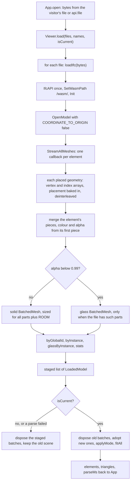
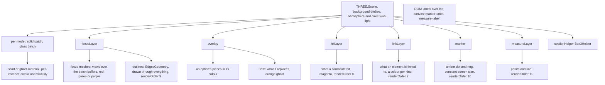
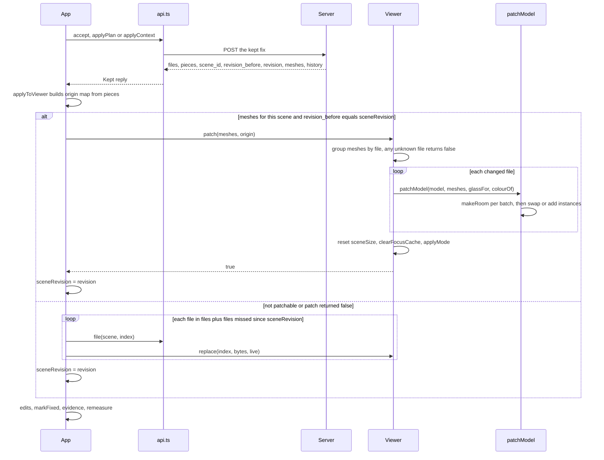

# 13 · 3D viewer

> **Covers:** `web/src/viewer/Viewer.ts`, `web/src/viewer/ifcLoader.ts`, `web/src/viewer/patch.ts`, and the viewer's
> controls in `web/src/ViewerToolbar.tsx`, `web/src/App.tsx`, `web/src/pilot.ts` · **Checked against code:**
> 2026-10-30 (`104fda9`) · **Deeper design:** [docs/edits.md](../edits.md) ("Keeping a fix"),
> [docs/show-it-built.md](../show-it-built.md) ("Capture"), [docs/mobile.md](../mobile.md) ("Touch")

The viewer draws the open models in the browser with three.js and web-ifc (no That Open, no other viewer library).
Each IFC file becomes one `BatchedMesh` (plus a second one for its see-through elements), so every element keeps its
own transform, colour and visibility at the cost of one draw call per batch: previewing a fix is a matrix update,
not new geometry. On top of the batches the viewer draws the clash pair, outlines, previews, the agent's hits, a
marker and measurements, frames the camera on where two elements meet, and takes the pictures the server and the PDF
use (A/B/C views, list thumbnails, before/after, Show it built's passes). `App` owns one `Viewer` and drives it from
state ([12](12-web-app.md)); the server never sees the viewer, only pictures and ids it sends.

## Files

| File | What it is | Main exports | Used by |
|---|---|---|---|
| `viewer/ifcLoader.ts` | Parses one IFC with web-ifc into a solid batch and an optional see-through batch | `loadIfc`, `LoadedModel`, `LoadedElement` | `viewer/Viewer.ts`, `viewer/patch.ts` (types) |
| `viewer/Viewer.ts` | The `Viewer` class: scene, camera, modes, focus, previews, picking, measuring, section box, captures | `Viewer`, `serverDeltaToViewer`, `serverPointToViewer`, `meetingZone`, types `Mesh`, `BuiltPiece`, `BuiltPasses`, `OptionShape`, `ViewMode`, `Preset`, `Side`, `Focus`, `Pick` | `App.tsx`, `pilot.ts`, `ViewerToolbar.tsx` (types), `web/spikes/built.ts` |
| `viewer/patch.ts` | Swaps a kept fix's changed and new elements into the batches in place | `patchModel`, `makeRoom`, `toGeometry`, `ROOM`, `ElementMesh` | `viewer/Viewer.ts`, `viewer/ifcLoader.ts` (`ROOM`), `api.ts` (`ElementMesh`) |

## Coordinates and units

- The server works in IFC axes: metres, **Z up**. web-ifc's placements (`flatTransformation`) and three.js are **Y
  up**. Everything the server sends is converted on the way in: `serverDeltaToViewer([dx, dy, dz])` returns
  `(dx, dz, −dy)` (`serverPointToViewer` is the same function, for the report's clash points), and server triangles
  are flipped the same way by `addMeshes`, `meshBox` and `patch.toGeometry` (normals too).
- `COORDINATE_TO_ORIGIN` is off in `loadIfc`: federated discipline files share coordinates, and shifting each by its
  own offset would pull them apart.
- The measure label reports in IFC axes: Δx from three's x, Δy from three's z, Δz from three's y, in mm.
- Fix colours follow the clash convention: side A red `#d0342c`, side B green `#1f9d3a`, one element on both sides
  purple `#8e44ad`.

## Loading (`ifcLoader.ts`)

- **One batch per file:** `BatchedMesh(parts + ROOM.instances, vertices + ROOM.vertices, indices + ROOM.indices)`.
  Each element is one instance (`addGeometry` then `addInstance`) whose matrix starts as identity, because the
  placement is baked into its geometry: a preview is then just a delta matrix.
- **Colour and opacity** come from web-ifc's style colour on the element's first placed geometry (grey 0.8 when none)
  and are set per instance with a `Vector4` (`setColorAt`). Elements with alpha below `SEE_THROUGH` (0.99) go into
  the model's `glass` batch, drawn without depth writes so what is inside a zone, a mesh guard or glazing still shows.
- **Element records** (`LoadedElement`): GlobalId (from `GetLine(...).GlobalId`, else `#expressId`), express id,
  instance id, which batch (`mesh`), `baseColor`, `baseAlpha`, `baseMatrix`. `LoadedModel` keeps `byGlobalId` and,
  for picking, `byInstance` (solid batch) and `glassByInstance`.
- **The wasm** comes from `/wasm/` (`web-ifc.wasm`, copied there by `web/scripts/copy-wasm.mjs`). One `IfcAPI` is
  shared for the page's life; each model is closed after loading.
- **`Viewer.load`** parses every file before touching the scene, so a failed or superseded load (the `isCurrent`
  callback is `App`'s `sceneEpoch` check) disposes what it staged and leaves the usable scene as it was.
  **`Viewer.replace(index, bytes, isCurrent)`** swaps one file the same way (used when a kept fix cannot be patched).
  Both assign the viewer's own materials to the batches (`adopt`), reset the cached scene size and redraw.

## The scene and its layers

- **Renderer:** WebGL with antialiasing and `preserveDrawingBuffer: true` (captures read the visible canvas), pixel
  ratio capped at 2, local clipping on. One `setAnimationLoop(frameTick)` renders every frame: it advances a camera
  flight, updates `OrbitControls`, adjusts the clip range, places the DOM labels and keeps the marker's size.
- **Materials:** `solid` (standard, double-sided), `ghost` (opacity 0.12, no depth write), `glass` (per-instance
  alpha, no depth write), focus materials per side (`focusMaterials`; `focusGlass` at 0.35 for a see-through element in
  focus), outline materials with `depthTest: false`, and the hit material (magenta `#e040fb`). All take the shared
  `clipping` planes, so the section box cuts everything.
- **Focus meshes share the batches' buffers:** `geometryOf` makes a `BufferGeometry` that points at the batch's
  position, normal and index attributes with a draw range for that element: no copy, already on the GPU. Only an
  outline copies the element's triangles (`edgeGeometryOf`, an `EdgesGeometry` at 25°, cached). Because they share
  buffers, the focus cache is dropped (not disposed) whenever a batch is replaced, patched or grown
  (`clearFocusCache`).

## `Viewer` API by concern

Public methods unless marked private. `App` calls nearly all of them; `pilot.ts` uses `orbit`, `setHits`,
`showOption` and `preview`.

| Concern | Members |
|---|---|
| Loading | `load(files, names, isCurrent)`, `replace(index, bytes, isCurrent)`, `patch(meshes, origin)`, `dispose()`; fields `models`, `names` |
| Visibility per model | `setModelVisible(index, visible)` (the toolbar's Models list; `App` keeps `tool.hiddenModels`) |
| Modes and focus | `setMode(mode)`, `setFocus({ a, b, group })`, `setEdges(on)`, `setHits(ids)`, `setLinks(groups)`; private `applyMode`, `drawFocus`, `nearFocus`, `focusSide` |
| Previews | `preview(moves)`, `showOption(shape, mode, colour)`, `showOptions(shapes, mode)` |
| Camera | `focusClash(ids, point, label)`, `frameFix(meshes, pairs)`, `frame(ids)`, `frameMeshes(meshes, tight)`, `fitAll(animate)`, `view(preset)`, `flyTo(position, target, animate)`, `orbit(on)`, callback `onUserCamera`; private `flyToZone`, `zoneCamera`, `zoneCameraFrom`, `viewDirection`, `flyToBox`, `adjustClipRange`, `sceneDiag`, `reach` |
| Section box and marker | `setSection(on, margin, box)`, `setMarker(point, label)`; private `boxAroundFocus` |
| Picking and measuring | `pickAt(event, { ghosts })`, `pick(event)`, `setMeasure(p1, p2)`, `has(gid)`, `boxOf(ids)` |
| Captures | `snapshot()`, `capture(side)`, `captureClash(a, b, side)`, `thumbClash(a, b, side)`, `captureBuilt(fix, pair, classOf, radius, side)`; private `posed`, `png` |
| Module functions | `serverDeltaToViewer`, `serverPointToViewer`, `meetingZone(a, b)` (per axis the overlap, or the gap when apart) |

### Modes and focus

`setFocus` takes side A, side B and a `group` of more elements per side (`"a"`, `"b"` or `"ab"`): the pieces accepted
fixes added, stand-ins for ports, a plan's elements (what moves green, what stays red) or a wider fix's. Focus
elements are hidden in their batch and drawn by the focus layer instead, so every mode can keep them solid and
outlined. `applyMode` then sets, for every element of every model, its visibility, colour and matrix:

| Mode (`ViewMode`) | With a focus | Toolbar key |
|---|---|---|
| `shaded` | Everything else in solid grey `#b9c2cc`; without a focus, every element in its own colour | V |
| `xray` | Everything else see-through (`ghost` material, opacity 0.12) | X |
| `context` | Only elements whose box comes within `reach(2.5, 0.25)` of the focus, see-through; the rest hidden | C |
| `isolate` | Only the focus | I |

Without a focus every mode draws the whole model in its own colours. `App` starts in `xray` (its `tool` state); the
`Viewer` field defaults to `shaded` until `App`'s effect sets it. `setEdges(false)` hides the outlines.
`setHits(ids)` lights up what a candidate fix ran into (magenta, outlined through everything; `[]` clears).
`setLinks(groups)` draws the connection highlight ([docs/connections.md](../connections.md)): each group's elements in
its kind's colour (`links.ts` `LINK_COLOURS`), at most 150 per group, outlines on the first 40, hidden elements and
models skipped, the section box respected; it never changes the mode. The layer is hidden while `posed` and
`captureBuilt` take pictures, and cleared with the focus cache.

### Previews

- `preview(moves)` previews plain moves: GlobalIds and a server delta, kept in `moved` as translation matrices that
  `matrixOf` premultiplies onto each element's base matrix. It clears any edit preview. `preview([])` clears all.
- `showOption(shape, mode, colour)` / `showOptions(shapes, mode)` show fixes as `OptionShape` (`kind`, `moved`,
  `deltaM`, `pieces`, `before`). Mode `after` draws the fix in place of what it changes (non-move kinds hide the moved
  originals and add their pieces as meshes; a penetration draws its provision for void solid and the host with its
  hole at 0.3 opacity); `before` draws the model as it is; `both` adds `before` as an orange ghost (`#e67e22`, 0.35).
  `App` colours an option red when it moves A, else green; a plan's fixes green; the pilot uses amber while checking
  and teal when clear ([12](12-web-app.md), `pilot.ts`).

### Camera

- **Controls:** `OrbitControls` with damping and `zoomToCursor` (the wheel zooms to what is under the pointer). Any
  controls `start` (drag, wheel, touch) and any `pointerdown` on the canvas call `onUserCamera`, which `App` wires to
  `pilot.takeOver()`.
- **Flights:** `flyTo` animates position and target over 650 ms (cubic ease in-out), or jumps when `animate` is false
  or the visitor prefers reduced motion. `orbit(on)` turns `autoRotate` on (speed 0.6) while Muse thinks.
- **Framing a clash:** `focusClash(ids, point, label)` frames the zone where the two elements meet (`meetingZone` of
  their boxes), not the two whole elements, so a 16 m run crossing a beam frames the crossing. With one element and a
  point it frames a `reach(1, 0.2)` cube there; with only a point, a `reach(0.6, 0.15)` cube. It sets the marker
  (label `#N`) and returns false when there is nothing to frame.
- **Framing a fix:** `frameFix(meshes, pairs)` frames the new pieces given (`fixKinds.framePieces`) plus, for each
  `[moved, partner]`, where the moved element now meets its partner.
- **`zoneCamera(zone, union)`:** the margin grows with the zone and with the elements around it (`union`) but has a
  least value of `min(0.5 m, max(a quarter of the pair, twice the zone), reach(0.5, 0.15))`; the distance fits the
  framed box in the narrower field of view with 10% to spare. The direction is `viewDirection()`: the user's current
  angle when it is a reasonable one (its height component between 0.15 and 0.97), else a high iso view `(1, 0.8, 1)`.
  `zoneCameraFrom` is the same from a given direction (Show it built).
- **Others:** `frame(ids)` and `frameMeshes(meshes, tight)` fly to a box (`flyToBox`, at least `reach(1.5, 0.5)`
  across); `fitAll` frames every visible model; `view(preset)` looks from `top`, `front`, `right` or `iso` around the
  current target, at least `reach(2, 0.8)` away.
- **Clip range:** `adjustClipRange` puts the near plane at a two-hundredth of the distance to the target, between
  0.5 mm and 1 m, and the far plane at 100,000 times that (at least 2,000 m), so close-ups of small parts don't clip
  and far views don't z-fight.

### Small models: `reach` and `sceneDiag`

The viewer's distances were tuned on buildings. `reach(metres, share)` (private) keeps each building value but never
more than `share` of the scene's diagonal (`sceneDiag`, the union of every batch's bounding box, cached in
`sceneSize` until a load, replace or patch resets it). A 100 mm machine part gets millimetres where a building keeps
exactly what it had.

| Use | Building value | Share of the scene's diagonal |
|---|---|---|
| Context mode radius (`nearFocus`) | 2.5 m | 0.25 |
| Section box margin (`setSection`) | 1.5 m | 0.1 |
| Section box around the marker (`boxAroundFocus`) | 4 m cube, unioned with a 1 m cube | 0.3, 0.1 |
| `focusClash` zone from a point (one element / none) | 1 m / 0.6 m | 0.2 / 0.15 |
| Least margin in `zoneCamera` / `zoneCameraFrom` | 0.5 m | 0.15 (and bounded by the pair) |
| Least box in `flyToBox` | 1.5 m | 0.5 |
| Least distance for `view(preset)` | 2 m | 0.8 |
| Measure points' radius | 30 mm | 0.01 |
| `captureBuilt`: area round the pair, framing margin, section radius | 1.5 m, 0.75 m, 3 m | 0.3, 0.2, 0.4 |

The marker keeps a constant size on screen (scale = distance / 8, no floor in metres).

### Section box and marker

- `setSection(on, margin, box)` cuts the model with six clipping planes round `box`, or round `boxAroundFocus()`
  (the focus elements' box clipped to a few metres round the marker, so a long run does not make a huge box), plus
  the margin; a `Box3Helper` shows the box. It returns false when there is no focus to cut round, and `App` then
  turns the toggle off. `App` re-cuts it whenever the pair, plan or wider fix on screen changes.
- `setMarker(point, label)` places the amber dot and ring (drawn through everything) and its DOM label.

### Picking and measuring

`pickAt(event)` casts a ray against the focus meshes and every visible batch and walks the hits nearest first:

- a hit outside the section box is skipped;
- a focus mesh returns its element at once;
- in a see-through mode with a focus (anything but `shaded`), batch hits are skipped: clicks go through the ghosted
  context to the pair;
- a solid batch hit returns its element (`byInstance` by `batchId`);
- a glass hit is remembered and returned only if nothing solid lies behind it, so a robot's safety zone does not
  swallow clicks on what stands inside it.

With `{ ghosts: true }` (the connection hover) ghosted context is picked too.

`pick(event)` returns just the GlobalId. `setMeasure(p1, p2)` draws the picked points and the line and returns the
distance in metres; its label reads "N mm (Δx · Δy · Δz)" in IFC axes.

### Captures

| Method | What it returns | Used for |
|---|---|---|
| `snapshot()` | The whole canvas as PNG | The Screenshot tool (`App.screenshot` saves `orca-clash-N.png`) |
| `capture(side = 640)` | The view's centre square as JPEG | Before/after pictures of fixes for the report (`App.captureFix`, `captureContext`), and the agent link's `capture_request` for a view (at 1024) |
| `captureClash(a, b, side = 768)` | `{ A, B, C }` PNGs: A the pair alone, see-through, framed on where they meet; B the pair solid in context; C as A from a quarter turn round | A detected clash's views, saved on the report (`App.captureViews`), read by the fix agent, triage and the PDF |
| `thumbClash(a, b, side = 192)` | View A's recipe as a small JPEG | List thumbnails of detected clashes |
| `captureBuilt(fix, pair, classOf, radius = 3, side = 1024)` | `BuiltPasses`: `look`, `ids` and `normals` PNGs of one square view, `cut`, `sectioned`, `shown` | Show it built |

- **`posed(a, b, take)`** (private) is shared by `captureClash` and `thumbClash`: it saves the camera, target, mode,
  focus, flight and marker, focuses the pair, points the camera with `zoneCamera`, lets `take` render shots (the focus
  materials see-through at 0.6 for A and C), then puts everything back and renders the restored view before
  returning. All in one task, so nothing changes on screen. The final render is the fix for thumbnails flashing: the
  canvas keeps its last frame, and a shot taken after the frame's own render used to show until the next frame.
- **`captureBuilt`** chooses a cutaway: of 12 directions (heights 0.8, 0.3 and −0.5 by four diagonals) it measures,
  at 256 px, how much of the fix each shows and takes away the elements that hide it, most pixels per cost first
  (cost 1 for coverings, lights, air terminals, furniture, slabs, roofs, plates, windows, doors, spaces, railings and
  sanitary terminals; 2 for walls and curtain walls; 6 for everything else), until 85% shows or 12 are gone. Never
  the pair, the moved elements or what the fix passes through. A slab, roof or covering taken away above or below the
  fix becomes the section's top or bottom instead (`sectioned`). Zones (alpha under 0.2) and what the server lists as
  not physical (`classOf` returns `""`) are never drawn. The passes: the look (true colours), ids (element index + 1 in
  24 bits, unlit, by swapping the batches' materials, because an override material would draw the pieces white) and
  view-space normals. Everything is restored in `finally` and the user's view drawn again. The server side and the
  check: [docs/show-it-built.md](../show-it-built.md), [09](09-agent-workflows.md).

## Accepting a fix in place (`patch.ts`)

When a fix is kept (single accept, plan, wider fix, or an agent's `applied` event), the server's reply carries
`Workspace.patch` ([07](07-fixes-and-edits.md)): `scene_id`, `revision_before`, `revision`, `meshes` (the changed and
new elements' triangles, world metres, Z up, unwelded, with normals, style colour and file index) and `history`.
`App.applyToViewer` patches only when the page's model is at the revision the fix started from; otherwise it reloads
the files the fix changed plus every file changed by an edit the page missed.

- **Revision check (in `App`):** `kept.meshes` present, `kept.scene_id` is this scene, and `kept.revision_before`
  equals `sceneRevision.current`. On reload, `history` (`[revision, files]` pairs) names the files changed after the
  revision this page last drew; when the page does not know its revision, every file in `history` is reloaded.
- **`ROOM`** (`{ instances: 64, vertices: 16384, indices: 49152 }`): spare room `loadIfc` reserves in every batch,
  so the first accepts patch in place without regrowing.
- **`makeRoom(batch, vertices, indices, instances)`:** first packs out what earlier patches freed
  (`BatchedMesh.optimize`), then grows the geometry buffers to the current size plus twice what is needed
  (`setGeometrySize`, reading three r186's private `_maxVertexCount` / `_maxIndexCount`), and the instance count
  likewise. Growing replaces the buffers, which is why the viewer drops its focus cache afterwards.
- **An element already drawn** keeps its instance (id, visibility): the new geometry is added, the instance pointed
  at it, then the old geometry deleted (deleting first would delete the instance). An element whose opacity moved it
  across the 0.99 line leaves its old batch and gets a new instance in the other.
- **A new piece** (a split run's pieces, bends, a provision for void) gets its own instance with an identity matrix.
- **Colours:** a mesh's own style colour wins; an element already drawn otherwise keeps the colour it had; a new
  piece otherwise takes the colour of the element it was split from (`colourOf`, from the `origin` map: each GlobalId
  after the first in a `pieces` group maps to the first, the original); else grey 0.75.
- **Glass batch creation:** a see-through piece in a model with no glass batch calls `glassFor`, which makes
  `new BatchedMesh(ROOM.instances, ROOM.vertices, ROOM.indices, glass material)` and adds it to the scene.
- **Failure is safe:** any exception in `patchModel` makes `Viewer.patch` return false, and `App` reloads the files.
- Measured (Oct 29, [docs/edits.md](../edits.md)): an offset on Northbank answers in 0.23 s with 9 meshes, and no
  file is fetched after an accept; the gain is the parse of the whole file, which grows with its size.

## Keyboard, mouse and touch

Keyboard shortcuts live in `App` (a `keydown` listener, ignored with Ctrl, Cmd or Alt or while typing in an input,
textarea or select). The toolbar shows each key in its tooltip.

| Key | Action | Key | Action |
|---|---|---|---|
| 1 / 2 / 3 / 4 | View top / front / right / iso | V | Shaded |
| H | Fit the whole model | X | X-ray |
| F | Go to the clash (`focusNow`) | C | Context |
| S | Section box | I | Isolate |
| E | Outlines | M | Measure |
| Esc | Clear measure points, the properties card, the image dialog and the connection highlight | L | Connections |

- **Mouse:** a single click shows the element's properties card (with Set as A / Set as B) or, in measure mode, adds
  a point; a double click picks A, then B (a third pick starts over at A); a drag of more than 5 px is an orbit, never
  a pick; the wheel zooms to the cursor.
- **Touch** (`(pointer: coarse)`): a tap shows the properties card, whose Set as A / Set as B buttons pick (a toast
  says what to do next); a long press of 500 ms with the finger still (moving over 10 px cancels it) picks A then B,
  with a short vibration; a drag must move 10 px to count as one; the context menu is suppressed. Orbit, pinch and
  pan are `OrbitControls`' defaults.
- **Toolbar** (`ViewerToolbar.tsx`): on desktop and tablet a vertical icon rail of `IconButton`s (modes; section box,
  outlines, measure; go to clash, fit, standard views, models shown, screenshot). On a phone (`compact`) one labelled
  **Tools** popover (a sheet from the bottom) holds the same, beside **Go to clash** and **Fit**. The rail stops click,
  double-click and pointer-down events so they never reach the canvas.
- **Connections:** hold Alt (Option) and point, or turn on Connections (L): what the element under the pointer is
  linked to lights up by kind, with a label (one pick per animation frame); Shift widens it to the run. A click or
  tap with the toggle on pins them to the selection. Alt's own default (the menu bar) is suppressed except while
  typing.
- **While the agent drives** (`pilot.ts`), any camera move or click is a takeover; the pill's **Let ORCA drive**
  resumes.

## Performance notes

- One draw call per batch, whatever the element count; a preview changes instance matrices, and focus meshes reuse
  the batches' GPU buffers. `applyMode` does walk every element of every model on each mode, focus or preview change.
- The frame loop renders continuously (`setAnimationLoop`), not on demand.
- Thumbnails: `thumbClash` renders into the visible canvas, so `posed` renders the restored view before returning
  (checked Oct 28 by sampling the canvas between frames: the old build jumped 45 levels of brightness, the new one 0;
  CLAUDE.md). `App` draws one queued thumbnail every 60 ms, newest request first, paused while a proposal, plan,
  replay, reload or check runs ([12](12-web-app.md)).
- Small models: `reach` and `sceneDiag` above, the marker's constant screen size and a near plane down to 0.5 mm
  (checked Oct 29 on a generated 110 mm load cell and on Northbank #1 and #40, which frame as before; CLAUDE.md).
- Big models: web-ifc parses on the main thread. A 500 MB upload took about three minutes to draw with the page frozen
  and a 1.4 GB JS heap (Oct 29, [docs/uploads.md](../uploads.md)); parsing in a Web Worker is the next step there.
- `package.json` lists `three-mesh-bvh`, but nothing in the viewer imports it at HEAD: picking uses three.js's own
  raycast on the batches.

## When to update this doc

- A new public `Viewer` method, a renamed one, or a change to what a capture returns or how it frames.
- A new view mode, preset, layer, material or render order, or a change to the A/B/purple colours.
- A change to how `loadIfc` splits solid and see-through elements, reads colours, or to `COORDINATE_TO_ORIGIN`.
- A change to the axis conversion (`serverDeltaToViewer`, `toGeometry`, `addMeshes`, `meshBox`).
- A change to `patch.ts` (`ROOM`, `makeRoom`, colour rules) or to `App.applyToViewer`'s revision check.
- A new `reach` use, or a change to the building values or shares.
- A new keyboard shortcut, mouse or touch gesture, or toolbar control.
- A new file in `web/src/viewer/` (the docs-map test checks every file is named here or in 12).
