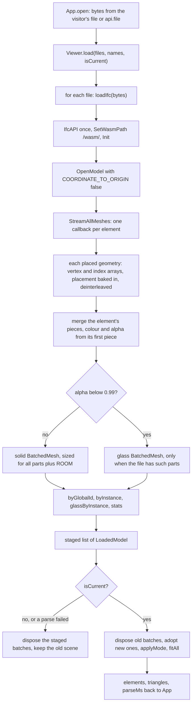
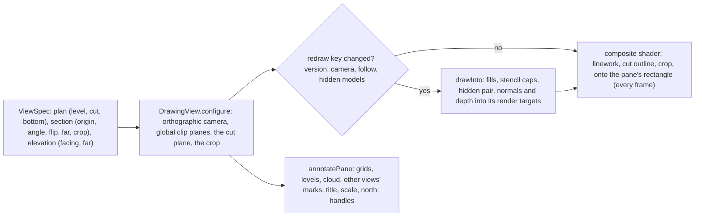
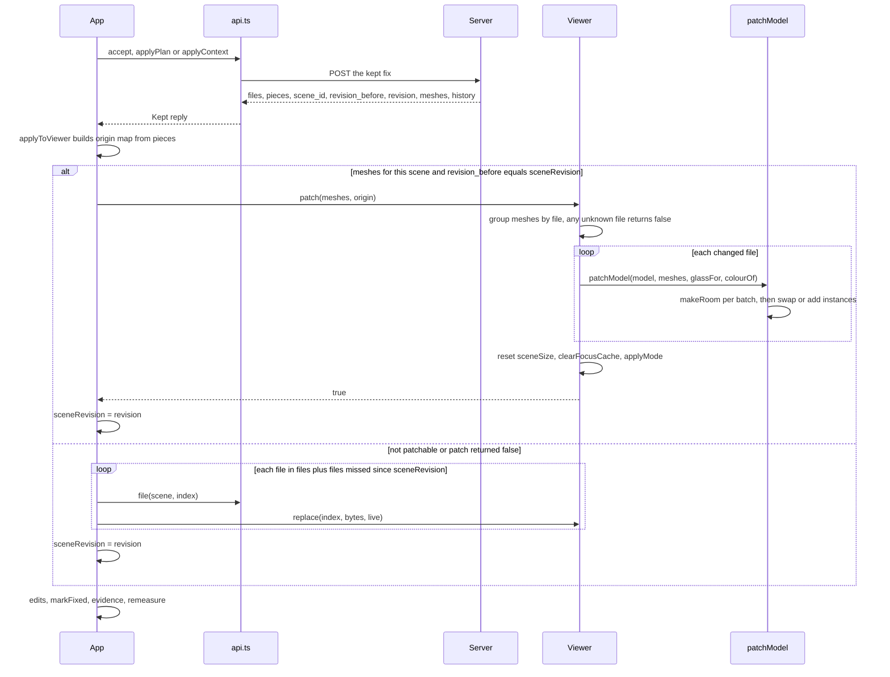

# 13 · 3D viewer

> **Covers:** `web/src/viewer/` (`Viewer.ts`, `ifcLoader.ts`, `patch.ts`, `views.ts`, `cube.ts`, `drawing.ts`,
> `annotate.ts`), and the viewer's controls in `web/src/ViewerToolbar.tsx`, `web/src/ViewPanes.tsx`, `web/src/App.tsx`,
> `web/src/pilot.ts` · **Checked against code:** 2026-10-30 (`feature/drawing-views`) · **Deeper design:**
> [docs/views.md](../views.md) (navigation, styles, visibility, drawing views), [docs/edits.md](../edits.md) ("Keeping
> a fix"), [docs/show-it-built.md](../show-it-built.md) ("Capture"), [docs/mobile.md](../mobile.md) ("Touch")

The viewer draws the open models in the browser with three.js and web-ifc (no That Open, no other viewer library).
Each IFC file becomes one `BatchedMesh` (plus a second one for its see-through elements), so every element keeps its
own transform, colour and visibility at the cost of one draw call per batch: previewing a fix is a matrix update,
not new geometry. On top of the batches the viewer draws the clash pair, outlines, previews, the agent's hits, a
marker and measurements, frames the camera on where two elements meet, and takes the pictures the server and the PDF
use (A/B/C views, list thumbnails, before/after, Show it built's passes). The camera and the clash are independent: the
model can be navigated, styled and filtered with or without a clash, and up to four panes (3D, plans, a section,
elevations) show it at once, the drawing views drawn like a CAD drawing from the same GPU buffers
([docs/views.md](../views.md)). `App` owns one `Viewer` and drives it from
state ([12](12-web-app.md)); the server never sees the viewer, only pictures and ids it sends.

## Files

| File | What it is | Main exports | Used by |
|---|---|---|---|
| `viewer/ifcLoader.ts` | Parses one IFC with web-ifc into a solid batch and an optional see-through batch | `loadIfc`, `LoadedModel`, `LoadedElement` | `viewer/Viewer.ts`, `viewer/patch.ts` (types) |
| `viewer/Viewer.ts` | The `Viewer` class: scene, camera, modes, focus, previews, picking, measuring, section box, captures | `Viewer`, `serverDeltaToViewer`, `serverPointToViewer`, `meetingZone`, types `Mesh`, `BuiltPiece`, `BuiltPasses`, `OptionShape`, `ViewMode`, `Preset`, `Side`, `Focus`, `Pick` | `App.tsx`, `pilot.ts`, `ViewerToolbar.tsx` (types), `web/spikes/built.ts` |
| `viewer/views.ts` | The views' pure rules: layouts, plan view ranges and presets, clash defaults, section frames, compass, scales, view cube regions, camera history, visibility filters, the Esc steps | `paneRects`, `planRange`, `planPreset`, `planThrough`, `sectionFrame`, `sectionThrough`, `nearestScale`, `scaleBar`, `cubeRegion`, `CameraHistory`, `shownBy`, `escStep`, types `ViewSpec`, `Datums`, `Filters`, `Temporary`, `Pose` | `viewer/Viewer.ts`, `viewer/cube.ts`, `App.tsx`, `ViewerToolbar.tsx`, `api.ts` (types) |
| `viewer/cube.ts` | The view cube: a labelled cube in the 3D view's corner, click a face, edge or corner (26 views), drag to orbit, Home | `ViewCube`, `CUBE_PX` | `viewer/Viewer.ts` |
| `viewer/drawing.ts` | A drawing view's orthographic camera, clip planes and crop (`DrawingView`), and the drawing style: paper fills, stencil caps for cut faces, the hidden pair, the composite shader that draws linework and the heavy cut outline | `DrawingView`, `DrawingStyle`, `farBehind`, `toIfc`, `CUT`, `CAP_LAYER`, `PAPER` | `viewer/Viewer.ts`, `viewer/annotate.ts` (types) |
| `viewer/measure.ts` | Measuring's pure parts ([docs/measure.md](../measure.md)): where a plane cuts triangles and the cut joined into straight runs, clipping an edge to a view's planes, choosing the snap (end, midpoint, edge), the words and the line to copy | `cutSegments`, `mergeRuns`, `clipSegment`, `candidatesOf`, `pickSnap`, `measureText`, `copyLine`, `copyText`, types `Measurement`, `Candidates`, `SnapKind` | `viewer/Viewer.ts`, `MeasurePanel.tsx` |
| `viewer/edit.ts` | The Edit tool's pure parts ([docs/manual-edits.md](../manual-edits.md)): the live push/pull preview's matrix (a stretch along the face's normal holding its far side), a face's coplanar triangles for its highlight, a drag in pixels as metres along a face, the palette's tools, their keys and what each can act on | `stretchMatrix`, `pushMatrix`, `depthBehind`, `coplanar`, `dragMetres`, `snapTo`, `signedMm`, `EDIT_TOOLS`, `toolState`, `toolForKey`, `toThree`, `toIfcAxes`, type `EditToolId` | `viewer/Viewer.ts`, `EditTool.tsx` |
| `viewer/annotate.ts` | A drawing pane's 2D layer: grids and bubbles, levels, the clash's revision cloud, other views' marks (section box, plan cuts, elevation markers, the 3D camera), title, scale bar, north; returns the handles a user can drag | `annotate`, `Handle`, `AnnotateInput` | `viewer/Viewer.ts` |
| `viewer/patch.ts` | Swaps a kept fix's changed and new elements into the batches in place | `patchModel`, `makeRoom`, `toGeometry`, `ROOM`, `ElementMesh` | `viewer/Viewer.ts`, `viewer/ifcLoader.ts` (`ROOM`), `api.ts` (`ElementMesh`) |

## Coordinates and units

- The server works in IFC axes: metres, **Z up**. web-ifc's placements (`flatTransformation`) and three.js are **Y
  up**. Everything the server sends is converted on the way in: `serverDeltaToViewer([dx, dy, dz])` returns
  `(dx, dz, −dy)` (`serverPointToViewer` is the same function, for the report's clash points), and server triangles
  are flipped the same way by `addMeshes`, `meshBox` and `patch.toGeometry` (normals too).
- `COORDINATE_TO_ORIGIN` is off in `loadIfc`: federated discipline files share coordinates, and shifting each by its
  own offset would pull them apart.
- The measure label reports in IFC axes: Δx from three's x, Δy from three's z, Δz from three's y, in mm.
- Fix colours follow the clash convention: side A red `#d0342c`, side B green `#1f9d3a`, one element on both sides
  purple `#8e44ad`.

## Loading (`ifcLoader.ts`)

- **One batch per file:** `BatchedMesh(parts + ROOM.instances, vertices + ROOM.vertices, indices + ROOM.indices)`.
  Each element is one instance (`addGeometry` then `addInstance`) whose matrix starts as identity, because the
  placement is baked into its geometry: a preview is then just a delta matrix.
- **Colour and opacity** come from web-ifc's style colour on the element's first placed geometry (grey 0.8 when none)
  and are set per instance with a `Vector4` (`setColorAt`). Elements with alpha below `SEE_THROUGH` (0.99) go into
  the model's `glass` batch, drawn without depth writes so what is inside a zone, a mesh guard or glazing still shows.
- **Element records** (`LoadedElement`): GlobalId (from `GetLine(...).GlobalId`, else `#expressId`), express id,
  instance id, which batch (`mesh`), `baseColor`, `baseAlpha`, `baseMatrix`. `LoadedModel` keeps `byGlobalId` and,
  for picking, `byInstance` (solid batch) and `glassByInstance`.
- **The wasm** comes from `/wasm/` (`web-ifc.wasm`, copied there by `web/scripts/copy-wasm.mjs`). One `IfcAPI` is
  shared for the page's life; each model is closed after loading.
- **`Viewer.load`** parses every file before touching the scene, so a failed or superseded load (the `isCurrent`
  callback is `App`'s `sceneEpoch` check) disposes what it staged and leaves the usable scene as it was.
  **`Viewer.replace(index, bytes, isCurrent)`** swaps one file the same way (used when a kept fix cannot be patched).
  Both assign the viewer's own materials to the batches (`adopt`), reset the cached scene size and redraw.

## The scene and its layers

```mermaid
flowchart TD
  scene["THREE.Scene, background dfe6ee, hemisphere and directional light"]
  scene --> batches["per model: solid batch, glass batch"]
  scene --> focus["focusLayer"]
  scene --> overlay["overlay"]
  scene --> hits["hitLayer"]
  scene --> links["linkLayer"]
  scene --> marker["marker"]
  scene --> section["sectionHelper Box3Helper, grips"]
  scene --> selection["selectionLayer"]
  batches --> solidMat["solid or ghost material, per-instance colour and visibility"]
  focus --> fmesh["focus meshes: views over the batch buffers, red, green or purple"]
  focus --> fedges["outlines: EdgesGeometry, drawn through everything, renderOrder 9"]
  overlay --> pieces["an option's pieces in its colour"]
  overlay --> ghostBefore["Both: what it replaces, orange ghost"]
  hits --> hitMesh["what a candidate hit, magenta, renderOrder 8"]
  links --> linkMesh["what an element is linked to, a colour per kind, renderOrder 7"]
  marker --> dot["amber dot and ring, constant screen size, renderOrder 10"]
  measure --> pts["points and line, renderOrder 11"]
  selection --> sel["the selected element, blue 2f8fdf, with its outline"]
  labels["DOM label over the canvas: marker-label; the measure layer, a 2D canvas over the stage"]
  cube["ViewCube: its own scene and camera, drawn last in the 3D pane's corner"]
```

- **Renderer:** WebGL with antialiasing and `preserveDrawingBuffer: true` (captures read the visible canvas), pixel
  ratio capped at 2, local clipping on. One `setAnimationLoop(frameTick)` renders every frame: it advances a camera
  flight, updates `OrbitControls`, adjusts the clip range, and calls `drawFrame`, which places the DOM labels, keeps
  the marker's and the grips' size on screen, and draws each visible pane into its own rectangle of the one canvas
  (viewport and scissor), then the view cube (Panes and drawing views, below). With no models open (the start page,
  models loading) it draws one empty 3D view over the whole stage, whatever the layout: the panes' headers are hidden
  until models are drawn, and their backgrounds alone showed as patches of sky and paper behind the load card. The
  layout stays chosen; its panes come back with the models.
- **Layers:** layer 0 is the model, seen by every camera. Layer 1 holds what only the 3D view shows: the marker, the
  outlines drawn through everything (focus, hits, links, selection), the section box helper and its grips, and the
  measure. The 3D camera sees 0 and 1; a drawing view's camera only 0. Layers 2 to 6 (`CAP_LAYER`) hold the stencil
  passes' copies of what a drawing cuts (the rest, side A, side B, both, a preview).
- **Materials:** `solid` (standard, double-sided), `ghost` (opacity 0.12, no depth write), `glass` (per-instance
  alpha, no depth write), focus materials per side (`focusMaterials`; `focusGlass` at 0.35 for a see-through element in
  focus), outline materials with `depthTest: false`, and the hit material (magenta `#e040fb`). All take the shared
  `clipping` planes, so the section box cuts everything.
- **Focus meshes share the batches' buffers:** `geometryOf` makes a `BufferGeometry` that points at the batch's
  position, normal and index attributes with a draw range for that element: no copy, already on the GPU. Only an
  outline copies the element's triangles (`edgeGeometryOf`, an `EdgesGeometry` at 25°, cached). Because they share
  buffers, the focus cache is dropped (not disposed) whenever a batch is replaced, patched or grown
  (`clearFocusCache`).

## `Viewer` API by concern

Public methods unless marked private. `App` calls nearly all of them; `pilot.ts` uses `orbit`, `setHits`,
`showOption` and `preview`.

| Concern | Members |
|---|---|
| Loading | `load(files, names, isCurrent)`, `replace(index, bytes, isCurrent)`, `patch(meshes, origin)`, `dispose()`; fields `models`, `names` |
| Visibility per model | `setModelVisible(index, visible)` (the toolbar's Models list; `App` keeps `tool.hiddenModels`) |
| Modes and focus | `setMode(mode)`, `setFocus({ a, b, group })`, `setEdges(on)`, `setHits(ids)`, `setLinks(groups)`; private `applyMode`, `aroundIds`, `drawFocus`, `nearFocus`, `focusSide` |
| Style, selection and visibility | `setStyle(style)`, `setGreyContext(on)`, `setSelection(gid)`, `setInfo(classes, storeys)` (either may be null to keep what it had), `setFilters(filters)`, `setTemporary(t)`, getter `temporary`, `setRules(view)` and `isShown(gid)` (the filters' rules, [docs/filters.md](../filters.md); its test is built once and kept until the next `applyMode`), `ofLevel(name)` (a storey's elements from the datums, for the Properties card's level actions), `infoCounts()` (cached until the models or the info change), `ofClass(cls)`; private `filterTest`, `drawSelection` |
| Previews | `preview(moves)`, `showOption(shape, mode, colour)`, `showOptions(shapes, mode)` |
| Camera | `focusClash(ids, point, label, fly)`, `frameFix(meshes, pairs)`, `frame(ids)`, `frameEverywhere(ids)` (the 3D view and every unpinned drawing: a filter applied, [docs/filters.md](../filters.md)), `frameMeshes(meshes, tight)`, `fitAll(animate)`, `view(preset)`, `flyTo(position, target, animate)`, `orbit(on)`, `orbitAround(pivot, dx, dy)`, `setOrbitClash(on)`, callback `onUserCamera`; private `flyToZone`, `zoneCamera`, `zoneCameraFrom`, `viewDirection`, `flyToBox`, `adjustClipRange`, `sceneDiag`, `reach` |
| Navigation | `activeCamera()`, `setProjection(p)`, `pose()`, `applyPose(p)`, `back()`, `forward()`, getters `canBack`, `canForward`, `setHome(p)`, getter `homeView`, `home()`, `lookFrom(dir)`, callback `onChange` (history, Home, layout or hides changed); private `press` (pivot or grip), `turn` (cube drag), `syncOrtho` |
| Panes and drawing views | `setDrawingsShow(show)`, `setLayout(layout)`, `maximise(i)`, getter `maximisedPane`, `setSplit(x, y)` (shares kept within 0.2–0.8), getter `splitShares`, `visiblePanes()`, `rect3d()`, `paneAt(x, y)`, `setPaneSpec(i, spec)`, `defaultSpec(kind)`, `setPinned(i, on)`, `fitPane(i)`, `paneToClash(i)`, getter `hasClash`, `defaultCrop()`, `setDatums(d)`, `setDrawingsFollow(on)`, `modelBox()`; fields `layout`, `panes`, `levels`, `datums`, `drawingsFollow`, `pane3d`; private `layoutPanes`, `configureViews`, `clashViews`, `renderDrawing`, `drawInto`, `render3d`, `annotatePane`, `dragHandle`, `lookHere`, `useDrawingVisibility`, `drawFrame` |
| Section box and marker | `setSection(on, margin, box)`, getter `section`, `setMarker(point, label)`; private `boxAroundFocus`, `boxInView`, `buildGrips`, `placeGrips`, `gripAt`, `dragGrip` |
| Picking and measuring | `pickAt(event, { ghosts })`, `pick(event)`, `has(gid)`, `boxOf(ids)`; measuring: getters `measurements`, `measureOpen`, `setMeasuring(on)`, `setSnap(on)`, `measureHover(event)`, `measureClick(event)`, `measureCancel()`, `removeMeasurement(id)`, `clearMeasurements()`; private `snapAt`, `snap3d`, `snapDrawing`, `snapNear`, `edgesFor`, `drawingCandidates`, `drawMeasures` |
| Captures | `snapshot()`, `capture(side)`, `captureClash(a, b, side)`, `thumbClash(a, b, side)`, `captureBuilt(fix, pair, classOf, radius, side)`; private `posed`, `posedShots`, `builtPasses`, `fullCanvas`, `png` |
| Module functions | `serverDeltaToViewer`, `serverPointToViewer`, `meetingZone(a, b)` (per axis the overlap, or the gap when apart) |

### Modes and focus

`setFocus` takes side A, side B and a `group` of more elements per side (`"a"`, `"b"` or `"ab"`): the pieces accepted
fixes added, stand-ins for ports, a plan's elements (what moves green, what stays red) or a wider fix's. Focus
elements are hidden in their batch and drawn by the focus layer instead, so every mode can keep them solid and
outlined. `applyMode` then sets, for every element of every model, its visibility, colour and matrix:

| Mode (`ViewMode`) | With a focus | Toolbar key |
|---|---|---|
| `shaded` | Everything else in solid grey `#b9c2cc` (`setGreyContext(false)`: in its own colours); without a focus, every element in its own colour | V |
| `xray` | Everything else see-through (`ghost` material, opacity 0.12) | X |
| `context` | Only elements whose box comes within `reach(2.5, 0.25)` of the focus, see-through; the rest hidden | C |
| `isolate` | Only the focus | I |

The modes work round the focus: the clash pair and its group, or, for `context` and `isolate` with no pair, the
selected element (`aroundIds`), so one element can be isolated without making it side A. Without either, every mode
draws the whole model in its own colours. `App` starts in `xray` (its `tool` state); the `Viewer` field defaults to
`shaded` until `App`'s effect sets it. `setEdges(false)` hides the outlines. Each `applyMode` bumps `version`, which
tells the drawing views to redraw.
`setHits(ids)` lights up what a candidate fix ran into (magenta, outlined through everything; `[]` clears).
`setLinks(groups)` draws the connection highlight ([docs/connections.md](../connections.md)): each group's elements in
its kind's colour (`links.ts` `LINK_COLOURS`), at most 150 per group, outlines on the first 40, hidden elements and
models skipped, the section box respected; it never changes the mode. The layer is hidden while `posed` and
`captureBuilt` take pictures, and cleared with the focus cache.

### Visual styles, selection and visibility

`setStyle(style)` decides how the 3D view draws everything (`VisualStyle`, cycled with G; the styles' design:
[docs/views.md](../views.md), "Visual styles"). The pair, the selection, previews, trials and hits keep their colours in
every style.

| Style | How it is drawn |
|---|---|
| `shaded` | the `solid` material, lit |
| `consistent` | Consistent colours: the `consistent` material, unlit, each element's own colour |
| `edges` | Shaded with edges: `render3d` draws the scene into a render target, then its normals and depth (solid only: no glass, ghosts or helpers), and the composite shader adds dark lines where normals turn or depth jumps; layer 1's helpers are drawn on top |
| `hidden` | Hidden line: as `edges` with the batches on the drawing views' paper fills, the pair flat in its colours, a paper background |
| `xray` | X-ray as a style: every batch see-through in its own colours (`xrayAll`), with or without a clash |

- **Selection:** `setSelection(gid)` draws the selected element blue (`#2f8fdf`) with an outline through everything,
  in every pane (`selectionLayer`; the outline on layer 1). `App` sets it from a single click.
- **Visibility:** what wins is a hidden model (`setModelVisible`), then a temporary hide or isolate
  (`setTemporary({ hidden, isolated })`), then the filters (`setFilters({ classes, levels })`: classes and storeys
  left out, `views.shownBy`), then the filters' rules (`setRules`: what hide rules find is hidden; while an isolate
  rule is on, only what isolate rules find shows), then the mode round the focus. `isShown(gid)` answers for the card
  and App (a filter that hides the selection clears it); the selection and lit links leave out what is hidden.
- **Colour:** `applyMode` sets each element's colour: a filter's colour (`setRules`' `paint`, the top rule winning),
  else the ghost, else grey (the grey context round a focus, or Grey the rest), else its own. One scratch `Vector4`
  for every element. The pair, selection, hits, links, previews and measure are their own layers over the batches,
  so they keep their colours over any filter's. The focus is drawn by its own layer, so the pair, previews
  and trials always show. `setInfo` takes each element's class (`api.classes`) and storey (`api.datums`); `infoCounts()` gives
  the toolbar its per-class and per-level counts, `ofClass(cls)` the GlobalIds for "Hide all / Isolate all".
- **Lifted:** while a capture shoots, `lifted` puts the style back to shaded and drops filters, the filters' rules and colours, temporary hides and the
  selection, so the pictures the server reads do not depend on how the user is looking (Captures, below).
- **The section box in Shaded with edges and Hidden line:** the drawings' fills, pair colours, selection and normals
  materials share the section box's planes, so it cuts those styles too (a drawing view empties the planes while it
  draws).

### Previews

- `preview(moves)` previews plain moves: GlobalIds and a server delta, kept in `moved` as translation matrices that
  `matrixOf` premultiplies onto each element's base matrix. It clears any edit preview. `preview([])` clears all.
- `showOption(shape, mode, colour)` / `showOptions(shapes, mode)` show fixes as `OptionShape` (`kind`, `moved`,
  `deltaM`, `pieces`, `before`). Mode `after` draws the fix in place of what it changes (non-move kinds hide the moved
  originals and add their pieces as meshes; a penetration draws its provision for void solid and the host with its
  hole at 0.3 opacity); `before` draws the model as it is; `both` adds `before` as an orange ghost (`#e67e22`, 0.35).
  `App` colours an option red when it moves A, else green; a plan's fixes green; the pilot uses amber while checking
  and teal when clear ([12](12-web-app.md), `pilot.ts`), and so does a check pointed at in Workings, with its hits lit
  when it failed ([docs/workings.md](../workings.md)).

### Camera

- **Controls:** `OrbitControls` with damping and `zoomToCursor` (the wheel zooms to what is under the pointer), on the
  3D pane's own element (`pane3d`). Any controls `start` (drag, wheel, touch) and any `pointerdown` call
  `onUserCamera`, which `App` wires to `pilot.takeOver()`.
- **Pivot** (`press`, capture phase, before the controls see it; not with Shift, Ctrl or Cmd, which pan). A press
  stops a flight under way first (the pilot frames each idea and glides to the clash before its slow turn), so the
  drag turns from where the camera is. What a left drag orbits round (`pivotFor`):
  - **the selected element** (its box's middle), or, with nothing selected, **the clash in focus** (its chip shows)
    **or the one ORCA works on** (a proposal, a plan, a wider fix, a replay: `App` calls `setOrbitClash` with
    `clashBusy` or a clash or pair on screen outside a plan's or a wider fix's view; `clashCentre` is where the pair
    meets, else the middle of the focus). The drag turns the camera and its target together round that point
    (`orbitAround`: across round the vertical, up and down tilting, never past straight up or down, at the controls'
    speed), so the pivot stays where it is on screen and nothing jumps; the controls' own rotation is off for that
    drag (they still pan, zoom and capture the pointer). Not on touch.
  - **otherwise the point under the pointer:** a pick, ghosts included, slides the controls' target along the view ray
    to that depth, so the orbit turns about that point and nothing jumps. Empty sky keeps the last target; not in
    orthographic. About 8 ms a press on Northbank.
- **View cube** (`cube.ts`): drawn last in the 3D pane's bottom right (104 px), with its own scene and camera turned
  like the main one. A click on a face, edge or corner calls `lookFrom(dir)` (26 directions round the current target,
  keeping the distance; straight down keeps north up); a drag orbits (`turn`); its Home button calls `home()`.
- **Projection:** `setProjection("orthographic")` draws and picks with `ortho`, which `syncOrtho` keeps looking the
  same way as the perspective camera, its frame the size of the view at the target, set back past the model. The
  controls still move the perspective camera.
- **History and Home:** every `flyTo` (a clash, F, H, a preset, the cube, a saved view, framing a fix) pushes the pose
  it leaves (`views.CameraHistory`); `back()` / `forward()` fly through it without pushing. `setHome(pose)` makes `home()` fly there instead of
  `fitAll`; `App` keeps Home and saved views per project (`sightline.views.<project>`, [12](12-web-app.md)).
- **Flights:** `flyTo` animates position and target over 650 ms (cubic ease in-out), or jumps when `animate` is false
  or the visitor prefers reduced motion. `orbit(on)` turns `autoRotate` on (speed 0.6) while Muse thinks; turning it
  on first glides the view sideways so the clash is in the middle (its angle and distance kept), so the turn is round
  the clash, not wherever the target was left.
- **Framing a clash:** `focusClash(ids, point, label)` frames the zone where the two elements meet (`meetingZone` of
  their boxes), not the two whole elements, so a 16 m run crossing a beam frames the crossing. With one element and a
  point it frames a `reach(1, 0.2)` cube there; with only a point, a `reach(0.6, 0.15)` cube. It sets the marker
  (label `#N`) and returns false when there is nothing to frame. With `fly` true it also takes every unpinned drawing
  pane to the clash (`clashViews`, below); with `fly` false (Fly to clash off) it only marks it, and nothing moves.
- **Framing a fix:** `frameFix(meshes, pairs)` frames the new pieces given (`fixKinds.framePieces`) plus, for each
  `[moved, partner]`, where the moved element now meets its partner.
- **`zoneCamera(zone, union)`:** the margin grows with the zone and with the elements around it (`union`) but has a
  least value of `min(0.5 m, max(a quarter of the pair, twice the zone), reach(0.5, 0.15))`; the distance fits the
  framed box in the narrower field of view with 10% to spare. The direction is `viewDirection()`: the user's current
  angle when it is a reasonable one (its height component between 0.15 and 0.97), else a high iso view `(1, 0.8, 1)`.
  `zoneCameraFrom` is the same from a given direction (Show it built).
- **Others:** `frame(ids)` and `frameMeshes(meshes, tight)` fly to a box (`flyToBox`, at least `reach(1.5, 0.5)`
  across); `fitAll` frames every visible model; `view(preset)` looks from `top`, `front`, `right` or `iso` around the
  current target, at least `reach(2, 0.8)` away.
- **Clip range:** `adjustClipRange` puts the near plane at a two-hundredth of the distance to the target, between
  0.5 mm and 1 m, and the far plane at 100,000 times that (at least 2,000 m), so close-ups of small parts don't clip
  and far views don't z-fight.

### Small models: `reach` and `sceneDiag`

The viewer's distances were tuned on buildings. `reach(metres, share)` (private) keeps each building value but never
more than `share` of the scene's diagonal (`sceneDiag`, the union of every batch's bounding box, cached in
`sceneSize` until a load, replace or patch resets it). A 100 mm machine part gets millimetres where a building keeps
exactly what it had.

| Use | Building value | Share of the scene's diagonal |
|---|---|---|
| Context mode radius (`nearFocus`) | 2.5 m | 0.25 |
| Section box margin (`setSection`) | 1.5 m | 0.1 |
| Section box around the marker (`boxAroundFocus`) | 4 m cube, unioned with a 1 m cube | 0.3, 0.1 |
| `focusClash` zone from a point (one element / none) | 1 m / 0.6 m | 0.2 / 0.15 |
| Least margin in `zoneCamera` / `zoneCameraFrom` | 0.5 m | 0.15 (and bounded by the pair) |
| Least box in `flyToBox` | 1.5 m | 0.5 |
| Least distance for `view(preset)` | 2 m | 0.8 |
| `captureBuilt`: area round the pair, framing margin, section radius | 1.5 m, 0.75 m, 3 m | 0.3, 0.2, 0.4 |

The marker keeps a constant size on screen (scale = distance / 8, no floor in metres).

### Section box and marker

- `setSection(on, margin, box)` cuts the model with six clipping planes round `box`, or round `boxAroundFocus()`
  (the focus elements' box clipped to a few metres round the marker, so a long run does not make a huge box), else the
  selected element, else what is in view (`boxInView`: a cube round the target about as wide as the camera is far),
  plus the margin; a `Box3Helper` shows the box, and each face has a grip (layer 1) to drag, live. It returns false
  only when there is nothing at all, and `App` then turns the toggle off. `App` re-cuts it whenever the pair, plan or
  wider fix on screen changes. The getter `section` gives the current box (saved views keep it).
- `setMarker(point, label)` places the amber dot and ring (drawn through everything) and its DOM label.

### Panes and drawing views

Up to four panes share the one canvas ([docs/views.md](../views.md), "Views and layouts"). `setLayout` takes
`single` (3D), `two` (plan · 3D) or `quad` (plan · 3D / section · elevation; `views.defaultKinds`), keeping panes that
stay; `views.paneRects` places them by the split shares (`setSplit`, from the lines `ViewPanes.tsx` draws between
them), and `maximise(i)` gives one pane the stage. Each pane has its own element over the canvas: the 3D pane's
(`pane3d`) carries `OrbitControls`, a drawing pane's carries a 2D canvas for its annotations. The 3D camera takes its
pane's aspect; the marker and measure labels are placed in its rectangle (`rect3d`).

- **A drawing view** (`drawing.DrawingView`) is an orthographic camera and its clip planes: a plan looks down, cut by
  its cut plane (`level + cut`) and, if set, its bottom; a section looks along its line's left (or right, flipped), cut
  by the line, with its far clip and crop as planes; an elevation looks in from outside the model's box, with an
  optional far clip from the façade on its side. `keeps(point)` says whether a point survives every plane (picking
  uses it). `frame(box, rect)`, `pan` and `zoomAt` (the point under the pointer stays put) move it.
- **Drawing it** (`drawInto`): the section box is lifted (its planes are the 3D view's) and the view's planes become
  `renderer.clippingPlanes`. The batches take paper fills tinted per file, the pair flat red and green; then, with the
  cut plane alone, each cut solid is drawn on its `CAP_LAYER` with colour and depth off: everything but the pair is
  counted (back faces up, front faces down, `DrawingStyle.counting`; nonzero becomes bit 1, `settleCount`), so
  overlapping solids still fill, and the pair and a preview flip their own bits by parity (`CUT`: rest 1, A 2, B 4,
  both 8, a preview 16); then full-view caps fill where a bit is set (grey with a 45°
  hatch, red, green, purple, the preview's colour, amber where A and B overlap), writing a class in alpha; the pair's
  hidden parts are drawn ghosted where something stands in front (`behind`); last a normals and depth pass. The
  composite shader (every frame, from the targets) draws projection lines where normals turn or depth jumps, the heavy
  cut outline where the alpha class changes, and paper outside the crop.
- **When it redraws:** `renderDrawing` keeps a content key of `version` (bumped by `applyMode`, previews, hits, the
  marker and loads), what the view shows apart from where it looks (`DrawingView.contentKey`: look, up, size, planes,
  crop), the follow toggle and the hidden models; a change redraws the targets. A pan or zoom alone does not: while
  the gesture goes on (a pointer holds the pane, or it moved in the last three frames) the composite moves and scales
  the last picture (`DrawingView.shift`, paper where it does not reach), and the drawing is drawn once the gesture
  rests. A drag that reshapes another view (a cut, a section line) redraws that view at most five times a second.
  Captures restore `version` after they shoot, so a thumbnail does not redraw every drawing.
- **What it draws:** a view that cuts puts its camera's near plane at the cut (its centre is on the cut plane), so what
  the cut removes is never drawn, not drawn and clipped: everything above a plan's cut, everything behind a section's
  line. The fills, the hidden pair and the normals put the far plane at a bottom or far clip too; the cut faces' passes
  keep it beyond the model (`DrawingView.reach(true)`), since they must see the whole of each solid the cut passes
  through. Targets have no multisampling (4× took about two thirds of a drawing's graphics memory: some 90 MB a pane
  at 2× pixels on a large screen, enough in Quad to lose the WebGL context), and a pane hidden by a maximised one
  gives its targets back.
- **Compositing:** the canvas keeps what each pane last showed (`preserveDrawingBuffer`), so a pane composites again
  only when its picture, shift, crop or rectangle changed, or when something drew over the whole canvas or cleared it
  (`canvasStamp`: captures, a resize, a layout change). Orbiting the 3D view composites no drawing.
- **A resize** (`fit`, from a `ResizeObserver`) resizes the canvas only when its size really changed, and draws every
  pane at once: the observer runs after the frame's drawing and before the browser paints, and a cleared canvas
  showed as the viewer blinking off and on.
- **A lost WebGL context** (the graphics card short of memory, or a driver reset): the stage says so
  (`.view-lost`); when the browser gives it back, every pane is drawn again (three.js re-creates what was on the
  card); not back within 5 s, it offers a reload, which picks the session up. Captures return nothing meanwhile
  (`Viewer.lost`), never black pictures, and `App` holds the thumbnail queue until it is back.
- **What drawings show** (`setDrawingsShow`, [docs/filters.md](../filters.md), "Drawings"): `filtered` (the default:
  what the filters and hides leave, without the 3D view's Context or Isolate), `follow` (exactly what the 3D view
  shows) or `whole` (only hidden models stay hidden). `applyMode` records each element whose 3D visibility differs
  from the drawings' in `drawVis`; `useDrawingVisibility` swaps the drawings' set in around a drawing's passes and
  picks.
- **Filter colours in drawings:** while filters colour anything (and drawings don't show the whole model), `drawInto`
  fills with `DrawingStyle.paintFill` (a fill that keeps each element's colour) and `useDrawingPaint` sets each
  element's colour for the pass, its filter's a quarter of the way to paper (`DrawingStyle.onPaper`) or its file's
  tint (`DrawingStyle.tint`), then puts the 3D colours back: 2N colour writes per redraw, and a drawing redraws only
  when something changes. Cut faces keep their poché; the 3D Hidden line style shows no filter colours.
- **Annotations** (`annotate.ts`, redrawn when its own key changes): grid lines and bubbles (in sections and
  elevations only the axes within 25° of the look direction, `views.gridShows`), level lines and heads, a revision
  cloud and the `#N` round where the pair meets, in plan each section's line, heads, far clip and crop sides, each
  elevation's marker and the 3D camera's position and field of view, in sections and elevations each plan's cut
  (dashed) and bottom (dotted), and a title block with the nearest standard scale (`views.nearestScale`), scale bar and
  north arrow. It returns the `Handle`s on screen.
- **Input** (`attachDrawingInput`): left or right drag pans, the wheel and a pinch zoom to the pointer, never a turn.
  A left press on a handle drags it (`dragHandle`: a section's line along its normal, its ends to turn it (Shift: 15°
  steps), its far clip and sides; a plan's cut and bottom; a section's crop top and bottom), redrawing the view it
  belongs to; Esc during the drag puts the value back. A right click without a drag turns the 3D view to that point
  (`lookHere`). Clicks bubble to the stage, so `App`'s click, double-click and long press work in every pane;
  `pickAt` hands a drawing pane's event to `pickDrawing`, which uses that view's camera and skips what its planes
  remove.
- **New panes** (`setLayout`) look at the clash on screen, else the whole model, never at empty paper round the IFC
  origin; a pane switched to Section from its header starts through the model's middle (`defaultSpec`). New datums
  with other levels put plans back on the ground level (Level 01, not the foundations). The clash a pane can go to
  (`lastClash`) is dropped when the marker is cleared or new models load, and its Go to the clash is then off.
- **Going to a clash** (`clashViews`, from `focusClash` with `fly`): every unpinned drawing pane, or one with its own
  Go to clash (`paneToClash`), is set to the clash and framed on where the pair meets: a plan at the storey the clash
  stands in with the cut through it (`views.planThrough`), a section through it along the run of the side that moves
  (not structure, else the longer run; `views.sectionThrough`), its far clip 2 m beyond where the pair meets
  (`drawing.farBehind`), and an elevation facing the way the section looks (`views.facingFor`).
- **Datums:** `setDatums` takes `api.datums` (levels and grids, [10](10-http-api-and-streams.md)); with no levels
  (`views.levelsOrModel`) one level spans the model's box, so plans cut at its mid-height.

### Picking and measuring

`pickAt(event)` casts a ray against the focus meshes and every visible batch and walks the hits nearest first:

- a hit outside the section box is skipped;
- a focus mesh returns its element at once;
- in a see-through mode with a focus (anything but `shaded`), batch hits are skipped: clicks go through the ghosted
  context to the pair;
- a solid batch hit returns its element (`byInstance` by `batchId`);
- a glass hit is remembered and returned only if nothing solid lies behind it, so a robot's safety zone does not
  swallow clicks on what stands inside it.

With `{ ghosts: true }` (the connection hover) ghosted context is picked too. A single click that selects an element
(`App.onClick`) falls back to `{ ghosts: true }` when the normal pick meets nothing, so any element can be selected
through a see-through view and its properties read ([docs/panels.md](../panels.md)); double-click A / B picking keeps
the normal pick.

`pick(event)` returns just the GlobalId.

**Measuring** ([docs/measure.md](../measure.md)) works in every pane. `measureClick` sets a first point and then a
second, which keeps a `Measurement` (two points in the model and the view it was taken in); `measureHover` (once a frame
from `App`) finds what the pointer snaps to; `measureCancel` drops a first point. `snapAt` routes by pane:

- **3D** (`snap3d`): a pick (ghosts included); with snapping on, the element's feature edges (the outlines' `EdgesGeometry`
  at 25°, in world space: `edgesFor`) give ends, midpoints and edges, and `measure.pickSnap` takes the nearest end within
  12 px, else a midpoint, else an edge within 8 px, the edge point where the pointer's ray passes closest (exact in
  perspective); else the surface point. Nothing under the pointer: no point.
- **A drawing** (`snapDrawing`): every point is laid on the drawing's plane (a plan's cut, a section's line, an
  elevation's façade plane), so a measurement reads as drawn; empty paper is a point too. Candidates
  (`drawingCandidates`): the element's edges clipped to the view's planes and laid on the plane, and where the view cuts,
  its triangles cut by the plane and joined into runs (`measure.cutSegments`, `mergeRuns`), so a cut wall snaps at its
  cut corners and along its cut faces.
- When the element under the pointer gives no snap, the elements under four points 10 px round it are tried
  (`snapNear`). Candidates are cached per element, placement and view.

The measure layer (`drawMeasures`) is one 2D canvas over the stage, drawn again only when the measurements, the
pointer, a camera or a pane changed: in 3D every measurement (dots at the ends), in a drawing the ones taken there (a
drawing's ticks at the ends), labels moved up off each other, the measurement under way as a dashed rubber band with
its length, and the snap glyph (square end, triangle midpoint, cross edge, dot surface). It shows only while measuring,
is never in a capture, and is in the Screenshot. Opening other models clears the measurements.

### Captures

| Method | What it returns | Used for |
|---|---|---|
| `snapshot()` | The whole canvas as PNG | The Screenshot tool (`App.screenshot` saves `orca-clash-N.png`) |
| `capture(side = 640)` | The view's centre square as JPEG | Before/after pictures of fixes for the report (`App.captureFix`, `captureContext`), and the agent link's `capture_request` for a view (at 1024) |
| `captureClash(a, b, side = 768)` | `{ A, B, C }` PNGs: A the pair alone, see-through, framed on where they meet; B the pair solid in context; C as A from a quarter turn round | A detected clash's views, saved on the report (`App.captureViews`), read by the fix agent, triage and the PDF |
| `thumbClash(a, b, side = 192)` | View A's recipe as a small JPEG | List thumbnails of detected clashes |
| `captureBuilt(fix, pair, classOf, radius = 3, side = 1024)` | `BuiltPasses`: `look`, `ids` and `normals` PNGs of one square view, `cut`, `sectioned`, `shown` | Show it built |

- **The guard:** every capture (`captureClash`, `thumbClash`, `capture`, `captureBuilt`) shoots through `fullCanvas`,
  which sets the whole canvas as the viewport, no scissor and no global clip planes, and the 3D camera's aspect to the
  canvas's, whatever the layout; and with `lifted` set, so the user's style, filters, temporary hides and selection are
  not in the pictures (`capture` also lifts the projection and the grips). `drawFrame` redraws every pane afterwards.
  Checked Oct 30: A/B/C, thumbnails, `capture()` and Show it built's passes byte-identical in Single and Quad, and with
  a style, filters, a hide and orthographic on. `snapshot()` saves the whole layout: the canvas and each drawing
  pane's annotation canvas.
- **`posed(a, b, take)`** (private) is shared by `captureClash` and `thumbClash`: it saves the camera, target, mode,
  focus, flight and marker, focuses the pair, points the camera with `zoneCamera`, lets `take` render shots (the focus
  materials see-through at 0.6 for A and C), then puts everything back and renders the restored view before
  returning. All in one task, so nothing changes on screen. The final render is the fix for thumbnails flashing: the
  canvas keeps its last frame, and a shot taken after the frame's own render used to show until the next frame.
- **`captureBuilt`** chooses a cutaway: of 12 directions (heights 0.8, 0.3 and −0.5 by four diagonals) it measures,
  at 256 px, how much of the fix each shows and takes away the elements that hide it, most pixels per cost first
  (cost 1 for coverings, lights, air terminals, furniture, slabs, roofs, plates, windows, doors, spaces, railings and
  sanitary terminals; 2 for walls and curtain walls; 6 for everything else), until 85% shows or 12 are gone. Never
  the pair, the moved elements or what the fix passes through. A slab, roof or covering taken away above or below the
  fix becomes the section's top or bottom instead (`sectioned`). Zones (alpha under 0.2) and what the server lists as
  not physical (`classOf` returns `""`) are never drawn. The passes: the look (true colours), ids (element index + 1 in
  24 bits, unlit, by swapping the batches' materials, because an override material would draw the pieces white) and
  view-space normals. Everything is restored in `finally` and the user's view drawn again. The server side and the
  check: [docs/show-it-built.md](../show-it-built.md), [09](09-agent-workflows.md).

## Accepting a fix in place (`patch.ts`)

When a fix is kept (single accept, plan, wider fix, or an agent's `applied` event), the server's reply carries
`Workspace.patch` ([07](07-fixes-and-edits.md)): `scene_id`, `revision_before`, `revision`, `meshes` (the changed and
new elements' triangles, world metres, Z up, unwelded, with normals, style colour and file index) and `history`.
`App.applyToViewer` patches only when the page's model is at the revision the fix started from; otherwise it reloads
the files the fix changed plus every file changed by an edit the page missed.

- **Revision check (in `App`):** `kept.meshes` present, `kept.scene_id` is this scene, and `kept.revision_before`
  equals `sceneRevision.current`. On reload, `history` (`[revision, files]` pairs) names the files changed after the
  revision this page last drew; when the page does not know its revision, every file in `history` is reloaded.
- **`ROOM`** (`{ instances: 64, vertices: 16384, indices: 49152 }`): spare room `loadIfc` reserves in every batch,
  so the first accepts patch in place without regrowing.
- **`makeRoom(batch, vertices, indices, instances)`:** first packs out what earlier patches freed
  (`BatchedMesh.optimize`), then grows the geometry buffers to the current size plus twice what is needed
  (`setGeometrySize`, reading three r186's private `_maxVertexCount` / `_maxIndexCount`), and the instance count
  likewise. Growing replaces the buffers, which is why the viewer drops its focus cache afterwards.
- **An element already drawn** keeps its instance (id, visibility): the new geometry is added, the instance pointed
  at it, then the old geometry deleted (deleting first would delete the instance). An element whose opacity moved it
  across the 0.99 line leaves its old batch and gets a new instance in the other.
- **A new piece** (a split run's pieces, bends, a provision for void) gets its own instance with an identity matrix.
- **Colours:** a mesh's own style colour wins; an element already drawn otherwise keeps the colour it had; a new
  piece otherwise takes the colour of the element it was split from (`colourOf`, from the `origin` map: each GlobalId
  after the first in a `pieces` group maps to the first, the original); else grey 0.75.
- **Glass batch creation:** a see-through piece in a model with no glass batch calls `glassFor`, which makes
  `new BatchedMesh(ROOM.instances, ROOM.vertices, ROOM.indices, glass material)` and adds it to the scene.
- **Failure is safe:** any exception in `patchModel` makes `Viewer.patch` return false, and `App` reloads the files.
- Measured (Oct 29, [docs/edits.md](../edits.md)): an offset on Northbank answers in 0.23 s with 9 meshes, and no
  file is fetched after an accept; the gain is the parse of the whole file, which grows with its size.

## Keyboard, mouse and touch

Keyboard shortcuts live in `App` (a `keydown` listener, ignored with Ctrl, Cmd or Alt, while typing in an input,
textarea or select, and while a modal dialog is open (`aria-modal`: About ORCA, the report, the agent link,
requirements), whose own Esc must not also leave the clash). The toolbar shows each key in its tooltip.

| Key | Action | Key | Action |
|---|---|---|---|
| 1 / 2 / 3 / 4 | View top / front / right / iso | V | Shaded |
| H | Home (the saved Home, else fit the whole model) | X | X-ray |
| F | Frame the selected element, else go to the clash (`focusNow`) | C | Context |
| S | Section box | I | Isolate |
| E | Outlines | M | Measure (N: snap on or off while measuring) |
| G | Next visual style | L | Connections |
| O | Perspective / orthographic | Q | Layout: Single, Two, Quad (Two at most on a tablet; none on a phone) |
| [ / ] | Back / forward through camera jumps | Esc | One thing at a time (`views.escStep`): the measure, the image dialog, the selected element, then the clash; not while ORCA works on it. It also clears the connection highlight. With a menu open it closes only the menu |

- **Mouse:** a single click selects the element and shows its properties card (with Set as A / Set as B and its view
  actions) or, in measure mode, adds a point; a double click picks A, then B (a third pick starts over at A); a drag of
  more than 5 px is an orbit about the point under the pointer, never a pick; the wheel zooms to the cursor. In a
  drawing pane a drag pans, a handle drags, and a right click turns the 3D view there (Panes and drawing views, above).
- **Touch** (`(pointer: coarse)`): a tap shows the properties card, whose Set as A / Set as B buttons pick (a toast
  says what to do next); a long press of 500 ms with the finger still (moving over 10 px cancels it) picks A then B,
  with a short vibration; a drag must move 10 px to count as one; the context menu is suppressed. Orbit, pinch and
  pan are `OrbitControls`' defaults.
- **Toolbar** (`ViewerToolbar.tsx`): on desktop and tablet a vertical icon rail of `IconButton`s in two kinds of group
  ([docs/measure.md](../measure.md), "The rail"). The 3D view's own: modes; visual style, with the greyed-context
  toggle; section box, outlines, connections; Home; a Camera popover (standard views, projection, back and forward, Set
  as Home); saved views. Every view's: go to clash, measure, Views (layout, what drawings show, Fly to clash),
  visibility by model, level and class and what is hidden for now, screenshot. In Single (or the 3D pane maximised) one
  rail holds both at the stage's left; in Two and Quad the 3D groups sit in the 3D pane under its header (`Rail3d`, from
  `App.rail3d`), folded to its height (the modes into one Mode menu, then the tools and camera into menus too), and a
  maximised drawing hides them. Each pane's header (`ViewPanes.tsx`) has its view
  picker, view range or depth and crop, pin, go to the clash, fit and maximise. A narrow pane's header folds rather
  than overflow: under 380 px the range button loses its words, under 300 px pin, go to the clash and fit move into
  the range menu; the view picker shrinks to a few letters and maximise always stays. Its title block and scale bar
  stack when they would meet, and a long title ends in "…". On a phone (`compact`) one labelled
  **Tools** popover (a sheet from the bottom) holds the same, beside **Go to clash** and **Fit**. The rail stops click,
  double-click and pointer-down events so they never reach the canvas.
- **Connections:** hold Alt (Option) and point, or turn on Connections (L): what the element under the pointer is
  linked to lights up by kind, with a label (one pick per animation frame); Shift widens it to the run. A click or
  tap with the toggle on pins them to the selection. Alt's own default (the menu bar) is suppressed except while
  typing.
- **While the agent drives** (`pilot.ts`), any camera move or click is a takeover; the pill's **Let ORCA drive**
  resumes.

## Performance notes

- One draw call per batch, whatever the element count; a preview changes instance matrices, and focus meshes reuse
  the batches' GPU buffers. `applyMode` does walk every element of every model on each mode, focus or preview change.
- The frame loop renders the 3D pane continuously (`setAnimationLoop`), not on demand. Drawing panes redraw their
  targets only when what they show changes, and composite only when their picture or place changes (measured Oct 30
  in Quad on Northbank: idle, no redraws; orbiting the 3D view, no redraws and no composites; panning a plan with 60
  pointer moves, no redraws while it goes on and one when it rests; ten wheel steps on a section, one redraw after; a
  new clash, three). A drawing with a cut costs four passes over what lies between its cut and its far plane (fills,
  counting both ways, normals) plus full-view quads. Frame times on a real GPU are still to measure (the cloud session
  renders with software GL).
- Thumbnails: `thumbClash` renders into the visible canvas, so `posed` renders the restored view before returning
  (checked Oct 28 by sampling the canvas between frames: the old build jumped 45 levels of brightness, the new one 0;
  CLAUDE.md). `App` draws one queued thumbnail every 60 ms (waiting while the WebGL context is lost), newest request first, paused while a proposal, plan,
  replay, reload or check runs ([12](12-web-app.md)).
- Small models: `reach` and `sceneDiag` above, the marker's constant screen size and a near plane down to 0.5 mm
  (checked Oct 29 on a generated 110 mm load cell and on Northbank #1 and #40, which frame as before; CLAUDE.md).
- Big models: web-ifc parses on the main thread. A 500 MB upload took about three minutes to draw with the page frozen
  and a 1.4 GB JS heap (Oct 29, [docs/uploads.md](../uploads.md)); parsing in a Web Worker is the next step there.
- `package.json` lists `three-mesh-bvh`, but nothing in the viewer imports it at HEAD: picking uses three.js's own
  raycast on the batches.
- **The host's size:** on a desktop the stage lives in the dock's Model panel ([docs/panels.md](../panels.md)); the
  viewer follows its host with a `ResizeObserver`, so collapsing a side bar grows the canvas with no viewer call.
  Panels floating over the canvas paint no opaque scroller of their own: in Chromium one culled the canvas under it by
  its whole content height and left a hole (Oct 30).

## When to update this doc

- A new public `Viewer` method, a renamed one, or a change to what a capture returns or how it frames.
- A new view mode, preset, layer, material or render order, or a change to the A/B/purple colours.
- A change to how `loadIfc` splits solid and see-through elements, reads colours, or to `COORDINATE_TO_ORIGIN`.
- A change to the axis conversion (`serverDeltaToViewer`, `toGeometry`, `addMeshes`, `meshBox`).
- A change to `patch.ts` (`ROOM`, `makeRoom`, colour rules) or to `App.applyToViewer`'s revision check.
- A new `reach` use, or a change to the building values or shares.
- A new keyboard shortcut, mouse or touch gesture, or toolbar control.
- A new file in `web/src/viewer/` (the docs-map test checks every file is named here or in 12).
- A new visual style, layout, view kind, clip plane, handle, annotation, or a change to the drawing style's passes, the
  stencil bits or the redraw key.
- A change to what the capture guard lifts or restores ([docs/views.md](../views.md), "What must not change").
