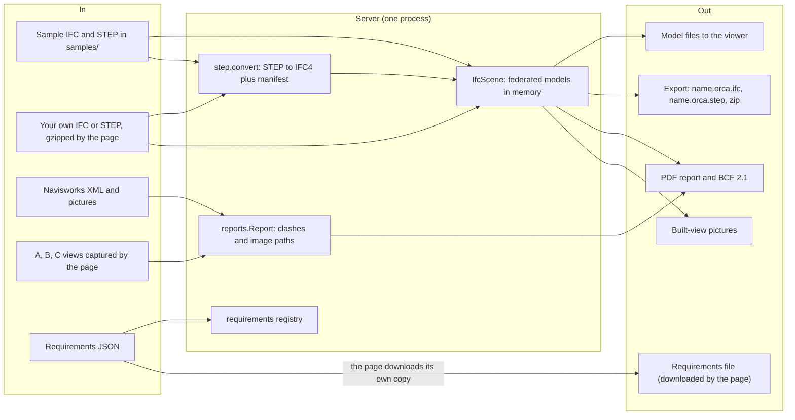
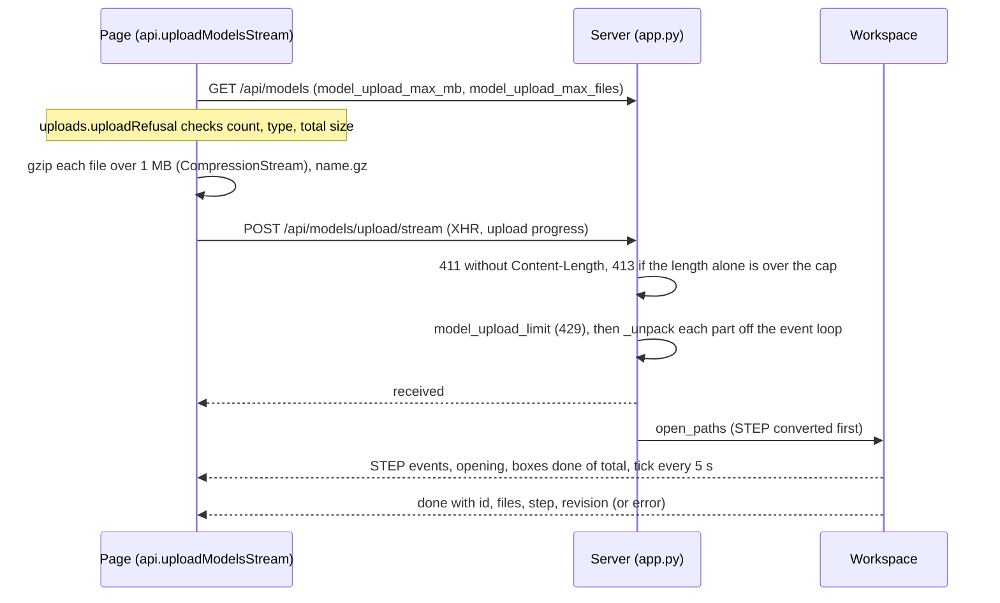
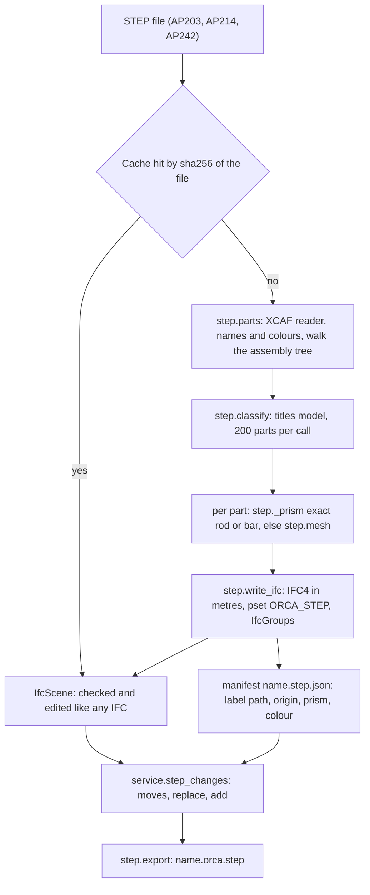
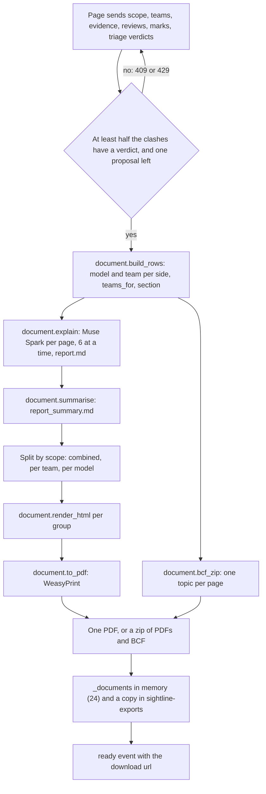

# 14 · Files in and out

> **Covers:** `server/sightline/scene.py` (opening IFC), `server/sightline/step.py`, `server/sightline/reports.py`,
> `server/sightline/document.py`, the file parts of `server/sightline/service.py` (`Workspace.open`, `open_paths`,
> `export`, `file`, `step_changes`, `open_report_sample`, `open_report_folder`, `save_capture`, `match`) and of
> `server/sightline/app.py` (`_receive_models`, `_unpack`, `upload_report`, `export`, `_build_document`,
> `_tidy_exports`), `server/sightline/built.py` (its cache), `web/src/uploads.ts`, `web/src/reqFile.ts` (the file
> side) · **Checked against code:** 2026-10-30 (`104fda9`) · **Deeper design:** [docs/step.md](../step.md),
> [docs/uploads.md](../uploads.md)

ORCA reads models (IFC, or STEP converted to IFC), clash reports (Navisworks XML with its pictures), pictures the
page takes of a clash, and a coordination requirements file. It writes edited models (IFC, and STEP back for a
model that came from STEP), a coordination report (PDF) with BCF issues, and built-view pictures. Everything lives
in memory or in temporary folders on the one server process, so this doc also says where each file lands on disk
and how long it stays. Routes are only named here; their full contract is in [10](10-http-api-and-streams.md).

## Every way in and out

## In: IFC models

- **Opening.** `IfcScene(paths)` opens every file with `ifcopenshell.open` and keeps them all in memory, edits
  included (`IfcScene.models`). One scene is one federation: Structure + MEP + Architecture (+ Site) that share
  coordinates. Nothing is moved to the origin, in the server or the viewer (`COORDINATE_TO_ORIGIN` is off, see
  [13](13-3d-viewer.md)). When a federation lies far from the origin, detection works in a shifted frame (see
  [06](06-geometry-and-detection.md)).
- **Units.** `IfcScene.unit_scales` holds each file's length unit in metres
  (`ifcopenshell.util.unit.calculate_unit_scale`). Everything the server measures, moves and checks is in metres;
  `IfcScene.placement` and `translate` convert per file. Exports are written in each file's own units.
- **Schemas.** IFC4 is the main case. IFC2X3 files open and are edited too: the edit code branches where the schema
  differs (`edits._see_through` wraps a style in `IfcPresentationStyleAssignment`; a provision for void is marked by
  `ObjectType` because IFC2X3 has no `PROVISIONFORVOID`; `edits._cut_opening` sets `PredefinedType` only on IFC4),
  class checks use `is_a`, so IFC2X3's `IfcWallStandardCase` counts as a wall (`agent.STAYS`), and `fixtures.py`
  builds IFC2X3 test models (`tests/test_penetration.py`). Other schemas IfcOpenShell reads will open; nothing tests
  them. STEP conversions are always written as IFC4.
- **What counts.** `IfcScene.products()` and `bounds()` take every `IfcElement` with a body that is physical
  (`scene.not_physical`: not an `IfcFeatureElement`, not virtual, not a provision for void). Boxes are measured once
  at open (`IfcScene.bounds`, in batches of `BOUNDS_BATCH`, meshes through CGAL; from `SIGHTLINE_BIG_MODEL_MB`
  every element goes through CGAL). See [06](06-geometry-and-detection.md) and [docs/uploads.md](../uploads.md).

### Sample models

- `GET /api/samples` lists every `*.ifc`, `*.step` and `*.stp` directly in `samples/` (`Workspace.list_samples`,
  `MODEL_SUFFIXES`). The folder is gitignored except `samples/README.md`; the Modal image copies it in at deploy.
- `POST /api/scenes` opens the named samples (`Workspace.open`). A name that resolves outside `samples/` is refused
  as not found. A STEP sample is converted first, with the triage model as classifier (`app._classifier`).
- The page picks its defaults from the list: every `…structure|mep|architecture|site.ifc` (App.tsx), and the
  palletising cell by `palletising-cell-reva.step` (`cellSample`). Where the demo files come from:
  [19](19-demo-data.md).

### Uploads

Your own models go up through Models › Upload models or the landing page's **Use your own models**. The page packs
them, the server refuses what is too big before reading it and unpacks in bounded steps, and the opening is
streamed so a big model never meets an idle timeout:

- **`app._receive_models`** reads the form (`max_files` is `MODEL_UPLOAD_MAX_FILES + 1`), takes 1 to 8 files,
  strips `.gz` from each name, refuses anything that is not `.ifc`, `.step` or `.stp` and any name given twice, takes
  one use of `model_upload_limit`, then writes each part into a new folder under `$TMP/sightline-models/`.
- **`app._unpack`** copies or gunzips one part, at most `UNPACK_STEP` (1 MiB) out of the decompressor per step,
  and counts the cap (`SIGHTLINE_MODEL_UPLOAD_MAX_MB`, all files together) on the unpacked bytes as it goes: a gzip
  bomb is refused (413) as soon as it passes the cap. An archive that ends early raises `zlib.error` and is refused
  (400), never kept as if whole. Any failure deletes the folder.
- **`POST /api/models/upload`** does the same and answers once with JSON; `/upload/stream` streams the opening
  (events in [10](10-http-api-and-streams.md)). Refusals before the files are in stay plain HTTP errors.
- **Drawn from the visitor's own file.** An uploaded IFC is parsed in the browser from the `File` the visitor chose
  (`uploads.localFile`); only a STEP comes back from the server, as its converted IFC.
- **A 409 `requirements_unknown`** (the server forgot the requirements id) re-registers and resends once
  (`reRegister` in `api.ts`).

## In: STEP models

`server/sightline/step.py` converts a STEP assembly to IFC when it opens, so it can be checked and edited like any
model, and writes the fixes back into the STEP on export. Design and measurements: [docs/step.md](../step.md).

- **Reading** (`step._read`, `step.parts`): `STEPCAFControl_Reader` with names and colours on; units from
  `xstep.cascade.unit` (mm when unset) become a scale to metres. Every leaf of the assembly tree is a `step.Part`
  in world position, with its name, group path (the assemblies above it), component label path, colour and alpha
  (inherited from its component when it has none). More than `SIGHTLINE_STEP_MAX_PARTS` (20,000) parts is a
  `StepError`.
- **Shapes.** `step._prism` recognises a single solid that is a plain cylinder (one cylindrical face, two flat caps
  on its axis, volume checked) or a box (six planes in three perpendicular pairs, volume checked) and writes it as an
  `IfcExtrudedAreaSolid` (`step._extrusion`) along its long axis, so moves, offsets, trims, routes and penetrations
  work on it. Everything else is meshed by `step.mesh` (`BRepMesh_IncrementalMesh`, at most 0.5 mm deflection,
  finer for small parts) into an `IfcTriangulatedFaceSet`; meshed parts can only move. Resize refuses any part from
  STEP (`edits._resizable`). More than `SIGHTLINE_STEP_MAX_TRIANGLES` (5 M) in total is a `StepError`.
- **Elements** (`step.write_ifc`, `step._element`): one IFC4 element per part, placed at its box minimum so a move
  is one placement edit, with its STEP name and a surface style for its colour and transparency. Each carries the
  pset `ORCA_STEP` (Group, Label, Source); `scene.step_source` also reads the old `Sightline_STEP` so older caches
  open. **GlobalIds** are `uuid5` of the file's sha256 and the label path, so the same STEP converts to the same ids.
- **Groups.** STEP sub-assemblies become `IfcGroup`s (ObjectType "STEP assembly"), not `IfcElementAssembly`:
  detection treats an assembly's parts as meant to meet. A part with no ports moves with the parts of its group that
  touch it (`IfcScene.step_run`).
- **Classes.** STEP carries none. `step.classify` asks the titles' model (`app._classifier`: the triage model) once
  per 200 parts, with `domain_packs/step_classes.md`, to pick one of `step.CLASSES` and a type. Without a model, or
  if the call fails (`classify_failed` event), every part stays an `IfcBuildingElementProxy` named for its group.
- **Cache.** `step.convert(cache=Workspace.step_cache)`: `samples/step-cache/` when that folder exists (the demo
  ships its conversions, so the first visitor after a restart does not wait), else `$TMP/sightline-models/step-cache/`.
  Files are `<sha256>.ifc` and `<sha256>.json`. Only a conversion whose classes were picked is cached.
- **Events** (to the upload stream): `reading`, `classifying` (parts), `classify_failed`, `meshing`, `converted`
  (`cached`, or parts and seconds).

## In: Navisworks clash reports

`server/sightline/reports.py` reads Navisworks XML clash reports
(`exchange/batchtest/clashtests/clashtest/clashresults/clashresult`) into a `reports.Report` of `ReportClash`es.
ORCA's own detection makes the same objects with `origin: "sightline"` ([06](06-geometry-and-detection.md));
Navisworks is the secondary path.

- **Two tag formats** (`reports._element`):
  - **grouped smart tags**, "`<node> / <category> / <property>`" (the three-view export of IssueLab's demo package):
    the clashed element is the first group with a non-spatial `Element / IfcClass`; its GlobalId from `Element /
    GlobalId` or `Element / IfcGUID`; a second element group becomes `part_of` (a port's owner); level from the
    package's own level tag or the storey group;
  - **the standard flat export**: "Item Name", "Item Type", any property whose name looks like a GlobalId or IFC GUID
    and whose value is 22 characters (`reports.GUID`), the selection-tree path (`pathlink/node`, the file first) and
    `layer` for the level.
- **XML is parsed with `defusedxml`**, so entity tricks in an uploaded file are refused.
- **Images** (`reports._images`): each result's `href`, relative to its XML and resolved only inside the report's
  folder. When it is one of `A-transparent.png`, `B-context.png`, `C-alternate.png` and all three sit together, all
  three are attached as A, B, C (`THREE_VIEW`); else the one picture as "Navisworks".
- **Ids, numbers, names** (`reports.load`): several XMLs read as one report; the same result exported twice (same
  test and guid, or ref and point) is kept once, preferring the copy with more images. Ids are `c0001…` and numbers
  `#N` run across the whole report; Navisworks' own "Clash39" is kept as `ref`. `reports.plain_name` names a clash
  "A × B" from its two elements (a port as "owner (port)") until Muse titles it. No results is a `ValueError`.
- **Sample reports leave tests out** (`service.SAMPLE_EXCLUDE`, env `SIGHTLINE_SAMPLE_EXCLUDE`, default
  `IfcGeographicElement,IfcSpace,IfcBuildingElementProxy`): a test whose name, or either side of any result, names
  one of these classes is dropped. Uploaded reports are kept whole.
- **Matching to the open model** (`Workspace.match`, `GET /api/reports/{rid}/match/{sid}`): each side by GlobalId,
  else by a unique IFC class + name, over every `IfcProduct` (spaces and ports too). `show` maps a port to the
  element that owns it, which is what the viewer can draw. `Workspace.measure` then measures the pair in the open
  model ([06](06-geometry-and-detection.md)).

### Report folders

- **Samples:** `samples/reports/<name>/` with at least one XML at its top level (`Workspace.list_report_samples`),
  opened by `POST /api/reports` (`open_report_sample`, only folders directly under `samples/reports/`).
- **Uploads:** `POST /api/reports/upload` takes a whole export folder (the page sends each file's
  `webkitRelativePath`). `app._safe_relpath` drops `..` and empty parts; only `.xml`, `.png`, `.jpg`, `.jpeg` are
  kept (`UPLOAD_TYPES`); at most `SIGHTLINE_UPLOAD_MAX_FILES` (5,000) files and `SIGHTLINE_UPLOAD_MAX_MB` (200) in
  all. Every XML at any depth is read (`open_report_folder`); the title is the top folder's name, else the first
  XML's stem. The folder is `temporary` and deleted when the report is dropped. There is no per-visitor cap on report
  uploads.

## In: clash views captured by the page

A clash ORCA detected has no Navisworks pictures, so the page draws them: `Viewer.captureClash` renders A, B and C
([13](13-3d-viewer.md)) and posts each to `POST /api/reports/{rid}/clashes/{cid}/images` (form: `label`, `image`).

- Only PNGs (checked by signature, 415 otherwise), at most `MAX_VIEW_BYTES` (4,000,000), label A, B or C, and only
  for reports with `origin: "sightline"` (`Workspace.save_capture`; 409 otherwise).
- Saved as `<run folder>/views/<clash id>-<label>.png`, joined to the clash's `images`, so the fix agent, triage and
  the PDF read them as they read Navisworks views. A rerun of detection copies a clash's views to the new run
  (`Workspace._carry`).
- Served back by `GET /api/reports/{rid}/clashes/{cid}/images/{index}`.

## In: the requirements file

An optional `orca-requirements/1` JSON file (at most 64 KB) of design level, strictness, groups, checks, who moves,
by-design pairs, penetration rules and guidance. The page keeps it in `localStorage` (`sightline.requirements`),
downloads it as `<name>.orca-requirements.json` and reads one back (`reqFile.parseUpload` checks the format and that
it has groups). The server validates and registers it (`requirements.parse`, `POST /api/requirements`). The format,
what it compiles into and how pages send it: [15](15-requirements-settings-and-config.md).

## Out: the model files the viewer loads

- `GET /api/scenes/{sid}/files/{index}` returns a file as it is now (`Workspace.file`): the original on disk when it
  has no kept edits, else the in-memory model written to `$TMP/sightline-exports/<sid>-<index>-<name>`. It is sent
  with `Cache-Control: no-store`, because after an accepted edit the same URL serves the edited model.
- Most accepted fixes no longer reload a file: the page patches its meshes in place from the apply reply
  (`Workspace.patch`), and reloads only when it missed a revision ([07](07-fixes-and-edits.md)).

## Out: IFC and STEP export

`GET /api/scenes/{sid}/export` (the header's **Export**, MCP `export_models`):

- **Only kept fixes count.** A file is marked edited only when a fix is kept: `IfcScene.mark_edited` from the
  `Workspace.apply*` methods (`apply`, `apply_offset`, `apply_trim`, `apply_route`, `apply_resize`,
  `apply_penetration`, `apply_combined`, which `plans.apply` and `/fix/apply` call), and a wider fix's commit
  (`context_eval.commit_candidate`). Trials move and move back without marking. With nothing kept the answer is
  **409** "Nothing has been changed yet. Accept a fix first."
- **Each edited discipline file once**, with every edit it holds (moves, offsets, trims, routes, resizes,
  penetrations, plans), as `<stem>.orca.ifc` (`IfcScene.write_edited`) in `$TMP/sightline-exports/<sid>/`.
  Untouched files are not rewritten.
- **A model that came from STEP** is also written back as `<step stem>.orca.step` (`Workspace.export` →
  `service.step_changes` → `step.export`):
  - **move:** a part whose extrusion still matches its manifest `prism` (only its start shifted), or a mesh; its
    component location becomes parent⁻¹ · T · parent · old, so nested assemblies keep their own placements;
  - **replace:** an exact part whose extrusion changed (an offset's first piece, a trimmed rail), rebuilt as an exact
    cylinder or box (`BRepPrimAPI_MakeCylinder` / `MakeBox`) in its component's frame; a part with openings (a host
    cut for a service) becomes a `cut` spec, its body less each void (`BRepAlgoAPI_Cut`; a boolean OCP cannot do
    leaves the STEP host whole while the IFC keeps the opening);
  - **add:** a new element carrying a part's `ORCA_STEP` Label (offset middles, risers, bends, a provision for void)
    becomes a new part in that part's group, with its name and colour (the provision for void in its see-through
    orange): an exact prism, or a sewn solid from its triangles;
  - shapes are placed with `BRepBuilderAPI_Transform` (`step._placed`), never `.Moved()`: a located shape loses its
    name and colour when the STEP is written.
- **One file or a zip.** One written file comes back as itself; several (two disciplines, or a STEP model's IFC and
  STEP) come back as one zip, `<sid>-sightline.zip`, made from the scene's export folder.
- MCP's stdio server writes the same files to a new `$TMP/orca-export-*` folder and returns their paths
  ([11](11-mcp-and-agent-links.md)).

## Out: the coordination report (PDF) and BCF

`server/sightline/document.py`, the header's **Report** (`web/src/ReportDoc.tsx`, [12](12-web-app.md)),
`POST /api/reports/{rid}/document/stream`, MCP `generate_report`.

- **What goes in.** The clash report and the verdicts the page shows (`triage` in the request, so the report
  survives a restart or a rerun of the shared triage; else the server's finished run). Fewer verdicts than half the
  clashes is 409 "Triage the report first". The session's `evidence` per clash (the fix accepted or proposed, its
  edit, clearance, `meets`, and `before_img` / `after_img` pictures the browser captured with `Viewer.capture`,
  plus `built_img` / `built_note`), `reviews` (team, name, decision, note, date: kept per report in the browser),
  `marks` (by design or for the author) and the user-confirmed `teams` per model file. Costs one proposal.
- **Team per model** (`document.guess_team`, `GET /api/reports/{rid}/teams`): a score per discipline from the
  model's IFC classes (`_class_team`: flow and distribution classes are MEP; beams, columns, footings, fasteners are
  Structure; doors, windows, curtain walls, coverings, spaces are Architecture; geographic and civil are Site); the
  file name only breaks ties. The dialog shows the guess for the user to confirm.
- **Who acts and who reviews** (`document.teams_for`): every team with an element in the clash reviews. The acting
  team is the one whose element the fix changed, else the discipline triage named (`responsible`), else one team when
  both sides are the same team, else the one later in `STAYS_FIRST` (Structure, Architecture, Site, MEP: structure
  stays, services move).
- **Sections** (`build_rows`): a clash with evidence, or a real clash, gets a **page**; a model error or "for the
  author" mark goes in the authors' table; everything else (by design, not physical, touching) is **noise**,
  grouped by test.
- **A page** (`document._page`): number, title, the test and Navisworks ref; both elements with model and team;
  distance (by whoever found it), level and grid; the triage reading; pictures (the first clash picture cropped by
  colour to where red A and green B meet, `_zone_crop`, the same reading as `clashImage.ts`; the model as it is; with
  the fix; and "As it could look built" when there is a built view, else "No built view: …"); Muse Spark's
  explanation, recommended action and review points, marked AI-drafted (or the triage reading when the call
  failed); the fix box ("verified by geometry", applied or proposed; "Opening requested" for an uncut penetration;
  "Recommended for the designer · not edited" under requirements that allow no edit); and the review table.
- **The DRAFT rule** (`render_html`): a page counts as reviewed when every reviewing team has at least one review on
  it. Only when every page is reviewed (and there is at least one page) does the cover say "REVIEWED · n of n";
  otherwise the cover's stamp says "DRAFT · AI-assisted · k of n reviewed" and every page's header "DRAFT · requires
  review".
- **Also in the PDF:** cover with counts and the clearance sentence (the requirements' fix clearance, else 25 mm);
  summary and actions by team (AI-drafted); the authors' table; noise by test; "How this report was made" (fixed
  text, which names Muse Spark Open as the triage model whichever model ran); and, under
  requirements, an appendix of the whole file (`requirements_html`) with "Requirements: name vN, label (id)" in the
  cover's facts.
- **HTML to PDF:** `document.to_pdf` renders with WeasyPrint (A4, DejaVu Sans). On Modal the image installs
  pango, harfbuzz and `fonts-dejavu-core` for it ([17](17-deployment-and-operations.md)).
- **BCF 2.1** (`document.bcf_zip`): `bcf.version`, then per page a topic folder with `markup.bcf` (TopicType "Clash",
  status Open, title = the clash label, priority from triage severity: high Critical, medium Major, low Minor, else
  Normal; Labels = the acting team then the reviewers; AssignedTo = the acting team; comments = the AI-drafted
  explanation, "Checked against coordination requirements …" when there are some, and each recorded review),
  `viewpoint.bcfv` (the pair selected and coloured, A `FFD0342C` red and B `FF1F9D3A` green, a perspective camera
  from `_bcf_camera` looking at where the two boxes meet, else at the clash point) and `snapshot.png` (the
  fix's true capture, else the cropped clash picture; none when there is neither).
- **Names and keeping.** A combined report without BCF is one `sightline-report.pdf`; otherwise a
  `sightline-report.zip` of `sightline-report[-<team or model>].pdf` files and `sightline-issues.bcfzip`.
  `_build_document` keeps the bytes in `_documents` (the 24 newest) for `GET /api/documents/{doc_id}` (404 "That
  report has expired. Build it again." after), and writes a copy to `$TMP/sightline-exports/<doc id>-<name>`.
  These download names, and the export zip's, still carry the internal name `sightline`; the files' contents say
  ORCA.

## Out: built-view pictures

Show it built ([09](09-agent-workflows.md), [docs/show-it-built.md](../show-it-built.md)) keeps each checked
picture in `built.CACHE` (`SIGHTLINE_BUILT_CACHE`, default `$TMP/sightline-built/`) as `<key>.jpg`,
`<key>-lines.png` and `<key>.json` (written last, the sign that all three are there; every file written whole by
`built._write`). The key is the first 32 hex characters of a sha256 of the look pass, the outline and the prompt
version. `GET /api/built/{name}` serves them (`built.path_of` takes only that name pattern), with
`Cache-Control: private, max-age=86400`. The PDF embeds a fix's picture from the cache as a data URL
(`document._built_img`); the BCF keeps the true capture.

## Where each file lands, and how long it lives

`$TMP` is `tempfile.gettempdir()` (`/tmp` on Modal). Nothing here survives a container restart except what is
under `samples/`, the settings store and a built cache placed outside `$TMP`.

| What | Where | Lives until |
|---|---|---|
| Sample models, sample reports, shipped STEP cache | `samples/`, `samples/reports/<name>/`, `samples/step-cache/` | Redeploy (part of the image) |
| Open scenes and every edit | Memory (`Workspace.scenes`, `IfcScene.models`) | Evicted by `SIGHTLINE_MAX_SCENES` or `SIGHTLINE_SCENE_BUDGET_MB` (oldest first, live agent links' last), or restart |
| Uploaded models (unpacked) | `$TMP/sightline-models/<tmp>/` | The scene is dropped, or the open fails |
| STEP conversions (sample or upload) | `<scene folder>/converted-<i>/<stem>.ifc` and `<stem>.step.json` | The scene is dropped |
| STEP cache when none is shipped | `$TMP/sightline-models/step-cache/<sha256>.ifc`, `.json` | Restart |
| Open reports | Memory (`Workspace.reports`) | Evicted by `SIGHTLINE_MAX_REPORTS` (0: never), or restart |
| Uploaded report folders | `$TMP/sightline-reports/<tmp>/` | The report is dropped |
| Detection runs and captured views | `$TMP/sightline-run-*/views/` | The report is dropped |
| Edited models served to the viewer | `$TMP/sightline-exports/<sid>-<index>-<name>` | An hour |
| Exports | `$TMP/sightline-exports/<sid>/`, `<sid>-sightline.zip` | An hour |
| PDF / BCF | Memory `_documents`, copy in `$TMP/sightline-exports/` | The 24 newest in memory; the copy an hour |
| Built-view pictures | `SIGHTLINE_BUILT_CACHE` (default `$TMP/sightline-built/`) | Never deleted by the server |
| Requirements | Memory registry (500 newest), the browser's `localStorage`, the visitor's downloaded file | Registry: restart or eviction (the page re-registers) |

- **"An hour"** is `EXPORTS_KEEP_S` (3,600 s): `app._tidy_exports` deletes anything in `sightline-exports` older
  than that, but it runs only when someone fetches a model file or an export, not on a timer.
- Dropping a scene deletes its own folder (`Workspace._roots`: the upload and its conversions); dropping a
  `temporary` report deletes its folder (`Workspace._keep`).

## When to update this doc

- A new input or output format, or a change to one listed here (a new schema branch, a new Navisworks tag format,
  a new STEP shape kind in `_prism`, a new BCF field, a new PDF section).
- A new or renamed temporary folder, cache, export name or retention rule (`EXPORTS_KEEP_S`, `_tidy_exports`,
  `built.CACHE`, `Workspace._evict` / `_keep`).
- A change to the upload path (`_receive_models`, `_unpack`, size or count caps, the page's packing in `api.ts`).
- A change to how teams, acting team, sections or the DRAFT rule are decided in `document.py`.
- A change to `service.step_changes` or `step.export` (what is moved, replaced or added).
