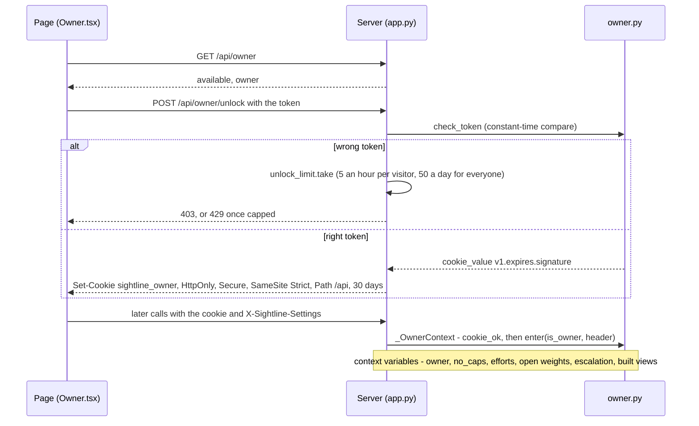
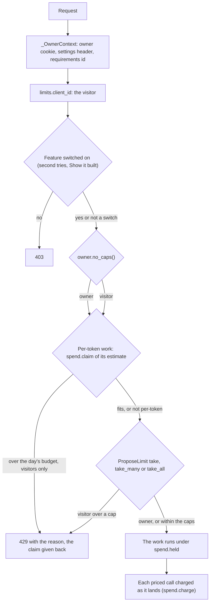

# 16 · Security, caps and cost controls

> **Covers:** `server/sightline/owner.py`, `server/sightline/limits.py`, `server/sightline/spend.py`, the token side
> of `server/sightline/agents.py`, the gates in `server/sightline/app.py` (`_OwnerContext`, `_take`,
> `escalation_refused`, `built_stream`, `_receive_models`, `_McpGate`, `mcp_hooks`), `voice_live.same_origin` and
> `voice_live.handshake`, `meta_client.load_env` and `PRICES`, the budget in `server/sightline/built.py`,
> `web/src/Owner.tsx` · **Checked against code:** 2026-10-30 (`104fda9`) · **Deeper design:**
> [docs/escalation.md](../escalation.md), [docs/show-it-built.md](../show-it-built.md), [docs/uploads.md](../uploads.md)

ORCA is a public demo that spends money on every model call, on one shared key, in one process. This doc is how it
keeps the keys on the server, tells visitors apart, trusts exactly one person (the owner) and agents holding a link
token, counts what each visitor may use, holds the day's spend on per-token models under a budget, and bounds the
memory, disk and time any one request can take. Environment variables are listed in full in
[15](15-requirements-settings-and-config.md); routes in [10](10-http-api-and-streams.md).

## Secrets

- **What they are.** `META_API_KEY` (Muse Spark, Muse Wonder, Muse Image, Muse Voice Transcribe), `TRIAGE_API_KEY`
  or `BASETEN_API_KEY` (the open-weights host), `SIGHTLINE_OWNER_TOKEN`, and the Modal CLI's
  `MODAL_TOKEN_ID` / `MODAL_TOKEN_SECRET` (read by the CLI, not by ORCA).
- **Where they live.** The real environment, or `.env` at the repo root, which is gitignored (`.gitignore`) and read
  by `meta_client.load_env` (real variables win; [15](15-requirements-settings-and-config.md)). On Modal they come
  from the `sightline-meta` secret ([17](17-deployment-and-operations.md)). The checked-in `.env.example` holds names
  only.
- **The rule** (CLAUDE.md, AGENTS.md): secrets and `.env` contents never enter git, chat or tool output.
- **Only the server calls Meta.** Every `Authorization` header to a model host is built on the server:
  `MetaChatModel._post` and its streaming variants, `meta_client.transcribe`, `built.restyle`, and the live voice
  handshake. The page talks only to ORCA's own origin. What the page can learn about keys is a boolean: whether
  second tries are available (`escalation_info.available`) and, for the owner, whether an open-weights host key is
  set (`host` in `GET /api/settings`).
- **Live voice keeps the key on the server.** Meta's realtime ASR reads the key from the first frame of the socket,
  so the browser cannot connect itself. `/api/voice/live` relays: `voice_live.handshake` builds that first frame
  (never logged, never sent to the browser), and a failure reaches the browser as "Couldn't reach Muse Voice
  Transcribe (ErrorType)", never the details, which could carry the frame. `/api/transcribe` failures say only the
  error type too (502).
- **The owner token is sent once** and never kept in the browser: the server answers with a cookie scripts cannot
  read (below).
- **Link tokens are shown once**; the server keeps only their sha256 (`agents._hash`).

## Who is asking

### Visitors

ORCA has no accounts. A visitor is an address: `limits.client_id(headers, peer)` returns the first entry of
`X-Forwarded-For` when `SIGHTLINE_TRUST_FORWARDED` is `1` (Modal sets it: its proxy sets the header), else the
socket's peer address, else "unknown". Everything per visitor (caps, a link's creator) keys on it. Visitors behind
one address share their caps; without the flag behind a proxy, every visitor would share one.

### Same origin

- **The live voice socket** checks it: `voice_live.same_origin` refuses an `Origin` whose host is not the request's
  `Host`, before accepting (close 1008), because another site's page could otherwise spend the Meta budget. A client
  that sends no `Origin` (not a browser) is let in and held to the same caps.
- **Everything else** relies on the browser's rules: there is no CORS middleware, so another site's scripts cannot
  read API responses, and the owner cookie is `SameSite=Strict` and scoped to `/api`, so a request from another site
  never carries the owner's rights.
- **`/mcp`** is gated by link token instead; its transport's DNS-rebinding check (meant for servers on localhost) is
  off (`app._mcp_transport`).

### The owner

The owner is whoever holds `SIGHTLINE_OWNER_TOKEN`. With no token, or one under 24 characters
(`owner.available`), nobody is the owner and `POST /api/owner/unlock` answers 404.

- **The cookie** is `v1.<expiry>.<HMAC-SHA256>` signed with a key derived from the token, so changing the token
  logs every browser out. `owner.cookie_ok` checks the version, the signature (constant time) and the expiry.
  `POST /api/owner/lock` deletes it.
- **Per request.** `_OwnerContext` (ASGI middleware, HTTP and WebSocket) reads the cookie and calls `owner.enter`;
  the `X-Sightline-Settings` header is read only when the cookie checks out
  ([15](15-requirements-settings-and-config.md)). `owner.spawn` and `owner.submit` carry the context into stream
  workers and model-call pools.
- **The page** shows the gear only once unlocked, or on a page opened with `#owner` (`Owner.tsx`). The owner's own
  settings are kept in `localStorage` (`sightline.owner`); the token is not.
- **Later:** GitHub sign-in would replace `cookie_ok` with "signed in as an allowed login"; the rest stays.

What the owner gets that visitors do not:

| | Owner | Where |
|---|---|---|
| Read and change settings for everyone | Yes; visitors get 403 | `GET` / `PUT /api/settings` |
| Their own effort, open weights, second tries, Show it built | Yes, per request | `owner.settings`, `owner.enter` |
| Demo caps | Skipped, unless the owner sends `no_caps: false` | `app._take`, plan and wider-fix streams, chat's closures |
| Muse Wonder day budget | Never refused (still counted) | `spend.claim(exempt=True)` in `escalation_refused`, `built_stream` |
| Agent links they make | Proposals and second tries not capped (`Link.owner`) | `mcp_hooks.charge`, `escalate` |
| MCP tool-call cap on their links | **Still applies** (`agent_call_limit.take(link.id)`) | `mcp_hooks` `allow_call` |
| Settings switched off (second tries off, Show it built off) | Still off unless their own setting turns it on | `settings.escalation`, `settings.built_views` |

### Agent link tokens

"Connect an agent" makes a link ([11](11-mcp-and-agent-links.md), [docs/mcp.md](../mcp.md)):

- **The token** is `orca_` + `secrets.token_urlsafe(32)`, returned once by `POST /api/links`; only its sha256 is
  kept (`Links._links`). It is a capability: whoever holds it can act on that visitor's session until it expires or
  is revoked (`DELETE /api/links/{token}`).
- **Lifetime.** 12 hours after its last use (`TTL`), never more than 24 hours after it was made (`MAX_AGE`). Use
  renews it: a context PUT, each connection of the events stream, a capture post, and every MCP call.
  `GET /api/links/{token}` and the page's leave beacon do not. At most 200 links (`MAX_LINKS`, oldest dropped). They
  live in memory: a restart ends them.
- **`_McpGate`** answers 401 with `WWW-Authenticate: Bearer realm="orca"` unless the request carries a live token,
  as `Authorization: Bearer …` or `?key=…` (moved into the header for the tools to read).
- **Who pays.** A link's proposals and second tries are charged to the visitor who made it (`link.visitor`), never
  when the owner made it; each tool call takes one use of `SIGHTLINE_AGENT_CALLS_PER_HOUR` for that link. Making a
  link takes one use of `SIGHTLINE_LINKS_PER_HOUR` / `_PER_DAY`.
- **The stdio server** (`python -m sightline.mcp_server`, `mcp_server.main`) runs as a local link marked owner,
  with the web server's hooks: no proposal caps, and a second try only counted against the budget, still refused
  when second tries are switched off (`escalation_refused` with the owner's exemption; `mcp_server._local_escalate`
  does the same for a server built without hooks). The tool-call cap would apply to it under the id `local` if
  `SIGHTLINE_AGENT_CALLS_PER_HOUR` were set.

## Caps

`limits.ProposeLimit(per_client_hour, per_day, noun)` keeps timestamps in memory: one deque per visitor over a
rolling hour, and one for everyone over a rolling 24 hours (`time.monotonic`). 0 turns either off, and every cap
but three is 0 unless the environment (or the repo's `.env`) sets it; unset and empty are the same
(`limits.env_int`), so an empty cap takes its default. The Modal deploy sets the demo's values. Refused requests are
not counted. The state is per process, which is why the deploy pins one container
([17](17-deployment-and-operations.md)).

- `take(client)` counts one, or returns why not.
- `take_many(client, n)` counts `n` at once or none: a plan of several fixes is refused whole, not half-run.
- `take_all(client, *limits)` takes one of each or none (a second try is one escalation and one proposal).
- `refusal(client)` says why one more would be refused, counting nothing.

| Cap | Env (per visitor per hour / everyone per day) | Default | Modal | What takes it, and how many |
|---|---|---|---|---|
| Proposals | `SIGHTLINE_PROPOSE_PER_HOUR` / `SIGHTLINE_PROPOSE_PER_DAY` | 0 / 0 | 20 / 300 | 1 per proposal (`/propose`, `/propose/stream`, chat and MCP `propose_fixes`); a plan `take_many` one per clash pair (the plan stream counts at most `plans.MAX_ITEMS`, 8); a root cause 1 for the cause, then one per fix only if it needs edits; a wider fix 3 (`take_many`); 1 to start a report's triage (following a run, or carrying readings to new rules, is free); 1 for a pattern reading (once per report, scene, set of patterns and triage prompt); 1 for a requirements draft; 1 for a PDF report |
| Second tries | `SIGHTLINE_ESCALATE_PER_HOUR` / `SIGHTLINE_ESCALATE_PER_DAY` | 0 / 0 | 3 / 30 | 1 per second try on Muse Wonder, with 1 proposal (`take_all`), after the budget claim |
| Chat messages | `SIGHTLINE_CHAT_PER_HOUR` / `SIGHTLINE_CHAT_PER_DAY` | 0 / 0 | 40 / 1500 | 1 per message; its tool calls charge their own proposals |
| Built views | `SIGHTLINE_BUILT_PER_HOUR` / `SIGHTLINE_BUILT_PER_DAY` | 0 / 0 | 6 / 60 | 1 per Show it built request that is neither cached nor being drawn already |
| Titling runs | `SIGHTLINE_TITLES_PER_HOUR` / `SIGHTLINE_TITLES_PER_DAY` | 0 / 0 | off | 1 per titling run started (one shared run per report) |
| Detection runs | `SIGHTLINE_DETECT_PER_HOUR` / `SIGHTLINE_DETECT_PER_DAY` | 0 / 0 | off | 1 per `/detect/stream` (chat and MCP detection take only their message or tool call) |
| Voice | `SIGHTLINE_VOICE_PER_HOUR` / `SIGHTLINE_VOICE_PER_DAY` | 0 / 0 | 60 / 2000 | 1 per clip (`/api/transcribe`) or live session, hands-free included |
| Model uploads | `SIGHTLINE_MODEL_UPLOADS_PER_HOUR` / `SIGHTLINE_MODEL_UPLOADS_PER_DAY` | 0 / 0 | 10 / 200 | 1 per upload, after the size and type checks |
| Requirements files | `SIGHTLINE_REQUIREMENTS_PER_HOUR` / `SIGHTLINE_REQUIREMENTS_PER_DAY` | **120** / 0 | default | 1 per file the server does not know yet |
| Requirement previews | `SIGHTLINE_PREVIEW_PER_HOUR` / `SIGHTLINE_PREVIEW_PER_DAY` | **60** / 0 | default | 1 per preview not already cached |
| Agent links | `SIGHTLINE_LINKS_PER_HOUR` / `SIGHTLINE_LINKS_PER_DAY` | 0 / 0 | 10 / 500 | 1 per link made |
| Agent calls | `SIGHTLINE_AGENT_CALLS_PER_HOUR` (no daily) | 0 | 600 | 1 per MCP tool call, keyed by link id |
| Unlock attempts | fixed in `app.unlock_limit` | 5 / 50 | 5 / 50 | 1 per wrong owner token |

### What a refusal looks like

| Where | Reply |
|---|---|
| REST routes and stream starts | HTTP 429 with the words as `detail`, before any work starts |
| Per-day cap | "The demo has used today's {noun}. Try again tomorrow, or run ORCA locally with your own key." (`take_many`: "The demo has too few {noun} left today for n more. Try fewer, or run ORCA locally.") |
| Per-hour cap | "You've used n {noun} this hour. Try again later." (`take_many`: "That needs n {noun}; you have k left this hour. Pick fewer clashes or try later.") |
| A root cause's fixes | The plan comes back with each item's `error` set to the refusal and no fixes run (`plans.build_root_cause`) |
| Chat tools | The tool result `{"error": …}`, so Muse Spark tells the visitor ("refused: allowance used") |
| MCP tools | A `ToolError` with the same words |
| Live voice | An `error` event with the words, then the socket closes |
| Muse Wonder budget | 429 "Today's budget for Muse Wonder ($25) is used up; it resets at midnight UTC. Muse Spark's own proposals still work." |
| Second tries switched off | 403 "Second tries with Muse Wonder are switched off." (409 first when the requirements allow no edit: there is nothing to try) |

## Cost

### The gate a paid request passes

Plain proposals, chat and triage on Muse Spark skip the budget box: only Muse Wonder and Muse Image are priced.
The order (switch, budget, caps) is the one `escalation_refused` and `built_stream` use; routes without a
per-token model only take their cap.

### The Muse Wonder day budget (`spend.py`)

- **What is priced.** `meta_client.PRICES`: any `muse-wonder…` model at $4 per million input tokens and $20 per
  million output tokens (reasoning counts as output). Muse Spark's contributor tier and the open-weights host are
  not priced here. Muse Image is charged a flat $0.01 a picture (`built.IMAGE_USD`, in `built.restyle`).
- **Charging.** `MetaChatModel` counts every call's usage (`Usage`, both endpoints' shapes, however a stream ended)
  and passes its cost to `on_cost`, which is `spend.charge` for second tries (`meta_client.escalation_model`) and
  Show it built's judges (`built.judge_model`).
- **The limit.** `SIGHTLINE_WONDER_MAX_USD_DAY` (25; 0 is no limit), for all visitors, per UTC calendar day, in
  memory: a restart starts the day's count again. Work is refused when today's spend plus what running work still
  holds plus its own estimate would pass the limit (`spend._refusal`).
- **Claim, then hold.** `spend.claim(estimate)` checks and holds in one step under the lock, so two requests on a
  nearly spent day cannot both pass. The work then takes the claim over with `spend.held(estimate)` and releases it
  when it ends; a request a cap refuses after its claim gives it back with `spend.unclaim`. Estimates:
  `escalation.ESTIMATE_USD` $1.00 a second try; `built.ESTIMATE_USD` $0.62 a built view (four pictures, eight Muse
  Wonder judgements at most); `built.PICTURES_USD` $0.04 for the pictures alone.
- **The owner** is never refused (`exempt`) but is still counted.

### Show it built's budget

Off unless switched on (`SIGHTLINE_BUILT_VIEWS` 0 and the `built_views` setting; 403 when off). In `built_stream`:
a cached picture, or one being drawn for the same view, costs nothing. Otherwise, when the day's budget can still
cover $0.62, the request claims it and Muse Wonder judges the pictures; when it cannot, the request claims only the
pictures' $0.04 and three Muse Spark judges check them instead (`built.SPARK_JUDGES`, named in the result's `judge`).
A picture checked the lighter way is drawn and checked again by Muse Wonder when the budget allows. Then the built
cap is taken. Design: [docs/show-it-built.md](../show-it-built.md).

### Open weights are off by default

Muse Spark Open runs on Baseten, which bills per hour while the model is deployed, not per call. So
`SIGHTLINE_OPEN_WEIGHTS` defaults to off and the setting is null: titles, triage, STEP classes and host readings
run on Muse Spark until the owner switches the open-weights model on, for themselves or for everyone
([15](15-requirements-settings-and-config.md)).

### Everything else

Muse Spark calls (proposals, chat, plans, reports, drafts, triage and titles on Muse Spark) are bounded by count,
through the caps above, not by money. Voice is bounded by its cap and the clip and session limits below.

## Resource limits

| What | Limit | Where |
|---|---|---|
| Model upload | `SIGHTLINE_MODEL_UPLOAD_MAX_MB` for all files, unpacked; 1 to 8 files; `.ifc`, `.step`, `.stp` (each may be `.gz`) | `app._receive_models`: 411 without Content-Length, 413 when the length alone is over, 413 as soon as unpacking passes the cap (`_unpack`, 1 MiB per gunzip step), 400 for a truncated archive |
| Report upload | `SIGHTLINE_UPLOAD_MAX_MB` (200), `SIGHTLINE_UPLOAD_MAX_FILES` (5,000); only `.xml`, `.png`, `.jpg`, `.jpeg` kept | `app.upload_report` (no per-visitor cap) |
| Open scenes | `SIGHTLINE_MAX_SCENES` and `SIGHTLINE_SCENE_BUDGET_MB` (IFC bytes) | `Workspace._evict`: room is made before a new scene is read; the oldest go first, those a live agent link points at last (`Links.kept`), never the one just opened; the scene's folder is deleted |
| Open reports | `SIGHTLINE_MAX_REPORTS` | `Workspace._keep`, the same order; a temporary report's folder is deleted |
| Wider fixes | `SIGHTLINE_WIDER_FIX_MAX_MB` (100) | `context_planner.validate_objective`: 413 before anything is charged |
| Wider-fix search | `SIGHTLINE_CONTEXT_*` ceilings: 6 model calls, 12 trials, 120 s, 3 alternatives, 2.5 m | `context_planner.Limits` |
| STEP | `SIGHTLINE_STEP_MAX_PARTS` (20,000), `SIGHTLINE_STEP_MAX_TRIANGLES` (5 M) | `step.parts`, `step.write_ifc`: 400 with the reason |
| Voice clip | 3,000,000 bytes; mono 16-bit WAV at 16 or 24 kHz | `app.transcribe_voice`: 413, 422 |
| Live voice | First frame within 10 s; audio frames at most 32,768 bytes and even; sent at most 1.5 s ahead of real time; 60 s hold to talk, `SIGHTLINE_VOICE_LIVE_MAX_S` (120) hands-free | `app.voice_live_socket`, `voice_live._to_meta` |
| Chat | 8 model calls per message (`chat.MAX_STEPS`); a message cut to 4,000 characters; 40 messages kept per session, 200 sessions | `chat.py`, `app.chat_turn` |
| Plans | 8 pairs (`plans.MAX_ITEMS`) | `plans.py` |
| Pictures in | Captured clash views 4 MB, PNG only; link captures 6 MB; built passes 12,000,000 characters each, square, 256 to 2,048 px | `app.save_view`, `app.link_capture`, `app.BuiltBody`, `built._decode` |
| Requirements | 64 KB a file, 500 kept | `requirements.MAX_BYTES`, `REGISTRY_MAX` |
| Streams | 64 unread events per request; progress dropped first | `app._RequestEvents` ([10](10-http-api-and-streams.md)) |
| Kept in memory | 16 triage jobs, 32 title jobs, 24 documents, 64 previews, 200 last tries, 200 links, 16 jobs per link | `app.py`, `service.LAST_KEPT`, `agents.py` |

### Other protections

- **Paths.** `Workspace.open` and `open_report_sample` refuse a name that resolves outside `samples/` (or
  `samples/reports/`); `app._safe_relpath` drops `..` from uploaded folder paths; `reports._images` only follows an
  image link inside the report's own folder; `built.path_of` serves only names of its own pattern; document and
  scene ids are random.
- **Uploaded XML** is parsed with `defusedxml`.
- **Captured views** must start with the PNG signature (415 otherwise).

## When to update this doc

- A new cap, a changed default or Modal value, or a new place that takes one (and the cap env vars in
  [15](15-requirements-settings-and-config.md)).
- A new per-token model or price in `meta_client.PRICES`, a new estimate, or a change to `spend.claim` / `held`.
- A change to the owner: token rules, the cookie (name, flags, signature), what the owner skips.
- A change to link tokens (format, lifetime, what renews them, `_McpGate`).
- A new secret, a new place that builds an `Authorization` header, or a change to the voice relay's handshake.
- A new upload or input size limit, eviction rule or in-memory bound.
