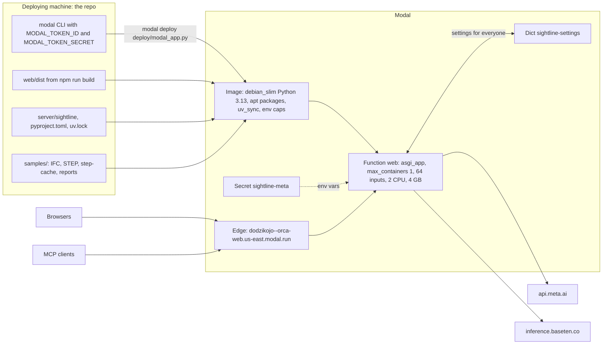
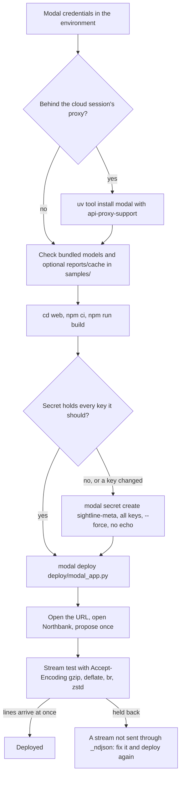

# 17 · Deployment and operations

> **Covers:** `deploy/modal_app.py`, `server/sightline/app.py` (static files, streams, exports), `server/sightline/meta_client.py`
> (`load_env`), `server/sightline/settings.py` (the Modal Dict), `server/sightline/service.py` (eviction),
> `.env.example`, `README.md` ("Run locally", "Deploy"), `samples/README.md`, `web/vite.config.ts`,
> `web/scripts/copy-wasm.mjs` · **Checked against code:** 2026-10-31 (local setup and samples; deploy code at `104fda9`) ·
> **Deeper design:** [docs/uploads.md](../uploads.md) (memory on Modal), [docs/mcp.md](../mcp.md) ("On Modal"),
> [docs/voice.md](../voice.md) (the socket on Modal)

ORCA's public demo runs on Modal as one container that serves the built web app and the API from one origin. This doc
says exactly what `deploy/modal_app.py` builds and why, how to deploy and check a deploy, how to run ORCA locally, and
how the running server behaves: what its streams need from Modal's edge, what a restart loses, and how memory and disk
are kept in bounds. Env vars are listed in full in [15](15-requirements-settings-and-config.md); caps and budgets in
[16](16-security-caps-and-cost.md).

## Deployment topology



## `deploy/modal_app.py` in detail

### The image

| Step | What | Why |
|---|---|---|
| `modal.Image.debian_slim(python_version="3.13")` | the base | the server needs Python 3.13 (`requires-python = ">=3.13"`) |
| `.apt_install("libpango-1.0-0", "libpangoft2-1.0-0", "libharfbuzz0b", "libharfbuzz-subset0", "fonts-dejavu-core", …)` | Pango, HarfBuzz and a font | WeasyPrint lays out and renders the PDF report with them (`document.py`) |
| `… "libgl1")` | the GL library | OpenCASCADE's Python bindings (`cadquery-ocp`, used by `step.py` for STEP models) link libGL and X11 |
| `.uv_sync(str(ROOT / "server"))` | the server's Python dependencies | from `server/pyproject.toml` and `server/uv.lock` ([02](02-system-architecture.md#technology-stack)) |
| `.env({...})` | the demo's caps and limits | the next table |
| `.add_local_dir(ROOT / "server" / "sightline", "/app/server/sightline", ignore=["__pycache__"])` | the server package | its prompts (`domain_packs/*.md`) come with it |
| `.add_local_dir(ROOT / "web" / "dist", "/app/web/dist")` | the built web app | build it first; it includes `public/` (web-ifc's `wasm/`, the tour's recorded runs, the demo pictures) |
| `.add_local_dir(ROOT / "samples", "/app/samples", ignore=…)` | only `.ifc`, `.step`, `.stp`, `.json`, `.xml`, `.png`, `.jpg`, `.jpeg` | the demo models, sample Navisworks reports with their images, and `samples/step-cache` (a converted STEP's IFC and manifest, so the first visitor after a restart does not wait for the part classes) |

The repo root's `.env` is never added to the image: in the container, settings come from the image's env and the
secret. `load_env()` finds no `/app/.env` and does nothing.

### Environment set in the image

| Variable | Value | Meaning |
|---|---|---|
| `SIGHTLINE_PROPOSE_PER_HOUR` | 20 | proposals per visitor per hour (a plan costs one per pair) |
| `SIGHTLINE_PROPOSE_PER_DAY` | 300 | proposals for everyone per day |
| `SIGHTLINE_TRUST_FORWARDED` | 0 | Modal's edge strips a client's `X-Forwarded-For` and sets none; the peer is the visitor (`limits.client_id`; measured Oct 30, [16](16-security-caps-and-cost.md)) |
| `SIGHTLINE_MAX_SCENES` | 8 | open model sets kept in memory |
| `SIGHTLINE_MAX_REPORTS` | 8 | open clash reports (an uploaded one's folder is deleted when it is dropped) |
| `SIGHTLINE_UPLOAD_MAX_MB` | 150 | a Navisworks report upload, all files |
| `SIGHTLINE_ESCALATE_PER_HOUR` / `_PER_DAY` | 3 / 30 | second tries on Muse Wonder (each also one proposal) |
| `SIGHTLINE_WONDER_MAX_USD_DAY` | 25 | what Muse Wonder may cost in a day, all visitors (`spend.py`) |
| `SIGHTLINE_BUILT_VIEWS` | 0 | Show it built off unless the owner switches it on |
| `SIGHTLINE_BUILT_PER_HOUR` / `_PER_DAY` | 6 / 60 | built views |
| `SIGHTLINE_CHAT_PER_HOUR` / `_PER_DAY` | 40 / 1500 | chat messages |
| `SIGHTLINE_VOICE_PER_HOUR` / `_PER_DAY` | 60 / 2000 | voice messages (a live session is one) |
| `SIGHTLINE_MODEL_UPLOAD_MAX_MB` | 150 | a visitor's own models, all files, unpacked ([docs/uploads.md](../uploads.md): opens through the page in about two minutes) |
| `SIGHTLINE_SCENE_BUDGET_MB` | 300 | open models' IFC bytes held: two of the biggest uploads, about 2.5 GB, inside the 4 GB container |
| `SIGHTLINE_MODEL_UPLOADS_PER_HOUR` / `_PER_DAY` | 10 / 200 | model uploads |
| `SIGHTLINE_LINKS_PER_HOUR` / `_PER_DAY` | 10 / 500 | agent links made |
| `SIGHTLINE_AGENT_CALLS_PER_HOUR` | 600 | MCP tool calls per link (fixes are also charged as proposals) |
| `SIGHTLINE_OPEN_WEIGHTS` | 0 | titles and triage on Muse Spark unless the owner switches the open-weights model on |

Not set, so the code's defaults apply on Modal: no cap on detection runs (page, chat or MCP) or titling runs
(`SIGHTLINE_DETECT_PER_HOUR`, `SIGHTLINE_TITLES_PER_HOUR` default 0), 120 requirements files and 60 previews per visitor per hour,
`SIGHTLINE_ESCALATION` `button`, `SIGHTLINE_TRIAGE_WORKERS` 8, the default models and efforts. A changed value takes
effect only in a new container, so it means a redeploy; the settings for everyone ([15](15-requirements-settings-and-config.md))
change live from the owner menu instead.

### The secret

`secrets=[modal.Secret.from_name("sightline-meta")]` puts the secret's keys into the container's environment. By name
only (values never go in git, chat, logs or tool output):

| Key | For |
|---|---|
| `META_API_KEY` | every call to Meta's API: Muse Spark, Muse Wonder, Muse Image, Muse Voice Transcribe |
| `TRIAGE_API_KEY` | Muse Spark Open on Baseten (the command below fills it from `BASETEN_API_KEY`) |
| `SIGHTLINE_OWNER_TOKEN` | the owner's unlock (at least 24 characters; [16](16-security-caps-and-cost.md)) |

The Modal internal names (`sightline-meta`, `sightline-settings`) keep ORCA's earlier name on purpose: renaming them
would break the deployed configuration ([21](21-glossary-and-naming.md)).

### The Dict

`settings._modal_dict()` opens `modal.Dict.from_name("sightline-settings", create_if_missing=True)` whenever
`MODAL_TASK_ID` is set (Modal sets it in its containers), so the deploy script does not create it: first use does. The
settings for everyone live under the key `settings`; they are read once per process (`settings.current`) and written on
`PUT /api/settings`. A store that cannot be read or written is logged (`log.warning`) and the value in memory is used. The
Dict survives restarts and redeploys; nothing else the server holds does.

### The container

| Setting | Value | Why |
|---|---|---|
| `max_containers=1` | one container, always | open scenes and their edits, reports, links, caps and the day's spend live in that process's memory; the docstring: "A second container would answer 'Model not loaded' to half the requests." |
| `@modal.concurrent(max_inputs=64)` | up to 64 requests at once | every page following an agent link holds an events stream, besides the NDJSON streams of proposals, triage and the rest |
| `cpu=2`, `memory=4096` | 2 CPUs, 4 GB | the scene budget above is sized to fit ([docs/uploads.md](../uploads.md)) |
| `timeout=10 * 60` | 10 minutes per request | a proposal with retries can take a few minutes; it is also why the link events stream ends after 240 s and `/mcp` answers one JSON reply per call |
| `scaledown_window=20 * 60` | 20 minutes | how long the container waits idle before Modal stops it; then everything in memory is gone (below) |

There is no `min_containers`: the first request after a scale-down starts a fresh container, with no models open.

### The entry point

```python
# abridged from deploy/modal_app.py
@app.function(image=image, secrets=[...], cpu=2, memory=4096, max_containers=1, scaledown_window=20 * 60, timeout=10 * 60)
@modal.concurrent(max_inputs=64)
@modal.asgi_app()
def web():
    sys.path.insert(0, "/app/server")
    from sightline.app import app as fastapi_app
    return fastapi_app
```

Importing `sightline.app` does the whole start-up: `load_env()` (in the package's `__init__.py`), the one `Workspace`,
the caps, the links, the MCP server (its session manager starts in the app's lifespan, `_lifespan`), and the static
mount of `/app/web/dist` at `/` (because `WEB_DIST`, `parents[2] / "web" / "dist"`, has an `index.html`). `SAMPLES`
resolves to `/app/samples` the same way. The app is `modal.App("orca")` and the function `web`, hence the URL
`https://dodzikojo--orca-web.us-east.modal.run`.

## How to deploy



1. **Credentials.** `MODAL_TOKEN_ID` and `MODAL_TOKEN_SECRET` come from the environment, never chat. Behind the cloud
   session's proxy the Modal CLI needs `uv tool install 'modal[api-proxy-support]'`.
2. **Samples** ([samples/README.md](../../samples/README.md)):
   - six Northbank IFCs and the cell's `PC-03-Palletising-Cell-RevA.step` and `-RevB.step` are bundled under MIT;
     no private-repository access is needed for the two demo cards;
   - optional `samples/step-cache/` stays gitignored (create the directory and open each STEP once with a model key
     and the server running locally to fill it);
   - optional Navisworks reports in `samples/reports/<name>/` stay gitignored (XML at the top, with linked images).
3. **Build the web app:** `cd web && npm ci && npm run build && cd ..`. `npm ci` runs `postinstall`
   (`scripts/copy-wasm.mjs`: web-ifc's `.wasm` into `public/wasm/`, which is gitignored and shipped in `dist`);
   `npm run build` is `tsc --noEmit && vite build`.
4. **The secret, once** (and again whenever a key changes):

   ```bash
   modal secret create sightline-meta META_API_KEY="$META_API_KEY" TRIAGE_API_KEY="$BASETEN_API_KEY" --force   # no echo
   ```

   The values come from the shell's environment; never type, print or paste them. `--force` overwrites the existing
   secret, so one command must name every key it should hold: with an owner token, add
   `SIGHTLINE_OWNER_TOKEN="$SIGHTLINE_OWNER_TOKEN"` to the same command.
5. **Deploy:** `modal deploy deploy/modal_app.py`.

Before delivering a change, run the checks in [18](18-testing-and-evals.md) (server tests, `npm run build`, `npm test`,
runtime checks), as `AGENTS.md` asks.

### After a deploy

- **Open the URL.** The landing page loads (the static mount works) and the demo cards show.
- **Open the Northbank demo.** Four models open and the check runs; the list appears (464 clashes on the default
  tests, measured Oct 28: [22](22-build-log.md)).
- **Propose once** on #1, the duct through the girder: a verified offset through the web opening (about 40 s into the
  proposal, measured Oct 28).
- **Test a stream as a browser asks for it**, because Modal's edge only misbehaves for browsers' `Accept-Encoding`.
  Detection makes no model call and has no cap on Modal:

  ```bash
  URL=https://dodzikojo--orca-web.us-east.modal.run
  SID=$(curl -s -X POST "$URL/api/scenes" -H 'Content-Type: application/json' \
    -d '{"samples": ["Northbank-Structure.ifc", "Northbank-MEP.ifc", "Northbank-Architecture.ifc"]}' \
    | python3 -c 'import json, sys; print(json.load(sys.stdin)["id"])')
  curl -sN -D - -X POST "$URL/api/scenes/$SID/detect/stream" -H 'Content-Type: application/json' \
    -H 'Accept-Encoding: gzip, deflate, br, zstd' -d '{}'
  ```

  Expect `content-encoding: identity` in the headers and the `phase` and `test` lines as they happen, not all at the
  end.
- **Owner.** Open the site with `#owner`, unlock, and check that **For everyone** reads back what was saved (the Dict).

## Running locally

Follow [README: Run locally](../../README.md#run-locally), the canonical setup path. It specifies Git, uv-managed
Python 3.13, Node 22.12+ or 24 LTS with npm, `uv sync --project server --locked --python 3.13`, `npm ci --prefix web`,
safe root `.env` creation for PowerShell/bash, two terminals with explicit working directories, API/browser URLs,
and a key-free fixture walkthrough. Eight MIT demo models are bundled; private eval inputs and STEP caches are not.
The README also lists native Linux GL and cross-platform PDF libraries, AI credential requirements, troubleshooting,
and the outstanding API-access link and clean-install verification. No new runtime scripts or settings are introduced.

- **`.env` loading.** `meta_client.load_env()` reads `KEY=value` lines from the repo root's `.env` (`ENV_FILE`) into
  the environment with `os.environ.setdefault`, so real environment variables win. Lines starting with `#` are skipped;
  values are taken as they are (no quotes, no inline comments). It runs on the first import of any `sightline` module
  (the package's `__init__.py`), before any module reads a setting, so every setting can be set there, including those
  read at import (`SIGHTLINE_MAX_SCENES`, `SIGHTLINE_STEP_MAX_PARTS`, …); it runs again wherever a key is read late
  (`MetaChatModel`, `transcribe`, `triage_model_info`, `escalation_model`, `voice_live`, `built`). Restart the server
  after changing `.env`.
- **Caps are off locally** unless set: the caps read `limits.env_int(…, 0)`, where unset, empty
  (`SIGHTLINE_PROPOSE_PER_HOUR=`) and 0 all mean no limit, except requirements files (120 an hour) and previews (60 an
  hour), which take their own defaults when unset or empty; only 0 turns those two off.
- **Settings for everyone** are kept in `server/.sightline-settings.json` (gitignored; `SIGHTLINE_SETTINGS_FILE`
  moves it) when not on Modal.
- **The dev server** (`npm run dev`, port 5173) proxies `/api` to `localhost:8000` with `ws: true` (live voice) and keeps
  the `Host` header, so the voice socket's same-origin check passes (`web/vite.config.ts`).
- **One origin, like Modal:** `npm run build`, then uvicorn serves `web/dist` at `/` (or the folder in
  `SIGHTLINE_WEB_DIST`). The mount is decided when `app.py` is imported, so restart the server after the first build.
- **MCP in dev.** Vite proxies only `/api`, and a link's `mcp_url` is built from the request's `Host`, so a page on
  port 5173 shows a 5173 URL whose `/mcp` Vite does not forward: point the agent at `http://localhost:8000/mcp`, or use
  the built app on 8000. (Read from the code, not run here.) The stdio server, `cd server && uv run python -m
  sightline.mcp_server`, is a separate process with its own `Workspace`: it does not see a running web server's scenes.
- **Without keys**, opening, detection, measuring and **Check this move** work; anything that asks a model fails,
  because `MetaChatModel` reads `META_API_KEY` from the environment when it is made.

## Operational behaviour

### Streams and Modal's edge

Modal's edge zstd-compresses responses for browsers that accept it and held NDJSON streams back until a buffer filled:
the first triage verdicts reached the browser after 77-170 s, and Muse Spark's reasoning arrived with its result
(measured Oct 28, [22](22-build-log.md)). It ignores `Cache-Control: no-transform`. So every stream goes through
`app._ndjson`, whose `NDJSON_HEADERS` are `Cache-Control: no-store, no-transform`, `X-Accel-Buffering: no` and
`Content-Encoding: identity`, which the edge passes through; `_McpGate` adds `content-encoding: identity` to every
`/mcp` response. A new stream that skips `_ndjson` will look fine locally and stall on Modal. The voice WebSocket passes
through the edge untouched ([docs/voice.md](../voice.md)).

Long work stays inside Modal's 10-minute request limit and its idle timeouts:
- the link events stream ends after about 240 s and the page reconnects; it sends a `heartbeat` every 15 s;
- `/mcp` is stateless with JSON replies; long tools are jobs (`wait_s`, at most 55 s, then `get_job`);
- the upload stream sends a `tick` every 5 s while a big model opens;
- shared triage and title runs send `ping` after 15 s of quiet.

### What a restart loses

A redeploy, a crash, or a scale-down after 20 idle minutes all start a fresh process. What lived in memory or in the
container's temp folders is gone; the page and agents recover as follows:

| Lost | What people see | Recovery |
|---|---|---|
| open scenes and every kept edit | a page still open shows one notice, "The server no longer holds your models", at its next call (the 404 "Model not loaded. Open it again." carries `X-Sightline-Gone`); its kept fixes are no longer claimed and Export is hidden. After a reload the resume card no longer appears (`GET /api/scenes/{sid}` 404, the saved session is forgotten) | the notice's **Open them again** reopens the same sample models and runs the check again (uploads: **Pick your files again**); fixes are accepted again from there, so export kept fixes before a redeploy (edits live only in memory) |
| open reports | the same notice, for the clash report (404 "Clash report not loaded. Open it again.") | **Open it again**: ORCA's check runs again, or the same sample report reopens; an uploaded report is imported again |
| registered requirements | 409 `requirements_unknown` | automatic: `api.ts` `send` registers the file again and retries once |
| triage and title runs | the Triage card shows nothing new | run triage again; a report request uses the verdicts the page sends (`DocumentRequest.triage`) |
| agent links | the agent gets 401, the page drops the link | make a new link |
| cap counters and the day's Muse Wonder spend | counts start again | none needed (in memory by design: `limits.py`, `spend.py`) |
| built documents | 404 "That report has expired. Build it again." | build the report again |
| the built-view cache (`/tmp/sightline-built`) | a picture is drawn again (and paid for again) | point `SIGHTLINE_BUILT_CACHE` at lasting storage to keep it (none is configured) |
| STEP conversions not in `samples/step-cache` | the first opening is slow again (about 35 s against 1.5 s with the shipped cache, measured Oct 28) | ship the conversion in `samples/step-cache` |

What survives: the settings for everyone (the Dict), the owner's cookie (signed with a key made from the token, so it
stays valid while the token is unchanged), and everything in the image (`samples/`, `web/dist`).

### Keeping memory and disk in bounds

- **Scenes** (`Workspace._evict`): the oldest go first when there are more than `SIGHTLINE_MAX_SCENES` or their IFC bytes
  pass `SIGHTLINE_SCENE_BUDGET_MB`; room is made before a new scene is read, because a scene peaks while it opens. Scenes
  a live agent link points at go last (`ws.keep = links.kept`). A dropped scene's upload or conversion folder is deleted.
- **Reports** (`Workspace._keep`): past `SIGHTLINE_MAX_REPORTS` the oldest goes (live links' last), and an uploaded
  report's folder is deleted.
- **Everything else in memory** is a bounded table that drops its oldest entry: triage jobs (16), title jobs (32),
  built documents (24), preview counts (64), links (200), chat sessions (200), last tries per pair (200), the
  requirements registry (500). The full list is in [05](05-domain-model-and-state.md).
- **Bigger models** are refused before they cost anything: the upload cap (`SIGHTLINE_MODEL_UPLOAD_MAX_MB`, counted
  unpacked) and wider fixes above `SIGHTLINE_WIDER_FIX_MAX_MB` ([docs/uploads.md](../uploads.md)).
- **Disk** (`tempfile.gettempdir()` in the container):
  - `sightline-exports` holds written models, exports and PDF copies; `_tidy_exports` deletes anything older than
    `EXPORTS_KEEP_S` (3,600 s) on every file download and export;
  - `sightline-models` (uploads, conversions) and `sightline-reports` (uploaded reports) are deleted with their scene or
    report;
  - `sightline-built` is never pruned by the code: it grows until the container goes.

### Logs and troubleshooting

The app logs little of its own. On Modal, the container's output (a traceback for an unhandled 500, the settings
store's warnings) is in the app's logs in the Modal dashboard (or `modal app logs orca`). A failure inside a
streamed job is not logged: it reaches the page as the stream's `error` event, with the exception's type and message, so
the browser's view of the stream is often the quickest place to look.

| Symptom | Likely cause | Fix |
|---|---|---|
| A stream's events arrive all at once at the end, in the browser only | the stream does not go through `app._ndjson` (no `Content-Encoding: identity`) | send it through `_ndjson`; test with `Accept-Encoding: gzip, deflate, br, zstd` |
| "The server no longer holds your models" (or "Model not loaded. Open it again.") during a session | a restart: every `modal deploy` replaces the container (Oct 30: the page's next call, a Show it built, answered 404 seconds after v16 went live), a scale-down after 20 idle minutes; or eviction under the scene budget | **Open them again** on the notice; don't redeploy while someone is working or recording; for many visitors, check `SIGHTLINE_MAX_SCENES` and `SIGHTLINE_SCENE_BUDGET_MB` |
| "Triage the report first" from Report | no verdicts on the page and no finished run on the server | Triage all, then build again |
| 401 from `/mcp` | the link expired (12 h after its last use, 24 h at most), was revoked, or the server restarted | make a new link in **Connect an agent** |
| The voice socket closes at once | another origin (1008 from `voice_live.same_origin`), the voice cap, or Meta refused the session (its close codes become sentences, `voice_live.CLOSED`) | open the page from the same host; read the `error` frame |
| The Modal CLI cannot connect from the cloud session | the session's proxy | `uv tool install 'modal[api-proxy-support]'` |
| The first cell opening after a restart takes about half a minute | `samples/step-cache` was not deployed | ship the conversion (step 2 above) |
| Show it built answers 403 | switched off for this visitor (`SIGHTLINE_BUILT_VIEWS` 0, owner settings) | switch it on in the owner menu |
| A second try answers 429 about the budget | the day's Muse Wonder budget (`SIGHTLINE_WONDER_MAX_USD_DAY`) is spent; it resets at midnight UTC | wait, or raise the budget and redeploy |

## When to update this doc

- Any change to `deploy/modal_app.py`: an apt package, a dependency step, an env var or its value, a directory added,
  the secret, a container setting, the entry point, the app name.
- A new secret key the server needs, or a new store outside the process (another Dict, a Volume).
- A change to how `.env` is loaded, to `SIGHTLINE_WEB_DIST` or static serving, or to the dev proxy.
- A new kind of stream or long request (it must go through `_ndjson` and stay inside the 10-minute limit).
- A change to what a restart loses, to eviction, or to temp-folder cleanup.
- A new measured deploy check, or a deploy step learned the hard way.
