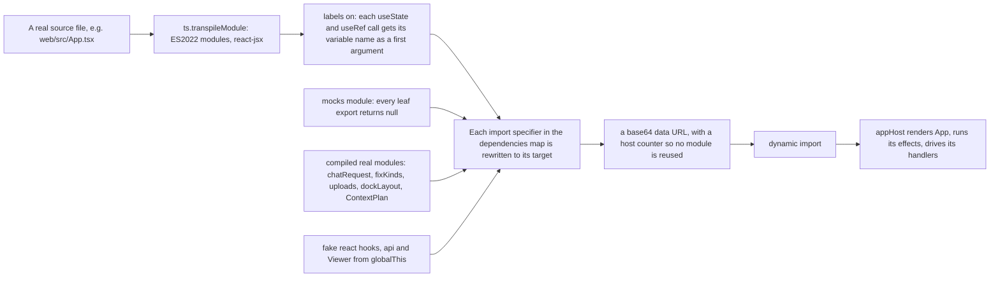
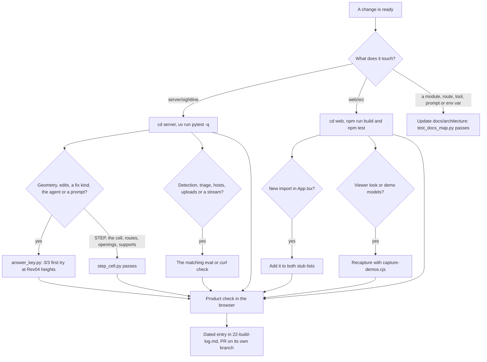

# 18 · Testing, evals and verification

> **Covers:** `server/tests/`, `server/sightline/fixtures.py`, `web/tests/`, `evals/`, `spikes/`, `web/spikes/`,
> `web/scripts/capture-demos.cjs`, `evals/big_models_browser.cjs`, `assets/brand/orca/` checks · **Checked against code:** 2026-10-30 (`feature/brand-assets`, based on `0390a12`) ·
> **Deeper detail:** [evals/README.md](../../evals/README.md) (the eval log), [spikes/README.md](../../spikes/README.md)

ORCA's promise is that no fix reaches a person unverified, so the project checks itself at five levels: fast server
tests on synthetic IFC models with scripted stand-ins for the AI models; web tests that run the real TypeScript
modules (and the real `App`) in Node; evals that run real Muse models on the real demo data and append their scores
to append-only files; spikes that answered the day-one questions; and product checks in a real browser. This doc says
what each level covers, how to run it, where its results go, and what to run before calling a change done.

## The five levels

| Level | What it proves | Needs | Costs | Where |
|---|---|---|---|---|
| Server tests | Geometry, every fix kind, the agent loop, triage, detection, API routes, streams, MCP tools, caps, settings | Python env only: no keys, no network, no demo models | Free, local | `server/tests/` |
| Web tests | App's state handling and ownership rules, the viewer's load and patch, fix wording, layout, the dock's saved layouts and panel homes, requirements file, uploads | `web/node_modules` (`npm install`) | Free, local | `web/tests/` |
| Evals | That real Muse models, on Northbank and the PC-03 cell, still give verified fixes and good readings | Demo models, `META_API_KEY` (and the triage key for Muse Spark Open) | Paid model calls (Muse Wonder is billed per token) | `evals/` |
| Spikes | The day-one go/no-go questions, and Show it built's S0 | Northbank in `samples/`; a Meta key for spike 4 and S0 | Spike 4 and S0 paid | `spikes/`, `web/spikes/` |
| Product checks | The running app does what the tests say: the golden path, the cell, phones, streams through Modal's edge | A running server and web app, Playwright's Chromium | Paid when a step proposes | ad hoc, plus two committed scripts |

## Server tests

### Running them

```bash
cd server
uv run pytest -q                         # the whole suite (541 tests collected at 104fda9)
uv run pytest -q tests/test_route.py     # one file
uv run pytest -q -k penetration          # by name
```

- `server/pyproject.toml` sets `testpaths = ["tests"]` and `pythonpath = ["."]`, so run from `server/`; pytest is in
  the `dev` dependency group.
- `AGENTS.md` names the Windows venv interpreter, `server/.venv/Scripts/python.exe` (on Linux and macOS it is
  `server/.venv/bin/python`), and says to run tests from `server` with `..` paths adjusted. `uv run pytest -q` is the
  supported way everywhere.
- The suite needs nothing but the Python environment (`uv sync`; the PDF tests need WeasyPrint's system libraries,
  pango and harfbuzz, which the Modal image also installs). No test calls Meta or Baseten: model calls go to scripted
  stand-ins (`ScriptedModel` in `test_agent.py` and its relatives), HTTP hosts are faked with httpx mock transports
  (`test_meta_client.py`, `test_triage.py`, `test_context_planner.py`), and the realtime voice socket is a `FakeMeta`
  that answers like the real one did (`test_voice_live.py`). Every model is built on the fly by
  `sightline/fixtures.py` or by the test itself (`test_step.py` writes a STEP file with OCP; `test_fix_kinds.py` and
  `test_supports.py` assemble their own scenes with `fixtures._box`). No test needs the demo models: API tests point a
  `Workspace(samples=tmp_path)` at a temporary folder holding the fixtures they wrote.
- Measured counts over time are in [22 · Build log](22-build-log.md): 66 server tests on Oct 27, 540 on Oct 30
  (CLAUDE.md's "latest validation"). 541 are collected at `104fda9`.

### `conftest.py`

One autouse fixture, `settings_store`: each test gets its own file for the settings for everyone
(`SIGHTLINE_SETTINGS_FILE` pointed into `tmp_path`), `MODAL_TASK_ID` is removed so `settings.py` never reaches for the
Modal Dict, and `settings.reset_cache()` runs before and after. A developer's own `server/.sightline-settings.json`
therefore never leaks into a test, and a test that switches the open-weights model or effort on cannot affect the
next. Other fixtures live in the test files that use them (`client`, `scene`, `cell`, `paths`, `meta`, `fresh_budget`
and so on).

### `sightline/fixtures.py`: the synthetic models

"Small synthetic IFC models for tests and spikes": Northbank is the real demo set; these run anywhere in seconds.
All are IFC4 written with `ifcopenshell.api`, in metres unless noted; `_box(model, body, element, size, origin)`
gives an element a rectangular extrusion and is reused by tests that build their own scenes.

| Builder | What it holds | The case it makes |
|---|---|---|
| `build_clash_fixture(path, millimetres=False, only=(...))` | A steel beam, a duct through it, a pipe just below the beam. `millimetres=True` writes mm like most authoring tools; `only` writes a subset so a structure file and a services file federate | The agent's "first try fails" case: down 0.40 m clears the beam but hits the pipe, 0.80 m clears both. `python -m sightline.fixtures <out.ifc>` writes it (README, "Run it") |
| `build_run_fixture(path, millimetres=False)` | One straight supply main (0–6 m, 400 x 300, ports at both ends, joined to a 1 m end segment) under a slab, crossing a beam at x = 3 | A local offset: up 0.375–0.425 m keeps 25 mm both sides, 0.40 m leaves 50 mm |
| `build_joint_fixture(path)` | A curtain-wall corner like Northbank's Clash7: a transom drawn as a plan rectangle extruded 60 mm, its end 60 mm into a mullion, tops flush; a spandrel panel on the transom | Trims, and the flush-faced overlap the intersection query misses |
| `build_context_fixture(path, millimetres=False)` | A constrained service corridor (tags CTX-DUCT/BEAM/TRAY) with `KeepFixed` constraints and a fixed terminal | A wider fix: only a tray move plus a duct offset clears it |
| `build_detection_fixtures(folder, offset=(0,0,0))` | A structure and a services model with one of every detection case (crossing duct, touches, a 0.5 mm touch, a 20 mm gap, a flush strut, a door in its wall, assembly plates, a duplicate, crossing braces, a sensor inside a duct, port-joined segments), shiftable by `offset` | Every rule and measure in [docs/detection.md](../detection.md), including models far from the origin |
| `build_route_fixture(path)` | Five runs (tags RT-1 to RT-5): a compound duct, a two-column duct with a post between, a sloped duct, a waste pipe, a cold-water pipe | Routes: up-then-sideways, one detour round each column, slopes, drainage, a rolling offset |
| `build_penetration_fixture(folder, version="IFC4")` | Structure (walls W1/W2, slab S1, beam B1, column C1, a transfer beam B2 with a column on it, a 3 mm gland plate, a glazing unit) and services crossing them (tags PN-1 to PN-11) | Openings: allowed, refused, at an edge, through two walls, a fitted gland; `version="IFC2X3"` too |
| `build_resize_fixture(path)` | A 500 x 300 duct 50 mm into a beam with a slab above, a ceiling below and walls either side; a tray under a beam; a pipe and a round duct | Resize: 735 x 220 mm bottom kept clears with 30 mm; the sizes a resize keeps |

### Every test file

Counts are tests collected at `104fda9` (parametrised cases counted separately).

**Geometry, the check and detection** ([06](06-geometry-and-detection.md))

| File | Tests | What it covers |
|---|---|---|
| `test_verify.py` | 7 | `verify.check` on the clash fixture: the duct collides; a 0.40 m drop lands on the pipe; 0.80 m passes with the true gap; moves survive write and reload; millimetre files measure in metres; federated files clash across disciplines; the neighbourhood check skips far elements |
| `test_supports.py` | 8 | A move keeps what it stands on (`verify.supports`, `keep_supports`): a post slid along its slab keeps its footing; lifted, sunk or pushed into something is refused; the clash partner is never a support; runs stand on nothing and the plan check agrees; `verify_move` keeps footing only when told the obstacle |
| `test_detect.py` | 22 | `detect.py` on the detection fixtures: default tests, a Site model's tests off, touches, exact flush depth, an element wholly inside another, pairs meant to meet counted not reported, duplicates vs crossing braces, clearance, far from the origin, stable ids and new/resolved on a rerun, the per-test cap (`partial`), selections, a run's report naming the requirements it ran under (`requirements_id`), the detect stream API, detection from chat, `measure_pair` |
| `test_datums.py` | 6 | `datums.py`: levels merged across files by name and height in metres; each element's storey; grid axes through their grid's placement and units; a sample scene with no grid reads its project's Grids file as context, a scene's own grid wins and no grid is none; the datums route |
| `test_port_frames.py` | 57 | Port frames read back from exported IFC, independently of the verifier: flow axes follow the cap normals, signed axes and profile roll, generated frames pass, unknown or two-way frames need review, offsets keep both external peers, the legacy external-frame exception stays strictly unchanged |
| `test_foundation_review_fixes.py` | 35 | Review reproductions on real IFC shapes and port graphs: tight generated bends, the bend allowance, new clearance to unrelated services, offset axis noise, single-, zero- and two-port chains through offset and export, the exact separating-axis fallback only for plain rectangles |

**Fix kinds and edits** ([07](07-fixes-and-edits.md))

| File | Tests | What it covers |
|---|---|---|
| `test_edits.py` | 16 | Offsets (`edits.apply_offset`): clears beam and slab and is undone, a kept offset chains ports, the agent offers a verified one, unsupported shapes say why, the API applies and serves the file; `edits.passages`; `/propose/stream` progress; trial pieces; trims (`butt_trim`): profile-drawn member, `SLENDER` refusal, mid-length refusal; bends like Rev04; square fallback |
| `test_route.py` | 23 | Routes (`edits.apply_route`, `agent._try_route`) on the route fixture: one step is the offset, up-then-sideways, one chain port to port, one detour per column, slopes keep their fall, drainage only sideways, rolling offsets, refusals, undo, plan and endpoint keep it, nearby clashes, free-band scan time |
| `test_resize.py` | 16 | Resize (`edits.resize_size`, `apply_resize`, `agent._try_resize`): equivalent diameter and tray cross-section, refusals, bottom kept clears the beam, transitions need room, undo, the agent offers it when offsets fail, endpoint and plan, centre-kept faces, resized pieces say their size |
| `test_penetration.py` | 18 | Penetrations (`edits.penetration`, `apply_penetration`): opening size, edge and off-line refusals, columns never, both files undone, provision for void never physical, structural review, ranking after plain fixes, cut only when the requirements allow, endpoint/plan/patch, IFC2X3, two walls, a service stopping inside the host |
| `test_hosts.py` | 18 | `hosts.py`: hard rules need no model, Muse reads each kind once from standard facts only (a project pset never reaches it), the hole against the reading's limits, a gland plate's fitted hole, requirements win over Muse, the transfer beam never offered, a failed reading leaves walls and slabs only, limits sanitised |
| `test_fix_kinds.py` | 7 | The registry: an unknown kind is refused, split ends checked against every obstacle, feedback names each kind and where it hit, `agent.TIERS` ranking, a lateral offset sized by how far it goes, plans refuse a kind they cannot apply, `POST /api/scenes/{scene_id}/fix/apply` keeps any kind |
| `test_accept_in_place.py` | 6 | `Workspace.patch`: the revision a page starts from, an offset's pieces as triangles, moves (the whole run)/routes/plans as meshes, no meshes when one will not triangulate or there are too many vertices, which files each revision changed, unstyled elements keep no colour |
| `test_keep_verified.py` | 9 | Keeping tries the fix again (`plans.recheck`, `plans.apply`): options carry their pair; tampered moves and offsets (any split or height) refused with 409 and nothing kept; an option proposed before another edit refused; the requirements' clearance, largest move and report-only apply, not the page's; a plan all or nothing (together, a later failure, a keep refused part way); the server keeps the whole run and the joint's end; a fix must name its clash; `kept_files` restores marks and leaves a held file to the outer one |

**AI workflows and the model client** ([08](08-ai-models-prompts-and-spend.md), [09](09-agent-workflows.md))

| File | Tests | What it covers |
|---|---|---|
| `test_agent.py` | 6 | `agent.resolve` with `ScriptedModel`: a failed attempt is fed back and only verified options survive, the loaded model is unchanged, a `.env` fills missing settings only, ranking, trials before checks, reasoning summaries only when watched |
| `test_plans.py` | 8 | `plans.py`: batches dedupe pairs and are checked as a whole, `verify_together` finds colliding fixes, a combined fix in a plan, root causes and plan endpoints, patterns, root-cause charging, a moved hub against every partner, `merge_shared` |
| `test_escalation.py` | 30 | `escalation.py`, `spend.py` and the combined kind (`agent._try_combined`): the brief and its budget, the second try's options with the first's, the setting and caps (both or neither), token usage and the day's budget, stale first tries, structure never moved, the apply endpoint returns every run |
| `test_triage.py` | 10 | `triage.py`: sure rules cost no call, JSON-mode fallback, the open-weights host only when switched on, the shared and replayed stream, rule verdicts say why, settled facts correct answers, reasoning streams, late subscribers, alike clashes read once |
| `test_titles.py` | 5 | `titles.py`: batches, facts, finding a clash by number, titles survive Detect again, the shared titles stream |
| `test_chat.py` | 7 | `chat.py`: tools run and images reach the model, tool errors go back to the model, `/api/chat` streams, root causes and plans from chat, history ordering on resume and cancellation |
| `test_built.py` | 10 | `built.py`: passes and key, the pixel gate, two judges, retries, the cache, the API switch and caps, the setting, the PDF takes a built view by URL only, oversized passes refused, one picture made once |
| `test_meta_client.py` | 3 | `MetaChatModel`: the Responses stream gives reasoning summaries then JSON, falls back to chat completions, other hosts never try Responses |

**Wider fixes (the context planner)** ([09](09-agent-workflows.md), [07](07-fixes-and-edits.md))

| File | Tests | What it covers |
|---|---|---|
| `test_context_eval.py` | 34 | `context_eval`: compound arrangements, lateral offsets keep endpoints and profile, invalid candidates change nothing, connected move groups, review conditions, revisions, three groups and cross-file rollback, the slender-trim gate, system mismatch at joints, missing port placements, baseline conflicts, square-fallback/compound/along-run offsets rejected |
| `test_context_planner.py` | 25 | `context_planner`: blocker feedback, every model and geometry limit, no model call holds the lock, dedupe and structural ranking, deadlines and cancellation keep earlier passes, bounded storage, timeouts and owner effort, malformed model replies |
| `test_context_api.py` | 29 | The wider-fix stream and accept endpoints and chat: charged once, owner bypass, accept needs the canonical id, every acknowledgement and a fresh revision, atomic failures, remeasured report pairs, disconnects and overflow cancel cleanly, interleaved allowances |
| `test_context_fixture.py` | 3 | The context fixture itself: the corridor needs the tray edit; fixed constraints check expanded members |
| `test_context_offset_profiles.py` | 16 | Real IFC profiles: an unpreserved profile is rejected without changing the model, whole-run moves keep profiles offsets cannot, plain profiles still offset and export |

**Files in and out** ([14](14-files-in-and-out.md))

| File | Tests | What it covers |
|---|---|---|
| `test_api.py` | 7 | Open → verify → apply → export (a move still clashing is refused), sample names cannot escape `samples/`, a federated export writes only the edited file, export carries kept fixes and no tried ones (as `orca-export.zip`; an offset the other model's beam blocks is refused until that beam moves), a multi-file export named for its project (`<project>-orca.zip`), reopening a held scene, eviction spares linked scenes |
| `test_reports.py` | 8 | `reports.py`: Navisworks grouped tags and three views, upload/match/measure/images, no-XML uploads refused, sample report folders, report clashes send their images and distance, a port's owner, `SAMPLE_EXCLUDE` renumbering, `/api/transcribe` biased to clash names |
| `test_step.py` | 8 | `step.py`: names, groups, colours and metres survive conversion, detection finds the ladder through the post, group runs move together, export writes moves back, classes from the model, upload accepts STEP and IFC only, caps, older conversions still read |
| `test_uploads.py` | 10 | Bigger uploads: gzipped parts unpacked, the cap on the unpacked size, 411/413 before reading, broken or repeated archives refused, the streamed open's events and errors, the scene byte budget, wider fixes refused on big models, bounded gunzip steps, room made first |
| `test_document.py` | 9 | `document.py`: team guess from content, who acts and who reviews, PDFs per team plus BCF (`orca-report.zip`, `orca-issues.bcfzip`), one combined PDF stays DRAFT (`orca-report.pdf`), the triage model the PDF names, screenshot facts, a kept fix page's built view or why not |

**Requirements, settings, owner and caps** ([15](15-requirements-settings-and-config.md), [16](16-security-caps-and-cost.md))

| File | Tests | What it covers |
|---|---|---|
| `test_requirements.py` | 25 | `requirements.py`: parsing and clamping, the content id, level and strictness to numbers (L3 Balanced is today's numbers and finds what the default tests find), groups, the matrix, `min_size`, policy, by-design rules, strict distrust of low-confidence by-design, prompt lines say only what differs, `model_key` |
| `test_requirements_wiring.py` | 18 | Requirements reaching the agent, triage and the API: unchanged prompt without a file, move limits, `meets`, recommendations, rules settling without a call, Muse's audit, seeded jobs, registration and 409 `requirements_unknown`, detection and preview, suggest, the report, agent links |
| `test_settings.py` | 8 | `settings.py`: the store survives a restart, refuses unknown values, falls back when broken; effort precedence owner > everyone > environment; open weights off unless switched on; owner-only `/api/settings`; `/api/models` |
| `test_owner.py` | 7 | `owner.py`: the HttpOnly cookie, a new token logs everyone out, no token no owner, wrong tokens capped, settings count only for the owner, unknown settings dropped, the owner skips the demo caps |
| `test_limits.py` | 5 | `limits.ProposeLimit`: per-visitor hour, the daily cap for everyone (refusals not counted), no limits by default, 429 on propose, `Workspace` keeps only the newest scenes |
| `test_env_file.py` | 3 | Configuration: a fresh interpreter on a copy of the package beside its own `.env` (the package's `__init__.py` loads it) reads `.env` for the settings read at import and the caps, a real environment variable wins, and empty numbers take their defaults (`limits.env_int` / `env_float`); a value that is not a number still raises |

**Agents and voice** ([11](11-mcp-and-agent-links.md), [10](10-http-api-and-streams.md))

| File | Tests | What it covers |
|---|---|---|
| `test_mcp.py` | 10 | `mcp_server.py` and `agents.py`: the tools and their `readOnlyHint`s, 401 without a live token, an agent finds, checks, proposes, applies and exports, the page answers for pictures, link expiry (sliding, 24 h at most) and caps, long proposals become jobs, stdio on its own session, a closed page |
| `test_voice_live.py` | 10 | `voice_live.py` against a fake Meta socket: hold to talk, hands-free sentences, the time limit, non-microphone audio refused, Meta failures in words without the key, one voice cap use per session, no cap for the owner, other origins refused, the page leaving ends the session |

**The docs map**

| File | What it covers |
|---|---|
| `test_docs_map.py` | Being added alongside this map: fails when a server module, prompt, web source file, route, MCP tool or env var is missing from `docs/architecture/`, or a link in it is broken. Fix it by adding the doc line, never by loosening the test (`AGENTS.md`) |

## Web tests

### Running them

```bash
cd web
npm install            # once; postinstall copies web-ifc's wasm into public/wasm
npm run build          # tsc --noEmit (type-check src/ and vite.config.ts), then vite build
npm test               # node --test tests/*.test.mjs (95 tests on Oct 30)
```

There is no test framework beyond Node's own runner: the tests use `node:test` and `node:assert`, and the
TypeScript compiler (a dev dependency) to run the real sources. `web/spikes/` is not in `tsconfig.json`'s `include`,
so the build never type-checks it.

### The harness: real modules, stubbed edges

`web/tests/app-host.mjs` exports `compiled(path, dependencies = {}, labels = false)`, which turns one real source file
into an importable module:



- `appHost({ initial, api, effects })` runs the production `App` with fake hooks keyed by the labelled names (so a
  test reads `state.context` or `state.planRun`), real effect bodies with cleanup before replacement, a fake `api`
  whose stream calls hand the test their `onEvent` and `resolve`, and a `Proxy` viewer that records every call. It
  returns helpers to find buttons and components, feed chat events, run timers, settle and unmount. "Only external
  IO, the GPU viewer and leaf components are replaced"; the assertions drive App's own handlers.
- **Why App's imports are stubbed:** App imports the GPU viewer, the network and every pane. A data-URL module cannot
  resolve a relative import, so every `./X` App imports must be in the dependencies map: the leaf panes and helpers map
  to one `mocks` module (functions returning `null`, plus the few constants App reads: `TOUR`, `CELL`, `clashLabel`,
  `noClash`, a `Pilot` and `Viewer` class), lucide icons to an `icons` module, and five modules are compiled for real
  (`./chatRequest`, `./fixKinds`, `./uploads`, `./signoffs`, `./ContextPlan` with its own `./ReportList` mocked).
- **The rule:** a new import in `web/src/App.tsx` (a new module, a new named export from a mocked module, or a new
  icon) must be added to **both** stub lists: the `names`, `icons` and module lists in `app-host.mjs` **and** the copies
  in `app-replacement.test.mjs`, which has its own minimal host and its own `compiled`. Otherwise `npm test` fails to
  resolve it. The same holds for the narrower harnesses: `async-ownership.test.mjs` compiles `Chat.tsx` with stubs for
  `react`, three lucide icons (`AudioLines`, `Mic`, `Square`), `./api` and `./voice`; `viewer-load.test.mjs` compiles
  `viewer/Viewer.ts` with real `three` (and its OrbitControls and BufferGeometryUtils), a stubbed `./ifcLoader` and the
  real `./patch`.
- **The transform limit:** `app-replacement.test.mjs`'s state-label transform checks
  `ts.isCallExpression(node.initializer)` on every variable declaration with an array pattern. A
  `for (const [a, b] of …)` declaration has no initializer, so the check throws and the test file fails to load. In
  App, iterate keys instead (CLAUDE.md, "Traps").

### Every web test file

| File | Tests | Harness | What it covers |
|---|---|---|---|
| `app-replacement.test.mjs` | 4 | its own minimal App host | Direct work retires a pending chat wider-fix search or batch plan, keeps a completed context proposal, and regenerating from the Plan tab is not retired by the old plan |
| `review-fixes.test.mjs` | 20 | `appHost` | Manual previews and who owns the viewer, choosing and deselecting options, accepting single and wider fixes, aborting wider streams on chat takeover, model or report replacement, stale loads and parse failures that must not publish, `api.ts` NDJSON abort and truncation, model download HTTP failures |
| `async-ownership.test.mjs` | 8 | own `source()` compile | `pilot.ts` cancellation between animation waits, camera takeover, `chatRequest.ts` ownership after workspace replacement, `ChatPanel` unmount aborting its stream, NDJSON events after abort |
| `viewer-patch.test.mjs` | 4 | `compiled` + `appHost` | `viewer/patch.ts` on real three.js batches: swapping an element's geometry, growing past the batch's room, packing first; accepting patches in place at the page's revision and reloads what it missed; an opening the host's team must cut is recorded as requested (Accept sends the clash pair) |
| `accept.test.mjs` | 1 | `compiled` | `api.accept`: every kind to `/fix/apply` with its pair (the option's own, else the clash on screen), meshes dropped, a 409 refusal's reason reaches the page |
| `viewer-load.test.mjs` | 7 | `compiled` | `Viewer.load` stages every parse before replacing a usable federation, discards obsolete parses, disposes partial failures, adopts solid and glass batches together |
| `fix-kinds.test.mjs` | 5 | `compiled` | `fixKinds.ts`: each kind's words, framing, clearance/change/recommendation lines, an opening's host reading and hole, a combined fix's steps |
| `about.test.mjs` | 5 | `compiled` | `aboutRoute.ts`: `#about` and `#about/<tab>` open the right tab, other hashes leave it closed, every tab's address round-trips, arrow keys wrap, no window means no hash |
| `layout.test.mjs` | 5 | `compiled` (React stubbed) | `layout.ts`: breakpoints, sheet snapping, flicks, handle taps, `follow()` |
| `requirements.test.mjs` | 7 | `compiled` | `reqFile.ts`: round trip, refusing other files, cell edits, who moves, by-design rules, browser storage, opening rules |
| `signoffs.test.mjs` | 5 | `compiled` + `appHost` | `signoffs.ts`: an imported report's are kept by its title and files (opening it again finds them); a detection run's per clash id (a rerun, other requirements or fewer models open find them; another project's ids don't); empty entries dropped, junk read as none, no storage no throw; title-keyed entries move over for the report's clashes, never over newer ones, the rest stay for their reports; the page shows each run its own and writes per clash |
| `uploads.test.mjs` | 3 | `compiled` | `uploads.ts`: the cap checked before sending, stage progress words, an uploaded IFC read from the visitor's own file |
| `upload-retry.test.mjs` | 1 | `compiled` | `api.ts`: a 409 `requirements_unknown` re-registers the file and resends once |
| `views.test.mjs` | 11 | `compiled` | `viewer/views.ts`: layouts tile the stage; a plan's view range, presets and clash default; sections look to the line's left and run along the moving run; which elevation and grid axes; the nearest standard scale and scale bar; the view cube's 26 directions; camera history; visibility (hidden, isolated, class and level filters); the Esc chain, never leaving a clash ORCA works on |
| `dock.test.mjs` | 7 | `compiled` | `dockLayout.ts`: every panel's home (only the model in the middle); which saved layouts load (floating, closed, beside the model) and which give way to the default (the model elsewhere, a panel twice or nowhere, a stranger, another component); pop-outs back in their bars on save; storage and versions; what showing a panel takes; dockview pinned at 8.5.1 and its paid package or options never used |
| `drawing.test.mjs` | 4 | `compiled` (real three.js) | `viewer/drawing.ts`: what a plan, a section (far clip, crop, flip) and an elevation keep; the section's far clip from the pair; framing, panning and zooming about the pointer |
| `links.test.mjs` | 4 | `compiled` | `links.ts`: direct links by kind (rests on read the other way as supports), an element lit once in its first kind, Shift walking the run to equipment, a whole assembly |
| `viewer-links.test.mjs` | 1 | `compiled` | The connection highlight never shows in a captured picture and is back on screen afterwards |
| `tour.test.mjs` | 5 | `compiled` (React and icons stubbed) | `Tour.tsx`: the cell tour's numbers, the ladder's copy per option kind, accepting without a reload, the recorded-run offer when a live proposal fails or finds nothing, a failed plan moving on |

## Evals

Evals run real Muse models on the real demo data and record scores so that runs on new prompts and models stay
comparable. Run them from `server/` with `uv run python ../evals/<script>.py`. They read the Northbank IFCs from
`samples/` (gitignored; copy them from IssueLab's private demo-models repo, see [19](19-demo-data.md)) and the
palletising cell from `$DEMO_MODELS` (default: a `demo-models` folder beside the repo). The cell's answer key is the
demo-models repo's own `verify_cell.PLANTED` / `by_design`, imported from `<cell>/Code`.

Where results go:
- **`evals/results.csv`**: one row per model call for proposal evals (date, dataset, clash, model, images, run,
  latency, candidates, passing, top-1 pass, top-1 delta, clearance, reference, notes). Append-only, never rewritten
  (`evals/README.md`).
- **`evals/not_a_clash.csv`** and **`evals/penetration_hosts.csv`**: one row per case, append-only.
- **`evals/runs/<date>-<name>/`**: each larger run's replies, tables and `summary.md` or `README.md`.

| Script | Measures | Data | Run | Writes | Latest recorded result |
|---|---|---|---|---|---|
| `answer_key.py` | Muse Spark's proposals on Northbank's answer key (#042 duct, #057 tray, #061 cold water vs girder `TB-L02-01`), one round, `want=3` | `samples/` Structure + MEP + Architecture; Navisworks images from `samples/reports/northbank-navisworks` (#061 has none: text only) | `--runs N`, `--clash '#057'`, `--no-images`, `--effort` | rows in `results.csv` | Oct 29: 3/3 first try at Rev04 heights (+0.40, +0.25, +0.28 m; 50/50/53 mm), 16.5–30.0 s |
| `navisworks_triage.py` | Triage verdicts on a Navisworks three-view package, scored against a metadata reference (non-physical, touches, answer key) | The package dir (demo-models repo `northbank/StructuredOutputs/<run>/`) | `<package> --out ...`, `--limit 5` (smoke), `--open` or `--base-url/--model/--api-key-env`, `--score-only`; resumes | `runs/<date>-...-triage/` (`replies.jsonl`, `triage.csv`, `summary.md`) | Oct 27: Muse Spark 6/6, 129/129, 51/55, median 10.0 s; Muse Spark Open 6/6, 129/129, 49/55, 6.1 s; agree on 299/317 |
| `not_a_clash.py` | Joints built that way (pad/ground beam, transom/mullion, beam/column): triage verdict, whether any option touches what must stay, whether every option is marked cleanup | `samples/` Northbank + the Navisworks sample report | no arguments | rows in `not_a_clash.csv` | Oct 28: 3/3 by design, 0/3 touch what must stay, 3/3 cleanup only |
| `penetration_hosts.py` | `hosts.decide` on 25 labelled hosts (16 Northbank, 9 cell): verdict, reviewer, fit | `samples/` Northbank IFCs and `PC-03-Palletising-Cell-RevA.ifc` | no arguments | rows in `penetration_hosts.csv` | Oct 29: 25/25, 18 kinds in one call, 34–41 s |
| `detection_navisworks.py` | ORCA's detection against the Navisworks package: timing, coverage of sampled results (and why not), the answer key, per-discipline counts | `samples/` four Northbank models incl. Site, `samples/reports/northbank-navisworks` | `--out ../evals/runs/<date>-northbank-detection` | `summary.md`, `pairs.csv`, `coverage.json` | Oct 28: 633 clashes in 1,961 elements, 117/117 real overlaps, answer key 3/3 (#057 −100 mm, #061 −77 mm) |
| `detection_cell.py` | Detection on the cell: every planted pair in Rev A, none in Rev B, nothing unexpected | `$DEMO_MODELS/palletising-cell` | `--cell ... --out ...` | `summary.md` | Oct 30 (`runs/2026-10-30-cell-detection/`): Rev A 112 clashes over 161 parts, 17/17 planted, 95 by design, 0 unexpected; Rev B 0 planted, 93 by design |
| `step_cell.py` | The cell from STEP end to end: conversion and classes, detection, C1 (Fix together), C2 (+150 mm and export), C3 (trim), C6 (route), C7 (wall opening), C8 (gland hole), export back to STEP, Rev B | `$DEMO_MODELS/palletising-cell` STEP files | `--cell ... --out ...`, `--no-classes` | `README.md` in the run folder | Oct 30 (`runs/2026-10-30-cell-supports/`): pass; Rev A 161/161 parts, 17/17 planted, 95 by design, 0 unexpected; Rev B 0 planted |
| `escalation.py` | E0: does Muse Wonder fix what Muse Spark cannot, and is it the model or the brief? Three arms on the unfixed cases | Cell Rev A (from STEP) and Northbank IFC | `--cell ... --northbank ... --out ...`, `--reuse`, `--workers` | `results.json`, `summary.md`, `sweep.json`, rows in `results.csv` | Oct 29: 6 of 21 unfixed; Spark again 0/6, Spark + brief 3/6, Wonder + brief 5/6, $2.01 |
| `big_models.py` | How big a model the server takes: `make --mb N --out F` writes a synthetic IFC4 of a realistic mix; `server F` times open, boxes and detection with peak RSS | none (generated) | see the script's docstring | numbers in `evals/README.md` | Oct 29: 150 MB 5/37/5 s, 1.4 GB; 500 MB 17/174/18 s, 2.8 GB |
| `big_models_browser.cjs` | The browser half: uploads a file through **Use your own models** and times each stage the page shows, then the JS heap | a file from `big_models.py make`; server with the web built | `node ../evals/big_models_browser.cjs http://localhost:8000 /tmp/big-150.ifc` | console | Oct 29: 150 MB 123 s end to end, 500 MB 484 s |

Notes:
- Paid: `answer_key.py`, `navisworks_triage.py`, `not_a_clash.py`, `penetration_hosts.py`, `step_cell.py` (class
  names and proposals) and `escalation.py` (Muse Wonder bills every token). The detection evals and `big_models` call
  no model.
- `detection_navisworks.py` calls `detect.run(scene)` with the default tests. Its recorded run (633 clashes) predates
  Site's tests being off by default; a rerun now checks Structure, MEP and Architecture (464 clashes, CLAUDE.md).
- `detection_cell.py`'s docstring still says five planted problems and 13 pairs; it reads the answer key from the
  demo-models repo, which now has eight problems and 17 pairs.
- `evals/README.md` has no section for `step_cell.py`; its results live in the run folders and in
  [docs/step.md](../step.md), [docs/edits.md](../edits.md).

### The answer-key check: "3/3 first try at Rev04 heights"

The benchmark is the designer's own fix, Northbank's `Northbank-MEP-Rev04.ifc`: a local offset of each service
through the girder's openings, duct +400, tray +250, cold water +280 mm ([19](19-demo-data.md)). After any change to
geometry, edits, a fix kind, the agent loop or the fixes prompt:

1. Put the Northbank IFCs (and the Navisworks sample report, for #042 and #057's images) in `samples/`, and set
   `META_API_KEY`.
2. `cd server && uv run python ../evals/answer_key.py` (one run of each, `reasoning_effort` low by default).
3. Read the three new rows at the end of `results.csv`: each must have `top1_pass` `yes` and `top1_delta_m`
   `0,0,0.4` / `0,0,0.25` / `0,0,0.28`, the offset Rev04 made, with its clearance (50, 50, 53 mm in the Oct 29 rows).
   That is "3/3 first try at Rev04 heights". The rows stay in the file as the record.

The latest such rows in `results.csv` are dated Oct 29; CLAUDE.md's Oct 30 validation repeats the claim after the
supports change, which left service runs untouched.

## Spikes

| Spike | What it proved |
|---|---|
| `spikes/README.md` 1 (browser load) | Northbank parses in the browser in 0.8 s (69k triangles), open-to-rendered 6.8 s. fps not measured (software GL); "check on a real GPU" |
| `spikes/02_move_and_check.py` (2, 3) | IfcOpenShell moves an element and writes a valid IFC that reopens moved. The check took 7.2 s re-triangulating everything; a box cache at open and a neighbourhood check made it 0.4–0.6 s |
| `spikes/04_muse_proposal.py` (4) | `muse-spark-1.3-contributor` returns valid JSON with no client changes. Text only, every move hit something; with A/B/C images it found the opening above #042, but "pixels give the direction, not the millimetres", which led to measuring openings as text (`edits.passages`). Whole-element moves fail for #057/#061: the case for local offsets |
| `spikes/built/` + `web/spikes/built.ts`, `built.html` | Show it built S0: real fixes (`fixes.py`), ORCA's viewer renders each four ways (`capture.cjs` driving `window.s0` in `built.ts`), Muse Image restyles them and the check scores them (`s0.py`); `judges.py` compares Muse Spark and Muse Wonder as judges. Decisions in [docs/show-it-built.md](../show-it-built.md) |

## Browser and product checks

Tests prove parts; the product check proves the running app. Run the server and the web app the way the README does
(`uv run uvicorn sightline.app:app --reload --port 8000` and `npm run dev`, which proxies `/api` and the voice socket
to port 8000), or build the web app and let the server serve `web/dist` on one port (`app.py` mounts it when
`web/dist/index.html` exists).

- **The golden path** (Northbank in `samples/`, a key set): **Open the Northbank demo** → the check runs and lists the
  clashes → No. 1, the duct through the girder → **Propose fixes** → a verified "offset up 400 mm through the web
  opening" (Rev04's height) → **Accept this fix** updates the model in place with no file download → **Detect again**
  says it was resolved. The build log records the times (Oct 28: the list at 22 s, Muse's first idea verified 42 s
  into the proposal).
- **The cell:** open it from its landing card; Muse Spark proposes the ladder +150 mm (C2); Fix together on C1 and C6;
  the C7 and C8 openings; export gives the STEP back.
- **Playwright:** the scripts `require("playwright")`. In the cloud session it is installed globally with its
  browsers (`PLAYWRIGHT_BROWSERS_PATH`), so run them with `NODE_PATH=$(npm root -g)` as `spikes/README.md` does;
  locally install it yourself. Headless Chromium draws with software GL: the scripts launch with
  `--use-gl=swiftshader` (`capture-demos.cjs`, `big_models_browser.cjs`) or `--use-angle=swiftshader
  --enable-unsafe-swiftshader` (`spikes/built/capture.cjs`).
- **`web/scripts/capture-demos.cjs`** captures the two demo pictures in ORCA's own viewer: it opens each demo as a
  visitor does, waits for the check, picks the iso view, saves the canvas with the viewer's Screenshot button, crops to
  16:10 and writes `web/public/demos/northbank.webp` and `cell.webp` with Pillow from the server's env. Run against a
  server with the demo models (`--url`, default `http://localhost:8765`). Recapture after the viewer's look or the demo
  models change; the landing cards and the README's "Two demos" table share these pictures and numbers.
- **`evals/big_models_browser.cjs`**: the timed upload above (start the server with `SIGHTLINE_MODEL_UPLOAD_MAX_MB`
  raised).
- **Phones and tablets** ([docs/mobile.md](../mobile.md), Oct 29): Playwright device profiles iPhone 13, iPhone SE,
  Pixel 7, iPad Mini (portrait and landscape) and desktop, plus the desktop compared box for box at 1280, 1440 and
  1920 px. Checked: no sideways scroll in any state, every visible control at least 40 px (20 px checkboxes) on touch
  profiles and named, and the golden path by touch on iPhone 13 and Pixel 7. These runs were ad hoc; no script for
  them is committed.
- **Streams:** Modal's edge compresses NDJSON for browsers and holds it back, so every stream goes out through
  `app._ndjson` with `Content-Encoding: identity` (`NDJSON_HEADERS`). Test a stream the way a browser asks for it,
  `curl -sN -D - -H 'Accept-Encoding: gzip, deflate, br, zstd' -X POST <host>/api/reports/<rid>/triage/stream`: the
  response must say `content-encoding: identity` and the first events must arrive at once, not with the result.
- **Voice:** recognition was checked with espeak-ng speech through the relay and in Chromium with a fake microphone
  ([docs/voice.md](../voice.md)); a human voice on a real microphone is not yet checked.
- **After a deploy:** open the live URL, load Northbank, try one proposal (CLAUDE.md, "Starting a session"; see
  [17](17-deployment-and-operations.md)).

## Before you call a change done

From `AGENTS.md` ("Verify tests and the running product before claiming completion") and CLAUDE.md ("Run the relevant
server tests, web build (`npm run build`, `npm test`) and product runtime checks before delivery"):



| The change touches | Run, besides the server tests and the web build and tests |
|---|---|
| Geometry, `verify`, `edits`, a fix kind, `agent`, `plans`, the fixes prompt (`domain_packs/construction.md`) | `answer_key.py` (3/3 first try at Rev04 heights); `step_cell.py` when the cell's cases can be affected |
| Detection | `detection_navisworks.py`, `detection_cell.py` |
| Triage or its prompt, trims at joints | `navisworks_triage.py` (or **Triage all** on Northbank in the app), `not_a_clash.py` |
| Hosts and openings | `penetration_hosts.py`, `step_cell.py` (C7, C8) |
| Escalation | `escalation.py` (billed), sparingly |
| Scene loading, boxes, uploads | `big_models.py`, `big_models_browser.cjs`; Northbank's boxes and its 464 clashes unchanged |
| A stream or a route behind Modal | The `Accept-Encoding` curl check, on the live URL after deploy |
| App's imports | Both stub lists (`app-host.mjs`, `app-replacement.test.mjs`) |
| The viewer's look, the demo models | `capture-demos.cjs`; then the landing, the README's "Two demos" table and the demo cards together |
| Numbers people see (landing, README, tour) | Only from a measured run, and say where it was measured |
| Any core part | The matching doc in `docs/architecture/` in the same PR, and a dated entry at the end of [22](22-build-log.md) |

Always: the product check in the browser for anything a person sees, and the work on its own branch (`feature/…`,
`fix/…`, `docs/…`) with a PR; never on `main`, never merged without authorisation.

## Brand and motion asset checks

The standalone brand/motion library has its own checks in [`assets/brand/orca/`](../../assets/brand/orca/README.md):
`source/build-print.py --validate-only --skip-package` checks existing static exports;
`motion/source/package-motion.py --package-only` checks animated exports; `npm run check:types` checks the React
wrappers; `npm run check:browser` runs `motion/source/check-browser.cjs` against a temporary loopback server and a
fresh headless Chromium browser. It checks changing motion, centring, pause, size/speed/theme controls, reduced
motion, final reveal states, accessible labels, safe dynamic text, controlled phases and mobile layout. These checks
write manifests/reports alongside the assets; temporary frames, browser screenshots, dependencies and ZIPs are ignored.
They do not replace the application checks when a later redesign integrates the library. Brand harness inventory
checked 2026-10-30 against `0390a12` plus this slice. Details: [brand asset design](../brand-assets.md).

## When to update this doc

- A test file is added, renamed or removed in `server/tests/` or `web/tests/`, or one changes what it covers.
- A new builder in `sightline/fixtures.py`, or a builder changes its case.
- The web test harness changes: `compiled`, `appHost`, the stub lists, or a narrower harness's stubs.
- An eval script is added or changes its data, arguments or output file; a new append-only CSV; a new kind of run
  folder.
- A new recorded result worth quoting (the "Latest recorded result" column), or the answer-key procedure changes.
- A new committed browser script, or the delivery checklist in `AGENTS.md` or `CLAUDE.md` changes.
