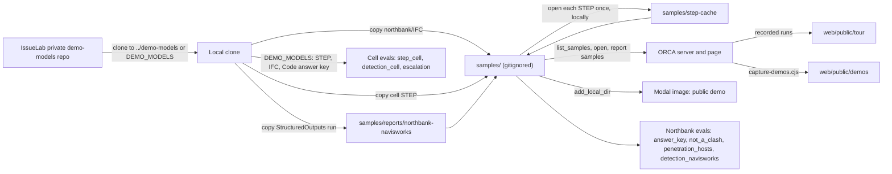

# 19 · Demo data

> **Covers:** `samples/` (and `samples/README.md`), `server/sightline/service.py` (`SAMPLES`, `SAMPLE_EXCLUDE`,
> `Workspace.list_samples`, `Workspace.step_cache`, `Workspace.list_report_samples`), `server/sightline/step.py`
> (`convert`, the cache), `server/sightline/fixtures.py`, `web/src/App.tsx` (default pick, `cellSample`,
> `replayPropose`, `replayPlan`), `web/src/Tour.tsx` (`TOUR`, `CELL`), `web/public/tour/`, `web/public/demos/`,
> `web/scripts/capture-demos.cjs`, `deploy/modal_app.py`, `evals/*.py` · **Checked against code:** 2026-10-30
> (`104fda9`) · **Deeper design:** [docs/step.md](../step.md), [docs/detection.md](../detection.md)

ORCA is shown on two model sets, both generated by IssueLab's own scripts in IssueLab's private demo-models repo,
each with an answer key: **Northbank**, a small office building (four IFC models plus a grid file and a later MEP
revision), and **PC-03**, a robot palletising cell (one STEP file, with the same parts as IFC). None of it is customer
data, and none of it is in this repo: `samples/` is gitignored except its README, and the files are copied in per
session. This doc says what each set contains, its answer key and what ORCA does with it, how to set the data up, how
the app, the evals and the deploy find it, and the recordings and pictures made from it.

**The rule:** no customer data, ever. Everything in `samples/` is deployed to the public demo (below), so only
IssueLab's generated demo models and the reports exported from them go there.

## Where the data comes from

The demo-models repo holds the generators and their outputs. Its IFCs are generated, never hand-edited:
Northbank from its layout modules (`nblayout.py` and the `nb*.py` modules, built by `generate_northbank.py`, checked
by `verify_northbank.py` for Rev03 and `--rev04`), the cell from one parts list (`palletising-cell/Code/celllayout.py`,
built by `generate_cell.py`, checked by `verify_cell.py`). Generation is byte-identical with stable GlobalIds, so an
unexpected change in a file is a real change. The generators pin IfcOpenShell 0.8.5; ORCA's server runs 0.9 (the
cell's IFC check needs 0.9, whose clash tree reads these files).

| Folder in the demo-models repo | What ORCA uses from it |
|---|---|
| `northbank/IFC/` | `Northbank-Structure.ifc`, `-MEP.ifc`, `-Architecture.ifc`, `-Site.ifc`, `-Grids.ifc`, `-MEP-Rev04.ifc` |
| `northbank/StructuredOutputs/<run>/` | A Navisworks three-view export: `sampled-clashes.xml`, `manifest.json` and `tests/**/*.png` (A/B/C per clash) |
| `palletising-cell/STEP/` | `PC-03-Palletising-Cell-RevA.step`, `-RevB.step` |
| `palletising-cell/IFC/` | `PC-03-Palletising-Cell-RevA.ifc`, `-RevB.ifc` (the same parts as IFC4) |
| `palletising-cell/Code/` | `celllayout.build`, `cellcore.gid`, `verify_cell.PLANTED`, `verify_cell.by_design`: imported by the cell evals as the answer key |

The renders committed in the demo-models repo predate the event; ORCA's landing and README pictures are captured in
ORCA's own viewer instead (below).

## Northbank

A fictional three-storey steel-framed office by a river, with its street and neighbours: 21.6 × 12.6 m on a 7 m by 6 m
grid (axes 1-4, A-C), Levels 01 / 02 / 03 at 0.0 / 4.0 / 8.0 m, roof at 12.0 m. All six files share one origin with
no transform (finished floor 0.00 = IFC Z 0), which is why the viewer keeps `COORDINATE_TO_ORIGIN` off.

| File | Contents (demo-models README) | Role in ORCA |
|---|---|---|
| `Northbank-Structure.ifc` | 230 elements: footings, ground beams, lift pit, base plates and bolts, columns, beams, bracing, composite slabs, the Level 02 transfer plate girder (six web openings, stiffeners), roof plant frame | Coordination set |
| `Northbank-MEP.ifc` (Rev03) | 844 elements, 1,319 ports, 9 systems: air, extract, water and drainage, LV; every segment joined port to port | Coordination set |
| `Northbank-Architecture.ifc` | 670 elements, 36 spaces, 4 zones: curtain walls, doors, stairs, core, ceilings, furniture | Coordination set |
| `Northbank-Site.ifc` | 229 elements: streets, river, car park, planting, five neighbouring buildings | Context: opened by default, its tests listed but off |
| `Northbank-Grids.ifc` | The column grid as visible lines and an `IfcGrid`, the five levels; no building elements | Context only: never in a check (its lines run through every column by design) |
| `Northbank-MEP-Rev04.ifc` | Rev03 with the three Level 02 services rerouted; 868 elements | The designer's fix: the benchmark, and a recheck demo |

**Coordination set vs context.** The page opens Structure, MEP, Architecture and Site by default: the samples whose
names end in `structure.ifc`, `mep.ifc`, `architecture.ifc` or `site.ifc` (the effect after `api.samples()` in
`App.tsx`), so not Grids and not Rev04. Detection gives every model file a team from its contents
(`document.guess_team`) and turns off by default every test involving a Site model (`detect.default_tests`); the
duplicates test then covers the building models only. So Northbank's default check covers Structure, MEP and
Architecture.

### The answer key

Three scripted clashes on the Level 02 transfer girder `TB-L02-01` (`1eVHoPtl1IhAbbhivqVqb0`). Column 3B is omitted on
Level 02, so grid line 3 carries a 1000 mm deep plate girder with six web openings, one per crossing service. Three
services pass through theirs; the other three were dropped 250-400 mm in a later reroute and now hit solid steel, with
their openings just above them.

| Label | Service | GlobalId | Clash point (IFC X, Y, Z m) | ORCA's depth | Navisworks |
|---|---|---|---|---|---|
| #042 | Supply air main 600x300 `SA-MAIN-L02-5` | `2AbvqKF25LGeR0M34N_jld` | 3.50, −2.45, 7.18 | −300 mm | −150 mm |
| #057 | Cable tray 300x100 `LV-TRAY-L02-1` | `3tQ7zxxRDMefPXL6hbHmO2` | 3.50, −1.00, 6.90 | −100 mm | reported |
| #061 | Cold water main DN54 `CW-MAIN-L02-2` | `1RHD_I4ibLDuUhW1LBAckc` | 3.50, −3.05, 6.90 | −77 mm | no result stored |

- The labels #042 / #057 / #061 are the demo's story, not ORCA's numbers: ORCA numbers its own clashes (#1 for the
  duct on a fresh check, per CLAUDE.md), and an imported report numbers by position.
- ORCA's depth is how far one element must move to clear the other ([06](06-geometry-and-detection.md),
  [docs/detection.md](../detection.md)). CLAUDE.md's older table gives −300 / −400 / −400 mm: the intersection figure
  detection used before, which reads a thin pipe or tray as far deeper than it is.
- Every other test in the demo-models answer key returns 0. The deliberate near-misses: the three coordinated services
  pass through their openings with 50 mm all round.
- Beyond the key, triage of a detected run reads a few more real problems (CLAUDE.md, Oct 28): the B1 pad footing
  against the lift-pit wall (−471 mm), and, with the Site tests on, site trees and paving.

**Rev04, the benchmark.** `Northbank-MEP-Rev04.ifc` is the designer's next issue. Each service lifts into its own web
opening with a four-bend offset between about x 2.7 and 4.3 m (demo-models README; CLAUDE.md says about 2.6-4.4 m):
the duct up 400 mm (180 mm radius bends), the tray 250 mm, the cold water main 280 mm, each with 50 mm clearance. All
844 Rev03 elements keep their GlobalIds; each offset adds four segments and four bends (24 new elements). ORCA's
evals score proposals against these heights (`evals/answer_key.py`, `KEY`: dz 0.40, 0.25, 0.28 m): "answer key 3/3
first try at Rev04 heights" is the regression check after every change to fixes ([18](18-testing-and-evals.md)).

### What ORCA's check finds

Measured runs (README; `evals/README.md`; CLAUDE.md):

| Run | Result |
|---|---|
| Default tests (Site off) | 464 clashes in 1,732 elements, about 4 s; the answer key 3/3, all in MEP vs Structure |
| Every test on (Site included) | 633 clashes in 1,961 elements, 7-12 s |
| Against the Navisworks sample package | 117 of 117 sampled real overlaps; the other 200 sampled results are not physical (129), touches (46), one element (24) or joined by ports (1) |
| Triage of the default run (Muse Spark Open) | 39 model calls, 101 s, 5 real, including the answer key's three (high, MEP) |

### The Navisworks sample report

The imported-report path (Coordinate › Import a Navisworks clash report) uses Navisworks' own results on Northbank.
Navisworks ran 1,275 automatic class-pair tests and stored 7,668 results (`evals/detection_navisworks.py`); the
three-view package samples at most five per test: 317 results in 73 tests, each with A/B/C pictures.

- **Set up:** copy `sampled-clashes.xml` and `tests/**/*.png` from the demo-models repo's
  `northbank/StructuredOutputs/<run>/` into `samples/reports/northbank-navisworks/` (`samples/README.md`). The app
  lists every folder under `samples/reports/` with an XML at its top (`Workspace.list_report_samples`); the evals expect
  that folder name.
- **Trimmed for the demo:** a sample report drops every clash test that involves one of the classes in
  `service.SAMPLE_EXCLUDE` (env `SIGHTLINE_SAMPLE_EXCLUDE`, default `IfcGeographicElement,IfcSpace,IfcBuildingElementProxy`;
  `reports.load(exclude=)`): site context, rooms and proxies are not coordination problems. Uploaded reports are kept
  whole. Northbank's sample: 217 clashes in 52 tests (was 317 in 73), with #042 as `c0053`, numbered #53. The evals
  read the full package.
- **Matching:** each clash is matched to the open models by GlobalId, else a unique class and name. With Site open,
  all of them link (CLAUDE.md: 290 of 317 without Site).

## The palletising cell (PC-03)

The end of a fictional food packaging line, made to show that coordination is not only for buildings: a belt
conveyor, a four-axis palletising robot with its restricted space (a see-through cylinder, radius 2.7 m), two pallet
stations, mesh guarding on bolted posts with light curtains and a gate, an electrical panel (EP-301) with its working
space (a see-through box), an HMI stand, a cable ladder, two compressed-air lines, and the plant's walls (drawn
see-through) and two columns.

| File | What it is |
|---|---|
| `PC-03-Palletising-Cell-RevA.step` | STEP AP214 in millimetres: an assembly tree with named parts and colours; zones carry alpha. 161 parts, eight planted problems (17 part pairs). |
| `PC-03-Palletising-Cell-RevB.step` | The designer's next issue: all eight fixed. 185 parts. |
| `PC-03-Palletising-Cell-RevA.ifc` / `-RevB.ifc` | The same parts as IFC4 in metres, with real classes, extrusions, revolved bends and ports. |

ORCA opens the **STEP** (the point of the demo): `step.convert` turns it into IFC on open, the triage model names each
part's class, plain boxes and cylinders become exact extrusions so offsets and trims work on them, and parts of one STEP
group that touch move together (`IfcScene.step_run`). Design: [docs/step.md](../step.md); code: [14](14-files-in-and-out.md).

### The planted problems and what fixes them

C1-C3 and C6-C8 are hard clashes between physical parts; C4 and C5 are clearance problems modelled as see-through
volumes nothing may enter, so they show in a plain hard check too. The "ORCA" column is what the evals and CLAUDE.md
record.

| | Problem (Rev A) | Rev B fix | ORCA's fix kind | Recorded by |
|---|---|---|---|---|
| **C1** | Air line `PL-301 compressed air DN25 segment 2` through both conveyor rails (`CV-301 side rail north` / `south`) | Local offset 250 mm down under the frame | **Fix together**: the two clashes become one job (`plans.merge_shared`) and one verified fix clears both. Which kind varies by run: an offset (CLAUDE.md, Oct 28), a route 900 mm west (`evals/runs/2026-10-30-cell-supports`, and the Oct 30 tour recording), a move west (the Oct 28 tour recording). | `evals/step_cell.py` |
| **C2** | Cable ladder `CT-301 run 2 along the west fence` into `Fence post W5` (62 mm) | Whole ladder 150 mm higher | **Move** +150 mm: the ladder's five touching parts move as one; written back to the STEP. Muse's own proposals vary: on Oct 30 a 120 mm local offset ranked first and a 100 mm whole-ladder raise second (the tour recording) | `evals/step_cell.py` |
| **C3** | `Fence top rail S5-SE` 40 mm into `Fence post SE` | Rail trimmed 40 mm | **Trim** to the post's face | `evals/step_cell.py` |
| **C4** | North fence line inside the robot's restricted space (posts N3, N4, their plates, two panels, a light curtain) | Fence line moved to Y 2.8 | **Move**: posts N3 / N4 350 mm north, first try, since a move keeps what it stands on (`verify.supports`) | CLAUDE.md, Oct 30 |
| **C5** | `Operator HMI stand OP-301` in `EP-301 working space` | HMI moved by the infeed | **None verified**: every direction hits a conveyor, tray or filter (a real limit, not a bug) | CLAUDE.md, Oct 30 |
| **C6** | Air branch `PL-302 … segment 3` through plant columns C3 and C4 | A detour round each column, 200 mm out | **Reroute**: Fix together → one job → a detour round each column (Oct 30 run: 250 mm north; the designer's 200 mm route also passes, 33 mm clear). Built so that only a two-step detour clears. | `evals/step_cell.py` |
| **C7** | Plant compressed-air main DN50 through the west wall, no opening | A 150 mm square opening | **Opening** (penetration): Ø130 mm, 220 mm deep, with clearance and an architecture review; cut when kept with no requirements; the STEP's wall cut and a provision for void added | `evals/step_cell.py` |
| **C8** | `C-302 400 V feed` (32 mm conduit) into EP-301 through its 3 mm top gland plate, no hole | A gland hole 1 mm round the conduit | **Opening**, fitted: a Ø34 mm gland hole (Muse reads the gland plate as allowed, a fitted gland) | `evals/step_cell.py` |

Besides the planted pairs, the cell has contacts it is built with (anchors through their plates, drums through their
rails, the robot's reach over the conveyor and pallets, the gland plate on its panel): 95 by design in Rev A, 93 in
Rev B. Latest run (`evals/runs/2026-10-30-cell-supports/README.md`): Rev A 161 of 161 parts converted, classes 161 of
161, 112 clashes in 1.7 s, 17 of 17 planted pairs, 0 unexpected; Rev B 185 parts, 0 planted.

### The STEP cache

Converting a STEP asks the triage model for each part's class, which takes about 30-35 s the first time. `step.convert`
reuses a conversion of the same bytes: it looks for `<sha256>.ifc` and `<sha256>.json` (the converted IFC and its
manifest, the source path written as a placeholder) in the cache, and writes them there after a conversion whose
classes the model gave. `Workspace.step_cache` is `samples/step-cache/` when that folder exists, else
`<tmp>/sightline-models/step-cache`. So:

- **To ship the cell's conversion:** create `samples/step-cache/`, start the server locally with a model key, and open
  each STEP once. The files land there and are deployed with the samples; the demo's first opening after a restart
  then takes about 1.5 s.
- **After the STEP changes** (C6-C8 were added on Oct 29), regenerate the cache: the old entries are keyed by the old
  bytes and simply stop matching.
- STEP part GlobalIds are derived from the file's hash and each part's label path (`step.py`, uuid5), so they differ
  from the cell IFC's GlobalIds and change whenever the STEP's bytes change. That is why the cell tour finds its clashes
  by part names (`CELL`, `clashOfNames`), not by GlobalId.

## Setting the data up in a session

1. Add IssueLab's private demo-models repo to the session and clone it next to this repo as `../demo-models`, or set
   `DEMO_MODELS` to wherever it is (the cell evals and `detection_navisworks.py` read `DEMO_MODELS`, else
   `../demo-models`).
2. Copy into `samples/` (CLAUDE.md says `northbank/*.ifc`; the files are in `northbank/IFC/`):

```bash
# from the repo root, in the cloud session's bash (GNU cp)
cp "$DEMO_MODELS"/northbank/IFC/*.ifc samples/
cp "$DEMO_MODELS"/palletising-cell/STEP/*.step samples/
dest="$PWD/samples/reports/northbank-navisworks" && mkdir -p "$dest"
run=$(ls -d "$DEMO_MODELS"/northbank/StructuredOutputs/*/ | head -1)
cp "$run"/sampled-clashes.xml "$dest"/
(cd "$run" && find tests -name '*.png' -exec cp --parents {} "$dest"/ \;)
```

3. Optionally `cp "$DEMO_MODELS"/palletising-cell/IFC/PC-03-Palletising-Cell-RevA.ifc samples/` (only
   `evals/penetration_hosts.py` needs it; it also shows in the Models menu), and the STEP cache (above).
4. For a model with no demo data at all: `cd server && uv run python -m sightline.fixtures ../samples/fixture-clash.ifc`
   writes a small test model (`fixtures.build_clash_fixture`).

### What `samples/` holds

| Path | Needed by |
|---|---|
| `Northbank-Structure.ifc`, `-MEP.ifc`, `-Architecture.ifc`, `-Site.ifc` | The Northbank demo card, the golden path, the building tour; `answer_key.py`, `detection_navisworks.py`, `not_a_clash.py`, `penetration_hosts.py` |
| `Northbank-Grids.ifc`, `Northbank-MEP-Rev04.ifc` | Optional: listed in Models (Rev04 for a recheck); not opened by default |
| `PC-03-Palletising-Cell-RevA.step` | The cell demo card and the cell tour (`cellSample`); without it the card is not shown |
| `PC-03-Palletising-Cell-RevB.step` | Optional: the fixed revision, from the Models menu |
| `step-cache/<sha256>.ifc`, `.json` | Optional: the cell's ready conversion |
| `reports/northbank-navisworks/` | The imported-report path; images for `answer_key.py`; `not_a_clash.py`, `detection_navisworks.py` |
| `PC-03-Palletising-Cell-RevA.ifc` | Optional: `penetration_hosts.py` |
| `fixture-clash.ifc` | Optional: a small model for local work |

### How the app finds them

| Code | What it does |
|---|---|
| `service.SAMPLES` | The repo's `samples/` folder (`Workspace(samples=)` overrides it; tests and evals pass their own folders). |
| `Workspace.list_samples` → `GET /api/samples` | Every `*.ifc`, `*.step`, `*.stp` at the top of `samples/` (`MODEL_SUFFIXES`). |
| `POST /api/scenes` → `Workspace.open` | Opens samples by name; a name that resolves outside `samples/` is refused (404). A STEP goes through `step.convert` with the cache. |
| `Workspace.list_report_samples` → `GET /api/reports/samples` | Folders under `samples/reports/` with an XML at their top. |
| `POST /api/reports` → `Workspace.open_report_sample` | Reads the folder's XMLs with `SAMPLE_EXCLUDE`. |
| The samples effect in `App.tsx` | Default pick: names matching `(structure\|mep\|architecture\|site).ifc`; else the first sample. `startLabel` says "Open the Northbank demo" when the pick has a Northbank file. |
| `cellSample` in `App.tsx` | The sample matching `palletising-cell-reva.(step\|stp)`: shows the cell card and enables the cell tour. |

### In the deploy

`deploy/modal_app.py` copies `samples/` into the image (`add_local_dir`, keeping only `.ifc`, `.step`, `.stp`,
`.json`, `.xml`, `.png`, `.jpg`, `.jpeg`), so the public demo serves exactly what `samples/` held at deploy time,
the STEP cache included. Put the data in place before `modal deploy` ([17](17-deployment-and-operations.md)).



## Tour recordings (`web/public/tour/`)

Real runs, recorded and committed, that the guided tours replay when a live Muse step errors or is slow ("Watch a
recorded run"). Each file is `{events: [{t, event}], …}`: the stream's events with their times in seconds, replayed at
the recorded pace through the same pilot and panels (`replayPropose`, `replayPlan` in `App.tsx`) and labelled as
recorded. Accepting a replayed fix edits the model for real.

| File | Recorded | What it replays | Used by |
|---|---|---|---|
| `c0053.json` | Oct 27, on the imported report (`c0053`, the duct × girder) | A single proposal, 18 s: "Offset duct up 400mm through beam opening" and a whole-run raise | Building tour, "One fix, live" (`replay("duct")`) |
| `c0051.json` | Oct 27 (`c0051`, the curtain-wall transom 30 mm into a mullion) | A single proposal, 9 s: "Trim transom end to mullion face" | Building tour, "A joint, not a move" (`replay("joint")`) |
| `girder-plan.json` | Oct 27, hub `1eVHoPtl1IhAbbhivqVqb0` | The root cause plan, 35 s: offsets up 400 / 250 / 280 mm through the web openings for the duct, tray and pipe | Building tour, "The root cause" (`replayPlan("girder")`) |
| `cell-ladder.json` | Oct 30, the 161-part Rev A STEP | A single proposal on the ladder × post W5 (#61), 39 s: "Local offset tray up 120 mm over post" (50 mm clear, ranked first) and "Raise tray 100 mm over post" (the ladder's five parts as one move, 38 mm) | Cell tour, "One fix" (`replay("ladder")`) |
| `cell-pipe-plan.json` | Oct 30, the same STEP | Fix together on the pipe × both rails (#66, #67), 73 s: one merged item, "Side-step pipe 900 mm west past both rail ends" (a route, 83 mm clear), alternative "Dip pipe down 150 mm under each rail" | Cell tour, "Together" (`replayPlan("pipe")`) |

- The building recordings were made on the imported Navisworks report, so they name `c0053` / `c0051`. The tour finds
  its clashes in whatever report is open by element pair (`TOUR.duct`, `TOUR.joint`, `clashOfPair`), and
  `replayPlan` re-points a recorded plan's clash ids to the open report's clashes of the same pairs, so "not in the
  report" reflects this report.
- The cell recordings carry the part GlobalIds of the STEP they were recorded on (the ladder `0PKSyDjLDRt8iXC1mscRPM`,
  post W5 `23HNLt2prKbAyvOqzfkEeZ`), and STEP GlobalIds follow the file's bytes (above). The Oct 28 recordings named
  parts of the 144-part STEP, so their fixes could not be drawn or accepted on the Oct 29 cell; they were re-recorded on
  Oct 30. Re-record them after any change to the cell's STEP: run the cell tour in a browser on a local server and save
  the propose and plan streams with their times (`{t, event}` from the request's start). Checked Oct 30 in headless
  Chromium with the live streams refused: both recordings offered, replayed and accepted in place (one model download,
  at open), all 12 steps.
- Muse's ideas vary by run, and ORCA ranks comfortable clearance before the smallest change, so the ladder's best option
  is often a local offset rather than the designers' 150 mm whole-ladder raise: the cell tour's copy describes the
  option on screen (`optionKinds`) rather than assuming a move.

## Demo pictures (`web/public/demos/`)

`northbank.webp` and `cell.webp` are the pictures on the landing's demo cards (`DemoCard` in `About.tsx`) and in the
README's "Two demos" table. `web/scripts/capture-demos.cjs` makes them in ORCA's own viewer: with the server running
on the demo models (`uv run uvicorn sightline.app:app --port 8765`), it opens each demo the way a visitor does in
headless Chromium (Playwright, SwiftShader WebGL), waits for the check, picks the iso view and zooms in, saves the
canvas with the viewer's screenshot button, and crops it to 16:10 WebP with Pillow from the server's environment.
Recapture after the viewer's look or the demo models change; the cards, the README table and the landing numbers move
together and only from measured runs.

## Which evals use which data

Details, commands and results: [18](18-testing-and-evals.md). The server's unit tests use none of this: they build
small synthetic models with `sightline.fixtures` in temporary folders.

| Eval | Data |
|---|---|
| `evals/answer_key.py` | Northbank Structure, MEP, Architecture from `samples/`; A/B/C images from `samples/reports/northbank-navisworks` (#042, #057; #061 runs on text alone); scores against Rev04's heights |
| `evals/navisworks_triage.py` | The Navisworks three-view package (a `northbank/StructuredOutputs/<run>/` folder, given as an argument) |
| `evals/detection_navisworks.py` | Northbank's four models from `samples/`, the package in `samples/reports/northbank-navisworks`, the run's manifest from `$DEMO_MODELS/northbank/StructuredOutputs` |
| `evals/not_a_clash.py` | `samples/` Northbank files (not Rev04 or Grids) and the sample report |
| `evals/penetration_hosts.py` | Northbank Structure, Architecture, MEP and `PC-03-Palletising-Cell-RevA.ifc` from `samples/` |
| `evals/detection_cell.py` | `$DEMO_MODELS/palletising-cell/IFC/` Rev A and B, and its `Code/` answer key |
| `evals/step_cell.py` | `$DEMO_MODELS/palletising-cell/STEP/` Rev A and B, and its `Code/` answer key |
| `evals/escalation.py` | The cell's Rev A STEP and `Code/`, and `$DEMO_MODELS/northbank/IFC` |
| `evals/big_models.py`, `big_models_browser.cjs` | Synthetic IFC files of a given size, written by the script |

## When to update this doc

- A new demo model set, a new revision, or a change to a set's answer key or planted problems (the demo-models repo).
- A new or renamed file the app expects in `samples/`, or a change to how it finds them (`list_samples`,
  `list_report_samples`, `step_cache`, `SAMPLE_EXCLUDE`, the default pick, `cellSample`).
- A new or re-recorded file in `web/public/tour/`, or a recapture of `web/public/demos/`.
- A new eval that reads demo data, or a change to where an eval reads it (`DEMO_MODELS`).
- New measured results on the demo sets (detection counts, fix kinds per planted problem).
- A change to what the deploy copies from `samples/` (`deploy/modal_app.py`).
