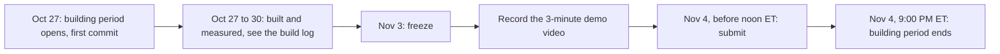

# 20 · Decisions, limits and roadmap

> **Covers:** `CLAUDE.md` ("Rules", "Stack and why", "Status and next steps"), `AGENTS.md`, `BUILT_DURING_HACKATHON.md`,
> the "Not yet" sections of the feature designs, and the code that enforces each limit (`server/sightline/edits.py`,
> `context_eval.py`, `hosts.py`, `document.py`, `service.py`, `deploy/modal_app.py`) · **Checked against code:**
> 2026-10-31 (public demo asset decision; remaining decisions at `0390a12`) · **Deeper design:** [docs/edits.md](../edits.md), [docs/escalation.md](../escalation.md),
> [docs/show-it-built.md](../show-it-built.md), [docs/uploads.md](../uploads.md), [docs/mcp.md](../mcp.md)

ORCA was built in nine days for a hackathon, so many choices were made fast and on purpose: some by the owner,
some forced by what a model or a library could not do. This doc keeps those choices in one place, with what was tried
and dropped and why, so nobody re-opens a settled question by accident; then it lists what ORCA does not do yet (the
limits a person can hit, each checked in the code), and what comes next. The dated history of how each part was built
is [22 · Build log](22-build-log.md); this doc is the current state.

## The hackathon frame

- **Event:** the Meta Global AI Developer Hackathon, Startup track. ORCA is a standalone web app by IssueLab.
- **Building period:** Oct 27 – Nov 4, 2026, 9:00 PM ET. A submission needs this public repo, a 3-minute demo video,
  and only work built during the event.
- **Plan to the end:** freeze Nov 3, record the video, submit Nov 4 before noon ET (CLAUDE.md, "Next, in order", item
  7; not done at `104fda9`). The video's script, plain words and tested shots: [docs/demo-video.md](../demo-video.md).

- **The anti-project list.** The hackathon lists "simple image analyzers", dashboards as the main feature and
  Streamlit apps as projects to avoid. So the headline is **verified model edits**: Muse Spark proposes a change to
  real IFC elements and the geometry check passes it before anyone sees it. Explaining a clash from its pictures is a
  fallback (the understanding and advice shown when nothing verifies, or a recommendation where the requirements let
  nothing be edited), never the pitch. Insights and the Triage card serve the fixes; they are not the product.
- **Only new work.** `BUILT_DURING_HACKATHON.md` lists what was built during the event (the web app, the server, the
  Meta model integration, the domain packs, spikes, tests, evals, the synthetic test models, and the PC-03 cell's
  models, generated during the event by IssueLab's own scripts) and what was not (the Northbank demo models, generated
  before the event, used as data; the open-source libraries). The rule (CLAUDE.md): code adapted from earlier IssueLab
  work is listed there **before** it is committed; none is. No customer data, ever. Even the landing's demo pictures
  are captured in ORCA's own viewer (`web/scripts/capture-demos.cjs`), not taken from the demo-models repo's renders,
  which predate the event.
- **Names.** The product is ORCA, by IssueLab, with no association with any other IssueLab product (none is named in
  the app, docs or commits). No "Meta" or "Muse" in the product name. Internal identifiers that still say `sightline`
  stay on purpose ([21](21-glossary-and-naming.md)).
- **Working rules** (`AGENTS.md`, CLAUDE.md): commits authored by Dodzi Agbenorku with the GitHub noreply address and
  no trailers; secrets only from `.env` or the environment, never in git, chat or the browser; a branch per slice
  named for its kind and a PR, never work on `main` or merge without authorisation; specs and plans in `docs/`, never
  `docs/superpowers/` (its files are history); keep `docs/architecture/` current in the same PR (checked by
  `server/tests/test_docs_map.py`, being added with this map).

## Owner decisions

From the build log ("owner decision", "owner feedback", "owner request") and the feature designs. "Where" names what
carries the decision today.

| Date | Decision | Where it shows |
|---|---|---|
| Oct 31 | Bundle six Northbank IFCs and two PC-03 STEP revisions under ORCA's MIT licence, so judges need no private access or separate model download. Disclose Northbank as a pre-existing synthetic baseline asset; ORCA application code was written during the challenge. No generator source is copied | `samples/README.md`, `.gitignore` filename allowlist, `.gitattributes` byte preservation, `README.md`, `BUILT_DURING_HACKATHON.md`; [19](19-demo-data.md) |
| Oct 27 | Deploy on Modal, public, with proposal caps (each proposal is a paid model call) | `deploy/modal_app.py` (one container), `limits.ProposeLimit`, `SIGHTLINE_PROPOSE_PER_HOUR` 20 / `_PER_DAY` 300 on Modal; [16](16-security-caps-and-cost.md), [17](17-deployment-and-operations.md) |
| Oct 28 | A site model is context: its tests are listed but off by default, and duplicates cover the building models only | `detect.default_tests`; [docs/detection.md](../detection.md) |
| Oct 28 | Coordination first: ORCA's own check is the golden path, a Navisworks report the second way in; the job is "design coordination", one item a "clash" | `openDemo` → `runDetect` in `App.tsx`; the header's **Coordinate** menu; [01](01-product-and-journeys.md), [21](21-glossary-and-naming.md) |
| Oct 28 | The open-weights model (Muse Spark Open on Baseten) costs per hour, so it is off unless switched on; settings for everyone beside the owner's own | `settings.py` (`SIGHTLINE_OPEN_WEIGHTS` default `0`), the Owner menu "For me" / "For everyone"; [15](15-requirements-settings-and-config.md) |
| Oct 28 | STEP models: converted to IFC on open, written back as STEP on export | `step.py`; [docs/step.md](../step.md), [14](14-files-in-and-out.md) |
| Oct 28 (feedback) | Insights must not jump, copy follows the model in use, a filter to one pattern or root cause, a compact Triage card, patterns read automatically, no flashing thumbnails | `keepPlaces`, `listFocus` in `App.tsx`; `meta_client.triage_model_info`; `Viewer.posed`; [12](12-web-app.md) |
| Oct 28 (feedback on Fix together for #61/#68) | One problem, one agent; never trim guarding to make room for a service; failures in plain words | `plans.merge_shared`, `agent._try_trim`, `plans.failure_summary`; [09](09-agent-workflows.md) |
| Oct 29 | The landing keeps "Watch ORCA fix a clash", with two equal demo cards; the README's "Two demos" table shares their pictures and numbers | `DemoCard` in `About.tsx`, `web/public/demos/*.webp` |
| Oct 29 | Agents over MCP, tied to the visitor's session by a pairing link | `agents.py`, `mcp_server.py`, `web/src/Agent.tsx`; [docs/mcp.md](../mcp.md), [11](11-mcp-and-agent-links.md) |
| Oct 29 (feedback) | A link shows time left on the server's clock; a closed tab can be resumed; the dialog leads with the token alone | `clock_offset`, `timeLeft`, `resumeSession` in `App.tsx`, `CopyField` in `Agent.tsx` |
| Oct 29 | Coordination requirements: one strictness scale for flagging and fixing, five levels, the Muse draft only on a button, a hackathon-sized slice | `requirements.py`, `Requirements.tsx`, `reqFile.ts`; [docs/requirements.md](../requirements.md) |
| Oct 29 (feedback) | Small models frame as well as buildings; a blank project for your own files | `Viewer.reach`, `ProjectStart.tsx`; [13](13-3d-viewer.md) |
| Oct 29 | Phones and tablets: the model stays on screen with a bottom sheet over it, and every feature stays reachable | `layout.ts`, `Sheet.tsx`, `AppMenu.tsx`; [docs/mobile.md](../mobile.md) |
| Oct 29 (feedback) | Insights patterns as cards; Clashes and Insights tabs so the list has room | `.pattern-head` / `.pattern-foot` in `index.css`, `leftView` in `App.tsx` |
| Oct 29 | Renamed from Sightline to ORCA; internal names kept so deployed config and saved state still work | the `sightline` package, `SIGHTLINE_*`, `X-Sightline-Settings`, `sightline.*` storage keys; `scene.step_source` still reads `Sightline_STEP`; [21](21-glossary-and-naming.md) |
| Oct 29 | Specs and plans in `docs/`, never `docs/superpowers/`; no superpowers skills | `AGENTS.md`, CLAUDE.md |
| Oct 29 | Fix kinds in one registry (groundwork for reroute, resize and penetration) | `agent.TRIES` / `PARAMS`, `plans.IN_TRIAL` / `EXTRA_FILES` / `KEEP`, `requirements.SIZED`, `web/src/fixKinds.ts`; [07](07-fixes-and-edits.md) |
| Oct 29 | Reroute, penetration and resize as new kinds of fix | `edits.apply_route`, `edits.penetration` / `apply_penetration`, `edits.resize_size` / `apply_resize`; [docs/edits.md](../edits.md) |
| Oct 29 | Accept in place: a kept fix patches the page's model instead of reloading the file | `Workspace.patch`, `applyToViewer` in `App.tsx`, `web/src/viewer/patch.ts` |
| Oct 29 | Which hosts take an opening: hard rules, then the requirements, then Muse's reading of each kind of host, then walls and slabs only | `hosts.py`, `domain_packs/penetrations.md` |
| Oct 29 | Bigger uploads, aiming at 500 MB; the demo cap stays 150 MB because that is what opens in about two minutes | `web/src/uploads.ts`, `app._receive_models`, `SIGHTLINE_MODEL_UPLOAD_MAX_MB`; [docs/uploads.md](../uploads.md) |
| Oct 29 | Escalation to Muse Wonder: a button by default; also "Look for a better fix" after a successful run | `escalation.py`, the `escalation` setting (`SIGHTLINE_ESCALATION` default `button`); [docs/escalation.md](../escalation.md) |
| Oct 29 | Show it built: the fix after only; a clean presentation render, not a site photo; a switch in the owner menu; two Muse Wonder judges per picture; the open tray bend to be fixed in the model, not the prompt; the PDF gets a built view for each accepted fix | `built.py`, `BuiltView.tsx`, `built_views` (`SIGHTLINE_BUILT_VIEWS` default `0`); [docs/show-it-built.md](../show-it-built.md) |
| Oct 30 (request) | A move keeps what it stands on: a post slid along its slab is not a new clash, a lift off it is refused | `verify.supports`, `verify.keep_supports`; [docs/edits.md](../edits.md) |
| Oct 29–30 | Drawing views beside 3D: up to four panes (Single, Two, Quad), plans, a section and elevations drawn like CAD; a toggle for whether drawings follow the 3D view's Context / Isolate or show the whole model; clip planes the user sets (a plan's cut and bottom, a section's line, far clip and crop) | `ViewPanes.tsx`, `viewer/drawing.ts`, `viewer/annotate.ts`, `Viewer.setLayout` / `setDrawingsFollow`; [docs/views.md](../views.md), [13](13-3d-viewer.md) |
| Oct 30 | Panels that dock, collapse, float and pop out on the desktop, on a real docking library: dockview's free MIT core only (never its paid package: the public repo must build for anyone), the default layout the classic one, pop-out windows in the first version, phones and tablets unchanged, a Classic layout switch | `web/src/dock.tsx`, `dockLayout.ts`, `inSlot` / `SlotHost` in `App.tsx`; [docs/panels.md](../panels.md), [12](12-web-app.md) |
| Oct 30 (request) | Measure in every view (3D and each drawing, on the drawing's plane), with snapping to ends, midpoints and edges (a toggle), several measurements to delete or clear, copied to the clipboard; the rail's 3D-only tools in the 3D pane when there are several panes | `viewer/measure.ts`, `Viewer.measureClick` / `snapAt`, `MeasurePanel.tsx`, `ViewerToolbar` (`Rail3d`); [docs/measure.md](../measure.md) |
| Oct 30 | Workings: the Activity panel draws each run as it happens (lanes for who works, steps for what happened, Muse's own words and the server's numbers only), as its default view beside Steps; an off switch; the bottom bar grows for it; phones and tablets keep Steps | `runlog.ts`, `workingsGraph.ts`, `Workings.tsx`, `Activity.tsx`, `DockHandle.fitBar`; [docs/workings.md](../workings.md) |
| Oct 31 (request) | Filters by property: find elements by model, class, floor or anything the model says, then colour, colour by value, hide, isolate or invert; shared by every view (colours in drawings too) with one setting for drawings to show the whole model; a list of named filters, several on at once, the top one winning; chat and voice drive them; all before the Nov 3 freeze | `facets.py`, `web/src/filters.ts`, `FiltersPanel.tsx`, `Viewer.setRules`; [docs/filters.md](../filters.md) |
| Oct 31 (report) | A check on filters takes what the filters show: a colour-by-value filter is a side of what it colours (values ticked off left out), Everything is what the full check covers (a site model left out; site elements only through a filter), and What the filters show (all filters together, as on screen) is a side of its own, also for chat and MCP (`{"shown": true}`). The owner's "run a clash test on the filtered items" took the Site model and all 1,961 elements | `facets.acted` / `shown`, `detect.Selection.filter.by` / `view`, `detect.everything`, `checks.viewOf`; [docs/filters.md](../filters.md), "Checks" |
| Oct 31 (request) | Hide everything a filter does not find, keeping its colours: The rest: Show · Grey · Hide under the filter list, and `hide_rest` for chat, voice and MCP ("i can filter but i can't seem to hide everything else") | `FilterState.hideRest`, `filters.evaluate`, `FiltersPanel`; [docs/filters.md](../filters.md) |
| Oct 31 (request) | Clash detection on filtered elements, from the page, chat and MCP: one test of side A (a filter) against side B (a filter, everything or itself), What do these hit? on each filter, chat and agents using both described elements and the user's filters by name, the clashes replacing the open list (titled with the check; Detect again repeats it; Check the open models brings the full check back) | `detect.Selection.filter`, `check_id`, `chat.Chat._check`, `web/src/checks.ts`, `FiltersPanel` (`check`); [docs/filters.md](../filters.md), [docs/detection.md](../detection.md) |
| Oct 31 (request) | Keep several clash checks at once ("we only have the results of one clash check … implement the ability to have multiple"): the latest result of each check (the open models, each check on filters), not a history of runs; one list of every check's clashes with a picker to narrow it to one; one #N per clash across every check, counting on, no restart under new requirements; triage verdicts follow the clash (carried free while unchanged, Triage reads only the unread ones in the check on screen). Replaces "the clashes replace the open list" above | `checks.py` (`Register`, `Check`, `union`), `Workspace.detect` / `detect_all` / `remove_check`, `CheckPicker`; [docs/detection.md](../detection.md), "Kept checks" |
| Oct 31 (request) | Applying a filter, from the panel, Properties, chat or an agent, zooms every view to what it acts on (not restoring a project's or a saved view's filters, which keep their camera) | `filters.applied` / `zoomTarget`, `Viewer.frameEverywhere`; [docs/filters.md](../filters.md) |
| Oct 31 (request) | Retrieve every property of an element, and a Properties panel with icon buttons, breadcrumbs to its storey, building, site and project (each shows its own properties) and filtering from any value | `properties.Reader`, `Properties.tsx`; [docs/panels.md](../panels.md) |
| Oct 30 | Navigate the model with or without a clash: leave a clash (Esc, the chip's ✕), CAD-style 3D (view cube, orthographic, styles, visibility by model, class and level, hide and isolate); a picked clash shows in every open view, and clicking a clash takes every view to it by default (Fly to clash) | `leaveClash`, `views.escStep`, `viewer/cube.ts`, `Viewer.setStyle` / `setFilters` / `setTemporary`, `Viewer.clashViews`; [docs/views.md](../views.md) |
| Oct 30 | The demo video goes after both hackathon themes as one story: it opens in our world (Theme 1, a building problem IssueLab knows firsthand) and turns to the frontier (Theme 2, the same loop on a robot cell); a narrator with captions; plain words, no BIM or IFC unless explained; Meta's models named with what each does; numbers only from measured runs | [docs/demo-video.md](../demo-video.md) |
| Oct 30 | The desktop has no header bar: the ORCA wordmark hangs from the model's top edge in a notch (20 px high, smaller than the brand guide's minimum, to stay out of the model) that grows to show live progress; Export and one menu sit in the model's top right corner; the brand's navy and ink across the app; the favicon and icons from the kit; not a redesign of the landing | `web/src/Brand.tsx`, `App.tsx` (`notchStatus`, `corner`), `AppMenu.tsx`; [docs/brand-assets.md](../brand-assets.md), [12](12-web-app.md) |
| Oct 30 | Nothing about one project, domain, demo or vendor is fixed in code. The requirements file decides whether a project is a building or a machine (`domain`) and what is fixed in place (`stays`, and groups allowed no edits), fully; the demos get default requirements of their own, checked in and evaluated off and on; team names are typed; the clearance follows the requirements on every check; model names, prices and limits are settings; the MCP website address is the deploy's setting | `requirements.Doc.domain` / `stays`, `IfcScene.stays`, `Workspace.requirements_for`, `demos.py`, `Workspace.clearance`, `meta_client.labels`, doc [15](15-requirements-settings-and-config.md) |
| Nov 1 | Fewer restrictions on editing by hand (owner testing): an edit that cannot keep a port joint is allowed behind "Keep with 1 open joint", logged for services, and where it can ORCA keeps the joint (the joined segment stretches); an I, U, C, L or T section's outer side pushes, with a structure warning; bodies that are not plain extrusions are split, sectioned and clipped by half-space clips, plain extrusions keep their exact path; people may leave 5 mm, fixes keep 50 mm | `manual.py` (`_follows`, `accept_joints`, `MIN_HAND_M`), `edits.py` (`solids`, `push_mesh_face`, `move_clip`, `split_by_clip`); [docs/manual-edits.md](../manual-edits.md) |
| Nov 1 | Edit by hand, with one log of every edit: the full toolset (push/pull, align, move, void, cut by shape, split, remove a section, delete, clip), the edit log and Muse on both before the freeze; an edit that makes clashes keeps only as "Keep with N clashes", never verified, and the clash is listed; the requirements bind hand edits, ORCA's hard rules only warn (logged with who reviews); "cut" means split and remove a section; the person's own "keep it" in chat or voice keeps, Muse never on its own; a hand edit after an accepted fix is tied to that clash and fix in the report | `journal.py`, `manual.py`, `faces.py`, `EditTool.tsx`, `EditPanel.tsx`, `chat.consents`; [docs/manual-edits.md](../manual-edits.md) |
| Nov 1 (request) | Triage can be stopped and goes on where it stopped, never asking about a clash twice ("i'll like to have the ability to stop, and when we run it again, it should skip those that has been done already"). A run is shared, so only whoever started it (or the owner) may stop it ("i'm not sure we want anyone to be able to stop a shared run"); anyone may go on with a stopped run, for a proposal of their own | `triage.Job.stop` / `may_stop` / `starter`, `app.triage_stop`, `_kept_readings`, `TriageCard`; [09](09-agent-workflows.md), "Stopping and going on" |
| Nov 1 (request) | Add models to an open scene and take one out, together ("we are unable to add/append a new model once we have opened one"), before the freeze: adding checks again at once, as opening does; no STEP among building models or the reverse (machines inside buildings stay Later), refused in words; removing a model with kept edits is allowed, with a warning that names what goes and suggests exporting first. Spec first, then a plan, then one PR per slice (server, then page and viewer) | `IfcScene.add_files` / `remove_file` / `layout`, `Workspace.add_models` / `remove_model`, `checks.Register.drop_file`, `journal.Journal.drop_file`, three routes (slice 1); the page and viewer are slice 2; [docs/add-and-remove-models.md](../add-and-remove-models.md) |
| Oct 31 | More model formats wait until after the freeze, and come in only as models ORCA checks (converted to IFC on the server, like STEP), never as a view-only viewer; glTF/GLB first | Nothing in code yet; "Later", below |
| Oct 31 | Later work to explore, beyond the hackathon: connectors into design tools (Inventor, Revit and others) so a kept fix lands in the designer's own model, and site data (photos, video, scans) aligned to the coordination model with SAM 3.1 | Nothing in code yet; "Later: connectors into design tools" and "Later: site data aligned to the model", below |

**Oct 30, owner decision:** approved direction **05 / ORCA Type** (custom wordmark and split-O symbol), then the full
asset and motion pack, and requested its repository PR and merge for the upcoming application redesign. The approved
library is [`assets/brand/orca/`](../../assets/brand/orca/README.md), documented in [docs/brand-assets.md](../brand-assets.md).
The app adopted it on Oct 30 (the notch row above).

## Tried and dropped

| Tried or considered | What happened | Instead | Where now |
|---|---|---|---|
| Blazor for the web app | Telerik is commercial with a private feed (a public repo must build for anyone), JS↔.NET interop on every viewer event, a slow WASM start for judges | Vite + TypeScript + React | `web/`; [02](02-system-architecture.md) |
| That Open's viewer components | Not used. CLAUDE.md records the choice, not the reason | An own viewer on three.js + web-ifc: one `BatchedMesh` per IFC file, so a preview is one matrix update | `web/src/viewer/`; [13](13-3d-viewer.md) |
| IfcOpenShell's default `opencascade.brep` tree | Has no `*_many` clash queries | `ifcopenshell.geom.tree(backend="opencascade.trianglebvh")` | `verify.check`, `detect._tree` |
| Collision queries for hard clashes | Collision misses an element wholly inside another | Intersection first; collision without touching as a second pass (intersection misses flush faces: Clash7's transom read as a 0 mm gap); an exact separating-axis depth for rectangular solids | `verify.check`, `detect._Solids`; [06](06-geometry-and-detection.md) |
| The intersection figure as a clash's depth | Wrong both ways: a 0.5 mm touch read 200 mm, a 40 mm rail 20 mm; #057 and #061 read −400 mm | How far one must move to clear the other: exact for rectangular solids, else the smaller of the figure and the box separation. #057 is −100 mm, #061 −77 mm | `detect._measure`; [docs/detection.md](../detection.md) |
| Re-triangulating everything for each check | 7.2 s a check (spike 3) | Boxes cached at open, only the neighbourhood triangulated: 0.4–0.6 s | `IfcScene.bounds`, `IfcScene.near` |
| Whole-element moves only | Fail for #057 and #061: long runs meet walls and services along their length | Local offsets with bends (Rev04's fix), then routes, resize and openings | `edits.py`; [07](07-fixes-and-edits.md) |
| Proposals from text alone | Spike 4: Muse guessed where openings were and every move hit something | A/B/C pictures for the direction, and the openings measured on the run's line as text for the millimetres | `edits.passages`; [spikes/README.md](../../spikes/README.md) |
| Square corners on offsets by default | Rev04 turns with radiused bends | Radiused 90° bend fittings; `SIGHTLINE_OFFSET_CORNERS=square` keeps the old corners | `edits.default_corners`, `edits.bend_radius` |
| SAM 3.1 to read Navisworks clash pictures | Found nothing from text prompts; from points it outlined 52–91% of each element and never the overlap | Read by colour in the browser (red A, green B, the blend where they meet) | `web/src/clashImage.ts` |
| Muse Image designing a fix, drawing a redline, or a site photo | Redrew the girder, ignored "change nothing", drew a different building, wrote wrong numbers | Muse Image only restyles ORCA's own view of a verified fix, checked against the model by a pixel gate and two judges | `built.py`; [docs/show-it-built.md](../show-it-built.md) |
| Navisworks pictures as Show it built's input | 3 of 3 fixes drawn wrong | ORCA's own captures (`Viewer.captureBuilt`) | [docs/show-it-built.md](../show-it-built.md) |
| A prompt line to keep the tray's bends closed in pictures | 0 of 2 pictures kept them closed | Fix the model's bends to follow the profile (open, below) | [docs/show-it-built.md](../show-it-built.md) |
| Spoken replies | Muse has no text-to-speech | Real-time recognition in, text out | `voice_live.py`; [docs/voice.md](../voice.md) |
| `Cache-Control: no-transform` on streams | Modal's edge ignored it, compressed NDJSON and held it back (first triage verdicts after 77–170 s) | `Content-Encoding: identity` on every stream | `app._ndjson`, `NDJSON_HEADERS`; [10](10-http-api-and-streams.md) |
| Long-held MCP sessions over SSE | Modal cuts requests at 10 minutes and its edge buffers streams | `/mcp` stateless with one JSON response per call; long work as jobs | `mcp_server.py`; [11](11-mcp-and-agent-links.md) |
| `muse mcp add` for Muse Code | Not a subcommand (owner, Oct 29) | The settings JSON, with `"mode": "optional"` (`required` aborts a run when a link expires) | `web/src/Agent.tsx`; [docs/mcp.md](../mcp.md) |
| CSS `::after` tooltips | Cut off by panel and window edges | One fixed `Tooltips` layer that flips and clamps | `web/src/ui.tsx` |
| An effect that returns `scrollIntoView(...)` | Chromium returns a Promise; React's cleanup broke and the panel blanked | Effects use braces | `web/src/App.tsx`, `Chat.tsx` |
| `camera-controls` for the 3D view's pivot | Not needed: sliding `OrbitControls`' target along the view ray to the point under the pointer pivots without a jump (about 8 ms a press) | `OrbitControls` kept | `Viewer.press` |
| A Wireframe visual style | three.js cannot draw a `BatchedMesh` as wireframe (its multi-draw ranges index triangles); per-model feature edges were not worth it beside Shaded with edges and Hidden line | Shaded with edges, Hidden line (the drawing views' linework pass in 3D) | `Viewer.render3d`; [docs/views.md](../views.md) |
| Thumbnails drawn into the visible canvas after the frame's render | The shot showed in the viewer until the next frame | `Viewer.posed` renders the restored view before returning; one thumbnail per 60 ms | `web/src/viewer/Viewer.ts` |
| Trims on any member | A verified "trim the pad footing 900 mm", half its bearing | A trim needs a slender member (`edits.SLENDER = 3`); a trim inside one model is marked model cleanup | `edits.butt_trim`, `agent._try_trim`; `evals/not_a_clash.py` |
| Counting a moved element's own footing as a clash | Muse Wonder lifted fence posts 100–200 mm off their slab to pass (E0) | `verify.keep_supports` | `agent._try_move`, `plans.verify_together`, `Workspace.verify_move` |
| Boxes in one iterator; OpenCASCADE for meshes; a sweep with no lower bound | 4.8 GB peak on 150 MB; 20–30 ms a mesh; 500 MB detection 482 s | Batches of 2,000 (`BOUNDS_BATCH`); CGAL for mesh-only bodies (`MESH_KERNEL`); the sweep bounded (18 s) | `scene.py`, `detect._candidates`; [docs/uploads.md](../uploads.md) |
| `.Moved()` to place STEP shapes | Names and colours lost on write | `BRepBuilderAPI_Transform` | `step.py` |
| "Every hard clash matters" in the L3 triage line | Muse Spark's 12 model errors became 80 on Northbank | Prompts say only what differs from the defaults (L3 Balanced adds nothing) | `requirements.py` prompt lines |
| "Modelled twice" in any test | Muse called Northbank's X-brace diagonals (same name, same box) duplicates | Said only in a duplicates test | `domain_packs/titles.md` |
| Reloading the whole file on accept | The server wrote the whole IFC and the browser re-parsed it | Accept in place (falls back to reloading when the page missed an edit or the meshes pass 500,000 vertices: `Workspace.PATCH_MAX_VERTS`) | `service.py`, `viewer/patch.ts` |
| A tight `max_completion_tokens` on Muse Wonder | Reasoning tokens count against it: a 20-token cap came back `content: null` | Never a tight cap | [docs/escalation.md](../escalation.md) |

## Known limits and open issues

Each limit below is enforced or visible in the code at `104fda9` unless it says otherwise. A grep for `TODO`, `FIXME`,
`XXX` and `HACK` across `server/sightline`, `server/tests`, `web/src`, `web/tests`, `web/scripts`, `evals`, `spikes`
and `deploy` finds none: open work is tracked in the feature docs and here, not in code comments.

### What a fix can change

- **Engineering is the designer's call.** ORCA checks geometry and model integrity: the clash is gone, the clearance is
  kept, nothing new is hit, ports still chain. Structural adequacy and service performance are not judged; options say
  who must review (`review`, `also_needs`). "These are geometry and model checks with designer review conditions, not
  a claim of engineering adequacy or full IFC conformance" (README).
- **Offsets and routes** (`edits.py`, raising `Unsupported` with the reason): the body must be one straight extrusion
  along its own axis, centred, with a rectangle, circle, U, C, I or L profile; a branched segment (more than two ports)
  cannot be split; an offset needs a horizontal segment, vertical or lateral but not both at once; a route takes at most
  `ROUTE_STEPS` = 3 steps, one axis per change (a round pipe may roll); runs sloping more than 15° and vertical runs
  cannot be rerouted; falling drainage is refused and level drainage only steps
  sideways; pieces shorter than `MIN_PIECE_M` (50 mm) are refused. Not yet: 45° pieces, falling drainage, splitting at
  fittings.
- **Bends are closed sections.** `edits._bend_mesh` sweeps a closed rectangle or circle for every bend, so an offset
  cable tray (Northbank's `LV-TRAY-L02-1` is an `IfcUShapeProfileDef` channel) gets closed boxes between open channels.
  Bends that follow the segment's own profile are an open ask ([docs/escalation.md](../escalation.md), "Asks of the
  Advanced IFC edits work").
- **Resize** (`edits._resizable`, `resize_size`): rectangular ducts and cable trays only, a plain
  `IfcRectangleProfileDef`, level and upright; no flatter than 4:1 (`MAX_ASPECT`), trays at least 50 mm deep; never
  pipes, round ducts, hollow, rounded or channel sections, or STEP parts (Northbank's U-channel tray cannot be resized).
  Not yet: round ducts (flat oval), resizing at fittings, keeping a pressure drop rather than an equivalent diameter.
  There is no planted demo case.
- **Penetrations** (`edits.penetration`, `hosts.py`): a straight service through a host with an extruded body; the
  opening must be surrounded by 50 mm of host; hard rules refuse columns, doors, windows, curtain walls, piles,
  footings, stairs, railings, lifts, services and equipment, glazing, see-through zones and transfer elements (the
  Northbank girder). Not yet: sleeves and fire-stopping as elements, one opening for several services.
- **Trims:** slender members only (`SLENDER`), and a trim inside one model is model cleanup, not a coordination fix.
- **Moves of a structural element carry no review.** E0's B1 fix moves a pad footing and is verified, but a move gets
  no `review` (in `agent.py` only a penetration and a resize set one): the "structure review" chip is a follow-up
  ([docs/escalation.md](../escalation.md)).
- **STEP parts:** plain boxes and cylinders become exact extrusions and take offsets and trims; other parts only move.
  Depth comes from the mesh, within the deflection. A STEP machine cannot be placed inside a building model (STEP has
  no world position) ([docs/step.md](../step.md)).

### Wider fixes (the context planner)

- Offsets in a wider fix take only an exact `IfcRectangleProfileDef` or `IfcCircleProfileDef` on a horizontal straight
  service, vertical or lateral but not both, with radiused fittings (a square fallback is not verified):
  `context_eval.check_offset_profile` and `_validate`. Hollow, rounded and U profiles are rejected, so Northbank's tray
  (#057) offsets in a single proposal but not in a wider fix.
- Routes and penetrations are not in the wider-fix planner yet ([docs/edits.md](../edits.md)).
- The search is bounded (model calls, trials, time), so an empty result does not prove there is no fix (README).
- Offered only up to `SIGHTLINE_WIDER_FIX_MAX_MB` (100 MB by default): it copies the open models two or three times.

### Models, files and size

- **Uploads:** 150 MB together on the demo (`SIGHTLINE_MODEL_UPLOAD_MAX_MB` on Modal), up to eight files. The cap is
  the largest size that opens in about two minutes (150 MB in 123 s locally, Oct 29). 250 and 500 MB open in about 3
  and 8 minutes; what blocks 500 MB is the server's box measuring (one triangulation per element, about 1 ms each on 4
  CPUs) and web-ifc drawing on the page's main thread (about 3 minutes with the page frozen). See
  [docs/uploads.md](../uploads.md).
- **Detection:** each check keeps only its latest run, in memory with the scene (no saved tests, no history of runs; a
  restart or reopening the models starts with no checks, and opening them again after a restart runs the check on
  screen again, not every check); Run all again runs the checks one after another, its time on Northbank not yet
  measured; very large federations are not split into local cells ([docs/detection.md](../detection.md)).
- **Adding and removing models** ([docs/add-and-remove-models.md](../add-and-remove-models.md)): STEP and IFC never in
  one scene; no chat or MCP tool adds or removes one yet (`open_models` is unchanged); a model is not replaced by a new
  revision of itself in place, nor moved to line up with the others. An edit kept in a model that is then removed
  stays in the log but can never be undone. A page that sees another layout (another tab, an agent) loads every
  file again rather than patch. Saved views and Home are kept per project name (the files' shared prefix): adding a
  file with another prefix changes the name, and the set starts with none (the filters on screen carry over).
- **Requirements:** no rules per element (by GlobalId), no import of Navisworks clash-test definitions, no STEP part
  groups as selectors, no requirements from the chat's own words ([docs/requirements.md](../requirements.md)).
- **iOS cannot pick a folder**, so "Upload an export folder" is left out there; XML files still upload
  ([docs/mobile.md](../mobile.md)).
- **IfcOpenShell drift:** the server runs IfcOpenShell 0.9 (`pyproject.toml`), the demo models pin 0.8.5; CLAUDE.md
  says to keep an eye on it.

### State, accounts and deploy

- **Everything lives in one process's memory:** open scenes and their edits, reports, chat sessions, triage and title
  jobs, the last try per pair, and agent links. A container restart, or opening the models again, starts clean; a
  restart ends every link. That is why Modal runs exactly one container ([17](17-deployment-and-operations.md)). On
  Modal only the settings for everyone (the Modal Dict `sightline-settings`) and what ships in the image (the demo's
  `samples/step-cache`) outlive a restart; built-view pictures (`SIGHTLINE_BUILT_CACHE`), uploads and new STEP
  conversions sit on the container's temporary disk.
- **Held models are capped:** 8 model sets on the demo (`SIGHTLINE_MAX_SCENES`), within `SIGHTLINE_SCENE_BUDGET_MB`
  (300); the oldest are evicted first, linked ones last. Exports older than an hour are deleted.
- **No accounts.** The owner is a token and a signed cookie (`owner.cookie_ok`); review sign-offs and the reviewer's
  name are kept in the browser's `localStorage` (a detected clash by its id, an imported report by its title and
  files); resume is the browser's saved session while the server
  still holds it.
- **Requests are cut at 10 minutes** on Modal (`timeout=10 * 60` in `deploy/modal_app.py`); long MCP work runs as
  jobs.
- **Server-only clearance.** Only server geometry supplies clearance numbers (`AGENTS.md`); the browser's preview is a
  picture until the server checks it.

### AI readings

- Triage is scored against a reference built from metadata, not a human review (`evals/navisworks_triage.py`).
- Muse Spark Open called the B1 pad footing vs the lift-pit wall (−471 mm, real) by design, where Muse Spark said real
  ([evals/README.md](../../evals/README.md)).
- Insights' early "duplicate braces → modelling error" pattern is likely the same misreading as the duplicate titles
  above (build log, Oct 28).
- An element whose GlobalId two open files share is read from the first file by the filters' index and the last by
  detection, so a check on filters may take the other file's element ([docs/filters.md](../filters.md), "Checks").
- Filter colours in drawing views fill each element's paper, but a cut face keeps its poché, and the 3D Hidden line
  style shows no filter colours (it would cost two colour writes per element every frame) ([docs/filters.md](../filters.md)).
- The cell's C5 (the HMI vs the panel's working space) has no fix: every direction hits a conveyor, tray or filter.
  That is a real result, not a bug.
- Muse Image takes no `mask` or `input_fidelity` (400), so there is no strength setting: keeping to the model comes
  from the inputs, the prompt and the check.

### Not yet checked

- A human voice on a real microphone, and recognition of real speech on a phone (checked only with espeak-ng speech
  and a fake microphone: [docs/voice.md](../voice.md), [docs/mobile.md](../mobile.md)).
- Frame rate on a real GPU (spike 1 ran on software GL), also for Quad with three drawing views (measured only as
  redraw counts in the cloud session's software GL: [docs/views.md](../views.md), "Built").
- Show it built's S0 did not try radii of 2 and 5 m or Muse Wonder judges at high effort.

### Known, not fixed

Hand edits (Nov 1, [docs/manual-edits.md](../manual-edits.md)):
- **A mesh face pushes only where it is flat**: a curved surface (a bend's outside) is refused, and the live preview
  stretches the whole element's box, not the one solid of a body of several (the server's check draws the real shape).
- **Bodies split by clips keep their whole body under the clips**: the copy's ports are dropped (its joints stay with
  the first piece, said so) and what fills an opening stays with the first piece. A removed section leaves two open
  ends for the services designer (said so, not capped). A wall's Axis representation, where a model has one, is not
  rewritten (Northbank's walls have none).
- **An open joint is left open**: ORCA disconnects the port and logs it for services; it does not cap the end or join
  it to anything else.
- **A type's mapped shape** (an element whose body is its type's) is not edited by hand: editing the type would change
  every element of it.
- **Cut by shape** grows an I, U or L cutter as its bounding rectangle, and a mesh cutter along its vertex normals
  (approximate, said so in its warning).
- **Undo** takes the newest entry only, and refuses when an edit was kept outside the log since (a direct
  `Workspace.apply_*` call, as `evals/step_cell.py` makes). Edits, the log and its pictures live in memory: a restart
  or reopening the models starts clean.

Recorded after the final review of Show it built (Oct 30) and still true in the code:

- **A combined step that moves another team's service doesn't add that team as a reviewer** in the PDF and BCF.
  `document.teams_for` lists only the teams of A and B as reviewers.
- **A second try's options aren't de-duplicated against the first's.** `Workspace._escalate` sorts both tries' options
  into one list with no check for the same fix found twice.

### Open questions

- Muse Wonder's cap defaults and day budget: 3 an hour per visitor, 30 a day, $25 a day "for now"
  ([docs/escalation.md](../escalation.md), `deploy/modal_app.py`).

## Roadmap

### Next, in order (CLAUDE.md)

| | Item | Status at `104fda9` |
|---|---|---|
| 1 | Spike 4 with images; opening heights fed as text (`edits.passages`) | Done |
| 2 | Local-offset edit verified on #042/#057/#061 at Rev04's heights; bends | Done. Of its "later": sideways offsets are done (lateral offsets, and route steps sideways); splitting at fittings is not |
| 3 | Viewer: context and X-ray modes, section box, measure; A/B/C capture in the browser; free navigation and plan, section and elevation views | Done (views on `feature/drawing-views`, Oct 30: [docs/views.md](../views.md)). Walk, Wireframe and an elevation's crop are later |
| 4 | Agent loop end to end in the UI, streamed; chat with tools | Done. Its "later", the report tools on the MCP server, is done: `report_summary`, `list_clashes`, `get_clash`, `get_clash_images`, `measure_clash`, `find_root_causes`, `find_patterns`, `triage` |
| 5 | Bulk triage on Muse Spark Open; voice; IFC export; PDF and BCF; ORCA detection; numbers and titles; demo, tour and landing on detection; STEP and the cell | Done |
| 6 | Escalation to Muse Wonder; Show it built | Done. Muse Image cannot design a fix; it only restyles one |
| 7 | Freeze Nov 3, record the video, submit Nov 4 before noon ET | To do |

### Later (not in the hackathon build)

From CLAUDE.md and [docs/mcp.md](../mcp.md):

- **User accounts and saved projects:** GitHub sign-in on top of links, so projects and links survive a restart
  (`owner.cookie_ok` then becomes "signed in as an allowed login"); persistence on Modal.
- **OAuth on `/mcp`,** so clients sign in instead of pasting a token (Muse Code supports OAuth 2.1 with
  `muse mcp login`; claude.ai's custom connectors expect it).
- **STEP machines placed inside building models.**
- **Offsets and trims on meshed STEP parts** (tubes, bends, castings).
- **More model formats, glTF/GLB first** (owner decision, Oct 31: after the freeze, and only as models ORCA checks,
  never as a view-only viewer). The way in is STEP's: the server converts the file to IFC, so detection, fixes,
  reports and export work unchanged and the viewer needs nothing new. A throwaway test on Oct 31 (not in the repo)
  wrote `tests/test_step.py`'s cell out with OpenCASCADE and ran it through `step.convert` with only `step._read`
  swapped:
  - **glTF/GLB** (`RWGltf_CafReader`): all six parts with their names and groups, in metres, and the same three
    clashes as the STEP. Parts arrive as meshes, so they only move, like meshed STEP parts. Group names are the
    file's node names (OpenCASCADE's own writer gives product names only with `RWMesh_NameFormat_Product`). To
    build: the reader picked by suffix, the suffix lists (`service.MODEL_SUFFIXES`, the message in
    `app._receive_models`, `web/src/uploads.ts`), moves written back into the `.glb` on export, tests,
    [14](14-files-in-and-out.md) and [docs/step.md](../step.md).
  - **IGES** (`IGESCAFControl_Reader`): opened, but the assembly collapsed into one part, so nothing could clash. It
    would need splitting by solid.
  - **Not tested:** STL and VRML (OpenCASCADE reads both; an STL has no part names, so one file is one element);
    OBJ, 3MF, PLY, DAE, 3DS and FBX need an MIT reader such as trimesh or assimp (this OCP build has no OBJ reader);
    3DM only when the file keeps its render meshes; DXF, SVG and most DWG are 2D drawings, underlays at most; DWG
    (ODA is paid, LibreDWG is GPL), SKP and DWF are closed; IES is a light's photometric data, not geometry.
- **Connectors into design tools** (Inventor, Revit and others), so a kept fix lands in the designer's own model:
  [below](#later-connectors-into-design-tools).
- **Site data aligned to the coordination model, with SAM 3.1**: [below](#later-site-data-aligned-to-the-model-sam-31).
- **Panels:** drawing views as dock panels of their own (they share one canvas), pop-out windows restored after a
  reload, docking on tablets ([docs/panels.md](../panels.md)).

### Later: connectors into design tools

Owner direction, Oct 31: explore taking ORCA into the tools models are made in, so a kept fix lands in the designer's
own model, not only in an exported IFC or STEP. Nothing here is built or tried; each way in is the maker's published
SDK or API.

**What every connector does,** the same in every tool:

1. **Send** the model to an ORCA session, each native element keeping its own id beside the GlobalId (or STEP label
   path) ORCA uses. Most tools already write that id when they export IFC or STEP.
2. **Receive** kept fixes as changes to elements. `plans.apply` has checked them again on the server; a connector
   never keeps a fix ORCA did not check.
3. **Apply** them natively. A move is one transform in every API below, so moves come first. Offsets, routes, resizes
   and penetrations need each tool's own MEP or feature calls (split a duct and add its fittings, cut an opening), so
   they follow tool by tool.

A connector would join a visitor's session the way MCP agents do, with a pairing link ([11](11-mcp-and-agent-links.md)).
An assistant inside a tool that speaks MCP can already call `check_move`, `propose_fixes` and `apply_fix` today.

**Feasibility:** *open* is a public REST API or an open-source SDK, no desktop needed; *add-in* is a desktop add-in on
the maker's public SDK (most are Windows only); *gated* needs a licensed SDK or a partner programme.

| Tool (maker) | Way in | What ORCA would do there | Feasibility |
|---|---|---|---|
| **Building design** | | | |
| Revit (Autodesk) | .NET add-in; Design Automation for Revit on Autodesk Platform Services (APS) runs it in the cloud | Send through Revit's open-source IFC exporter, which keeps each element's IFC GUID; moves with `ElementTransformUtils`; offsets as native duct, pipe and tray segments with their fittings | Add-in, or cloud through APS |
| Archicad (Graphisoft) | C++ Add-On API; a JSON interface scripted from Python for lighter work | Elements keep their IFC GUIDs; moves first | Add-in |
| Tekla Structures (Trimble) | .NET Open API | Structure usually stays: send steel and concrete, take issues back; move embeds when asked | Add-in |
| OpenBuildings, MicroStation, iTwin (Bentley) | iTwin Platform REST APIs and the open-source iTwin.js; MicroStation SDK | An iModel has element ids and changesets: the kept fixes as one changeset | Open (Bentley account) |
| Vectorworks, Allplan (Nemetschek) | Python (Vectorworks also VectorScript; Allplan's PythonParts) | Moves of placed objects | Add-in |
| Rhino and Grasshopper (McNeel) | RhinoCommon (.NET) and Python 3 in Rhino 8; a Grasshopper component calling ORCA's HTTP API | Check and fix a design while it is still parametric | Add-in (Windows and Mac) |
| SketchUp (Trimble) | Ruby API extension | SKP is closed as a file, but an extension can send the model and move components | Add-in |
| AutoCAD, AutoCAD MEP, Plant 3D (Autodesk) | .NET API, ObjectARX | DWG is closed as a file, but an add-in can read and move its objects | Add-in |
| Bonsai (on Blender) and FreeCAD BIM, both open source | Python, both built on IfcOpenShell like ORCA's server | A kept fix is already an IFC edit: the shortest path of all | Open |
| **Mechanical design** (ORCA's STEP path already writes moves back onto assembly components by label path: [docs/step.md](../step.md)) | | | |
| Inventor (Autodesk) | .NET/COM add-in, iLogic; Design Automation for Inventor on APS | Assembly occurrences match STEP component paths; moves as occurrence transforms; where constraints hold a part, the add-in says so instead of breaking them | Add-in, or cloud through APS |
| Fusion (Autodesk) | Python or C++ add-in; its data through APS | Occurrence transforms, with joints respected | Add-in (Windows and Mac) |
| SolidWorks (Dassault Systèmes) | COM/.NET add-in | Component transforms, with mates respected | Add-in |
| Onshape (PTC) | REST API with OAuth; an assembly's occurrence transforms are set through the API | No desktop at all: the easiest mechanical tool to connect, and to demo | Open |
| Creo (PTC) | J-Link (Java); Creo Toolkit (C/C++) | Component moves | Add-in (J-Link); gated (Toolkit) |
| NX and Solid Edge (Siemens) | NX Open (C++, .NET, Python, Java); Solid Edge COM API | Component moves | Add-in (parts of NX Open licensed) |
| CATIA V5 and 3DEXPERIENCE (Dassault Systèmes) | V5 Automation (COM); 3DEXPERIENCE web services and EKL | Large programmes where clashes are reviewed in bulk | Gated |
| **Plant, factory and robot cells** | | | |
| E3D (AVEVA), Smart 3D (Hexagon) | .NET APIs (E3D also PML) | Plant piping, where clash review is daily work | Add-in, for licensed sites |
| Factory Design Utilities (Autodesk) | Inventor and AutoCAD add-ins | Machines placed in building layouts: the gap in "STEP machines placed inside building models" above | Add-in |
| Process Simulate (Siemens), RoboDK, Visual Components | .NET API (Process Simulate); Python APIs | A fix in a robot cell must keep the robot's reach and paths clear | Add-in (Process Simulate licensed) |
| **Coordination and common data environments** | | | |
| Navisworks (Autodesk) | .NET API | ORCA reads its XML reports today; an add-in would send clash tests live and take fixes back as viewpoints and BCF | Add-in |
| Autodesk Construction Cloud (BIM 360) | APS Data Management, Model Coordination and Issues APIs | Pull model versions and clash groups; push issues with the fix's pictures | Open (Autodesk account) |
| Trimble Connect; Procore, Dalux, BIMcollab, Revizto | REST APIs; BCF topics where they take them | Push issues with the fix's pictures; pull model versions | Open |
| BCF API (buildingSMART, OpenCDE) | An open REST standard | One connector for every common data environment that speaks it; ORCA writes BCF 2.1 files today ([14](14-files-in-and-out.md)) | Open standard |
| Solibri (Nemetschek) | Java API; BCF | Rule-check results in, fixes back as BCF | Add-in |
| Speckle (open source) | Python SDK; Speckle's own connectors for Revit, Rhino, Archicad, Tekla, AutoCAD, SketchUp, Navisworks and others | One connector reaches many tools; objects keep their ids from send to send | Open |

**Order to explore:**

1. Open and cloud first, which reach the most tools without a Windows desktop: Speckle, the BCF API, Onshape and
   Bonsai.
2. Revit and Inventor next, the largest user bases, with Design Automation on APS so a fix can be applied without the
   designer's desktop open.
3. The rest as users ask.

### Later: site data aligned to the model (SAM 3.1)

Owner direction, Oct 31: the other end of the job. Bring what is on site (photos, video, laser scans) into ORCA,
aligned to the coordination model's own coordinates, so ORCA can compare what was installed with what was designed
and check fixes against what is really there. Nothing here is built or tried.

**SAM 3.1** is Meta's open-weights Segment Anything model, released March 27, 2026
([release notes](https://github.com/facebookresearch/sam3/blob/main/RELEASE_SAM3p1.md),
[weights](https://huggingface.co/facebook/sam3.1)). From a text or visual prompt it finds, outlines and tracks every
instance of a concept in images and video. 3.1's Object Multiplex tracks many objects together, faster than SAM 3.

How it could work:

1. **Capture:** a laser scan (E57, LAS) with its panoramas, a 360° camera walk, or phone photos and video.
2. **Align** to the model's coordinates. ORCA never moves models to the origin, so site data joins the federation where
   it is: a scan registered to the site's survey control; photos placed by their capture tool's camera poses, or by a
   person picking three points in the photo and in the model, with ORCA reporting the residual. This step, not
   segmentation, sets the accuracy.
3. **Segment with SAM 3.1.** Prompts come from the classes of the elements in view (a duct, a cable tray, a pipe, a
   beam), never a fixed list. Video and panoramas use 3.1's tracking, so one element keeps one mask across frames.
4. **Lift to 3D:** each mask picks out its points in the scan (the panoramas share the scan's pose), or its depth.
5. **Match and measure on the server:** each segment is matched to the nearest model element of its class, and its
   as-built position is measured from its points, not its pixels (as today, numbers come from geometry).
6. **Use it in ORCA:**
   - **Installed against designed:** an element installed away from its model position becomes an issue, with its
     offset in millimetres.
   - **Check against what is there:** a fix to a service not yet installed is verified against the as-built
     positions of what is (the matched elements moved to where they were found, as a site model in the federation).
   - **Not in the model:** points no element explains (something installed but never modelled) become a clash
     candidate.
   - **Progress:** which elements are seen installed.
   - **Reports:** BCF issues and PDF pages with the site photo beside the model view.

**To settle first:** where SAM 3.1 runs (its open weights on a Modal GPU beside the server, or Meta's API if it serves
the model); how good alignment can be from photos alone (scans first); people in site imagery (SAM can find them, to
blur them); and the size of scans against the upload caps ([docs/uploads.md](../uploads.md)).

### Planned per feature

| Area | Planned | Source |
|---|---|---|
| Routes | 45° pieces, falling drainage, routes in the wider-fix planner | [docs/edits.md](../edits.md) |
| Penetrations | Sleeves and fire-stopping as elements, openings for several services at once, penetrations in the wider-fix planner | [docs/edits.md](../edits.md) |
| Resize | Round ducts (flat oval), resizing at fittings, keeping a pressure drop rather than an equivalent diameter | [docs/edits.md](../edits.md) |
| Bends | Sweep the segment's own profile (open trays, C, I and L sections) | [docs/escalation.md](../escalation.md), [docs/show-it-built.md](../show-it-built.md) |
| Review | A "structure review" chip when a fix moves structure (E0's B1 footing) | [docs/escalation.md](../escalation.md) |
| Escalation | Give the brief to Muse Spark's own second round (it lifted Spark from 0 to 3 of 6), and keep Muse Wonder for what is left | [docs/escalation.md](../escalation.md) |
| Show it built | On the MCP server (chat has `show_it_built`; MCP has no such tool yet) | [docs/show-it-built.md](../show-it-built.md) |
| Workings | Hover a check to see its trial in the viewer; a chat turn as the parent of its runs; triage's groups and call starts from the server; phones and tablets | [docs/workings.md](../workings.md) |
| Big models | Parse in a Web Worker; measure boxes without triangulating | [docs/uploads.md](../uploads.md) |
| Detection | Checks saved with a project and a history of each check's runs (with saved state); Run all again in one pass (one triangle tree for every check); splitting very large federations into local cells | [docs/detection.md](../detection.md) |
| Requirements | Rules per element, Navisworks test import, STEP groups as selectors, requirements from the chat's words | [docs/requirements.md](../requirements.md) |
| STEP | Exact B-rep for depth | [docs/step.md](../step.md) |

## When to update this doc

- The owner makes a decision, or gives feedback that changes how something works (add a dated row; the build log gets
  its entry too).
- An approach is tried and dropped, or a dropped one comes back.
- A limit is lifted or a new one is enforced in the code (`Unsupported` reasons in `edits.py`, `context_eval`,
  `hosts.hard_rule`, caps in `deploy/modal_app.py`).
- A "Known, not fixed" item is fixed, an item is checked for the first time, or an open question is decided.
- A roadmap item is done or added (CLAUDE.md's "Next, in order" and "Later", or a feature doc's "Not yet").
- The hackathon dates or rules change, or `BUILT_DURING_HACKATHON.md` gains an entry.
