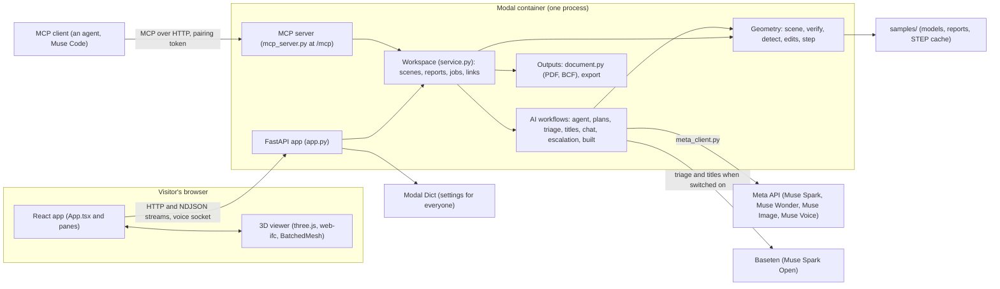

# 00 · ORCA architecture map

> **Covers:** the whole repository · **Checked against code:** 2026-10-30 (`feature/brand-assets`, based on `0390a12`)

These docs map ORCA end to end: what it does, how the parts fit together, where each thing lives in the code, and
how data and requests move through it. They are written for engineers and agents who need to understand or change
a part they have not seen before. Each doc covers one part, has diagrams where a picture is clearer than prose, and
was checked against the code at the commit above.

How this set relates to the other docs:

- **`CLAUDE.md` and `AGENTS.md`** hold the rules, the traps and the current status. They point here for how things
  work.
- **The feature designs in [`docs/`](../)** ([connections](../connections.md), [detection](../detection.md), [edits](../edits.md),
  [escalation](../escalation.md), [mcp](../mcp.md), [measure](../measure.md), [mobile](../mobile.md), [requirements](../requirements.md),
  [show-it-built](../show-it-built.md), [step](../step.md), [uploads](../uploads.md), [views](../views.md), [voice](../voice.md)) hold
  the reasoning and measurements behind each feature. This map summarises them and links to them; it does not copy
  them.
- **[22 · Build log](22-build-log.md)** is the dated history (Oct 27–30) that used to be in `CLAUDE.md`. Its numbers
  were true when written. Where it and the topic docs disagree, the code and the topic docs win.
- `docs/superpowers/` is an earlier program's history; nothing new goes there.

## The whole system on one page



The loop at ORCA's heart: **understand** a clash → **propose** fixes that edit real IFC elements → **verify** each
by geometry (clash gone, clearance met, nothing new hit) → **review** in 3D → **accept** in place → **report and
export**. See [01](01-product-and-journeys.md) for what the user sees and [03](03-end-to-end-flows.md) for how each
step crosses the layers.

## The docs

### Getting oriented

| Doc | What it holds |
|---|---|
| [01 · Product and user journeys](01-product-and-journeys.md) | What ORCA does and for whom, every way in, the golden path, the main screen |
| [02 · System architecture](02-system-architecture.md) | The parts, the single process, threads and locks, the request lifecycle, the stack and why |
| [03 · End-to-end flows](03-end-to-end-flows.md) | Sequence diagrams for every user action, browser to models and back |

### Server

| Doc | What it holds |
|---|---|
| [04 · Server code map](04-server-code-map.md) | Every module in `server/sightline/`: responsibility, main symbols, dependencies |
| [05 · Domain model and state](05-domain-model-and-state.md) | The objects, their ids, their lifecycles, and where every piece of state lives |
| [06 · Geometry engine and detection](06-geometry-and-detection.md) | Loading scenes, the geometric check, ORCA's own clash detection |
| [07 · Fixes and model edits](07-fixes-and-edits.md) | The fix-kind registry, each kind of edit, trial and keep, accept in place |
| [08 · AI models, prompts and spend](08-ai-models-prompts-and-spend.md) | Which feature uses which model where, the model client, every prompt, the money |
| [09 · Agent workflows](09-agent-workflows.md) | The propose loop, plans and root causes, triage, titles, chat, escalation, built views |

### Interfaces

| Doc | What it holds |
|---|---|
| [10 · HTTP API and streams](10-http-api-and-streams.md) | Every route, every stream event, headers, errors, the voice socket |
| [11 · MCP and agent links](11-mcp-and-agent-links.md) | Pairing links, every MCP tool, remote and stdio transports, the page's side |

### Browser

| Doc | What it holds |
|---|---|
| [12 · Web app](12-web-app.md) | Every file in `web/src/`, the component tree, App's state and events, phones and tablets |
| [13 · 3D viewer](13-3d-viewer.md) | Loading, render layers, modes, camera, picking, captures, patching in place |

### Data, policy and operations

| Doc | What it holds |
|---|---|
| [14 · Files in and out](14-files-in-and-out.md) | IFC, STEP, Navisworks reports, uploads, IFC/STEP export, PDF, BCF |
| [15 · Requirements, settings and configuration](15-requirements-settings-and-config.md) | The requirements file and what it compiles into, settings precedence, every env var |
| [16 · Security, caps and cost controls](16-security-caps-and-cost.md) | Secrets, visitor identity, the owner, link tokens, every cap and budget |
| [17 · Deployment and operations](17-deployment-and-operations.md) | The Modal app, deploying, running locally, operating it |
| [18 · Testing, evals and verification](18-testing-and-evals.md) | Server and web tests, evals, spikes, browser checks, what to run before delivery |
| [19 · Demo data](19-demo-data.md) | Northbank and the palletising cell, the answer key, setting the data up |

### Reference

| Doc | What it holds |
|---|---|
| [20 · Decisions, limits and roadmap](20-decisions-limits-and-roadmap.md) | Owner decisions, approaches rejected, known limits, what comes next |
| [21 · Glossary and naming](21-glossary-and-naming.md) | BIM and ORCA terms, what users see vs internal names, wording rules |
| [22 · Build log](22-build-log.md) | The dated history, Oct 27–30, moved verbatim from `CLAUDE.md` |

## Reading order

- **New to the project:** 01 → 02 → 03, then 21 for the words. Then the part you will work on.
- **Changing the server:** 04 for where it lives, 05 for the state you touch, then 06–09 for the part.
- **Changing the page:** 12, 13, and 10 for the routes and events the page reads.
- **Adding a kind of fix:** 07 (its checklist), then 09, 10 and 12.
- **Adding a model call or prompt:** 08, then 16 for caps and spend.
- **Deploying or debugging production:** 17, 16, 15.
- **Before you claim a change works:** 18.

## Where the code is

```text
server/sightline/     the Python server: API, MCP, workspace, AI workflows, geometry, outputs (04)
server/sightline/domain_packs/   the prompts sent to the models (08)
server/tests/         pytest suite (18)
web/src/              the React app (12) and web/src/viewer/, the 3D viewer (13)
web/public/           tour recordings, demo pictures, favicon (12, 19)
web/scripts/          build helpers and the demo-picture capture (12)
web/tests/            node test suite and the App harness (18)
deploy/modal_app.py   the public deploy (17)
evals/                evals, recorded runs, results.csv (18)
spikes/               day-1 spikes and the built-view spike (18)
samples/              models, reports and the STEP cache; gitignored except its README (19)
docs/                 feature designs; docs/architecture/ is this map
assets/brand/orca/    approved identity, motion, exports and rebuild/check scripts (12, 18, 20, 21)
```

## Keeping these docs current

**Every agent and engineer keeps this map true.** The same rule is in `CLAUDE.md` and `AGENTS.md`:

1. **A core change updates its doc in the same PR.** Use the table below to find it. Each doc also ends with its own
   "When to update this doc" list.
2. **Re-checked a doc against the code?** Update its "Checked against code" date and commit.
3. **Found a doc wrong?** Fix it, even if your change didn't cause it. The code is the truth.
4. **Notable work** gets a short dated entry at the end of [22 · Build log](22-build-log.md): what changed, where,
   how it was checked, and any owner decision.
5. **A feature with a design of its own** still gets `docs/<feature>.md`; link it from the doc that covers its part.
6. **`server/tests/test_docs_map.py` enforces the inventories.** It fails when a server module, a prompt, a web
   source file, a route, an MCP tool or an env var is missing from its doc, when a doc is missing from this index or
   its header, or when a relative link is broken. Fix a failure by adding the doc line, never by loosening the test.

| When you change… | Update |
|---|---|
| What the user sees or can do; a new entry point, screen or tour step | 01, 03, 12 |
| A process, thread pool, lock, middleware or how parts call each other | 02, 03 |
| A module in `server/sightline/` (new, renamed, removed, new dependency) | 04 (the test checks it), 05 if it holds state |
| An object's fields, an id's format, a lifecycle, where state is kept, a storage key | 05 |
| Scene loading, units, the check, what counts as physical, detection tests or rules | 06 |
| A fix kind or its geometry, the registries (`TRIES`, `KEEP`, …), accept in place | 07, then 09, 10, 12 as they change |
| A model, host, endpoint, effort rule, price, or a prompt in `domain_packs/` | 08 (the test checks prompts), 15 for env vars |
| The agent loop, plans, root causes, patterns, triage, titles, chat tools, escalation, built views | 09, plus 10 for new events |
| A route, a stream event type, a header, an error code, the voice socket | 10 (the test checks routes) |
| Pairing links or an MCP tool | 11 (the test checks tools) |
| A file in `web/src/`, App's state, a client module, a layout breakpoint | 12 or 13 (the test checks files) |
| The viewer: loading, modes, camera, picking, captures, patching | 13 |
| An input or output format: IFC, STEP, Navisworks XML, uploads, export, PDF, BCF | 14 |
| The requirements format or what it compiles into, a setting, an env var | 15 (the test checks env vars) |
| Secrets, identity, the owner, a cap, a budget, a size limit | 16 |
| `deploy/modal_app.py`, image packages, secrets, deploy steps, operational quirks | 17 |
| A test harness, a new eval, the delivery checklist | 18 |
| Demo models, the answer key, tour recordings, demo pictures | 19 |
| An owner decision, a rejected approach, a known limit, the roadmap | 20 |
| A new term, or a name users see | 21 |
| The approved identity, brand masters, exports or motion library | 12, 18, 20, 21; [brand asset design](../brand-assets.md) |

## How these docs are written

- **Shape:** a title `NN · Title`, a header line (**Covers:** the code files · **Checked against code:** date and
  commit · **Deeper design:** the feature doc, if any), one paragraph on what the part is, the sections, and
  "When to update this doc" last.
- **Concrete:** files and symbols by name (`agent.resolve`, `Workspace.lock`), never line numbers. Tables for
  inventories, bullets for rules, prose for reasoning. Plain English, British spelling.
- **True at HEAD:** describe what the code does, not what it was meant to do. Measured numbers say where they came
  from.
- **Diagrams are Mermaid** (GitHub renders them, and they stay editable as text). Quote labels that have spaces or
  punctuation; keep `#`, `;`, braces and angle brackets out of labels; keep each diagram to about a screen.
- **A new doc** takes the next number, a row in the index above and a row in the change table, and follows the
  shape; the test checks the index and the header.
- **Never** write a secret's value, and never name any other IssueLab product; the demo models come from "IssueLab's
  private demo-models repo".

## When to update this doc

- A doc is added, renamed or removed (the index, the change table and `CLAUDE.md`'s "Where things are").
- The top-level layout of the repository changes ("Where the code is").
- The system diagram stops being true: a new external service, a new process, a new entry point.
- The upkeep rules change (keep `CLAUDE.md` and `AGENTS.md` in step).
